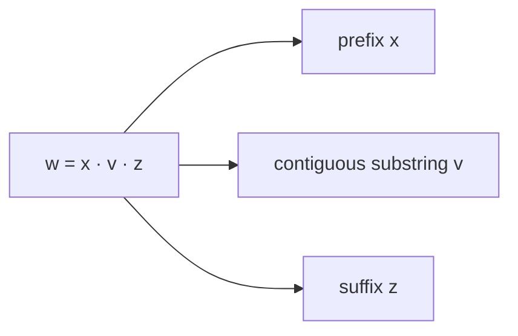

# ADS205 · Cadenas, lenguajes y demostraciones

## Estado de generación del vídeo
PENDIENTE: material preparado; no se ha generado ni revisado ningún vídeo nuevo.

## Instrucciones
Explica la unidad en español siguiendo únicamente este material. Cita las fuentes y distingue práctica complementaria, respuestas suministradas y comentarios locales. Conserva fórmulas, identificadores, discrepancias y límites de evidencia. No inventes contenido, requisitos, resultados, dominio del estudiante ni predicciones de examen.

## Fuentes originales
- Lecture 1 Intro and Regular Language.pdf (original en inglés) · SHA-256 88253ba3fa709a16ef3bb5361caf06c6cabd5f918336eefe1c3b2d0efe802b8a
- Tutorial 1 - Strings, Languages and Proofs.pdf (original en inglés) · SHA-256 b4e08c51931370ea9744e5fc40696a542c2f980e085facba585b27a3c4fb6abf
- Tutorial 1 - Strings, Languages and Proofs — current supplied version.pdf (original en inglés) · SHA-256 92dbbe8eb932ed27087d0ac7a7425244215227277e4778d7c102cc9113a9dbab

## Edición española derivada
El hash indicado para cada documento identifica la fuente inglesa; el contenido mostrado es la traducción española. Los originales se conservan en la biblioteca.

### content/reviewed/ADS205/01/tutor.md
Hash de fuente inglesa: 50425140cbcbfe368a7ba822bdbcab2294cccb709214ed8724a4889be4c52e7e

---
title: "Strings, Languages and Proofs · Tutor Notes"
course: ADS205
type: tutor-notes
status: reviewed
study_status: untested
language: en
cssclasses:
  - university-study
---

# Cadenas, lenguajes y pruebas

[[10_UNIVERSITY_CS/ADS205/Tutor Mode/00 Start Here|Tutor comienza aquí]] · [[10_UNIVERSITY_CS/ADS205/Tutor Mode/Unit 01 - Strings, Languages and Proofs/02 Recall and Exam Practice|Recuerdo y práctica]] · [[10_UNIVERSITY_CS/ADS205/Unit 01 - Strings, Languages and Proofs/01 Notes|Referencia ordinaria]] · [[10_UNIVERSITY_CS/ADS205/Unit 01 - Strings, Languages and Proofs/03 Lab|Laboratorio]]

## En 60 segundos

Esta unidad proporciona el lenguaje necesario para todo lo que sigue. Un problema de cálculo se convierte en una cuestión de pertenencia: ¿hay una cadena finita dentro de un conjunto específico de cadenas? Aprenderá a mantener separados los símbolos, las cadenas y los lenguajes; manipular la concatenación y la estrella Kleene; manejar correctamente la cadena vacía y el lenguaje vacío; y escribir pruebas cuyos cuantificadores coincidan con la afirmación. Después del estudio, debería poder decidir la pertenencia a partir de definiciones, exponer testigos para afirmaciones de prefijo/subcadena y demostrar una identidad lingüística en ambas direcciones.[^t1-1][^l1-19]

## Vista previa del concepto

> [!note] **Concepto — Disciplina de tipo**
> **Significado en lenguaje sencillo:** Un símbolo, una cadena y un conjunto de cadenas son diferentes tipos de objetos. Por lo tanto, `ε`, `∅` y `{ε}` se comportan de manera diferente.
> **Por qué es importante:** Muchas pruebas falsas realizan una operación en el tipo incorrecto.
> **Se conecta a:** entradas de autómatas, lenguajes de expresiones regulares, testigos de bombeo.
> **Fuente:** Tutorial 1, PDF p.1.

> [!note] **Concepto — Concatenación y estrella**
> **Significado en lenguaje sencillo:** La concatenación une cadenas elegidas en orden. `L*` permite cualquier número finito de bloques `L`, incluido el cero.
> **Por qué es importante:** Describe infinitas cadenas con una regla finita.
> **Se conecta a:** composición de expresiones regulares y NFA.
> **Fuente:** Tutorial 1, PDF, páginas 1–4; Conferencia 2, PDF, páginas 4–5.

> [!note] **Concepto — Testigos y cuantificadores**
> **Significado en lenguaje sencillo:** “Existe” requiere un testigo verificado; “para cada” requiere un caso arbitrario o un argumento general válido.
> **Por qué es importante:** Los ejemplos pueden refutar una afirmación universal, pero no pueden probarla.
> **Se conecta a:** pruebas de cierre y cuantificadores de lemas de bombeo.
> **Fuente:** Tutorial 1, PDF, páginas 4–7.

> [!note] **Concepto — Finito versus cofinito**
> **Significado en lenguaje sencillo:** Un lenguaje finito enumera sus miembros; un lenguaje cofinito enumera un número finito de exclusiones relativas a un `Σ*` fijo.
> **Por qué es importante:** “Infinito” no significa “no puede tener una descripción finita”.
> **Conecta a:** complemento y procedimientos de afiliación decidibles.
> **Fuente:** Tutorial 1, PDF, páginas 7–8; Conferencia 2, PDF, páginas 6–7.

## Instantánea de la evidencia del examen

**Nota de disponibilidad: 12 de octubre de 2026:** estas son observaciones históricas de la muestra parcial inspeccionada previamente, no un corpus actual recién inspeccionado. El PDF original del examen hash no está disponible; no se volvieron a calcular recuentos ni prioridades a partir de capturas no inspeccionadas.

| Tema | Evidencia observada | Marcas conocidas | Profundidad | Prioridad |
|---|---|---:|---|---|
| Regular no implica finito | 1 de 2 administraciones PARCIALES distintas; repetido en dos variantes de la misma sesión 2023-24 | 3 en cada variante, no añadidos | Verdadero/falso con justificación | MEDIANO — Evidencia LIMITADA |
| Unidad General 01 métodos de prueba | No se ha establecido ninguna observación directa en las páginas inspeccionadas | Desconocido | No observado | NO OBSERVADO EN MUESTRA PARCIAL DISPONIBLE |

No se justifica ningún nivel ALTO porque el corpus no tiene artículos completos. Consulte [[10_UNIVERSITY_CS/ADS205/Tutor Mode/_System/past-paper-intelligence|inteligencia en artículos anteriores]].

## Antes de comenzar

Sólo necesitas un conjunto básico de pertenencia e igualdad. Ponte a prueba:

> [!question] ¿Qué se debe comprobar para que dos cadenas finitas sean iguales?

> [!success]- Comprueba tu respuesta
> Deben tener la misma longitud y el mismo símbolo en cada posición.
> Fuente: Tutorial 1, PDF, páginas 1–3.

## Una pregunta motivadora

**Caso sintético usando el Tutorial 1 P5.** Un validador acepta cero o más bloques de `L={ac,bd}`. Un colega dice que cada entrada de longitud par es válida y almacena solo `ac`, `bd`, `acac` y `bdbd`.

Decida si se aceptan `ε`, `acbd`, `aaaa` y `acbdac`. Luego explique por qué una lista almacenada finita no puede estar completa, mientras que la regla `L*` aún puede ser una especificación completa.

| Pregunta | Conocimiento necesario |
|---|---|
| ¿Qué es una factorización válida? | Concatenación y estrella |
| ¿Por qué la longitud es insuficiente? | Condiciones necesarias versus condiciones suficientes |
| ¿Por qué el lenguaje es infinito? | Una familia de testigos distintos por pares |
| ¿Por qué está completa la regla? | Definición y procedimiento de extinción de la pertenencia |

El éxito significa que cada decisión tiene un argumento testigo o de imposibilidad; comprobar algunos ejemplos es insuficiente.

## Aprende el mecanismo

### Tipos primero: `ε`, `∅` y `{ε}`

Un alfabeto `Σ` es un conjunto finito de símbolos no vacío. Una cadena es una secuencia ordenada finita de símbolos y `Σ*` es el conjunto de todas las cadenas sobre `Σ`. Un lenguaje es un subconjunto de `Σ*` y puede ser finito o infinito.[^t1-1]

| Objeto | Tipo | Hecho clave |
|---|---|---|
| `ε` | cadena | longitud 0 |
| `∅` | lenguaje/conjunto | no contiene cadenas |
| `{ε}` | lenguaje/conjunto | contiene exactamente una cadena |

El curso identifica un símbolo con su cadena de un solo símbolo, por lo que `Σ ⊆ Σ*`; no convierte a `ε` en un símbolo. En consecuencia `ε∈Σ*` pero `ε∉Σ`.[^t1-1]

> [!warning] Confusión común
> `∅*={ε}`, no `∅`. Star permite cero factores incluso cuando no existe ninguna opción de factor positivo. Este es un hecho basado en una definición, no una excepción especial.

### La concatenación preserva el orden

Para las cadenas `x,y`, `xy` agrega `y` a `x`, por lo que `|xy|=|x|+|y|`. Es asociativo pero generalmente no conmutativo. Para lenguajes `A,B`,

$$AB=\{xy\mid x\in A,\ y\in B\}.$$

Para probar `w∈AB`, exhiba ambos factores. Para demostrar la no pertenencia, descarte toda factorización posible compatible con los conjuntos. El mismo hábito de testigo aparece en las definiciones de prefijos y subcadenas: `v` es una subcadena de `w` exactamente cuando `w=xvz` para algunos `x,z`.[^t1-1]

**Figura 1: una subcadena necesita dos testigos**

**Léelo:** Toda la cadena se descompone en el material anterior, el objetivo contiguo y el material posterior.
**Conclusión clave:** Eliminar una parte media arbitraria no preserva la contigüidad; la igualdad debe ser literalmente `w=xvz`.
**Procedencia:** Diagrama pedagógico derivado del Tutorial 1, PDF, páginas 1–3.

### Star es un constructor de lista finita

la definicion

$$L^*=\{w_1\cdots w_k\mid k\ge0,\ w_i\in L\}$$

permite una cadena `L` diferente en cada posición y permite la repetición. Cada salida utiliza un número finito de factores, pero no se impone ningún límite superior común en `k`.[^t1-1]

**Ejemplo resuelto.** Dejemos `L={ac,bd}` y solicite miembros de longitud como máximo cuatro.

1. Cada factor tiene longitud 2, por lo que un producto de factores `k` tiene longitud `2k`.
2. `2k≤4` implica `k∈{0,1,2}`.
3. Para `k=0`, obtenga `ε`; para `k=1`, obtenga `ac,bd`; para `k=2`, tome los cuatro pares pedidos.
4. Por lo tanto la lista completa es `ε, ac, bd, acac, acbd, bdac, bdbd`.

Es necesaria una longitud uniforme porque todos los bloques tienen una longitud dos. No es suficiente: `aaaa` se divide en `aa·aa` y `aa∉L`.

> [!question] Explícalo tú mismo
> ¿Por qué diferentes opciones de factores pueden producir el mismo resultado para `A={a,aa}`, aunque hay opciones ordenadas de `|A|^k` para `k` fijo?

> [!success]- Consulta tu explicación
> La concatenación puede borrar los límites de los factores: `(a,aa)` y `(aa,a)` producen `aaa`. El poder cuenta las opciones, no necesariamente los distintos resultados.
> Fuente: Conferencia 2, PDF p.5, calificado por las definiciones.

### Una descripción finita no es una pertenencia finita

La familia `(ac)^k`, para cada número entero `k≥0`, consta de cadenas aceptadas con distintas longitudes. Esto demuestra que `L*` es infinito. Sin embargo, la regla "dividir en pares y requerir que cada par sea `ac` o `bd`" es finita y termina en cada entrada finita. Por lo tanto, un lenguaje puede ser infinito y finitamente especificado.[^t1-78]

Para complemento fijar `Σ`: `L̄=Σ*\L`. Un lenguaje finito puede almacenar a todos los miembros. Un lenguaje cofinito puede almacenar su complemento finito. Ninguna categoría contiene todos los lenguajes finitamente descriptibles; el lenguaje de longitud par y su complemento son infinitos sobre `{a,b}`.[^l2-67][^t1-78]

### Relaciona la prueba con el reclamo

| Formulario de reclamación | Carga correcta |
|---|---|
| `∃x P(x)` | Da un testigo y verifícalo |
| `∀x P(x)` | Comience con `x` arbitrario y derive `P(x)` |
| `¬∀x P(x)` | Dé un contraejemplo |
| `A=B` | Probar `A⊆B` y `B⊆A` |

**Identidad trabajada: `L*={ε}∪LL*`.** Para `w∈L*`, o usa cero factores y es igual a `ε`, o usa al menos un factor; separe el primer factor para ubicarlo en `LL*`. Por el contrario, `ε` usa factores cero, mientras que una palabra en `LL*` tiene un factor `L` seguido de una lista finita de factores `L`, por lo que está en `L*`. Esto cubre `L=∅` y los lenguajes que contienen `ε`; los ejemplos por sí solos no lo harían.[^t1-67]

## Volver a la pregunta motivadora

- Se acepta `ε` utilizando bloques cero.
- Se acepta `acbd` con testigo `ac·bd`.
- Se rechaza `aaaa`: sus únicos bloques de dos símbolos no están en `L`.
- Se acepta `acbdac` con testigo `ac·bd·ac`.

La regla de longitud par del colega solo es necesaria, y la lista de cuatro entradas omite `acbd`, `bdac`, todas las entradas válidas de longitud seis e infinitas entradas posteriores. La especificación finita `L*` está completa porque caracteriza cada entrada aceptada mediante una factorización finita. El escaneo por pares decide la pertenencia.

> [!warning] Discrepancia de fuente preservada
> El Tutorial 1 P5 anterior conservado usa `L={ac,bd}`, pero su respuesta P5.3 y la actividad de Python usan bloques `aa/bb`. Para el ejercicio indicado se rechaza `aaaa`; para el diferente lenguaje de la actividad `{aa,bb}`, se acepta. Fuente: Tutorial 1, PDF págs.4, 8–9.

## Definiciones y distinciones

### Verifique la versión fuente antes de tomar prestada una respuesta

El [[10_UNIVERSITY_CS/ADS205/Original Sources/LM Core 2026-10-07/Tutorial 1 - Strings, Languages and Proofs.pdf|Tutorial 1]] actual, PDF p.4 (23 de septiembre), corrige la antigua respuesta P5.3: `aaaa ∉ {ac,bd}*`. La derivación aquí no ha cambiado porque ya respetó los bloques indicados. La zona de pruebas del portátil, celda 15, todavía usa `{aa,bb}`, por lo que su resultado `True` es sobre un lenguaje diferente. Una revisión de la fuente puede corregir una respuesta sin cambiar todas las actividades.

Para practicar a partir de los archivos actuales, utilice primero el [[10_UNIVERSITY_CS/ADS205/Original Sources/LM Core 2026-10-07/Tutorial 1 - Strings, Languages and Proofs (Student Version).ipynb|cuaderno de estudiante]] y luego el [[10_UNIVERSITY_CS/ADS205/Original Sources/LM Core 2026-10-07/Tutorial 1 - Strings, Languages and Proofs.ipynb|cuaderno de solución]]. Sus tareas P1–P8 y Extra se corresponden con los mismos ejercicios ordinarios completos; La actividad de Python se encuentra en el laboratorio de la Unidad 01 existente. No se reclama la ejecución del cuaderno.

| Término A | Término B | Distinción decisiva | Fuente |
|---|---|---|---|
| Símbolo | Cadena | Un elemento del alfabeto versus una secuencia finita | T1 pág.1 |
| `ε` | `∅` | Una cadena de longitud cero frente a un conjunto sin miembros | T1 págs. 1–4 |
| Prefijo | Subcadena | El prefijo comienza en la posición 1; subcadena puede comenzar más tarde pero es contigua | T1 págs.1–3 |
| Lenguaje finito | Lenguaje habitual | Cardinalidad versus reconocibilidad por un autómata finito | L1 págs. 19-22; T1 págs. 7–8 |
| Necesario | Suficiente | Debe mantenerse para el éxito versus garantías de éxito | Derivado de T1 P5 |

## Revisión

### Comprensión total

Utilice las explicaciones detalladas anteriores y la [[10_UNIVERSITY_CS/ADS205/Unit 01 - Strings, Languages and Proofs/01 Notes|referencia ordinaria]] para obtener el registro completo de corrección de fuente.

## Revisión de 5 minutos

- Verifique cada expresión antes de calcular.
- La concatenación necesita testigos de factores ordenados; la subcadena necesita `w=xvz`.
- `L*` siempre contiene `ε` y permite cualquier recuento de factores finitos.
- Puede ser necesaria una condición de longitud sin identificar factores válidos.
- Infinitas lenguajes pueden tener reglas finitas y procedimientos de extinción de la pertenencia.
- Las afirmaciones universales necesitan un razonamiento de casos arbitrarios; La igualdad lingüística necesita ambas inclusiones.

## Recuperación de 60 segundos

`Σ` · `Σ*` · `ε/∅/{ε}` · concatenación ordenada · estrella de factor cero · testigo · contraejemplo · dos inclusiones · finito/cofinito

[^t1-1]: `Tutorial 1 - Strings, Languages and Proofs.pdf`, PDF p.1, tarjeta de referencia y convenciones.
[^t1-67]: `Tutorial 1 - Strings, Languages and Proofs.pdf`, PDF, páginas 6–7, problema 7 y guía de prueba.
[^t1-78]: `Tutorial 1 - Strings, Languages and Proofs.pdf`, PDF páginas 7–8, Problema 8.
[^l1-19]: `Lecture 1 Intro and Regular Language.pdf`, PDF p.19, cadenas e lenguajes.
[^l2-67]: `Lecture 2 DFA and NFA.pdf`, PDF págs. 6–7, complemento y resumen finito/cofinito.

### content/reviewed/ADS205/01/practice.md
Hash de fuente inglesa: fa832e61928f2cebc832a38e4f1ed12b5e4efa5ac792e1a35bfc5e769f28c775

---
title: "Strings, Languages and Proofs · Recall and Exam Practice"
course: ADS205
type: tutor-practice
status: reviewed
study_status: untested
language: en
cssclasses:
  - university-study
---

# Recordar y practicar

[[10_UNIVERSITY_CS/ADS205/Tutor Mode/00 Start Here|Tutor Start Here]] · [[10_UNIVERSITY_CS/ADS205/Tutor Mode/Unit 01 - Strings, Languages and Proofs/01 Tutor Notes|Tutor Notes]] · [[10_UNIVERSITY_CS/ADS205/Unit 01 - Strings, Languages and Proofs/02 Exercises|Ejercicios ordinarios completos]]

Intento con referencias cerradas. Abra la pista adyacente solo cuando esté atascado, luego compare el razonamiento completo con la solución. La evidencia de la evaluación es limitada y parcial; La tarea etiquetada como examen a continuación conserva sus marcas visibles pero no tiene un esquema oficial.

## Repaso activo atómico

### Tarjeta 01 — ¿Qué es un alfabeto?
> [!success]- Respuesta
> Un conjunto finito de símbolos no vacío.
>
> Fuente: Tutorial 1, PDF p.1.

### Tarjeta 02: ¿Qué es `Σ*`?
> [!success]- Respuesta
> El conjunto de todas las cadenas finitas sobre `Σ`, incluido `ε`.
>
> Fuente: Tutorial 1, PDF p.1.

### Tarjeta 03: Distinga `ε` y `∅`.
> [!success]- Respuesta
> `ε` es una cadena de longitud cero; `∅` es un lenguaje que no contiene cadenas.
>
> Fuente: Tutorial 1, PDF, páginas 1–4.

### Tarjeta 04: ¿Por qué `ε∈L*` es para todos los lenguajes `L`?
> [!success]- Respuesta
> Permisos estrella `k=0`; el producto vacío es `ε`.
>
> Fuente: Tutorial 1, PDF p.1.

### Tarjeta 05: ¿Qué atestigua que `v` es una subcadena de `w`?
> [!success]- Respuesta
> Cadenas `x,z` que satisfacen `w=xvz`.
>
> Fuente: Tutorial 1, PDF p.1.

### Tarjeta 06: ¿Qué prueba que una afirmación universal es falsa?
> [!success]- Respuesta
> Un contraejemplo válido dentro de su dominio declarado.
>
> Fuente: Tutorial 1, PDF, páginas 4–7.

### Tarjeta 07: ¿Qué debe contener una prueba de igualdad de conjuntos?
> [!success]- Respuesta
> Ambas inclusiones: todo miembro de izquierda es de derecha y todo miembro de derecha es de izquierda.
>
> Fuente: Tutorial 1, PDF, páginas 6–7.

### Tarjeta 08 — ¿Qué es una lenguaje cofinita?
> [!success]- Respuesta
> Un lenguaje cuyo complemento relativo al fijo `Σ*` es finito.
>
> Fuente: Tutorial 1, PDF, páginas 7–8.

### Tarjeta 09: ¿Un lenguaje infinito requiere cadenas infinitas?
> [!success]- Respuesta
> No. Puede contener infinitas cadenas finitas distintas.
>
> Fuente: Tutorial 1, PDF p.3.

### Tarjeta 10: Para un lenguaje A, ¿por qué $|A|^k$ puede exceder el número de cadenas distintas en $A^k$?
> [!success]- Respuesta
> Se pueden concatenar diferentes tuplas de factores ordenados en la misma cadena.
>
> Fuente: Conferencia 2, PDF p.5, calificación basada en definiciones.

## Práctica progresiva

### Práctica 1: Diagnóstico de tipo y pertenencia

**PRÁCTICA COMPLEMENTARIA.** Sea `Σ={0,1}`. Clasifique cada objeto como símbolo, cadena o lenguaje cuando corresponda, luego decida: `ε∈Σ`, `ε∈Σ*`, `∅⊆Σ*`, `{ε}⊆Σ*`.

> [!tip]- Sugerencia
> La pertenencia compara un objeto con elementos; El subconjunto compara cada elemento de un conjunto con otro conjunto.

> [!success]- Solución
> `0,1` son símbolos y cadenas de un símbolo por convención de curso. `ε` es una cadena. `Σ`, `Σ*`, `∅` y `{ε}` son lenguajes/conjuntos de cadenas donde sus elementos se ajustan al alfabeto.
>
> `ε∉Σ` porque no es un símbolo. `ε∈Σ*` porque la longitud cero es finita. `∅⊆Σ*` de forma vacía porque no tiene ningún elemento de contraejemplo. `{ε}⊆Σ*` porque su único elemento está en `Σ*`.
>
> Fuente: Tutorial 1, PDF, páginas 1–4.

### Práctica 2: Factorización guiada

**PRÁCTICA COMPLEMENTARIA.** Sea `B={0,11}`. Decida si `ε`, `0110`, `11011` y `101` están en `B*`. Muestra una factorización para cada palabra aceptada y una obstrucción completa para cada rechazo.

> [!tip]- Sugerencia
> Escanear de izquierda a derecha. Un `1` sólo puede ocurrir como parte del bloque completo `11`.

> [!success]- Solución
> `ε∈B*` por cero factores. `0110=0·11·0`, por lo que se acepta. `11011=11·0·11`, por lo que se acepta. `101` es rechazado: su primer símbolo es `1`, por lo que no puede comenzar con el bloque `0`; sus dos primeros símbolos son `10`, por lo que no puede comenzar con el bloque `11`; de manera equivalente, los 1 aislados no pueden ser cubiertos por bloques permitidos.
>
> Fuente: Aplicación sintética del Tutorial 1, PDF p.1 definición de estrella.

### Práctica 3: diagnosticar una prueba

**PRÁCTICA COMPLEMENTARIA.** Un estudiante escribe: “Para `L={a}`, los ejemplos `ε,a,aa` pertenecen tanto a `L*` como a `{ε}∪LL*`; por lo tanto, los lenguajes son iguales”. Identifique la brecha y repare la prueba.

> [!tip]- Sugerencia
> Los ejemplos prueban sólo tres palabras y un lenguaje. Demuestre ambas inclusiones para `L` arbitrario y `w` arbitrario.

> [!success]- Solución
> Los ejemplos no cubren palabras más largas, no miembros ni ningún otro lenguaje. Para `w∈L*`, divida en cero factores (`w=ε`) o al menos un factor (`w∈LL*`). Por el contrario, `ε∈L*` y cualquier `w∈LL*` es un factor `L` seguido de muchos más, por lo tanto, se encuentra en `L*`. Por lo tanto, la igualdad es válida para todos los lenguajes `L`.
>
> Fuente: Tutorial 1, PDF, páginas 6–7, Problema 7.

### Práctica 4 — Argumento de representación independiente

**PRÁCTICA COMPLEMENTARIA.** Sobre `{a,b}`, deje que `E` contenga exactamente las cadenas de longitud par. Demuestre que `E` no es finito ni cofinito y proporcione un procedimiento de terminación de pertenencia.

> [!tip]- Sugerencia
> Producir infinitos miembros e infinitos no miembros distinguidos por su longitud.

> [!success]- Solución
> Las cadenas `a^(2k)` para `k≥0` son miembros distintos por pares, por lo que `E` es infinito. Las cadenas `a^(2k+1)` son no miembros distintos por pares, por lo que el complemento es infinito y `E` no es cofinito. Para decidir la pertenencia, cuente los símbolos de la entrada finita y acepte exactamente cuando el recuento sea par. La regla es finita aunque el lenguaje y el complemento sean infinitos.
>
> Fuente: Tutorial 1, PDF, páginas 7–8, Problema 8.

> [!warning] RELEVANCIA DEL EXAMEN MEDIO
> La distinción entre regular y finito se observó en la administración parcial de 2023-24 (dos variantes de la misma sesión, contadas una vez). Esta es evidencia descriptiva, no una predicción.

### Práctica de evaluación: regular no significa finito

**EJERCICIO ORIGINAL DEL CURSO.** `ADS205-EXAMS.pdf`, PDF p.1 Q1(a) y PDF p.6 Q1(a), `INT201/23-24/S1` variantes A/B, **3 puntos en cada variante**: indique verdadero o falso y justifique brevemente la afirmación “Si un lenguaje `A` es regular, entonces `A` debe ser finito”.

> [!tip]- Sugerencia
> Un lenguaje infinito reconocido por un bucle de estados finitos es suficiente para refutar la afirmación universal.

> [!success]- Solución
> **Falso.** Sobre `{a}`, el lenguaje `a*={a^n | n≥0}` es infinito porque sus miembros tienen longitudes distintas ilimitadas. Un DFA de un estado que es a la vez de inicio y de aceptación, con un bucle automático `a`, lo reconoce. Por tanto, los autómatas finitos tienen un número finito de estados, pero pueden reconocer infinitos lenguajes volviendo a visitar los estados.
>
> **AUTOCOMPROBACIÓN SUGERIDA:** indique el valor de verdad, proporcione un lenguaje genuinamente infinito, proporcione o describa su autómata finito y conecte el contraejemplo con la afirmación universal. No se proporcionó ningún esquema oficial.

### Práctica 6 — Transferencia: un código de bloque diferente

**PRÁCTICA COMPLEMENTARIA.** Sea `C={01,011}`. ¿Es necesaria o suficiente una longitud uniforme para ser miembro de `C*`? Proporcione una palabra de longitud impar aceptada, una palabra de longitud par rechazada y explique por qué la longitud por sí sola no puede decidir la pertenencia.

> [!tip]- Sugerencia
> Las longitudes de bloque disponibles son dos y tres.

> [!success]- Solución
> La longitud par no es necesaria: `011` es una palabra aceptada de longitud 3. No es suficiente: `00` tiene una longitud par pero no es `01` ni una concatenación de bloques permitidos. La longitud por sí sola olvida el orden de los símbolos y los límites de los bloques; La pertenencia requiere una factorización válida en `01` y `011`.
>
> Fuente: Transferencia sintética de la definición de estrella del Tutorial 1.

## Navegación del ejercicio original

Las 47 asignaciones de tareas fuente de la Unidad 01 conservan soluciones locales completas en la edición ordinaria:

- [[10_UNIVERSITY_CS/ADS205/Unit 01 - Strings, Languages and Proofs/02 Exercises#T1 P1 — Symbols and languages|T1 P1 — símbolos e lenguajes]]
- [[10_UNIVERSITY_CS/ADS205/Unit 01 - Strings, Languages and Proofs/02 Exercises#T1 P2 — Contiguous pieces|T1 P2 — prefijos y subcadenas]]
- [[10_UNIVERSITY_CS/ADS205/Unit 01 - Strings, Languages and Proofs/02 Exercises#T1 P3 — What may be infinite|T1 P3 — objetos finitos y lenguajes infinitos]]
- [[10_UNIVERSITY_CS/ADS205/Unit 01 - Strings, Languages and Proofs/02 Exercises#T1 P4 — Empty objects|T1 P4 — objetos vacíos]]
- [[10_UNIVERSITY_CS/ADS205/Unit 01 - Strings, Languages and Proofs/02 Exercises#T1 P5 — Concrete language operations|T1 P5 — operaciones de lenguaje y discrepancia de fuente]]
- [[10_UNIVERSITY_CS/ADS205/Unit 01 - Strings, Languages and Proofs/02 Exercises#T1 P6 — Translate proof formats|T1 P6 — formatos de prueba]]
- [[10_UNIVERSITY_CS/ADS205/Unit 01 - Strings, Languages and Proofs/02 Exercises#T1 P7 — A recursive identity for star|T1 P7 — identidad de estrella recursiva]] y [[10_UNIVERSITY_CS/ADS205/Unit 01 - Strings, Languages and Proofs/02 Exercises#T1 P7 Extra — Star of a star|Extra]]
- [[10_UNIVERSITY_CS/ADS205/Unit 01 - Strings, Languages and Proofs/02 Exercises#T1 P8 — Finite and cofinite representation|T1 P8 — finito/cofinito]]
- [[10_UNIVERSITY_CS/ADS205/Unit 01 - Strings, Languages and Proofs/02 Exercises#L2 recap — Language difference|Diferencia de la Conferencia 2]] y [[10_UNIVERSITY_CS/ADS205/Unit 01 - Strings, Languages and Proofs/02 Exercises#L1 introduction — A membership decision|Membresía de la Conferencia 1]]
- [[10_UNIVERSITY_CS/ADS205/Unit 01 - Strings, Languages and Proofs/03 Lab#Procedure and expected results|Tutorial 1 actividad Python opcional]]
