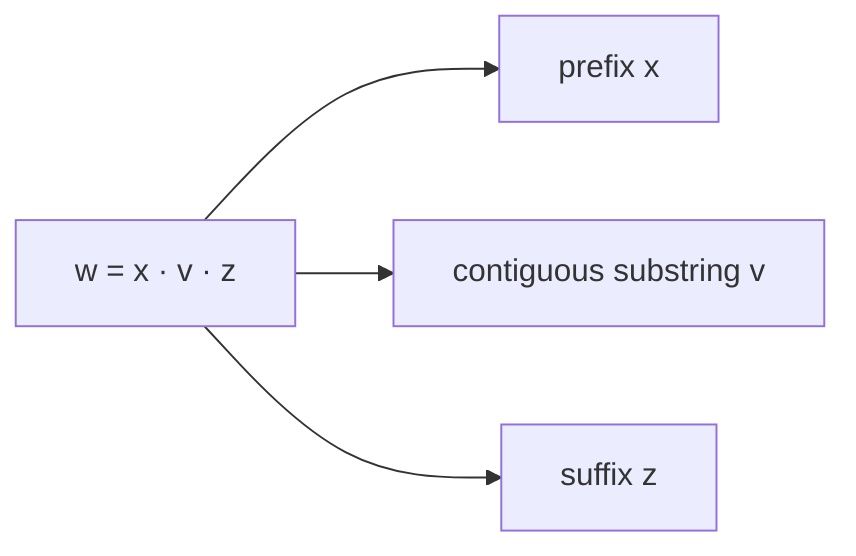

# ADS205 · Strings, Languages and Proofs

## Video generation status
PENDING: source pack prepared; no cloud video has been generated or reviewed.

## Spanish video overview prompt
Explica esta unidad en español claro, paso a paso, para alguien que aprende de forma autodidacta. Usa únicamente el material incluido. Comienza con el problema motivador, presenta los conceptos, muestra un ejemplo visual fiel a las convenciones del curso, pausa para una pregunta y después explica la respuesta. Distingue práctica suplementaria de tareas oficiales y de soluciones oficiales. No inventes datos, fuentes, requisitos, capítulos pendientes, resultados de ejecución ni predicciones de examen. Conserva los límites y discrepancias indicados. Cierra con una actividad que el estudiante pueda intentar en Learning Uni. Cita el nombre del documento y su localizador cuando corresponda. Si falta evidencia, dilo; no rellenes el hueco. Mantén visibles las fórmulas y direcciones de flechas.

## Verified original file snapshots
- Lecture 1 Intro and Regular Language.pdf · SHA-256 88253ba3fa709a16ef3bb5361caf06c6cabd5f918336eefe1c3b2d0efe802b8a
- Tutorial 1 - Strings, Languages and Proofs.pdf · SHA-256 b4e08c51931370ea9744e5fc40696a542c2f980e085facba585b27a3c4fb6abf

## Source material

### Snapshot: content/reviewed/ADS205/01/tutor.md
SHA-256: 6f10b1cac9c7e00ad0fb7c4eb2254a1ba811735e5f91f175e328e7c72edaca88

---
title: "Strings, Languages and Proofs · Tutor Notes"
course: ADS205
type: tutor-notes
status: reviewed
study_status: untested
language: en
cssclasses:
  - university-study
---

# Strings, Languages and Proofs

[[10_UNIVERSITY_CS/ADS205/Tutor Mode/00 Start Here|Tutor Start Here]] · [[10_UNIVERSITY_CS/ADS205/Tutor Mode/Unit 01 - Strings, Languages and Proofs/02 Recall and Exam Practice|Recall and Practice]] · [[10_UNIVERSITY_CS/ADS205/Unit 01 - Strings, Languages and Proofs/01 Notes|Ordinary reference]] · [[10_UNIVERSITY_CS/ADS205/Unit 01 - Strings, Languages and Proofs/03 Lab|Lab]]

## In 60 Seconds

This unit supplies the language needed by everything that follows. A computation problem becomes a membership question: is a finite string inside a specified set of strings? You will learn to keep symbols, strings and languages separate; manipulate concatenation and Kleene star; handle the empty string and empty language correctly; and write proofs whose quantifiers match the claim. After study, you should be able to decide membership from definitions, expose witnesses for prefix/substring claims, and prove a language identity in both directions.[^t1-1][^l1-19]

## Concept Preview

> [!note] **Concept — Type discipline**
> **Plain-language meaning:** A symbol, a string, and a set of strings are different kinds of object. `ε`, `∅`, and `{ε}` therefore behave differently.
> **Why it matters:** Many false proofs perform an operation on the wrong type.
> **Connects to:** automata inputs, regex languages, pumping witnesses.
> **Source:** Tutorial 1, PDF p.1.

> [!note] **Concept — Concatenation and star**
> **Plain-language meaning:** Concatenation joins chosen strings in order. `L*` allows any finite number of `L`-blocks, including zero.
> **Why it matters:** It describes infinitely many strings with a finite rule.
> **Connects to:** regex and NFA composition.
> **Source:** Tutorial 1, PDF pp.1–4; Lecture 2, PDF pp.4–5.

> [!note] **Concept — Witnesses and quantifiers**
> **Plain-language meaning:** “There exists” requires one verified witness; “for every” requires an arbitrary case or a valid general argument.
> **Why it matters:** Examples can refute a universal claim but cannot prove one.
> **Connects to:** closure proofs and pumping-lemma quantifiers.
> **Source:** Tutorial 1, PDF pp.4–7.

> [!note] **Concept — Finite versus cofinite**
> **Plain-language meaning:** A finite language lists its members; a cofinite language lists finitely many exclusions relative to a fixed `Σ*`.
> **Why it matters:** “Infinite” does not mean “cannot have a finite description.”
> **Connects to:** complement and decidable membership procedures.
> **Source:** Tutorial 1, PDF pp.7–8; Lecture 2, PDF pp.6–7.

## Exam Evidence Snapshot

| Topic | Observed evidence | Known marks | Depth | Priority |
|---|---|---:|---|---|
| Regular does not imply finite | 1 of 2 distinct PARTIAL administrations; repeated in two same-session 2023–24 variants | 3 in each variant, not added | True/false with justification | MEDIUM — LIMITED evidence |
| General Unit 01 proof methods | No direct observation established in inspected pages | Unknown | Not observed | NOT OBSERVED IN AVAILABLE PARTIAL SAMPLE |

No HIGH tier is justified because the corpus has zero complete papers. See [[10_UNIVERSITY_CS/ADS205/Tutor Mode/_System/past-paper-intelligence|past-paper intelligence]].

## Before You Start

You need only basic set membership and equality. Test yourself:

> [!question] What must be checked for two finite strings to be equal?

> [!success]- Check your answer
> They must have the same length and the same symbol at each position.
> Source: Tutorial 1, PDF pp.1–3.

## A motivating question

**Synthetic case using Tutorial 1 P5.** A validator accepts zero or more blocks from `L={ac,bd}`. A colleague says every even-length input is valid and stores only `ac`, `bd`, `acac`, and `bdbd`.

Decide whether `ε`, `acbd`, `aaaa`, and `acbdac` are accepted. Then explain why a finite stored list cannot be complete, while the rule `L*` can still be a complete specification.

| Question | Knowledge needed |
|---|---|
| What is a valid factorization? | Concatenation and star |
| Why is even length insufficient? | Necessary versus sufficient conditions |
| Why is the language infinite? | A family of pairwise distinct witnesses |
| Why is the rule complete? | Definition and a terminating membership procedure |

Success means every decision has a witness or impossibility argument; checking a few examples is insufficient.

## Learn the mechanism

### Types first: `ε`, `∅`, and `{ε}`

An alphabet `Σ` is a nonempty finite set of symbols. A string is a finite ordered sequence of symbols, and `Σ*` is the set of all strings over `Σ`. A language is a subset of `Σ*` and may be finite or infinite.[^t1-1]

| Object | Type | Key fact |
|---|---|---|
| `ε` | string | length 0 |
| `∅` | language/set | contains no strings |
| `{ε}` | language/set | contains exactly one string |

The course identifies a symbol with its one-symbol string, so `Σ ⊆ Σ*`; it does not make `ε` a symbol. Consequently `ε∈Σ*` but `ε∉Σ`.[^t1-1]

> [!warning] Common confusion
> `∅*={ε}`, not `∅`. Star permits zero factors even when no positive-factor choice exists. This is a definition-based fact, not a special exception.

### Concatenation preserves order

For strings `x,y`, `xy` appends `y` to `x`, so `|xy|=|x|+|y|`. It is associative but generally not commutative. For languages `A,B`,

$$AB=\{xy\mid x\in A,\ y\in B\}.$$

To prove `w∈AB`, exhibit both factors. To prove nonmembership, rule out every possible factorization compatible with the sets. The same witness habit appears in prefix and substring definitions: `v` is a substring of `w` exactly when `w=xvz` for some `x,z`.[^t1-1]

**Figure 1 — A substring needs two witnesses**

**Read it:** The whole string is decomposed into the material before, the contiguous target, and the material after.
**Key takeaway:** Deleting an arbitrary middle part does not preserve contiguity; the equality must literally be `w=xvz`.
**Provenance:** Pedagogical diagram derived from Tutorial 1, PDF pp.1–3.

### Star is a finite-list constructor

The definition

$$L^*=\{w_1\cdots w_k\mid k\ge0,\ w_i\in L\}$$

allows a different `L`-string at every position and permits repetition. Each output uses finitely many factors, but no common upper bound on `k` is imposed.[^t1-1]

**Worked example.** Let `L={ac,bd}` and ask for members of length at most four.

1. Every factor has length 2, so a product of `k` factors has length `2k`.
2. `2k≤4` implies `k∈{0,1,2}`.
3. For `k=0`, obtain `ε`; for `k=1`, obtain `ac,bd`; for `k=2`, take all four ordered pairs.
4. Therefore the complete list is `ε, ac, bd, acac, acbd, bdac, bdbd`.

Even length is necessary because all blocks have length two. It is not sufficient: `aaaa` splits into `aa·aa`, and `aa∉L`.

> [!question] Explain it yourself
> Why can different factor choices produce the same output for `A={a,aa}`, even though there are `|A|^k` ordered choices for fixed `k`?

> [!success]- Check your explanation
> Concatenation may erase factor boundaries: `(a,aa)` and `(aa,a)` both yield `aaa`. The power counts choices, not necessarily distinct outputs.
> Source: Lecture 2, PDF p.5, qualified by the definitions.

### Finite description is not finite membership

The family `(ac)^k`, for every integer `k≥0`, consists of accepted strings with distinct lengths. This proves `L*` infinite. Yet the rule “split into pairs and require every pair to be `ac` or `bd`” is finite and terminates on each finite input. A language can therefore be infinite and finitely specified.[^t1-78]

For complement, fix `Σ`: `L̄=Σ*\L`. A finite language can store all members. A cofinite language can store its finite complement. Neither category contains all finitely describable languages; the even-length language and its complement are both infinite over `{a,b}`.[^l2-67][^t1-78]

### Match the proof to the claim

| Claim form | Correct burden |
|---|---|
| `∃x P(x)` | Give one witness and verify it |
| `∀x P(x)` | Start with arbitrary `x` and derive `P(x)` |
| `¬∀x P(x)` | Give one counterexample |
| `A=B` | Prove `A⊆B` and `B⊆A` |

**Worked identity: `L*={ε}∪LL*`.** For `w∈L*`, either it uses zero factors and equals `ε`, or it uses at least one factor; separate the first factor to place it in `LL*`. Conversely, `ε` uses zero factors, while a word in `LL*` has one `L`-factor followed by a finite list of `L`-factors, so it is in `L*`. This covers `L=∅` and languages containing `ε`; examples alone would not.[^t1-67]

## Return to the motivating question

- `ε` is accepted using zero blocks.
- `acbd` is accepted with witness `ac·bd`.
- `aaaa` is rejected: its only two-symbol blocks are not in `L`.
- `acbdac` is accepted with witness `ac·bd·ac`.

The colleague's even-length rule is only necessary, and the four-entry list misses `acbd`, `bdac`, every valid length-six input, and infinitely many later inputs. The finite specification `L*` is complete because it characterizes every accepted input by a finite factorization. Pairwise scanning decides membership.

> [!warning] Source discrepancy
> Tutorial 1 P5 uses `L={ac,bd}`, but its supplied P5.3 answer and Python activity use `aa/bb` blocks. For the stated exercise, `aaaa` is rejected; for the activity's different language `{aa,bb}`, it is accepted. Source: Tutorial 1, PDF pp.4, 8–9.

## Definitions and distinctions

| Term A | Term B | Decisive distinction | Source |
|---|---|---|---|
| Symbol | String | An alphabet element versus a finite sequence | T1 p.1 |
| `ε` | `∅` | One length-zero string versus a set with no members | T1 pp.1–4 |
| Prefix | Substring | Prefix begins at position 1; substring may begin later but is contiguous | T1 pp.1–3 |
| Finite language | Regular language | Cardinality versus recognizability by a finite automaton | L1 pp.19–22; T1 pp.7–8 |
| Necessary | Sufficient | Must hold for success versus guarantees success | Derived from T1 P5 |

## Review

### Full Understanding

Use the detailed explanations above and the [[10_UNIVERSITY_CS/ADS205/Unit 01 - Strings, Languages and Proofs/01 Notes|ordinary reference]] for the full source-correction record.

## 5-Minute Review

- Type-check every expression before calculating.
- Concatenation needs ordered factor witnesses; substring needs `w=xvz`.
- `L*` always contains `ε` and permits any finite factor count.
- A length condition may be necessary without identifying valid factors.
- Infinite languages may have finite rules and terminating membership procedures.
- Universal claims need arbitrary-case reasoning; language equality needs both inclusions.

## 60-Second Recall

`Σ` · `Σ*` · `ε/∅/{ε}` · ordered concatenation · zero-factor star · witness · counterexample · two inclusions · finite/cofinite

[^t1-1]: `Tutorial 1 - Strings, Languages and Proofs.pdf`, PDF p.1, reference card and conventions.
[^t1-67]: `Tutorial 1 - Strings, Languages and Proofs.pdf`, PDF pp.6–7, Problem 7 and proof guidance.
[^t1-78]: `Tutorial 1 - Strings, Languages and Proofs.pdf`, PDF pp.7–8, Problem 8.
[^l1-19]: `Lecture 1 Intro and Regular Language.pdf`, PDF p.19, strings and languages.
[^l2-67]: `Lecture 2 DFA and NFA.pdf`, PDF pp.6–7, complement and finite/cofinite recap.

### Snapshot: content/reviewed/ADS205/01/practice.md
SHA-256: fa832e61928f2cebc832a38e4f1ed12b5e4efa5ac792e1a35bfc5e769f28c775

---
title: "Strings, Languages and Proofs · Recall and Exam Practice"
course: ADS205
type: tutor-practice
status: reviewed
study_status: untested
language: en
cssclasses:
  - university-study
---

# Recall and Practice

[[10_UNIVERSITY_CS/ADS205/Tutor Mode/00 Start Here|Tutor Start Here]] · [[10_UNIVERSITY_CS/ADS205/Tutor Mode/Unit 01 - Strings, Languages and Proofs/01 Tutor Notes|Tutor Notes]] · [[10_UNIVERSITY_CS/ADS205/Unit 01 - Strings, Languages and Proofs/02 Exercises|Complete ordinary exercises]]

Attempt with references closed. Open the adjacent hint only when stuck, then compare complete reasoning with the solution. Assessment evidence is limited and partial; the exam-labelled task below preserves its visible marks but has no official scheme.

## Atomic Recall

### Card 01 — What is an alphabet?
> [!success]- Answer
> A nonempty finite set of symbols.
>
> Source: Tutorial 1, PDF p.1.

### Card 02 — What is `Σ*`?
> [!success]- Answer
> The set of all finite strings over `Σ`, including `ε`.
>
> Source: Tutorial 1, PDF p.1.

### Card 03 — Distinguish `ε` and `∅`.
> [!success]- Answer
> `ε` is a length-zero string; `∅` is a language containing no strings.
>
> Source: Tutorial 1, PDF pp.1–4.

### Card 04 — Why is `ε∈L*` for every language `L`?
> [!success]- Answer
> Star permits `k=0`; the empty product is `ε`.
>
> Source: Tutorial 1, PDF p.1.

### Card 05 — What witnesses that `v` is a substring of `w`?
> [!success]- Answer
> Strings `x,z` satisfying `w=xvz`.
>
> Source: Tutorial 1, PDF p.1.

### Card 06 — What proves a universal assertion false?
> [!success]- Answer
> One valid counterexample within its stated domain.
>
> Source: Tutorial 1, PDF pp.4–7.

### Card 07 — What must a set-equality proof contain?
> [!success]- Answer
> Both inclusions: every left member is right, and every right member is left.
>
> Source: Tutorial 1, PDF pp.6–7.

### Card 08 — What is a cofinite language?
> [!success]- Answer
> A language whose complement relative to the fixed `Σ*` is finite.
>
> Source: Tutorial 1, PDF pp.7–8.

### Card 09 — Does an infinite language require infinite strings?
> [!success]- Answer
> No. It may contain infinitely many distinct finite strings.
>
> Source: Tutorial 1, PDF p.3.

### Card 10 — For a language A, why can $|A|^k$ exceed the number of distinct strings in $A^k$?
> [!success]- Answer
> Different ordered factor tuples can concatenate to the same string.
>
> Source: Lecture 2, PDF p.5, definition-based qualification.

## Progressive Practice

### Practice 1 — Type and membership diagnostic

**SUPPLEMENTARY PRACTICE.** Let `Σ={0,1}`. Classify each object as symbol, string, or language where applicable, then decide: `ε∈Σ`, `ε∈Σ*`, `∅⊆Σ*`, `{ε}⊆Σ*`.

> [!tip]- Hint
> Membership compares an object with elements; subset compares every element of one set with another set.

> [!success]- Solution
> `0,1` are symbols and one-symbol strings by course convention. `ε` is a string. `Σ`, `Σ*`, `∅`, and `{ε}` are languages/sets of strings where their elements fit the alphabet.
>
> `ε∉Σ` because it is not a symbol. `ε∈Σ*` because length zero is finite. `∅⊆Σ*` vacuously because it has no counterexample element. `{ε}⊆Σ*` because its only element is in `Σ*`.
>
> Source: Tutorial 1, PDF pp.1–4.

### Practice 2 — Guided factorization

**SUPPLEMENTARY PRACTICE.** Let `B={0,11}`. Decide whether `ε`, `0110`, `11011`, and `101` are in `B*`. Show a factorization for every accepted word and a complete obstruction for every rejection.

> [!tip]- Hint
> Scan left to right. A `1` can occur only as part of the complete block `11`.

> [!success]- Solution
> `ε∈B*` by zero factors. `0110=0·11·0`, so it is accepted. `11011=11·0·11`, so it is accepted. `101` is rejected: its first symbol is `1`, so it cannot start with block `0`; its first two symbols are `10`, so it cannot start with block `11`; equivalently the isolated 1s cannot be covered by allowed blocks.
>
> Source: Synthetic application of Tutorial 1, PDF p.1 star definition.

### Practice 3 — Diagnose a proof

**SUPPLEMENTARY PRACTICE.** A student writes: “For `L={a}`, examples `ε,a,aa` belong to both `L*` and `{ε}∪LL*`; therefore the languages are equal.” Identify the gap and repair the proof.

> [!tip]- Hint
> The examples test only three words and one language. Prove both inclusions for arbitrary `L` and arbitrary `w`.

> [!success]- Solution
> The examples do not cover longer words, nonmembers, or any other language. For `w∈L*`, split into zero factors (`w=ε`) or at least one factor (`w∈LL*`). Conversely, `ε∈L*`, and any `w∈LL*` is one `L`-factor followed by finitely many more, hence lies in `L*`. Therefore equality holds for every language `L`.
>
> Source: Tutorial 1, PDF pp.6–7, Problem 7.

### Practice 4 — Independent representation argument

**SUPPLEMENTARY PRACTICE.** Over `{a,b}`, let `E` contain exactly the even-length strings. Prove `E` is neither finite nor cofinite, and give a terminating membership procedure.

> [!tip]- Hint
> Produce infinitely many members and infinitely many nonmembers distinguished by length.

> [!success]- Solution
> The strings `a^(2k)` for `k≥0` are pairwise distinct members, so `E` is infinite. The strings `a^(2k+1)` are pairwise distinct nonmembers, so the complement is infinite and `E` is not cofinite. To decide membership, count the finite input's symbols and accept exactly when the count is even. The rule is finite even though the language and complement are infinite.
>
> Source: Tutorial 1, PDF pp.7–8, Problem 8.

> [!warning] MEDIUM EXAM RELEVANCE
> The regular-versus-finite distinction was observed in the 2023–24 partial administration (two same-session variants, counted once). This is descriptive evidence, not a prediction.

### Assessment Practice — Regular does not mean finite

**ORIGINAL COURSE EXERCISE.** `ADS205-EXAMS.pdf`, PDF p.1 Q1(a) and PDF p.6 Q1(a), `INT201/23-24/S1` variants A/B, **3 marks in each variant**: indicate true or false and briefly justify the claim “If a language `A` is regular, then `A` must be finite.”

> [!tip]- Hint
> One infinite language recognized by a finite-state loop is enough to refute the universal claim.

> [!success]- Solution
> **False.** Over `{a}`, the language `a*={a^n | n≥0}` is infinite because its members have unbounded distinct lengths. A one-state DFA that is both start and accepting, with an `a` self-loop, recognizes it. Thus finite automata have finitely many states but can recognize infinite languages by revisiting states.
>
> **SUGGESTED SELF-CHECK:** state the truth value, give a genuinely infinite language, give or describe its finite automaton, and connect the counterexample to the universal claim. No official scheme was supplied.

### Practice 6 — Transfer: a different block code

**SUPPLEMENTARY PRACTICE.** Let `C={01,011}`. Is even length necessary or sufficient for membership in `C*`? Give one accepted odd-length word, one rejected even-length word, and explain why length alone cannot decide membership.

> [!tip]- Hint
> The available block lengths are two and three.

> [!success]- Solution
> Even length is not necessary: `011` is an accepted word of length 3. It is not sufficient: `00` has even length but is neither `01` nor a concatenation of permitted blocks. Length alone forgets symbol order and block boundaries; membership requires a valid factorization into `01` and `011`.
>
> Source: Synthetic transfer from Tutorial 1's star definition.

## Original Exercise Navigation

All 47 Unit 01 source-task mappings retain complete local solutions in the ordinary edition:

- [[10_UNIVERSITY_CS/ADS205/Unit 01 - Strings, Languages and Proofs/02 Exercises#T1 P1 — Symbols and languages|T1 P1 — symbols and languages]]
- [[10_UNIVERSITY_CS/ADS205/Unit 01 - Strings, Languages and Proofs/02 Exercises#T1 P2 — Contiguous pieces|T1 P2 — prefixes and substrings]]
- [[10_UNIVERSITY_CS/ADS205/Unit 01 - Strings, Languages and Proofs/02 Exercises#T1 P3 — What may be infinite|T1 P3 — finite objects and infinite languages]]
- [[10_UNIVERSITY_CS/ADS205/Unit 01 - Strings, Languages and Proofs/02 Exercises#T1 P4 — Empty objects|T1 P4 — empty objects]]
- [[10_UNIVERSITY_CS/ADS205/Unit 01 - Strings, Languages and Proofs/02 Exercises#T1 P5 — Concrete language operations|T1 P5 — language operations and source discrepancy]]
- [[10_UNIVERSITY_CS/ADS205/Unit 01 - Strings, Languages and Proofs/02 Exercises#T1 P6 — Translate proof formats|T1 P6 — proof formats]]
- [[10_UNIVERSITY_CS/ADS205/Unit 01 - Strings, Languages and Proofs/02 Exercises#T1 P7 — A recursive identity for star|T1 P7 — recursive star identity]] and [[10_UNIVERSITY_CS/ADS205/Unit 01 - Strings, Languages and Proofs/02 Exercises#T1 P7 Extra — Star of a star|Extra]]
- [[10_UNIVERSITY_CS/ADS205/Unit 01 - Strings, Languages and Proofs/02 Exercises#T1 P8 — Finite and cofinite representation|T1 P8 — finite/cofinite]]
- [[10_UNIVERSITY_CS/ADS205/Unit 01 - Strings, Languages and Proofs/02 Exercises#L2 recap — Language difference|Lecture 2 difference]] and [[10_UNIVERSITY_CS/ADS205/Unit 01 - Strings, Languages and Proofs/02 Exercises#L1 introduction — A membership decision|Lecture 1 membership]]
- [[10_UNIVERSITY_CS/ADS205/Unit 01 - Strings, Languages and Proofs/03 Lab#Procedure and expected results|Tutorial 1 optional Python activity]]
