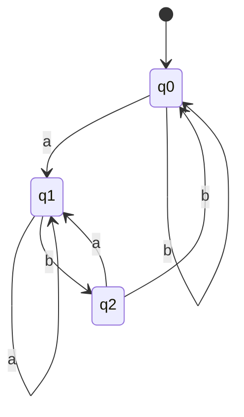

# ADS205 · Autómatas finitos y cierre

## Estado de generación del vídeo
PENDIENTE: material preparado; no se ha generado ni revisado ningún vídeo nuevo.

## Instrucciones
Explica la unidad en español siguiendo únicamente este material. Cita las fuentes y distingue práctica complementaria, respuestas suministradas y comentarios locales. Conserva fórmulas, identificadores, discrepancias y límites de evidencia. No inventes contenido, requisitos, resultados, dominio del estudiante ni predicciones de examen.

## Fuentes originales
- Lecture 2 DFA and NFA.pdf (original en inglés) · SHA-256 3f3244b198c06b502fa7344cab113f472ba164a03ba6588862a666934a64d239
- Tutorial 2 - DFAs and NFAs.pdf (original en inglés) · SHA-256 64c9ae4fc37d4749c47db080a8b0338edf8d8a9421f12af74c290c6a49f687ba
- Tutorial 2 - DFAs and NFAs — current supplied version.pdf (original en inglés) · SHA-256 4e54cbf8ee641f579a642639fd4de645f1524b0aba7a443ed6857fa98d4cf9a4

## Edición española derivada
El hash indicado para cada documento identifica la fuente inglesa; el contenido mostrado es la traducción española. Los originales se conservan en la biblioteca.

### content/reviewed/ADS205/02/tutor.md
Hash de fuente inglesa: fb4b26dca48cff04864a24cfef1ab58067516c22b4afbfa8ba27fcef38537f3c

---
title: "Finite Automata and Closure · Tutor Notes"
course: ADS205
type: tutor-notes
status: reviewed
study_status: untested
language: en
cssclasses:
  - university-study
---

# Autómatas finitos y cierre

[[10_UNIVERSITY_CS/ADS205/Tutor Mode/00 Start Here|Tutor comienza aquí]] · [[10_UNIVERSITY_CS/ADS205/Tutor Mode/Unit 02 - Finite Automata and Closure/02 Recall and Exam Practice|Recuerdo y práctica]] · [[10_UNIVERSITY_CS/ADS205/Unit 02 - Finite Automata and Closure/01 Notes|Referencia ordinaria]] · [[10_UNIVERSITY_CS/ADS205/Unit 02 - Finite Automata and Closure/03 Lab|Laboratorio]]

## En 60 segundos

Un autómata finito reemplaza un historial de entrada ilimitado con uno de un número finito de resúmenes llamados estados. Un DFA tiene exactamente un estado siguiente para cada par de estado-símbolo; una NFA rastrea un conjunto de estados posibles y acepta cuando al menos una ruta completa tiene éxito. La construcción de subconjuntos convierte ese conjunto en un estado DFA ordinario. Los estados del producto rastrean dos máquinas a la vez, mientras que los enlaces épsilon implementan unión, concatenación y estrella. Después del estudio, debería poder diseñar significados de estados, rastrear ambos modelos, determinar un NFA épsilon y justificar construcciones de cierre.[^l2][^t2]

## Vista previa del concepto

> [!note] **Concepto — Invariante de estado**
> **Significado en lenguaje sencillo:** Un estado dice exactamente qué hecho relevante sobre el prefijo consumido es cierto actualmente.
> **Por qué es importante:** Un diagrama etiquetado se convierte en una prueba cuando cada transición conserva el significado declarado.
> **Se conecta a:** detectores de sufijos, estados del producto, circuitos de bombeo.
> **Fuente:** Conferencia 1, PDF, páginas 20–28.

> [!note] **Concepto — Aceptación no determinista**
> **Significado en lenguaje sencillo:** Una NFA sigue conceptualmente todos los caminos permitidos y acepta si uno consume toda la entrada y termina de aceptar.
> **Por qué es importante:** Las ramas muertas no vetan una exitosa.
> **Se conecta a:** construcción y cierre de expresiones regulares.
> **Fuente:** Conferencia 2, PDF, páginas 11–14; Tutorial 2, PDF p.1.

> [!note] **Concepto — Construcción de subconjunto**
> **Significado en lenguaje sencillo:** Un estado de DFA registra el conjunto completo de estados de NFA accesibles después del mismo prefijo.
> **Por qué es importante:** Demuestra que las NFA y las DFA reconocen los mismos lenguajes.
> **Se conecta a:** complemento e implementación.
> **Fuente:** Conferencia 2, PDF, páginas 16–18; Tutorial 2, PDF, páginas 3–4.

> [!note] **Concepto — Construcción de cierre**
> **Significado en lenguaje sencillo:** Las nuevas máquinas finitas pueden combinar máquinas antiguas conservando la semántica de unión, intersección, concatenación, estrella o complemento.
> **Por qué es importante:** Muestra resultados para cada par de lenguajes regulares, no solo ejemplos.
> **Se conecta a:** sintaxis de expresión regular.
> **Fuente:** Conferencia 1, PDF, páginas 32–35; Conferencia 2, PDF, páginas 19–27.

## Instantánea de la evidencia del examen

**Nota de disponibilidad: 12 de octubre de 2026:** estas son observaciones históricas de la muestra parcial inspeccionada previamente, no un corpus actual recién inspeccionado. El PDF original del examen hash no está disponible; no se volvieron a calcular recuentos ni prioridades a partir de capturas no inspeccionadas.

| Tema | Observación positiva | Marcas conocidas | Demanda | Prioridad |
|---|---|---:|---|---|
| Definiciones y equivalencias de DFA/NFA | 2 de 2 administraciones PARCIALES | Múltiples declaraciones de 3 puntos | Explicar/distinguir | MEDIANO — Evidencia LIMITADA |
| Diseño NFA y construcción de subconjuntos | 2 de 2 administraciones PARCIALES | 12 en 2324-A; 10 en 2425 | Dibujar/convertir | MEDIO: observación positiva más fuerte |
| Construcción de cierre | 1 de 2 administraciones PARCIALES | 3+10 en 2425 | Justificar/dibujar | MEDIANO — Evidencia LIMITADA |

Cero artículos completos y ningún esquema significan que ALTO no está justificado. El segundo trimestre de 2023–24 p.7 otorga un lenguaje y 8 puntos, pero omite el verbo de tarea; sigue siendo una indicación incompleta, no una evidencia reconstruida. Ver [[10_UNIVERSITY_CS/ADS205/Tutor Mode/_System/past-paper-intelligence|libro mayor de pruebas]].

## Antes de comenzar

Recuerde que un lenguaje es un conjunto de cadenas y que la aceptación se decide después de que se consume toda la cadena.

> [!question] Si se visita un estado de aceptación antes de que finalice la entrada, ¿la entrada ya está aceptada?

> [!success]- Comprueba tu respuesta
> No. Continúe cada transición; la aceptación depende del estado después de que se consuman todos los símbolos.
> Fuente: Conferencia 1, PDF, páginas 22–28.

## Una pregunta motivadora

**Caso de monitoreo sintético basado en el Tutorial 2 P2.** Diseñe un verificador de transmisión sobre `{a,b}` que acepte exactamente cadenas que terminen en `ab`. No puede almacenar toda la entrada. Debe definir una transición para cada estado y símbolo, rechazar correctamente `ε` y `aba`, y aceptar `ab`, `aab` y `bbab`.

| Pregunta | Conocimiento necesario |
|---|---|
| ¿Qué hay que recordar? | Clases de equivalencia de información útil sobre sufijos |
| ¿Cómo se calcula una carrera? | Tupla DFA y función de transición total |
| ¿Cómo se prueba el diseño? | Inicialización, preservación de la transición, equivalencia final |
| ¿Cómo se pueden simular las elecciones? | Semántica de conjuntos NFA y construcción de subconjuntos |

## Construir un DFA a partir de los significados de los estados

Utilice tres significados: `q0` significa que el prefijo no termina ni en `a` ni en `ab`; `q1` significa que termina en `a`; `q2` significa que termina en `ab`. Son mutuamente excluyentes y cubren todos los prefijos. La entrada vacía comienza en `q0`; solo se acepta `q2`.[^t2]

| Estado | en `a` | en `b` |
|---|---|---|
| `q0` | `q1` | `q0` |
| `q1` | `q1` | `q2` |
| `q2` | `q1` | `q0` |

Agregar `a` siempre crea el sufijo `a`. Agregar `b` crea el sufijo `ab` exactamente cuando el prefijo anterior terminaba en `a`. De estas dos observaciones se deriva la tabla.

**Figura 1: El significado del estado impulsa cada flecha**

**Léelo:** Siga exactamente un borde por símbolo de entrada; el estado de aceptación de doble función se alcanza sólo cuando el prefijo completo actual termina en `ab`.
**Conclusión clave:** Visitar `q2` temprano es irrelevante si los símbolos posteriores lo abandonan.
**Procedencia:** Tutorial 2, PDF, páginas 2–3, redibujado como Sirena.

> [!note] DFA
> Un DFA es `(Q,Σ,δ,q0,F)` con un total de `δ:Q×Σ→Q`. A partir de `q0`, aplique una transición por símbolo y acepte si el estado final está en `F`.[^l2].

La prueba invariante es una inducción sobre la longitud del prefijo. El prefijo vacío satisface el significado de `q0`. La tabla conserva los significados de cualquiera de los siguientes símbolos. Por lo tanto, el estado final es `q2` exactamente cuando la entrada completa termina en `ab`.

## De un camino a un conjunto de caminos

Una NFA tiene `δ:Q×(Σ∪{ε})→P(Q)`. Una transición faltante no produce sucesor para esa rama. Una transición épsilon cambia de estado sin consumir entrada. La aceptación es existencial: al menos un camino debe consumir cada símbolo y terminar en `F`.[^l2][^t2]

Para un conjunto `S`, su cierre épsilon `E(S)` contiene todos los estados alcanzables a través de cero o más bordes épsilon. Un paso de símbolo es:

$$S' = E\left(\bigcup_{q\in S}\delta(q,a)\right).$$

El conjunto inicial es `E({q0})`, no simplemente `{q0}`. El conjunto vacío es un subconjunto rechazante legítimo y se convierte en un sumidero bajo la construcción.

**Construcción de subconjunto trabajado.** El NFA mostrado en el artículo parcial de 2024-25 tiene transiciones:

- `1 --a,ε→ 2`; `2 --b→2`; `2 --b→3`;
- `3 --a→2`; `3 --b→1`; estado de aceptación `3`.

Nombre los subconjuntos accesibles `A={1,2}`, `B={2}`, `C={2,3}`, `D=∅`, `E={1,2,3}`. El cierre épsilon inicial es `A`.

| Subconjunto de DFA | `a` | `b` | ¿Aceptando? |
|---|---|---|---|
| `A={1,2}` | `B` | `C` | No |
| `B={2}` | `D` | `C` | No |
| `C={2,3}` | `B` | `E` | Sí |
| `D=∅` | `D` | `D` | No |
| `E={1,2,3}` | `B` | `E` | Sí |

Por ejemplo, `C` en `b` llega a `{2,3}` desde el estado 2 y a `{1}` desde el estado 3; El cierre épsilon de `{1,2,3}` no cambia nada, dando `E`. Se aceptan subconjuntos que contengan `3`. Esta es una solución de enseñanza; no se proporciona ningún esquema oficial.[^exam11]

> [!question] Explícalo tú mismo
> ¿Por qué la construcción de subconjuntos puede detenerse después de los subconjuntos alcanzables en lugar de dibujar todos los subconjuntos `2^|Q|`?

> [!success]- Consulta tu explicación
> Una ejecución de entrada comienza en un subconjunto y sigue las transiciones; un subconjunto inalcanzable nunca puede afectar la aceptación de ninguna entrada.
> Fuente: Conferencia 2, PDF, páginas 16–18.

## Construcciones de cierre

Para DFA `MA,MB` con el mismo alfabeto, el estado del producto `(q,r)` realiza un seguimiento de ambos estados de los componentes después del mismo prefijo. Acepte pares por OR para unión, AND para intersección y “A final, B no final” para diferencia. El invariante prueba la construcción de todas las palabras.[^l1closure]

El complemento requiere un **DFA completo**: sustituir `F` por `Q\F`. Invertir una NFA arbitraria es incorrecto porque cambia "existe algún camino de aceptación" por "existe algún camino de rechazo anterior", no "no existe ningún camino de aceptación". Determinar y completar primero.[^t2]

Para la composición de NFA:

| Operación | Construcción | Por qué funciona |
|---|---|---|
| Unión | Nuevo comienzo épsilon: se ramifica en ambos viejos comienzos | Elija cualquiera de las máquinas |
| Concatenación | Epsilon vincula cada final A con el inicio de B; sólo se aceptan finales B | Elija una división en prefijo A y sufijo B |
| Estrella | Nuevo comienzo de aceptación, épsilon al viejo comienzo, épsilon regresa después de viejas finales | Aceptar cero o un número finito de factores completos |

Un nuevo comienzo estelar es importante. Simplemente hacer un comienzo antiguo aceptando puede aceptar una ruta no vacía que regrese allí incluso cuando esa ruta no sea un factor de lenguaje completo.[^l2]

## Volver a la pregunta motivadora

Usando la tabla de arriba:

| Entrada | Seguimiento | Resultado |
|---|---|---|
| `ε` | `q0` | rechazar |
| `ab` | `q0,q1,q2` | aceptar |
| `aab` | `q0,q1,q1,q2` | aceptar |
| `aba` | `q0,q1,q2,q1` | rechazar |
| `bbab` | `q0,q0,q0,q1,q2` | aceptar |

El invariante de estado demuestra la corrección más allá de estas pruebas. Una alternativa NFA puede adivinar dónde comienza un sufijo útil; Luego, la construcción de subconjuntos registra cada suposición de manera determinista. Las construcciones de productos y épsilon reutilizan máquinas completas sin cambiar su significado interno.

## Definiciones y distinciones

### Puente fuente-corriente: una construcción es una garantía de doble vía

El PDF actual del Tutorial 2, páginas 4 a 6, detalla ESTIRAR y CORTAR. En STRETCH, el estado intermedio recuerda qué símbolo debe volver a aparecer; una pareja desigual o una pareja inacabada no pueden aceptar. En CHOP, una entrada épsilon adivina el primer símbolo eliminado, y un nuevo conjunto de aceptación garantiza que algún último símbolo eliminado conduce a un final antiguo. Demuestre que “toda palabra original transformada es aceptada” y “cada palabra nueva aceptada tiene un testigo original”. Se permite el medio vacío porque su testigo original tiene dos símbolos.

Utilice [[10_UNIVERSITY_CS/ADS205/Unit 02 - Finite Automata and Closure/02 Exercises#T2 P6 — STRETCH and CHOP|la tarea y solución original completa de P6]] y [[10_UNIVERSITY_CS/ADS205/Unit 02 - Finite Automata and Closure/03 Lab#Current-source activity — Original Tock CSV machines|la actividad actual de Tock]]. Las máquinas CSV difieren de la demostración anterior: los nombres de los estados por sí solos no identifican una máquina. Obtenga una vista previa de las transiciones antes de ejecutar el software; Las pruebas acotadas ilustran la prueba en lugar de reemplazarla.

La [[10_UNIVERSITY_CS/ADS205/Original Sources/LM Core 2026-10-07/Forum Clarifications#T2 — Nondeterminism as guessing|respuesta del profesor del 16 de septiembre]] fundamenta las “adivinanzas” en transiciones de valores conjuntos, no en la probabilidad. Una rama fallida es irrelevante si otra consume la palabra entera y acepta.

| Término A | Término B | Distinción decisiva | Fuente |
|---|---|---|---|
| Transición de DFA | Transición de la NFA | Un estado requerido versus un conjunto de cero o más estados | L2 págs.9–14 |
| Movimiento Épsilon | Auto-bucle | No consume ningún símbolo versus consume su símbolo etiquetado | T2 pág.1 |
| Sucursal que acepta | Aceptando NFA | Un camino versus existencia de al menos un camino de aceptación completo | T2 pág.1 |
| Completar DFA | Dibujo parcial taquigráfico | Cada par de estado-símbolo definido frente a bordes de sumidero omitidos | L2 págs.9–10 |
| Subconjunto accesible | Límite superior del conjunto de potencia | En realidad encontré un conjunto de estados versus cualquiera de los subconjuntos `2^n` | L2 págs. 16-18 |

## Revisión

### Comprensión total

Revise los mecanismos anteriores y la [[10_UNIVERSITY_CS/ADS205/Unit 02 - Finite Automata and Closure/01 Notes|referencia ordinaria]] para obtener la conferencia completa NFA, diagramas de cierre y casos extremos.

## Revisión de 5 minutos

- Asigne a cada estado de DFA un prefijo invariante y a cada símbolo una transición.
- DFA: una ejecución; NFA: un conjunto de recorridos posibles y aceptación existencial.
- El cierre Epsilon se aplica inicialmente y después de cada símbolo consumido.
- Los subconjuntos de DFA aceptan exactamente cuando se cruzan con el conjunto final de NFA.
- Los estados del producto combinan hechos simultáneos; Los enlaces épsilon componen opciones secuenciales.
- Complementar volteando finales sólo después de determinar/completar.

## Recuperación de 60 segundos

`(Q,Σ,δ,q0,F)` · DFA total · NFA con valor establecido · cierre épsilon · mover y luego cerrar · aceptar subconjunto · invariante de producto · nuevo comienzo estrella

[^l2]: `Lecture 2 DFA and NFA.pdf`, PDF, páginas 8–29.
[^t2]: `Tutorial 2 - DFAs and NFAs.pdf`, PDF páginas 1–5.
[^l1closure]: `Lecture 1 Intro and Regular Language.pdf`, PDF páginas 32–35.
[^exam11]: `ADS205-EXAMS.pdf`, PDF p.11, INT201/2024/25/S1 Q2 (artículo PARCIAL).

### content/reviewed/ADS205/02/practice.md
Hash de fuente inglesa: e44627b0acaa295e7f74e109fde7ae07f617f9babcefde77f649253dfff43754

---
title: "Finite Automata and Closure · Recall and Exam Practice"
course: ADS205
type: tutor-practice
status: reviewed
study_status: untested
language: en
cssclasses:
  - university-study
---

# Recordar y practicar

[[10_UNIVERSITY_CS/ADS205/Tutor Mode/00 Start Here|Tutor Comienza Aquí]] · [[10_UNIVERSITY_CS/ADS205/Tutor Mode/Unit 02 - Finite Automata and Closure/01 Tutor Notes|Notas del Tutor]] · [[10_UNIVERSITY_CS/ADS205/Unit 02 - Finite Automata and Closure/02 Exercises|Ejercicios ordinarios completos]] · [[10_UNIVERSITY_CS/ADS205/Unit 02 - Finite Automata and Closure/03 Lab|Laboratorio]]

Las preguntas de evaluación provienen de trabajos PARCIAL INT201 sin esquema. Se conservan las marcas visibles; Las soluciones y las dimensiones de autoevaluación son criterios pedagógicos, no oficiales.

## Repaso activo atómico

### Tarjeta 01: ¿Qué hace que un DFA sea determinista?
> [!success]- Respuesta
> Cada par estado-símbolo tiene exactamente un siguiente estado definido.
>
> Fuente: Conferencia 2, PDF, páginas 9–10.

### Tarjeta 02: ¿Cuándo acepta un DFA `ε`?
> [!success]- Respuesta
> Exactamente cuando su estado inicial es de aceptación.
>
> Fuente: Tutorial 1, PDF p.2.

### Tarjeta 03: ¿Qué hace una transición NFA faltante?
> [!success]- Respuesta
> Mata esa rama; no mantiene al estado sin cambios.
>
> Fuente: Tutorial 2, PDF p.2.

### Tarjeta 04: ¿Qué es la aceptación de la NFA?
> [!success]- Respuesta
> Alguna ruta consume todas las entradas y termina en un estado de aceptación.
>
> Fuente: Tutorial 2, PDF p.1.

### Tarjeta 05: ¿Qué consume una transición épsilon?
> [!success]- Respuesta
> Nada; el siguiente símbolo de entrada no leído permanece sin cambios.
>
> Fuente: Conferencia 2, PDF, páginas 11–12.

### Tarjeta 06: ¿Qué es el cierre épsilon?
> [!success]- Respuesta
> Estados accesibles desde un conjunto usando cero o más movimientos épsilon.
>
> Fuente: Tutorial 2, PDF, páginas 3–4.

### Tarjeta 07 — ¿Cuándo se acepta un estado de construcción de subconjuntos?
> [!success]- Respuesta
> Cuando el subconjunto contiene al menos un estado de aceptación antiguo.
>
> Fuente: Conferencia 2, PDF, páginas 16–18.

### Tarjeta 08: ¿Cuándo debe aparecer el subconjunto vacío en una construcción DFA de estado alcanzable desde una NFA?
> [!success]- Respuesta
> Si es accesible, representa que ninguna ruta NFA sobrevive al prefijo consumido. Cada símbolo lo mantiene vacío, por lo que es un sumidero de rechazo. No es necesario dibujar un subconjunto vacío inalcanzable.
>
> Fuente: Tutorial 2, PDF, páginas 3–4.

### Tarjeta 09: ¿Cómo reconoce un producto de DFA una intersección?
> [!success]- Respuesta
> Realice un seguimiento de ambos estados y acepte solo pares en los que ambos componentes acepten.
>
> Fuente: Tutorial 2, PDF p.4.

### Tarjeta 10: ¿Por qué no se pueden invertir las finales de una NFA?
> [!success]- Respuesta
> La aceptación existencial puede retener una rama que anteriormente rechazaba incluso cuando existe una rama que acepta.
>
> Fuente: Tutorial 2, PDF p.4.

### Tarjeta 11: ¿Cómo se construye un NFA para $A^*$ a partir de un NFA arbitrario para A, incluida la aceptación de ε?
> [!success]- Respuesta
> Agregue un nuevo inicio de aceptación r y un borde épsilon r→q0. Mantenga todas las transiciones y estados de aceptación antiguos, y agregue una ventaja épsilon desde cada estado de aceptación anterior a r. Permanecer en r implica cero factores; Las ejecuciones antiguas completas repetidas aceptan más factores.
>
> Fuente: Conferencia 2, PDF, páginas 24–27.

## Práctica progresiva

### Práctica 1: Trazar antes de diseñar

**PRÁCTICA COMPLEMENTARIA.** Sobre `{a,b}`, comience en `q0`; sólo se acepta `q2`. Transiciones: `q0: a→q1,b→q0`; `q1: a→q1,b→q2`; `q2: a→q1,b→q0`. Rastree `baba` y `baab`, enumerando el inicio y todos los estados posteriores. Explique quién acepta y por qué alcanzar un estado de aceptación temprano es insuficiente.

Fuente: Tutorial 2, PDF, páginas 2–3.

> [!tip]- Sugerencia
> Escriba cada estado visitado, incluido el inicio, y decida solo después del símbolo final.

> [!success]- Solución
> `baba`: `q0→q0→q1→q2→q1`, por lo que rechaza; el sufijo final es `a`. `baab`: `q0→q0→q1→q1→q2`, por lo que acepta; el sufijo final es `ab`. Llegar a `q2` después del tercer símbolo de `baba` no decide la entrada inacabada.
>
> Fuente: Tutorial 2, PDF páginas 2–3, P2.

### Práctica 2: Encuentra la omisión de la construcción del subconjunto

**PRÁCTICA COMPLEMENTARIA.** Un estudiante calcula correctamente el cierre inicial de un épsilon-NFA, pero después de cada símbolo solo toma los sucesores etiquetados y omite el nuevo cierre. Explique la invariante que falla.

> [!tip]- Sugerencia
> Una ruta de aceptación puede tomar bordes épsilon inmediatamente después de consumir un símbolo.

> [!success]- Solución
> El subconjunto de DFA debe ser igual a cada estado de NFA alcanzable después del prefijo consumido, incluido cualquier movimiento épsilon de cero o más después de su paso final etiquetado. Al omitir el cierre posterior al símbolo se pierden esos caminos. El paso de inducción debe ser `move` seguido de `E`, no solo `move`.
>
> Fuente: Conferencia 2, PDF, páginas 16–18.

> [!warning] RELEVANCIA DEL EXAMEN MEDIO
> El diseño y la conversión de NFA se observaron positivamente en ambas administraciones PARCIALES distintas. ALTA no se justifica porque no se dispone de un artículo completo.

### Práctica de evaluación 1: exactamente seis estados de la NFA

**EJERCICIO DEL CURSO ORIGINAL.** `ADS205-EXAMS.pdf`, PDF p.2, `INT201/23-24/S1` variante A Q2, **12 puntos**: dibuje un NFA con exactamente seis estados sobre `{0,1}` aceptando cadenas con al menos dos `0`, o exactamente dos `1`.

> [!tip]- Sugerencia
> Construir dos sucursales en tres estados. Reutilice el inicio de una rama como inicio completo y conéctelo épsilon a la otra rama.

> [!success]- Solución
> Estados de uso `p0,p1,p2,r0,r1,r2`; iniciar `r0`; finales `{p2,r2}`. Agregue `r0 --ε→ p0`.
>
> **Rama de al menos dos ceros:** `p0` realiza un bucle en `1` y va a `p1` en `0`; `p1` realiza un bucle en `1` y va a `p2` en `0`; `p2` se repite en ambos símbolos.
>
> **Rama exactamente dos unos:** `r0` realiza un bucle en `0` y va a `r1` en `1`; `r1` realiza un bucle en `0` y va a `r2` en `1`; `r2` se repite en `0` y no tiene transición `1`.
>
> Una ruta en la rama `p` acepta exactamente después del segundo cero y posteriormente. Una ruta en la rama `r` acepta exactamente después de dos unos; un tercero lo mata. Tomar el borde épsilon expone inmediatamente la rama completa de al menos dos ceros. Un borde épsilon retrasado sólo es posible mientras `r0` haya leído los ceros a la izquierda; Si ese camino retrasado luego ve dos ceros más, la palabra completa todavía tiene al menos dos ceros, por lo que no crea una aceptación falsa. Por el contrario, cada miembro del sindicato tiene la ruta inmediata `p` o la ruta global `r`. Hay exactamente seis estados.
>
> **AUTOCOMPROBACIÓN SUGERIDA:** seis estados nombrados; salida/finales correctas; cada rama lingüística justificada en ambas direcciones; Semántica sindical declarada. No se proporcionó ningún esquema oficial.

### Práctica de evaluación 2: convertir el épsilon-NFA mostrado

**EJERCICIO ORIGINAL DEL CURSO.** `ADS205-EXAMS.pdf`, PDF p.11, `INT201/2024/25/S1` Q2, **10 puntos**: convierta el NFA mostrado a un DFA equivalente. Las transiciones de origen son `1 --a,ε→2`, `2 --b→2`, `2 --b→3`, `3 --a→2`, `3 --b→1`; El estado `3` acepta.

> [!tip]- Sugerencia
> Comience con `E({1})={1,2}`. Mantenga el subconjunto vacío y marque cada subconjunto que contenga `3`.

> [!success]- Solución
> Los estados alcanzables son `A={1,2}`, `B={2}`, `C={2,3}`, `D=∅`, `E={1,2,3}`.
>
> | Estado | `a` | `b` | ¿Final? |
> |---|---|---|---|
> | `A` | `B` | `C` | no |
> | `B` | `D` | `C` | no |
> | `C` | `B` | `E` | si |
> | `D` | `D` | `D` | no |
> | `E` | `B` | `E` | si |
>
> El inicio es `A`; Las finales son `C,E`. Cada entrada se obtiene uniendo sucesores etiquetados y luego cerrándolos bajo épsilon. Esta tabla determina de forma única el gráfico de DFA solicitado.

### Práctica de evaluación 3: construcción general de NFA para `A*`

**EJERCICIO DEL CURSO ORIGINAL.** `ADS205-EXAMS.pdf`, PDF p.11, `INT201/2024/25/S1` P3, **10 puntos**: dado un NFA arbitrario `N` para `A`, dibuje un NFA para `A*`; las transiciones internas de `N` son irrelevantes.

> [!tip]- Sugerencia
> La nueva máquina debe aceptar factores cero y reiniciarse después de cada ejecución anterior completada.

> [!success]- Solución
> Agregue un estado nuevo `r` y conviértalo en el nuevo inicio y un estado de aceptación. Agregue `r --ε→ q0`, donde `q0` es el comienzo anterior. Conserve todas las viejas transiciones y viejas finales. De cada `f` final anterior, agregue `f --ε→ r`.
>
> Alojarse en `r` acepta cero factores. Para cualquier lista finita de palabras de `A`, ingrese `N`, siga una ejecución de aceptación para un factor, regrese a `r` y repita. Por el contrario, cada ejecución de aceptación se descompone en los retornos a `r` en cero o más ejecuciones de aceptación antiguas completas, por lo que su entrada está en `A*`.

### Práctica 6 — Traslado: elige una construcción

**PRÁCTICA COMPLEMENTARIA.** Tiene DFA completos para “contiene `00`” y “termina en `1`”. Describir construcciones para cadenas que satisfacen ambas condiciones y para cadenas que satisfacen la primera pero no la segunda.

> [!tip]- Sugerencia
> Realizar un seguimiento de los estados de ambos componentes; sólo cambia la regla del par final.

> [!success]- Solución
> Utilice la misma transición de producto `(q,r) --a→ (δA(q,a),δB(r,a))`. Para ambas condiciones, acepte `FA×FB`. Para “contiene `00` pero no termina en `1`”, acepte `FA×(QB\FB)`. La inducción sobre el prefijo consumido demuestra que el par siempre es igual a los dos estados componentes, por lo que la regla final implementa la condición booleana deseada.
>
> Fuente: Conferencia 1, PDF, páginas 32–35; Tutorial 2, PDF p.4.

## Navegación del ejercicio original

Las 57 asignaciones de tareas fuente de la Unidad 02 conservan la ayuda local completa en la edición ordinaria:

- [[10_UNIVERSITY_CS/ADS205/Unit 02 - Finite Automata and Closure/02 Exercises#T1 Q&A — Basic finite automata|Preguntas y respuestas sobre autómatas finitos T1/L1]]
- [[10_UNIVERSITY_CS/ADS205/Unit 02 - Finite Automata and Closure/02 Exercises#T2 P1 — Quick diagnostic|Diagnóstico T2 P1]]
- [[10_UNIVERSITY_CS/ADS205/Unit 02 - Finite Automata and Closure/02 Exercises#T2 P2 — A DFA for a final ab|T2 P2 sufijo DFA]]
- [[10_UNIVERSITY_CS/ADS205/Unit 02 - Finite Automata and Closure/02 Exercises#T2 P3 — An NFA for contains 01|Subcadena T2 P3 NFA]]
- [[10_UNIVERSITY_CS/ADS205/Unit 02 - Finite Automata and Closure/02 Exercises#T2 P4 — Subset construction with epsilon moves|Construcción del subconjunto T2 P4]]
- [[10_UNIVERSITY_CS/ADS205/Unit 02 - Finite Automata and Closure/02 Exercises#T2 P5 — Intersection and complement|T2 P5 intersección/complemento]]
- [[10_UNIVERSITY_CS/ADS205/Unit 02 - Finite Automata and Closure/02 Exercises#T2 P6 — STRETCH and CHOP|Construcciones transferencia T2 P6]]
- [[10_UNIVERSITY_CS/ADS205/Unit 02 - Finite Automata and Closure/02 Exercises#L2 p14 — Trace the lecture NFA|Conferencia sobre seguimiento de NFA]] · [[10_UNIVERSITY_CS/ADS205/Unit 02 - Finite Automata and Closure/02 Exercises#L2 p18 — How many subset states?|subconjunto enlazado]]
- [[10_UNIVERSITY_CS/ADS205/Unit 02 - Finite Automata and Closure/02 Exercises#L2 Q&A — Path semantics|semántica de ruta]] · [[10_UNIVERSITY_CS/ADS205/Unit 02 - Finite Automata and Closure/02 Exercises#L2 p11-p12 — Effect of an epsilon option|opción épsilon]]
- [[10_UNIVERSITY_CS/ADS205/Unit 02 - Finite Automata and Closure/02 Exercises#L2 closure-challenges — Build machines for the operations|desafíos de cierre]]
- [[10_UNIVERSITY_CS/ADS205/Unit 02 - Finite Automata and Closure/03 Lab#Procedure — Original demonstrations|Tutorial 2 laboratorio opcional de simulación/determinación]]

La variante B Q2 de 2023-24 no se reproduce como una tarea que se puede resolver porque la página proporcionada solo indica el lenguaje y las marcas; la acción requerida está ausente. Esta brecha se conserva en lugar de adivinarse.
