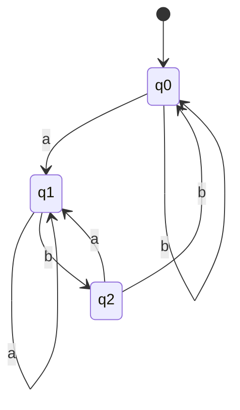

# ADS205 · Finite Automata and Closure

## Video generation status
PENDING: source pack prepared; no cloud video has been generated or reviewed.

## Spanish video overview prompt
Explica esta unidad en español claro, paso a paso, para alguien que aprende de forma autodidacta. Usa únicamente el material incluido. Comienza con el problema motivador, presenta los conceptos, muestra un ejemplo visual fiel a las convenciones del curso, pausa para una pregunta y después explica la respuesta. Distingue práctica suplementaria de tareas oficiales y de soluciones oficiales. No inventes datos, fuentes, requisitos, capítulos pendientes, resultados de ejecución ni predicciones de examen. Conserva los límites y discrepancias indicados. Cierra con una actividad que el estudiante pueda intentar en Learning Uni. Cita el nombre del documento y su localizador cuando corresponda. Si falta evidencia, dilo; no rellenes el hueco. Mantén visibles las fórmulas y direcciones de flechas.

## Verified original file snapshots
- Lecture 2 DFA and NFA.pdf · SHA-256 3f3244b198c06b502fa7344cab113f472ba164a03ba6588862a666934a64d239
- Tutorial 2 - DFAs and NFAs.pdf · SHA-256 64c9ae4fc37d4749c47db080a8b0338edf8d8a9421f12af74c290c6a49f687ba
- Tutorial 2 - DFAs and NFAs — current supplied version.pdf · SHA-256 4e54cbf8ee641f579a642639fd4de645f1524b0aba7a443ed6857fa98d4cf9a4

## Source material

### Snapshot: content/reviewed/ADS205/02/tutor.md
SHA-256: e971a96dc29b277bc5d3b1d860829c89c7239f679ecb66d624898cfee20ae1de

---
title: "Finite Automata and Closure · Tutor Notes"
course: ADS205
type: tutor-notes
status: reviewed
study_status: untested
language: en
cssclasses:
  - university-study
---

# Finite Automata and Closure

[[10_UNIVERSITY_CS/ADS205/Tutor Mode/00 Start Here|Tutor Start Here]] · [[10_UNIVERSITY_CS/ADS205/Tutor Mode/Unit 02 - Finite Automata and Closure/02 Recall and Exam Practice|Recall and Practice]] · [[10_UNIVERSITY_CS/ADS205/Unit 02 - Finite Automata and Closure/01 Notes|Ordinary reference]] · [[10_UNIVERSITY_CS/ADS205/Unit 02 - Finite Automata and Closure/03 Lab|Lab]]

## In 60 Seconds

A finite automaton replaces an unbounded input history with one of finitely many summaries called states. A DFA has exactly one next state for every state-symbol pair; an NFA tracks a set of possible states and accepts when at least one complete path succeeds. Subset construction turns that set into an ordinary DFA state. Product states track two machines at once, while epsilon links implement union, concatenation and star. After study, you should be able to design state meanings, trace both models, determinize an epsilon-NFA, and justify closure constructions.[^l2][^t2]

## Concept Preview

> [!note] **Concept — State invariant**
> **Plain-language meaning:** A state says exactly what relevant fact about the consumed prefix is currently true.
> **Why it matters:** A labelled diagram becomes a proof when every transition preserves the stated meaning.
> **Connects to:** suffix detectors, product states, pumping loops.
> **Source:** Lecture 1, PDF pp.20–28.

> [!note] **Concept — Nondeterministic acceptance**
> **Plain-language meaning:** An NFA follows all permitted paths conceptually and accepts if one consumes the entire input and finishes accepting.
> **Why it matters:** Dead branches do not veto a successful one.
> **Connects to:** regex construction and closure.
> **Source:** Lecture 2, PDF pp.11–14; Tutorial 2, PDF p.1.

> [!note] **Concept — Subset construction**
> **Plain-language meaning:** One DFA state records the whole set of NFA states reachable after the same prefix.
> **Why it matters:** It proves NFAs and DFAs recognize the same languages.
> **Connects to:** complement and implementation.
> **Source:** Lecture 2, PDF pp.16–18; Tutorial 2, PDF pp.3–4.

> [!note] **Concept — Closure construction**
> **Plain-language meaning:** New finite machines can combine old machines while preserving union, intersection, concatenation, star or complement semantics.
> **Why it matters:** It proves results for every pair of regular languages, not only examples.
> **Connects to:** regular-expression syntax.
> **Source:** Lecture 1, PDF pp.32–35; Lecture 2, PDF pp.19–27.

## Exam Evidence Snapshot

| Topic | Positive observation | Known marks | Demand | Priority |
|---|---|---:|---|---|
| DFA/NFA definitions and equivalence | 2 of 2 PARTIAL administrations | Multiple 3-mark statements | Explain/distinguish | MEDIUM — LIMITED evidence |
| NFA design and subset construction | 2 of 2 PARTIAL administrations | 12 in 2324-A; 10 in 2425 | Draw/convert | MEDIUM — strongest positive observation |
| Closure construction | 1 of 2 PARTIAL administrations | 3 + 10 in 2425 | Justify/draw | MEDIUM — LIMITED evidence |

Zero complete papers and no scheme mean HIGH is not justified. The 2023–24 p.7 Q2 gives a language and 8 marks but omits the task verb; it remains an incomplete prompt, not reconstructed evidence. See [[10_UNIVERSITY_CS/ADS205/Tutor Mode/_System/past-paper-intelligence|evidence ledger]].

## Before You Start

Recall that a language is a set of strings and that acceptance is decided after the whole string is consumed.

> [!question] If an accepting state is visited before the input ends, is the input already accepted?

> [!success]- Check your answer
> No. Continue every transition; acceptance depends on the state after all symbols are consumed.
> Source: Lecture 1, PDF pp.22–28.

## A motivating question

**Synthetic monitoring case based on Tutorial 2 P2.** Design a streaming checker over `{a,b}` that accepts exactly strings ending in `ab`. It cannot store the whole input. It must define a transition for every state and symbol, correctly reject `ε` and `aba`, and accept `ab`, `aab`, and `bbab`.

| Question | Knowledge needed |
|---|---|
| What must be remembered? | Equivalence classes of useful suffix information |
| How is a run computed? | DFA tuple and total transition function |
| How is the design proved? | Initialization, transition preservation, final equivalence |
| How can choices be simulated? | NFA set semantics and subset construction |

## Build a DFA from state meanings

Use three meanings: `q0` means the prefix ends in neither `a` nor `ab`; `q1` means it ends in `a`; `q2` means it ends in `ab`. They are mutually exclusive and cover every prefix. Empty input begins at `q0`; only `q2` is accepting.[^t2]

| State | on `a` | on `b` |
|---|---|---|
| `q0` | `q1` | `q0` |
| `q1` | `q1` | `q2` |
| `q2` | `q1` | `q0` |

Appending `a` always creates suffix `a`. Appending `b` creates suffix `ab` exactly when the previous prefix ended in `a`. These two observations derive the table.

**Figure 1 — State meaning drives every arrow**

**Read it:** Follow exactly one edge per input symbol; the double-role accepting state is reached only when the current entire prefix ends in `ab`.
**Key takeaway:** Visiting `q2` early is irrelevant if later symbols leave it.
**Provenance:** Tutorial 2, PDF pp.2–3, redrawn as Mermaid.

> [!note] DFA
> A DFA is `(Q,Σ,δ,q0,F)` with total `δ:Q×Σ→Q`. Starting at `q0`, apply one transition per symbol and accept iff the final state is in `F`.[^l2]

The invariant proof is an induction on prefix length. The empty prefix satisfies `q0`'s meaning. The table preserves the meanings for either next symbol. Therefore the final state is `q2` exactly when the full input ends in `ab`.

## From one path to a set of paths

An NFA has `δ:Q×(Σ∪{ε})→P(Q)`. A missing transition yields no successor for that branch. An epsilon transition changes state without consuming input. Acceptance is existential: at least one path must consume every symbol and finish in `F`.[^l2][^t2]

For a set `S`, its epsilon closure `E(S)` contains every state reachable through zero or more epsilon edges. One symbol step is:

$$S' = E\left(\bigcup_{q\in S}\delta(q,a)\right).$$

The initial set is `E({q0})`, not merely `{q0}`. The empty set is a legitimate rejecting subset and becomes a sink under the construction.

**Worked subset construction.** The 2024–25 partial paper's displayed NFA has transitions:

- `1 --a,ε→ 2`; `2 --b→2`; `2 --b→3`;
- `3 --a→2`; `3 --b→1`; accepting state `3`.

Name reachable subsets `A={1,2}`, `B={2}`, `C={2,3}`, `D=∅`, `E={1,2,3}`. The initial epsilon closure is `A`.

| DFA subset | `a` | `b` | Accepting? |
|---|---|---|---|
| `A={1,2}` | `B` | `C` | No |
| `B={2}` | `D` | `C` | No |
| `C={2,3}` | `B` | `E` | Yes |
| `D=∅` | `D` | `D` | No |
| `E={1,2,3}` | `B` | `E` | Yes |

For example, `C` on `b` reaches `{2,3}` from state 2 and `{1}` from state 3; epsilon closure of `{1,2,3}` changes nothing, giving `E`. Subsets containing `3` accept. This is a teaching solution; no official scheme is supplied.[^exam11]

> [!question] Explain it yourself
> Why can subset construction stop after reachable subsets instead of drawing all `2^|Q|` subsets?

> [!success]- Check your explanation
> An input run starts at one subset and follows transitions; an unreachable subset can never affect any input's acceptance.
> Source: Lecture 2, PDF pp.16–18.

## Closure constructions

For DFAs `MA,MB` over the same alphabet, product state `(q,r)` tracks both component states after the same prefix. Accept pairs by OR for union, AND for intersection, and “A final, B nonfinal” for difference. The invariant proves the construction for all words.[^l1closure]

Complement requires a **complete DFA**: replace `F` by `Q\F`. Flipping an arbitrary NFA is wrong because it changes “some accepting path exists” into “some formerly rejecting path exists,” not “no accepting path exists.” Determinize and complete first.[^t2]

For NFA composition:

| Operation | Construction | Why it works |
|---|---|---|
| Union | Fresh start epsilon-branches to both old starts | Choose either machine |
| Concatenation | Epsilon-link every A-final to B's start; only B-finals accept | Choose a split into A-prefix and B-suffix |
| Star | Fresh accepting start, epsilon to old start, epsilon returns after old finals | Accept zero or finitely many complete factors |

A fresh star start matters. Merely making an old start accepting can accept a nonempty path returning there even when that path is not one whole language factor.[^l2]

## Return to the motivating question

Using the table above:

| Input | Trace | Result |
|---|---|---|
| `ε` | `q0` | reject |
| `ab` | `q0,q1,q2` | accept |
| `aab` | `q0,q1,q1,q2` | accept |
| `aba` | `q0,q1,q2,q1` | reject |
| `bbab` | `q0,q0,q0,q1,q2` | accept |

The state invariant proves correctness beyond these tests. An NFA alternative can guess where a useful suffix begins; subset construction then records every guess deterministically. Product and epsilon constructions reuse complete machines without changing their internal meaning.

## Definitions and distinctions

### Current-source bridge: a construction is a two-way guarantee

Tutorial 2's current PDF pp.4–6 spells out STRETCH and CHOP. In STRETCH, the intermediate state remembers which symbol must occur again; an unequal pair or an unfinished pair cannot accept. In CHOP, an epsilon entry guesses the removed first symbol, and a new accepting set guarantees some removed last symbol leads to an old final. Prove both “every transformed original word is accepted” and “every accepted new word has an original witness.” The empty middle is allowed because its original witness has two symbols.

Use [[10_UNIVERSITY_CS/ADS205/Unit 02 - Finite Automata and Closure/02 Exercises#T2 P6 — STRETCH and CHOP|the complete original P6 task and solution]] and [[10_UNIVERSITY_CS/ADS205/Unit 02 - Finite Automata and Closure/03 Lab#Current-source activity — Original Tock CSV machines|the current Tock activity]]. The CSV machines differ from the old demonstration: state names alone do not identify a machine. Preview the transitions before running software; bounded tests illustrate the proof rather than replace it.

The [[10_UNIVERSITY_CS/ADS205/Original Sources/LM Core 2026-10-07/Forum Clarifications#T2 — Nondeterminism as guessing|lecturer's 16 September reply]] grounds “guessing” in set-valued transitions, not probability. An unsuccessful branch is irrelevant if another consumes the whole word and accepts.

| Term A | Term B | Decisive distinction | Source |
|---|---|---|---|
| DFA transition | NFA transition | One required state versus a set of zero or more states | L2 pp.9–14 |
| Epsilon move | Self-loop | Consumes no symbol versus consumes its labelled symbol | T2 p.1 |
| Accepting branch | Accepting NFA | One path versus existence of at least one complete accepting path | T2 p.1 |
| Complete DFA | Shorthand partial drawing | Every state-symbol pair defined versus omitted sink edges | L2 pp.9–10 |
| Reachable subset | Powerset upper bound | Actually encountered state-set versus any of `2^n` subsets | L2 pp.16–18 |

## Review

### Full Understanding

Revisit the mechanisms above and the [[10_UNIVERSITY_CS/ADS205/Unit 02 - Finite Automata and Closure/01 Notes|ordinary reference]] for the full lecture NFA, closure diagrams and edge cases.

## 5-Minute Review

- Give every DFA state a prefix invariant and every symbol a transition.
- DFA: one run; NFA: a set of possible runs and existential acceptance.
- Epsilon closure is applied initially and after every consumed symbol.
- DFA subsets accept exactly when they intersect the NFA final set.
- Product states combine simultaneous facts; epsilon links compose sequential choices.
- Complement by flipping finals only after determinizing/completing.

## 60-Second Recall

`(Q,Σ,δ,q0,F)` · total DFA · set-valued NFA · epsilon closure · move then close · accepting subset · product invariant · fresh star start

[^l2]: `Lecture 2 DFA and NFA.pdf`, PDF pp.8–29.
[^t2]: `Tutorial 2 - DFAs and NFAs.pdf`, PDF pp.1–5.
[^l1closure]: `Lecture 1 Intro and Regular Language.pdf`, PDF pp.32–35.
[^exam11]: `ADS205-EXAMS.pdf`, PDF p.11, INT201/2024/25/S1 Q2 (PARTIAL paper).

### Snapshot: content/reviewed/ADS205/02/practice.md
SHA-256: e44627b0acaa295e7f74e109fde7ae07f617f9babcefde77f649253dfff43754

---
title: "Finite Automata and Closure · Recall and Exam Practice"
course: ADS205
type: tutor-practice
status: reviewed
study_status: untested
language: en
cssclasses:
  - university-study
---

# Recall and Practice

[[10_UNIVERSITY_CS/ADS205/Tutor Mode/00 Start Here|Tutor Start Here]] · [[10_UNIVERSITY_CS/ADS205/Tutor Mode/Unit 02 - Finite Automata and Closure/01 Tutor Notes|Tutor Notes]] · [[10_UNIVERSITY_CS/ADS205/Unit 02 - Finite Automata and Closure/02 Exercises|Complete ordinary exercises]] · [[10_UNIVERSITY_CS/ADS205/Unit 02 - Finite Automata and Closure/03 Lab|Lab]]

The assessment questions come from PARTIAL INT201 papers with no scheme. Visible marks are preserved; solutions and self-check dimensions are pedagogical, not official criteria.

## Atomic Recall

### Card 01 — What makes a DFA deterministic?
> [!success]- Answer
> Every state-symbol pair has exactly one defined next state.
>
> Source: Lecture 2, PDF pp.9–10.

### Card 02 — When does a DFA accept `ε`?
> [!success]- Answer
> Exactly when its start state is accepting.
>
> Source: Tutorial 1, PDF p.2.

### Card 03 — What does a missing NFA transition do?
> [!success]- Answer
> It kills that branch; it does not keep the state unchanged.
>
> Source: Tutorial 2, PDF p.2.

### Card 04 — What is NFA acceptance?
> [!success]- Answer
> Some path consumes all input and finishes in an accepting state.
>
> Source: Tutorial 2, PDF p.1.

### Card 05 — What does an epsilon transition consume?
> [!success]- Answer
> Nothing; the next unread input symbol remains unchanged.
>
> Source: Lecture 2, PDF pp.11–12.

### Card 06 — What is epsilon closure?
> [!success]- Answer
> States reachable from a set using zero or more epsilon moves.
>
> Source: Tutorial 2, PDF pp.3–4.

### Card 07 — When is a subset-construction state accepting?
> [!success]- Answer
> When the subset contains at least one old accepting state.
>
> Source: Lecture 2, PDF pp.16–18.

### Card 08 — When must the empty subset appear in a reachable-state DFA construction from an NFA?
> [!success]- Answer
> If reachable, it represents that no NFA path survives the consumed prefix. Every symbol keeps it empty, so it is a rejecting sink. An unreachable empty subset need not be drawn.
>
> Source: Tutorial 2, PDF pp.3–4.

### Card 09 — How does a DFA product recognize intersection?
> [!success]- Answer
> Track both states and accept only pairs where both components accept.
>
> Source: Tutorial 2, PDF p.4.

### Card 10 — Why can an NFA's finals not simply be flipped?
> [!success]- Answer
> Existential acceptance may retain a formerly rejecting branch even when an accepting branch exists.
>
> Source: Tutorial 2, PDF p.4.

### Card 11 — How do you construct an NFA for $A^*$ from an arbitrary NFA for A, including acceptance of ε?
> [!success]- Answer
> Add a fresh accepting start r and an epsilon edge r→q0. Keep all old transitions and accepting states, and add an epsilon edge from each old accepting state back to r. Staying at r accepts zero factors; repeated complete old runs accept more factors.
>
> Source: Lecture 2, PDF pp.24–27.

## Progressive Practice

### Practice 1 — Trace before designing

**SUPPLEMENTARY PRACTICE.** Over `{a,b}`, start at `q0`; only `q2` accepts. Transitions: `q0: a→q1,b→q0`; `q1: a→q1,b→q2`; `q2: a→q1,b→q0`. Trace `baba` and `baab`, listing the start and every subsequent state. Explain which accepts and why reaching an accepting state early is insufficient.

Source: Tutorial 2, PDF pp.2–3.

> [!tip]- Hint
> Write every visited state, including the start, and decide only after the final symbol.

> [!success]- Solution
> `baba`: `q0→q0→q1→q2→q1`, so it rejects; the final suffix is `a`. `baab`: `q0→q0→q1→q1→q2`, so it accepts; the final suffix is `ab`. Reaching `q2` after the third symbol of `baba` does not decide the unfinished input.
>
> Source: Tutorial 2, PDF pp.2–3, P2.

### Practice 2 — Find the subset-construction omission

**SUPPLEMENTARY PRACTICE.** A student computes an epsilon-NFA's start closure correctly, but after each symbol takes only labelled successors and omits the new closure. Explain the invariant that fails.

> [!tip]- Hint
> An accepting path may take epsilon edges immediately after consuming a symbol.

> [!success]- Solution
> The DFA subset should equal every NFA state reachable after the consumed prefix, including any zero-or-more epsilon moves after its final labelled step. Omitting the post-symbol closure loses those paths. The induction step must be `move` followed by `E`, not only `move`.
>
> Source: Lecture 2, PDF pp.16–18.

> [!warning] MEDIUM EXAM RELEVANCE
> NFA design and conversion were positively observed in both distinct PARTIAL administrations. HIGH is not justified because no complete paper is available.

### Assessment Practice 1 — Exactly six NFA states

**ORIGINAL COURSE EXERCISE.** `ADS205-EXAMS.pdf`, PDF p.2, `INT201/23-24/S1` variant A Q2, **12 marks**: draw an NFA with exactly six states over `{0,1}` accepting strings with at least two `0`s, or exactly two `1`s.

> [!tip]- Hint
> Build two three-state branches. Reuse one branch's start as the whole start and epsilon-connect it to the other branch.

> [!success]- Solution
> Use states `p0,p1,p2,r0,r1,r2`; start `r0`; finals `{p2,r2}`. Add `r0 --ε→ p0`.
>
> **At-least-two-zeros branch:** `p0` loops on `1` and goes to `p1` on `0`; `p1` loops on `1` and goes to `p2` on `0`; `p2` loops on both symbols.
>
> **Exactly-two-ones branch:** `r0` loops on `0` and goes to `r1` on `1`; `r1` loops on `0` and goes to `r2` on `1`; `r2` loops on `0` and has no `1` transition.
>
> A path in the `p` branch accepts exactly after the second zero and thereafter. A path in the `r` branch accepts exactly after two ones; a third one kills it. Taking the epsilon edge immediately exposes the full at-least-two-zeros branch. A delayed epsilon edge is possible only while `r0` has read leading zeros; if that delayed path later sees two more zeros, the whole word still has at least two zeros, so it creates no false acceptance. Conversely every union member has either the immediate `p` path or the global `r` path. There are exactly six states.
>
> **SUGGESTED SELF-CHECK:** six named states; correct start/finals; every branch language justified in both directions; union semantics stated. No official scheme was supplied.

### Assessment Practice 2 — Convert the displayed epsilon-NFA

**ORIGINAL COURSE EXERCISE.** `ADS205-EXAMS.pdf`, PDF p.11, `INT201/2024/25/S1` Q2, **10 marks**: convert the displayed NFA to an equivalent DFA. The source transitions are `1 --a,ε→2`, `2 --b→2`, `2 --b→3`, `3 --a→2`, `3 --b→1`; state `3` accepts.

> [!tip]- Hint
> Begin with `E({1})={1,2}`. Keep the empty subset and mark every subset containing `3`.

> [!success]- Solution
> Reachable states are `A={1,2}`, `B={2}`, `C={2,3}`, `D=∅`, `E={1,2,3}`.
>
> | State | `a` | `b` | Final? |
> |---|---|---|---|
> | `A` | `B` | `C` | no |
> | `B` | `D` | `C` | no |
> | `C` | `B` | `E` | yes |
> | `D` | `D` | `D` | no |
> | `E` | `B` | `E` | yes |
>
> The start is `A`; finals are `C,E`. Each entry is obtained by unioning labelled successors and then closing under epsilon. This table uniquely determines the requested DFA graph.

### Assessment Practice 3 — General NFA construction for `A*`

**ORIGINAL COURSE EXERCISE.** `ADS205-EXAMS.pdf`, PDF p.11, `INT201/2024/25/S1` Q3, **10 marks**: given an arbitrary NFA `N` for `A`, draw an NFA for `A*`; internal transitions of `N` are irrelevant.

> [!tip]- Hint
> The new machine must accept zero factors and restart after every completed old run.

> [!success]- Solution
> Add a fresh state `r` and make it the new start and an accepting state. Add `r --ε→ q0`, where `q0` is the old start. Retain every old transition and old final. From each old final `f`, add `f --ε→ r`.
>
> Staying at `r` accepts zero factors. For any finite list of words from `A`, enter `N`, follow an accepting run for one factor, return to `r`, and repeat. Conversely, every accepting run decomposes at returns to `r` into zero or more complete old accepting runs, so its input is in `A*`.

### Practice 6 — Transfer: choose a construction

**SUPPLEMENTARY PRACTICE.** You have complete DFAs for “contains `00`” and “ends in `1`.” Describe constructions for strings satisfying both conditions and for strings satisfying the first but not the second.

> [!tip]- Hint
> Track both component states; only the final-pair rule changes.

> [!success]- Solution
> Use the same product transition `(q,r) --a→ (δA(q,a),δB(r,a))`. For both conditions, accept `FA×FB`. For “contains `00` but does not end in `1`,” accept `FA×(QB\FB)`. Induction on the consumed prefix proves that the pair always equals the two component states, so the final rule implements the desired Boolean condition.
>
> Source: Lecture 1, PDF pp.32–35; Tutorial 2, PDF p.4.

## Original Exercise Navigation

All 57 Unit 02 source-task mappings retain complete local help in the ordinary edition:

- [[10_UNIVERSITY_CS/ADS205/Unit 02 - Finite Automata and Closure/02 Exercises#T1 Q&A — Basic finite automata|T1/L1 finite-automata Q&A]]
- [[10_UNIVERSITY_CS/ADS205/Unit 02 - Finite Automata and Closure/02 Exercises#T2 P1 — Quick diagnostic|T2 P1 diagnostic]]
- [[10_UNIVERSITY_CS/ADS205/Unit 02 - Finite Automata and Closure/02 Exercises#T2 P2 — A DFA for a final ab|T2 P2 suffix DFA]]
- [[10_UNIVERSITY_CS/ADS205/Unit 02 - Finite Automata and Closure/02 Exercises#T2 P3 — An NFA for contains 01|T2 P3 substring NFA]]
- [[10_UNIVERSITY_CS/ADS205/Unit 02 - Finite Automata and Closure/02 Exercises#T2 P4 — Subset construction with epsilon moves|T2 P4 subset construction]]
- [[10_UNIVERSITY_CS/ADS205/Unit 02 - Finite Automata and Closure/02 Exercises#T2 P5 — Intersection and complement|T2 P5 intersection/complement]]
- [[10_UNIVERSITY_CS/ADS205/Unit 02 - Finite Automata and Closure/02 Exercises#T2 P6 — STRETCH and CHOP|T2 P6 transfer constructions]]
- [[10_UNIVERSITY_CS/ADS205/Unit 02 - Finite Automata and Closure/02 Exercises#L2 p14 — Trace the lecture NFA|Lecture NFA tracing]] · [[10_UNIVERSITY_CS/ADS205/Unit 02 - Finite Automata and Closure/02 Exercises#L2 p18 — How many subset states?|subset bound]]
- [[10_UNIVERSITY_CS/ADS205/Unit 02 - Finite Automata and Closure/02 Exercises#L2 Q&A — Path semantics|path semantics]] · [[10_UNIVERSITY_CS/ADS205/Unit 02 - Finite Automata and Closure/02 Exercises#L2 p11-p12 — Effect of an epsilon option|epsilon option]]
- [[10_UNIVERSITY_CS/ADS205/Unit 02 - Finite Automata and Closure/02 Exercises#L2 closure-challenges — Build machines for the operations|closure challenges]]
- [[10_UNIVERSITY_CS/ADS205/Unit 02 - Finite Automata and Closure/03 Lab#Procedure — Original demonstrations|Tutorial 2 optional simulation/determinization lab]]

The 2023–24 variant-B Q2 is not reproduced as a solvable task because the supplied page states only the language and marks; the required action is absent. This gap is preserved rather than guessed.
