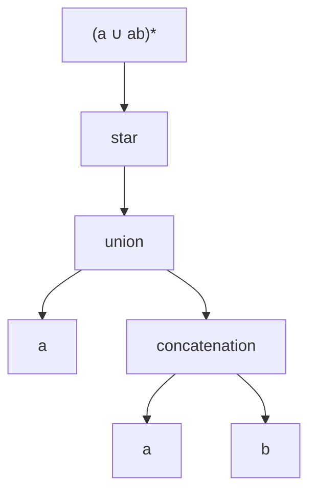

# ADS205 · Expresiones regulares y conversión de autómatas

## Estado de generación del vídeo
PENDIENTE: material preparado; no se ha generado ni revisado ningún vídeo nuevo.

## Instrucciones
Explica la unidad en español siguiendo únicamente este material. Cita las fuentes y distingue práctica complementaria, respuestas suministradas y comentarios locales. Conserva fórmulas, identificadores, discrepancias y límites de evidencia. No inventes contenido, requisitos, resultados, dominio del estudiante ni predicciones de examen.

## Fuentes originales
- Lecture 3 Regular Expression and Pumping Lemma.pdf (original en inglés) · SHA-256 9c83e333cfe8d2d6f17c14eadafe6e568f6aa824ed7e369e1076ae0ba6b56d0f
- Tutorial 3 - Regular Expressions and Pumping Lemma — current supplied version.pdf (original en inglés) · SHA-256 ca88463a37538efa75190c9d9d0977c1da7f6b400ae60d17bfd78b739af1a019
- Lecture 3 Regular Expression and Pumping Lemma — current supplied version.pdf (original en inglés) · SHA-256 28376bbeceea407fab2c07f29fb2dda439accd9549e5b192215be3944e501cd0

## Edición española derivada
El hash indicado para cada documento identifica la fuente inglesa; el contenido mostrado es la traducción española. Los originales se conservan en la biblioteca.

### content/reviewed/ADS205/03/tutor.md
Hash de fuente inglesa: 2f550f447c6ece37e78b9ada885e7ed4b2b0e7cdc6a6ed8754a889298c4aa397

---
title: "Regular Expressions and Automata Conversion · Tutor Notes"
course: ADS205
type: tutor-notes
status: reviewed
study_status: untested
language: en
cssclasses:
  - university-study
---

# Expresiones regulares y conversión de autómatas

[[10_UNIVERSITY_CS/ADS205/Tutor Mode/00 Start Here|Tutor comienza aquí]] · [[10_UNIVERSITY_CS/ADS205/Tutor Mode/Unit 03 - Regular Expressions and Automata Conversion/02 Recall and Exam Practice|Recuerdo y práctica]] · [[10_UNIVERSITY_CS/ADS205/Unit 03 - Regular Expressions and Automata Conversion/01 Notes|Referencia ordinaria]]

## En 60 segundos

Una expresión regular es una sintaxis finita que denota un lenguaje, no una única cadena de entrada. Las lenguajes atómicas se combinan por unión, concatenación y estrella. Esas mismas operaciones construyen un NFA a partir de una expresión. A la inversa, una NFA generalizada etiqueta los bordes con expresiones y elimina estados preservando cada lenguaje de ruta. Después del estudio, debería poder interpretar los paréntesis con precisión, diseñar expresiones a partir de condiciones del lenguaje, crear una NFA de forma recursiva y aplicar la actualización de eliminación de estado sin perder rutas directas.[^l3]

## Vista previa del concepto

> [!note] **Concepto — Semántica recursiva**
> **Significado en lenguaje sencillo:** Cada nodo de expresión regular denota un lenguaje; Los nodos principales combinan los lenguajes secundarios mediante una operación regular.
> **Por qué es importante:** Los paréntesis y el alcance de la operación determinan qué cadenas existen.
> **Se conecta a:** árboles de sintaxis y composición NFA.
> **Fuente:** Conferencia 3, PDF, páginas 4–9.

> [!note] **Concepto — Construcción de expresión a NFA**
> **Significado en lenguaje sencillo:** Construya máquinas atómicas y luego compóngalas con aristas épsilon para unión, concatenación y estrella.
> **Por qué es importante:** Demuestra que cada lenguaje de expresiones regulares es regular.
> **Se conecta a:** Unidad 02 construcciones de cierre.
> **Fuente:** Conferencia 3, PDF, páginas 6–9.

> [!note] **Concepto — NFA generalizado**
> **Significado en lenguaje sencillo:** Un solo borde puede consumir cualquier palabra indicada por su etiqueta de expresión regular.
> **Por qué es importante:** Se pueden comprimir familias de rutas completas mientras se eliminan los estados.
> **Se conecta a:** eliminación estatal.
> **Fuente:** Conferencia 3, PDF, páginas 11–17.

> [!note] **Concepto: actualización directa o por derivación**
> **Significado en lenguaje sencillo:** Después de eliminar el estado `k`, conserve la ruta directa y agregue todas las rutas que entran, hacen bucles y salen de `k`.
> **Por qué es importante:** Omitir cualquiera de las alternativas cambia el lenguaje.
> **Se conecta a:** `Rij ∪ Rik(Rkk)*Rkj`.
> **Fuente:** Conferencia 3, PDF, páginas 15–22.

## Instantánea de la evidencia del examen

**Nota de disponibilidad: 12 de octubre de 2026:** estas son observaciones históricas de la muestra parcial inspeccionada previamente, no un corpus actual recién inspeccionado. El PDF original del examen hash no está disponible; no se volvieron a calcular recuentos ni prioridades a partir de capturas no inspeccionadas.

| Tema | Observación positiva | Marcas conocidas | Demanda | Prioridad |
|---|---|---:|---|---|
| Semántica/diseño de expresiones regulares | 2 de 2 administraciones PARCIALES | 2324-A: 3; 2324-B: 12; 2425: 3 | Diagnosticar/construir | MEDIANO — Evidencia LIMITADA |
| Interpretación de NFA a expresiones regulares | 1 de 2 administraciones PARCIALES | 8 en 2324-A | Derivar | MEDIANO — Evidencia LIMITADA |

El corpus tiene cero artículos completos; no se justifica ningún nivel ALTO o marcador rojo. Consulte [[10_UNIVERSITY_CS/ADS205/Tutor Mode/_System/past-paper-intelligence|inteligencia en artículos anteriores]].

## Antes de comenzar

Necesita las operaciones de lenguaje de la Unidad 01 y las construcciones de cierre NFA de la Unidad 02.

> [!question] ¿Cuál es el lenguaje de `∅*`?

> [!success]- Comprueba tu respuesta
> `{ε}`: son posibles cero factores, pero no existe ninguna opción de factor positivo.
> Fuente: Conferencia 3, PDF, páginas 6–7; Tutorial 1, PDF, páginas 3–4.

## Una pregunta motivadora

**Tarea de especificación sintética basada en artículos parciales.** Sobre `{a,b}`, escriba una expresión regular para cadenas con un número impar de `a`. Debe permitir cualquier número de `b` en cualquier lugar, rechazar `ε` y todas las cadenas pares `a`, y aceptar `a`, `ba`, `abbababa` exactamente cuando su recuento de `a` sea impar.

Luego explique cómo su expresión podría compilarse en una NFA y cómo un autómata finito arbitrario podría, en principio, convertirse nuevamente en una expresión.

| Pregunta | Conocimiento necesario |
|---|---|
| ¿Cómo aplicamos la paridad impar? | Un `a` más pares de `a` posteriores |
| ¿Dónde pueden ocurrir los `b`? | Espacios `b*` alrededor de cada `a` |
| ¿Por qué es correcta la expresión? | Argumento de factorización en ambas direcciones |
| ¿Por qué las máquinas son equivalentes? | Construcción recursiva y eliminación de estados |

## Las expresiones denotan lenguajes

Las expresiones atómicas `a`, `ε` y `∅` denotan `{a}`, `{ε}` y `∅`. Si `R,S` son expresiones, entonces `R∪S`, `RS` y `R*` denotan unión de lenguaje, concatenación y estrella. `Σ` se utiliza como abreviatura de la unión finita de sus símbolos.[^l3]

Star se une a su expresión anterior; la concatenación une factores; El sindicato selecciona alternativas. Comparar:

- `(a∪ab)*`: cualquier secuencia finita de bloques `a` o `ab`;
- `a∪ab*`: ya sea la palabra única `a` o `a` seguida de cero o más `b`.

Los separa la palabra `aa`: pertenece al primero pero no al segundo. La palabra `abb` pertenece al segundo pero no al primero. Los paréntesis son semánticos, no decorativos.

**Figura 1: Leer una expresión regular como un árbol de construcción del lenguaje**

**Léelo:** Comience por las hojas, construya `ab`, únalo con `a`, luego aplique estrella a toda la unión.
**Conclusión clave:** Mover un paréntesis cambia la operación raíz y, por lo tanto, el lenguaje.
**Procedencia:** Diagrama Mermaid pedagógico derivada de la Conferencia 3, PDF, páginas 4–9.

> [!warning] Expresión versus entrada
> Lección 3 p.10 llama a `(a∪ab)(a∪ab)` una cadena de entrada. Es una expresión que denota cuatro entradas: `aa`, `aab`, `aba`, `abab`. La distinción es necesaria para el razonamiento de tipo correcto.

## Diseño por bloques y límites.

Para obtener un número impar de `a`, elija un `a` inicial y luego agregue cero o más **pares** de `a`. Permitir `b` arbitrarios antes, entre y después de ellos:

$$R=b^*ab^*(ab^*ab^*)^*.$$

**Por qué cada palabra generada es válida.** El prefijo aporta un `a`; cada grupo repetido aporta dos. El recuento total de `a` es `1+2k`, impar. Todos los demás símbolos consumidos provienen de un espacio `b*`.

**Por qué se genera cada palabra válida.** Tome cualquier palabra con apariciones `2k+1` de `a`. Sus `b` forman un prefijo, espacios entre `a` consecutivos y un sufijo. Asigne el primer `a` al factor de prefijo y empareje los `2k` `a` restantes en orden. Los factores `b*` correspondientes absorben exactamente los huecos. Esto proporciona la factorización requerida.

Las pruebas de límites son parte del argumento: `ε` tiene cero `a` y está excluido; `a` utiliza cada estrella cero veces; Los `b` arbitrarios solos se excluyen porque el `a` requerido está ausente.

## De expresiones a máquinas y viceversa.

Para `∅`, utilice un inicio de no aceptación sin transiciones. Para `ε`, utilice un inicio de aceptación. Para el símbolo `a`, utilice un borde `a` desde el principio hasta el final. Componga recursivamente con las construcciones épsilon de la Unidad 02. La inducción estructural dice que las máquinas atómicas son correctas y cada composición conserva exactamente su funcionamiento del lenguaje, por lo que cada expresión regular tiene un NFA.[^l3] equivalente.

Para la dirección inversa, una etiqueta de borde GNFA es una expresión regular. Normalizar con un nuevo comienzo `s` y una nueva suela final `f`; combine bordes paralelos mediante unión y trate los bordes faltantes como `∅`. Al eliminar el estado interno `k`, actualice cada par restante:

$$R'_{ij}=R_{ij}\cup R_{ik}(R_{kk})^*R_{kj}.$$

El término directo preserva caminos que evitan `k`. El término de omisión ingresa a `k`, repite su ciclo cero o más veces y luego sale. Cada ruta anterior se expande a una alternativa y cada palabra de nueva etiqueta se expande nuevamente a una ruta anterior, por lo que se conserva el lenguaje.[^l3]

**Actualización local trabajada.** Supongamos que `i→j` está etiquetado como `b`, `i→k` es `a`, `k→k` es `b` y `k→j` es `a`. Al eliminar `k` se obtiene `b∪ab*a`. Al escribir solo `ab*a` se pierde la palabra directa `b`.

> [!question] Explícalo tú mismo
> ¿Por qué un bucle `k` ausente contribuye con `ε` en lugar de hacer imposible cada derivación?

> [!success]- Consulta tu explicación
> Su etiqueta es `∅`; `∅*={ε}` representa tomar el bucle cero veces, por lo que la entrada puede conectarse directamente para salir.
> Fuente: Conferencia 3, PDF, páginas 15-17.

### Resultado de eliminación de estado fiel a la fuente

Para la NFA de cuatro estados de la conferencia (Conferencia 2 p.14; Conferencia 3 págs. 14-22), la eliminación de `q3,q1,q2,q0` produce

$$\varepsilon(10^*0)^*(1\cup10^*)=(10^*0)^*(1\cup10^*)=(10^*0)^*10^*.$$

La equivalencia final utiliza `{1}⊆L(10*)`. Acepta `10`, `101` y `10101`, y rechaza `01`, de acuerdo con las trazas directas de NFA.

> [!warning] Corrección de agrupación de fuentes
> Clase 3 p.22 imprime `(10*0)*1 ∪ 10*` sin la agrupación requerida por el gráfico anterior. El gráfico da `(10*0)*(1∪10*)`. La palabra `1010` es aceptada por el gráfico y la expresión agrupada, pero excluida por la desagrupada normalmente analizada.

Diferentes órdenes de eliminación pueden producir diferentes expresiones equivalentes. El método prueba la existencia, no la sintaxis más corta.

## Volver a la pregunta motivadora

Para `R=b*ab*(ab*ab*)*`:

- `ε` se rechaza porque se requiere un `a` explícito.
- `a` acepta con cada `b*` y el par-estrella vacío.
- `ba` acepta con prefijo `b` y sin pares.
- `abbababa` tiene cuatro `a`, por lo que rechaza; ninguna factorización puede cambiar el conteo explícito `1+2k` a cuatro.

La prueba de corrección cubre cada palabra mediante el conteo y los espacios ordenados. Las máquinas atómicas más el cierre compilan la expresión en una NFA. La normalización de GNFA y las repetidas actualizaciones directas o de derivación convierten cualquier autómata finito nuevamente. Junto con la construcción de subconjuntos, DFA, NFA y las expresiones regulares clásicas caracterizan los mismos lenguajes regulares.

## Definiciones y distinciones

| Término A | Término B | Distinción decisiva | Fuente |
|---|---|---|---|
| expresión regular | Palabra | Sintaxis de descripción del lenguaje versus un miembro del alfabeto base `Σ*` | L3 págs.4–10 |
| Borde `∅` | Borde `ε` | Sin recorrido versus recorrido sin consumir nada | L3 págs. 6–7, 11–17 |
| Ruta directa | Ruta de circunvalación | Evita el estado eliminado versus entra/recorre/sale | L3 págs. 15-17 |
| Expresiones equivalentes | Sintaxis idéntica | Mismo lenguaje denotado versus mismo árbol escrito | L3 págs.18–22 |
| Expresión regular clásica | Programación de expresiones regulares | La gramática del curso utiliza sólo unión, concatenación, estrella y átomos | L3 págs.4–6 |

## Revisión

### Comprensión total

Utilice las derivaciones anteriores y la [[10_UNIVERSITY_CS/ADS205/Unit 03 - Regular Expressions and Automata Conversion/01 Notes|referencia ordinaria]] para la conversión completa de la conferencia.

## Revisión de 5 minutos

- Interpretar cada subexpresión como un lenguaje.
- Construir especificaciones a partir de bloques requeridos, casos de paridad y límites.
- Demostrar una expresión regular en ambas direcciones: generado implica propiedad; La propiedad implica factorización.
- Expresión → NFA sigue el árbol de expresión.
- La eliminación de GNFA mantiene rutas directas y agrega rutas `entry(loop)*exit`.
- Entre paréntesis cada unión utilizada como factor de concatenación.

## Recuperación de 60 segundos

átomos · unión · concatenación · estrella · árbol de sintaxis · factorización · GNFA · nuevos puntos finales · directo o bypass · agrupación

[^l3]: `Lecture 3 Regular Expression and Pumping Lemma.pdf`, PDF, páginas 4–24.

## Tutorial actual 3: sufijos, subcadenas y versiones fuente

El actual L3 de 43 páginas agrega un borde fusionado $1\cup10^*$ explícito en la página 22; la eliminación final es la p.23. Las citas históricas anteriores se refieren a la fuente conservada de 42 páginas. La eliminación trabajada requiere todavía la unión de vías directas y de circunvalación; la revisión aclara ese paso en lugar de permitir la omisión de cualquiera de las rutas.

Para el Tutorial 3 P2, pregunte “¿La máquina reconoce un 01 final o simplemente un 01?” Un bucle de prefijo en q0 mantiene vivas las posibles conjeturas; q0→q1 en 0 y q1→q2 en 1 eligen el objetivo; aceptar q2 no tiene salidas. En cambio, una máquina de subcadenas realiza un bucle en su estado final. Para 010, una rama llega brevemente a final después de 01 pero no puede consumir el 0 final, por lo que la máquina de sufijos lo rechaza.

Para P3, q0 significa no 11/no 1 pendiente, q1 significa no 11/1 final, q2 significa 11 visto. Los retornos a q0 consumen 0 o 10; la primera entrada a q2 consume 11. Esto explica $(0\cup10)^*11(0\cup1)^*$ sin adivinar. Eliminar q1 produce esas etiquetas. Fuente: Tutorial 3 actual PDF, páginas 2–3.

[[10_UNIVERSITY_CS/ADS205/Unit 03 - Regular Expressions and Automata Conversion/02 Exercises#T3 P1 — Evidence and expression syntax|P1.1–3]] · [[10_UNIVERSITY_CS/ADS205/Unit 03 - Regular Expressions and Automata Conversion/02 Exercises#T3 P2 — Construct the specified NFA|P2]] · [[10_UNIVERSITY_CS/ADS205/Unit 03 - Regular Expressions and Automata Conversion/02 Exercises#T3 P3 — Convert the given DFA|P3]] enlace declaraciones originales completas y ayuda local. [[10_UNIVERSITY_CS/ADS205/Unit 03 - Regular Expressions and Automata Conversion/03 Lab|El experimento de expresiones regulares opcional]] vincula ambas ediciones de portátiles. Se trata de prácticas del curso, no de pruebas nuevas de la aparición de exámenes.

### content/reviewed/ADS205/03/practice.md
Hash de fuente inglesa: d57ba4282f5417bc9c8e9c124e6758616c0042b575575fca93efd909643438d2

---
title: "Regular Expressions and Automata Conversion · Recall and Exam Practice"
course: ADS205
type: tutor-practice
status: reviewed
study_status: untested
language: en
cssclasses:
  - university-study
---

# Recordar y practicar

[[10_UNIVERSITY_CS/ADS205/Tutor Mode/00 Start Here|Tutor Start Here]] · [[10_UNIVERSITY_CS/ADS205/Tutor Mode/Unit 03 - Regular Expressions and Automata Conversion/01 Tutor Notes|Tutor Notes]] · [[10_UNIVERSITY_CS/ADS205/Unit 03 - Regular Expressions and Automata Conversion/02 Exercises|Ejercicios ordinarios completos]]

Las preguntas PARCIAL INT201 conservan marcas visibles. No hay ningún esquema de marcado disponible; Las soluciones son respuestas didácticas basadas en fuentes.

## Repaso activo atómico

### Tarjeta 01: ¿Qué denota la expresión regular atómica `a`?
> [!success]- Respuesta
> El lenguaje de una sola palabra `{a}`.
>
> Fuente: Conferencia 3, PDF, páginas 4–6.

### Tarjeta 02: ¿Qué denota la expresión regular `ε`?
> [!success]- Respuesta
> El lenguaje `{ε}`, que contiene una cadena vacía.
>
> Fuente: Conferencia 3, PDF, páginas 6–7.

### Tarjeta 03: ¿Qué denota la expresión regular `∅`?
> [!success]- Respuesta
> El lenguaje vacío, que no contiene cadenas.
>
> Fuente: Conferencia 3, PDF, páginas 6–7.

### Tarjeta 04 - ¿Qué expresa la unión de expresiones regulares?
> [!success]- Respuesta
> Una palabra puede provenir de cualquier lenguaje de operando.
>
> Fuente: Conferencia 3, PDF, páginas 4–6.

### Tarjeta 05: ¿Qué requiere la concatenación?
> [!success]- Respuesta
> Una división en una palabra del primer lenguaje seguida de una palabra del segundo lenguaje.
>
> Fuente: Conferencia 3, PDF, páginas 4–6.

### Tarjeta 06: ¿Por qué una expresión regular normalmente no es una palabra de entrada?
> [!success]- Respuesta
> Es una sintaxis que denota un conjunto de palabras del alfabeto base.
>
> Fuente: Conferencia 3, PDF p.10.

### Tarjeta 07: ¿Por qué agregar un nuevo comienzo y un nuevo estado de aceptación única antes de la eliminación del estado GNFA?
> [!success]- Respuesta
> Obtener un inicio sin aristas de entrada y un final sin aristas de salida.
>
> Fuente: Conferencia 3, PDF, páginas 11–17.

### Tarjeta 08: Al eliminar el estado k de GNFA, ¿qué etiqueta reemplaza el borde de i a j y qué significa cada término?
> [!success]- Respuesta
> $R_{ij} \cup R_{ik}(R_{kk})^*R_{kj}$. Mantenga la ruta directa i→j, o ingrese k, recorra su bucle cero o más veces y luego salga a j. Omitir el término directo puede perder palabras aceptadas.
>
> Fuente: Conferencia 3, PDF, páginas 15-17.

### Tarjeta 09: ¿Qué significa una arista GNFA ausente?
> [!success]- Respuesta
> Su etiqueta es `∅`, no permitiendo recorrido.
>
> Fuente: Conferencia 3, PDF, páginas 11–17.

### Tarjeta 10 — ¿El orden de eliminación cambia el lenguaje?
> [!success]- Respuesta
> No, pero puede cambiar la sintaxis y el tamaño de la expresión.
>
> Fuente: Conferencia 3, PDF, páginas 18–22.

## Práctica progresiva

### Práctica 1: Analizar antes de simplificar

**PRÁCTICA COMPLEMENTARIA.** Indique una palabra en `(a∪ab)*` pero no en `a∪ab*`, y una en `a∪ab*` pero no en `(a∪ab)*`. Justifica por factorización.

> [!tip]- Sugerencia
> Compara qué expresión puede repetir un bloque completo y cuál puede repetir solo su símbolo final. Busque una palabra corta cuya factorización no pueda cubrir una expresión.

> [!success]- Solución
> `aa=a·a` pertenece a `(a∪ab)*`, pero `a∪ab*` solo proporciona `a` o `a` seguido exclusivamente de `b`, por lo que no `aa`. `abb` pertenece a `ab*`; no se puede incluir en los bloques `a` y `ab` porque el último `b` queda descubierto.
>
> Fuente: Aplicación sintética de la Conferencia 3, PDF, páginas 4–9.

### Práctica 2: diagnosticar una ruta faltante

**PRÁCTICA COMPLEMENTARIA.** Durante la eliminación, `i→j` es `0`, `i→k` es `1`, `k→k` es `0∪1` y `k→j` es `1`. Un estudiante escribe sólo `1(0∪1)*1`. Corrige la etiqueta y da una palabra perdida.

> [!tip]- Sugerencia
> Preservar caminos que nunca visitan `k`.

> [!success]- Solución
> La etiqueta correcta es `0 ∪ 1(0∪1)*1`. La expresión del estudiante pierde la palabra `0`, que sigue el borde directo. El término de omisión cubre precisamente las rutas que ingresan a `k` en `1`, hacen un bucle en cualquier cadena binaria y luego salen en `1`.
>
> Fuente: Aplicación sintética de la Conferencia 3, PDF, páginas 15-17.

> [!warning] RELEVANCIA DEL EXAMEN MEDIO
> La interpretación/diseño de expresiones regulares se observó positivamente en ambas administraciones PARCIALES. Esto no es una predicción y no justifica una etiqueta ALTA.

### Práctica de evaluación 1: Declaración de ceros impares

**EJERCICIO DEL CURSO ORIGINAL.** `ADS205-EXAMS.pdf`, PDF p.1 Q1(d), `INT201/23-24/S1` variante A, **3 puntos**: determine si `(01*0 ∪ 1)*0` genera exactamente cadenas binarias con un número impar de `0`.

> [!tip]- Sugerencia
> Cuente los ceros aportados por los bloques repetidos, luego verifique si la expresión fuerza una condición adicional en el último símbolo que el lenguaje de destino no requiere.

> [!success]- Solución
> **Falso.** Cada bloque repetido es `01*0`, que aporta dos ceros, o `1`, que no aporta ninguno. El `0` final aporta uno, por lo que cada palabra generada tiene un número impar de ceros. Sin embargo, cada palabra generada también termina en `0`. La palabra `01` tiene un cero y por lo tanto pertenece al lenguaje de destino indicado, pero no puede coincidir con la expresión. La expresión denota sólo un subconjunto adecuado del lenguaje de ceros impares.

### Práctica de evaluación 2: tres tareas de lenguaje a expresión regular

**EJERCICIO DEL CURSO ORIGINAL.** `ADS205-EXAMS.pdf`, PDF p.7 Q3(a–c), `INT201/23-24/S1` variante B, **4 puntos cada uno**, sobre `{a,b}`: proporcione expresiones regulares para (a) un número impar de `a`; (b) cadenas que terminan en `aa` o `bb`; (c) cadenas que no terminan en `aa` o `bb`.

> [!tip]- Sugerencia
> Para (c), separe las cadenas de longitud inferior a dos de las cadenas cuyos dos últimos símbolos difieren.

> [!success]- Solución
> Dejar `Σ=(a∪b)`.
>
> **(a)** `b*ab*(ab*ab*)*`. Contribuye con las apariciones de `1+2k` de `a` y absorbe cada espacio de `b`.
>
> **(b)** `Σ*(aa∪bb)`. El prefijo arbitrario va seguido del sufijo de símbolo igual requerido.
>
> **(c)** `ε ∪ a ∪ b ∪ Σ*(ab∪ba)`. Las cadenas de longitud cero/uno no pueden terminar en una letra doble; cada palabra más larga que no termina en uno tiene últimos símbolos desiguales y viceversa.
>
> Cada expresión incluye tanto casos límite como una interpretación bidireccional. No se proporcionó ningún esquema de calificación oficial.

### Práctica de evaluación 3: leer dos NFA como expresiones regulares

**EJERCICIO DEL CURSO ORIGINAL.** `ADS205-EXAMS.pdf`, PDF págs.2–3 Q3(a,b), `INT201/23-24/S1` variante A, **4 puntos cada uno**: proporcione expresiones regulares para dos NFA. Las listas de transición a continuación se reconstruyen a partir de la explicación elaborada con referencia a fuentes existentes; El diagrama del examen original no está incluido en este paquete web. Cualquier transición que no esté incluida en la lista está ausente en estos modelos reconstruidos.

- **NFA (a):** inicio 1, aceptando estado 2. Transiciones: `1 --a→ 2`, `1 --b→ 3`, `3 --a,b→ 3`, `3 --a→ 2`, `2 --b→ 2`. Se permiten las dos opciones `a` del estado 3.
- **NFA (b):** inicio 1, aceptando estado 4. Transiciones: `1 --b→ 3`, `1 --a→ 2`, `2 --a→ 3`, `3 --a→ 3`, `3 --b→ 4`, `4 --b→ 4`.

> [!tip]- Sugerencia
> Describir todas las rutas desde el principio hasta el final, incluidos los bucles antes o después de la transición decisiva.

> [!success]- Solución
> **(a)** Desde el estado inicial 1, lleve `a` directamente al estado de aceptación 2 y realice un bucle en `b`, o lleve `b` al estado 3, realice un bucle allí en `a` o `b`, luego lleve `a` al estado 2 y continúe `b`. Una expresión regular es `ab* ∪ b(a∪b)*ab*`.
>
> **(b)** Alcanzar el estado 3 ya sea por `b` o por `aa`; realice un bucle allí en `a`, luego lleve `b` al estado de aceptación 4 y realice un bucle en `b`. Una expresión regular es `(b∪aa)a*bb*`.
>
> La descomposición de ruta directa demuestra que cada palabra generada sigue una ruta de aceptación y cada ruta de aceptación tiene una de estas formas.

### Práctica de evaluación 4: contraejemplo de límites

**EJERCICIO ORIGINAL DEL CURSO.** `ADS205-EXAMS.pdf`, PDF p.10 P1(b), `INT201/2024/25/S1`, **3 puntos**: decida si `0(0∪1)*0` denota todas las cadenas binarias que comienzan y terminan con `0`.

> [!tip]- Sugerencia
> Pruebe la cadena más corta que comience y termine con cero.

> [!success]- Solución
> **Falso.** La palabra de un símbolo `0` comienza y termina con `0`, pero la expresión requiere dos ceros explícitos y, por lo tanto, tiene una longitud mínima de dos. La expresión denota exactamente cadenas binarias de al menos dos longitudes que comienzan y terminan en cero. Una expresión corregida es `0 ∪ 0(0∪1)*0`.

### Práctica 7: Elección de conversión de transferencia

**PRÁCTICA COMPLEMENTARIA.** Explique por qué no simplificar un resultado grande de eliminación de estados no demuestra que el lenguaje no sea regular.

> [!tip]- Sugerencia
> Separar la existencia de una expresión equivalente de su legibilidad o minimalidad.

> [!success]- Solución
> Cada eliminación correcta preserva el lenguaje y eventualmente produce alguna expresión regular. Diferentes órdenes pueden producir una sintaxis difícil de manejar pero equivalente. La dificultad humana para simplificar un resultado no es evidencia contra la existencia. La no regularidad necesita una prueba como una contradicción del lema de bombeo, no un álgebra fallida.
>
> Fuente: Conferencia 3, PDF, páginas 18–24.

## Navegación del ejercicio original

Las nueve asignaciones de tareas fuente de la Unidad 03 permanecen completamente resueltas en la edición ordinaria:

- [[10_UNIVERSITY_CS/ADS205/Unit 03 - Regular Expressions and Automata Conversion/02 Exercises#L3 conversion — Build the lecture regex machine|Regex→Construcción NFA]]
- [[10_UNIVERSITY_CS/ADS205/Unit 03 - Regular Expressions and Automata Conversion/02 Exercises#L3 expression input — Interpret a language-valued input|Expresión versus entrada]]
- [[10_UNIVERSITY_CS/ADS205/Unit 03 - Regular Expressions and Automata Conversion/02 Exercises#L3 elimination — Eliminate the lecture states|Eliminación completa del estado de conferencia]]
- [[10_UNIVERSITY_CS/ADS205/Unit 03 - Regular Expressions and Automata Conversion/02 Exercises#Practice — Diagnose a missing direct route|Diagnóstico de ruta faltante]]

## Navegación del Tutorial 3 actual

Estas entradas navegan a preguntas originales con sugerencias adyacentes y soluciones completas; no son preguntas extra planteadas.

- [[10_UNIVERSITY_CS/ADS205/Unit 03 - Regular Expressions and Automata Conversion/02 Exercises#T3 P1 — Evidence and expression syntax|P1.1–3: justificar sintaxis y evidencia]]
- [[10_UNIVERSITY_CS/ADS205/Unit 03 - Regular Expressions and Automata Conversion/02 Exercises#T3 P2 — Construct the specified NFA|P2: sufijo NFA y significados de estados]]
- [[10_UNIVERSITY_CS/ADS205/Unit 03 - Regular Expressions and Automata Conversion/02 Exercises#T3 P3 — Convert the given DFA|P3.1–3: lenguaje, conversión y sintaxis equivalente]]
- [[10_UNIVERSITY_CS/ADS205/Unit 03 - Regular Expressions and Automata Conversion/03 Lab|Experimento de expresiones regulares originales opcionales]]

### Problema: una extensión de un solo símbolo

**PRÁCTICA COMPLEMENTARIA**, basada en T3 P2. Sobre {0,1}, la NFA comienza q0, acepta q2 y transiciones q0 en 0 → {q0,q1}, q0 en 1 → {q0}, q1 en 1 → {q2}; todas las demás transiciones están ausentes. Reconoce cadenas que terminan en 01 y no tiene salidas desde q2. Agregue bucles en 0 y 1 en q2, dejando todas las demás transiciones sin cambios. Explique el nuevo lenguaje y dé una palabra que separe las máquinas antiguas y nuevas.

> [!tip]- Sugerencia
> Siga lo que puede leer un camino exitoso después de completar el 01 elegido.

> [!success]- Solución
> El nuevo lenguaje es $(0\cup1)^*01(0\cup1)^*$: cualquier prefijo, el 01 elegido, luego cualquier sufijo. La palabra 010 es rechazada por el sufijo NFA original pero aceptada por la máquina modificada. Los nuevos bucles finales conservan una subcadena ya encontrada; Las antiguas salidas faltantes requieren que la coincidencia termine en el límite de entrada. Se trata de un cambio de especificación, no de una simplificación que preserve la equivalencia.

## Recuperación atómica adicional del Tutorial 3

### Tarjeta 11: en la NFA de tres estados para cadenas binarias que terminan en 01, ¿qué propiedad de aceptar q2 requiere que la coincidencia termine en el extremo de entrada?

> [!success]- Respuesta
> El estado de aceptación no tiene transiciones salientes, por lo que una ruta exitosa no puede consumir un sufijo posterior.
>
> Fuente: Tutorial 3 PDF p.2, P2.

### Tarjeta 12: ¿Por qué las órdenes de eliminación pueden generar expresiones regulares de apariencia diferente?

> [!success]- Respuesta
> Crean una sintaxis intermedia diferente conservando el mismo lenguaje reconocido.
>
> Fuente: Tutorial 3 PDF págs.2–3, P3.3.
