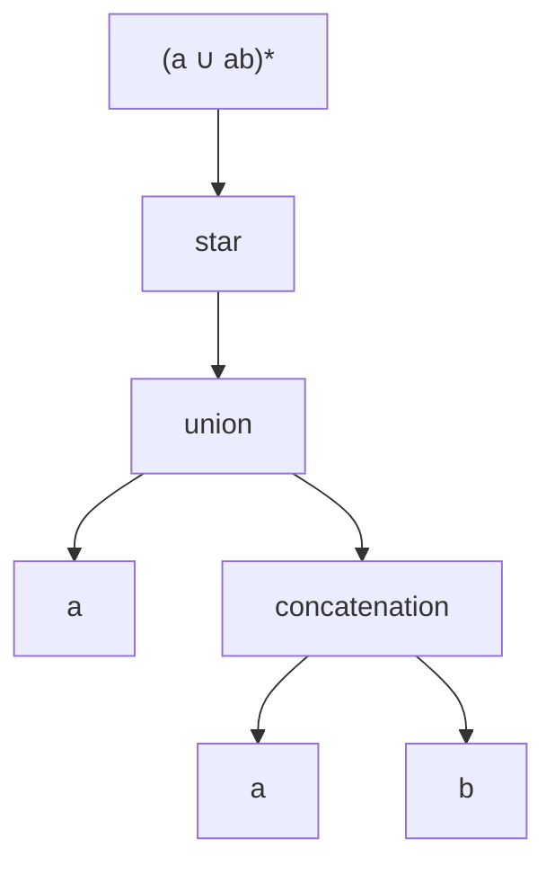

# ADS205 · Regular Expressions and Automata Conversion

## Video generation status
PENDING: source pack prepared; no cloud video has been generated or reviewed.

## Spanish video overview prompt
Explica esta unidad en español claro, paso a paso, para alguien que aprende de forma autodidacta. Usa únicamente el material incluido. Comienza con el problema motivador, presenta los conceptos, muestra un ejemplo visual fiel a las convenciones del curso, pausa para una pregunta y después explica la respuesta. Distingue práctica suplementaria de tareas oficiales y de soluciones oficiales. No inventes datos, fuentes, requisitos, capítulos pendientes, resultados de ejecución ni predicciones de examen. Conserva los límites y discrepancias indicados. Cierra con una actividad que el estudiante pueda intentar en Learning Uni. Cita el nombre del documento y su localizador cuando corresponda. Si falta evidencia, dilo; no rellenes el hueco. Mantén visibles las fórmulas y direcciones de flechas.

## Verified original file snapshots
- Lecture 3 Regular Expression and Pumping Lemma.pdf · SHA-256 9c83e333cfe8d2d6f17c14eadafe6e568f6aa824ed7e369e1076ae0ba6b56d0f
- Tutorial 3 - Regular Expressions and Pumping Lemma — current supplied version.pdf · SHA-256 ca88463a37538efa75190c9d9d0977c1da7f6b400ae60d17bfd78b739af1a019
- Lecture 3 Regular Expression and Pumping Lemma — current supplied version.pdf · SHA-256 28376bbeceea407fab2c07f29fb2dda439accd9549e5b192215be3944e501cd0

## Source material

### Snapshot: content/reviewed/ADS205/03/tutor.md
SHA-256: 0d327fc7fc040fc099381a123d3ac07fc2fbb786fb572f08916dc293cfdec41a

---
title: "Regular Expressions and Automata Conversion · Tutor Notes"
course: ADS205
type: tutor-notes
status: reviewed
study_status: untested
language: en
cssclasses:
  - university-study
---

# Regular Expressions and Automata Conversion

[[10_UNIVERSITY_CS/ADS205/Tutor Mode/00 Start Here|Tutor Start Here]] · [[10_UNIVERSITY_CS/ADS205/Tutor Mode/Unit 03 - Regular Expressions and Automata Conversion/02 Recall and Exam Practice|Recall and Practice]] · [[10_UNIVERSITY_CS/ADS205/Unit 03 - Regular Expressions and Automata Conversion/01 Notes|Ordinary reference]]

## In 60 Seconds

A regular expression is finite syntax denoting a language, not a single input string. Atomic languages are combined by union, concatenation and star. Those same operations build an NFA from an expression. In reverse, a generalized NFA labels edges with expressions and removes states while preserving every path language. After study, you should be able to interpret parentheses precisely, design expressions from language conditions, build an NFA recursively, and apply the state-elimination update without losing direct routes.[^l3]

## Concept Preview

> [!note] **Concept — Recursive semantics**
> **Plain-language meaning:** Every regex node denotes a language; parent nodes combine child languages by one regular operation.
> **Why it matters:** Parentheses and operation scope determine which strings exist.
> **Connects to:** syntax trees and NFA composition.
> **Source:** Lecture 3, PDF pp.4–9.

> [!note] **Concept — Expression-to-NFA construction**
> **Plain-language meaning:** Build atomic machines, then compose them with epsilon edges for union, concatenation and star.
> **Why it matters:** It proves every regex language is regular.
> **Connects to:** Unit 02 closure constructions.
> **Source:** Lecture 3, PDF pp.6–9.

> [!note] **Concept — Generalized NFA**
> **Plain-language meaning:** A single edge can consume any word denoted by its regex label.
> **Why it matters:** Whole path families can be compressed while states are removed.
> **Connects to:** state elimination.
> **Source:** Lecture 3, PDF pp.11–17.

> [!note] **Concept — Direct-or-bypass update**
> **Plain-language meaning:** After removing state `k`, preserve the direct route and add every route entering, looping at, and leaving `k`.
> **Why it matters:** Omitting either alternative changes the language.
> **Connects to:** `Rij ∪ Rik(Rkk)*Rkj`.
> **Source:** Lecture 3, PDF pp.15–22.

## Exam Evidence Snapshot

| Topic | Positive observation | Known marks | Demand | Priority |
|---|---|---:|---|---|
| Regex semantics/design | 2 of 2 PARTIAL administrations | 2324-A: 3; 2324-B: 12; 2425: 3 | Diagnose/construct | MEDIUM — LIMITED evidence |
| NFA-to-regex interpretation | 1 of 2 PARTIAL administrations | 8 in 2324-A | Derive | MEDIUM — LIMITED evidence |

The corpus has zero complete papers; no HIGH tier or red marker is justified. See [[10_UNIVERSITY_CS/ADS205/Tutor Mode/_System/past-paper-intelligence|past-paper intelligence]].

## Before You Start

You need Unit 01's language operations and Unit 02's NFA closure constructions.

> [!question] What is the language of `∅*`?

> [!success]- Check your answer
> `{ε}`: zero factors are possible, but no positive-factor choice exists.
> Source: Lecture 3, PDF pp.6–7; Tutorial 1, PDF pp.3–4.

## A motivating question

**Synthetic specification task based on the partial papers.** Over `{a,b}`, write a regular expression for strings with an odd number of `a`s. It must allow any number of `b`s anywhere, reject `ε` and all even-`a` strings, and accept `a`, `ba`, `abbababa` exactly when their `a` count is odd.

Then explain how your expression could be compiled to an NFA and how an arbitrary finite automaton could, in principle, be converted back to an expression.

| Question | Knowledge needed |
|---|---|
| How do we enforce odd parity? | One `a` plus pairs of later `a`s |
| Where can `b`s occur? | `b*` gaps around every `a` |
| Why is the expression correct? | Both-direction factorization argument |
| Why are machines equivalent? | Recursive construction and state elimination |

## Expressions denote languages

Atomic expressions `a`, `ε`, and `∅` denote `{a}`, `{ε}`, and `∅`. If `R,S` are expressions, then `R∪S`, `RS`, and `R*` denote language union, concatenation, and star. `Σ` is used as shorthand for the finite union of its symbols.[^l3]

Star binds to its preceding expression; concatenation joins factors; union selects alternatives. Compare:

- `(a∪ab)*`: any finite sequence of blocks `a` or `ab`;
- `a∪ab*`: either the single word `a`, or `a` followed by zero or more `b`s.

The word `aa` separates them: it belongs to the first but not the second. The word `abb` belongs to the second but not the first. Parentheses are semantic, not decorative.

**Figure 1 — Read a regex as a language-construction tree**

**Read it:** Start at the leaves, build `ab`, union it with `a`, then apply star to the entire union.
**Key takeaway:** Moving one parenthesis changes the root operation and therefore the language.
**Provenance:** Pedagogical Mermaid derived from Lecture 3, PDF pp.4–9.

> [!warning] Expression versus input
> Lecture 3 p.10 calls `(a∪ab)(a∪ab)` an input string. It is an expression denoting four inputs: `aa`, `aab`, `aba`, `abab`. The distinction is necessary for type-correct reasoning.

## Design by blocks and boundaries

To obtain an odd number of `a`s, choose one initial `a`, then add zero or more **pairs** of `a`s. Allow arbitrary `b`s before, between and after them:

$$R=b^*ab^*(ab^*ab^*)^*.$$

**Why every generated word is valid.** The prefix contributes one `a`; every repeated group contributes two. Total `a` count is `1+2k`, odd. Every other consumed symbol comes from a `b*` gap.

**Why every valid word is generated.** Take any word with `2k+1` occurrences of `a`. Its `b`s form a prefix, gaps between consecutive `a`s, and a suffix. Assign the first `a` to the prefix factor and pair the remaining `2k` `a`s in order. The corresponding `b*` factors absorb exactly the gaps. This provides the required factorization.

Boundary tests are part of the argument: `ε` has zero `a`s and is excluded; `a` uses every star zero times; arbitrary `b`s alone are excluded because the required `a` is absent.

## From expressions to machines and back

For `∅`, use a nonaccepting start with no transitions. For `ε`, use an accepting start. For symbol `a`, use one `a` edge from start to final. Compose recursively with Unit 02's epsilon constructions. Structural induction says the atomic machines are correct and each composition preserves exactly its language operation, so every regex has an equivalent NFA.[^l3]

For the reverse direction, a GNFA edge label is a regex. Normalize with a fresh start `s` and fresh sole final `f`; combine parallel edges by union and treat missing edges as `∅`. When removing internal state `k`, update every remaining pair:

$$R'_{ij}=R_{ij}\cup R_{ik}(R_{kk})^*R_{kj}.$$

The direct term preserves paths avoiding `k`. The bypass term enters `k`, repeats its loop zero or more times, then exits. Every old path expands to one alternative, and every new-label word expands back to an old path, so the language is preserved.[^l3]

**Worked local update.** Suppose `i→j` is labelled `b`, `i→k` is `a`, `k→k` is `b`, and `k→j` is `a`. Removing `k` gives `b∪ab*a`. Writing only `ab*a` loses the direct word `b`.

> [!question] Explain it yourself
> Why does an absent `k`-loop contribute `ε` rather than making every bypass impossible?

> [!success]- Check your explanation
> Its label is `∅`; `∅*={ε}` represents taking the loop zero times, so entry can connect directly to exit.
> Source: Lecture 3, PDF pp.15–17.

### Source-faithful state-elimination result

For the lecture's four-state NFA (Lecture 2 p.14; Lecture 3 pp.14–22), eliminating `q3,q1,q2,q0` yields

$$\varepsilon(10^*0)^*(1\cup10^*)=(10^*0)^*(1\cup10^*)=(10^*0)^*10^*.$$

The final equivalence uses `{1}⊆L(10*)`. It accepts `10`, `101`, and `10101`, and rejects `01`, agreeing with direct NFA traces.

> [!warning] Source grouping correction
> Lecture 3 p.22 prints `(10*0)*1 ∪ 10*` without the grouping required by the preceding graph. The graph gives `(10*0)*(1∪10*)`. The word `1010` is accepted by the graph and grouped expression but excluded by the ordinarily parsed ungrouped one.

Different elimination orders may produce different equivalent expressions. The method proves existence, not shortest syntax.

## Return to the motivating question

For `R=b*ab*(ab*ab*)*`:

- `ε` rejects because one explicit `a` is required.
- `a` accepts with every `b*` and the pair-star empty.
- `ba` accepts with prefix `b` and no pairs.
- `abbababa` has four `a`s, so it rejects; no factorization can change the explicit count `1+2k` into four.

The correctness proof covers every word through counting and ordered gaps. Atomic machines plus closure compile the expression to an NFA. GNFA normalization and repeated direct-or-bypass updates convert any finite automaton back. Together with subset construction, DFA, NFA and classical regexes characterize the same regular languages.

## Definitions and distinctions

| Term A | Term B | Decisive distinction | Source |
|---|---|---|---|
| Regex | Word | Language description syntax versus a member of the base alphabet's `Σ*` | L3 pp.4–10 |
| `∅` edge | `ε` edge | No traversal versus traversal consuming nothing | L3 pp.6–7, 11–17 |
| Direct route | Bypass route | Avoids removed state versus enters/loops/exits it | L3 pp.15–17 |
| Equivalent expressions | Identical syntax | Same denoted language versus same written tree | L3 pp.18–22 |
| Classical regex | Programming regex | Course grammar uses only union, concatenation, star and atoms | L3 pp.4–6 |

## Review

### Full Understanding

Use the derivations above and the [[10_UNIVERSITY_CS/ADS205/Unit 03 - Regular Expressions and Automata Conversion/01 Notes|ordinary reference]] for the complete lecture conversion.

## 5-Minute Review

- Interpret every subexpression as a language.
- Build specifications from required blocks, parity and boundary cases.
- Prove a regex in both directions: generated implies property; property implies factorization.
- Expression→NFA follows the expression tree.
- GNFA elimination keeps direct routes and adds `entry(loop)*exit` routes.
- Parenthesize every union used as a concatenation factor.

## 60-Second Recall

atoms · union · concatenation · star · syntax tree · factorization · GNFA · fresh endpoints · direct-or-bypass · grouping

[^l3]: `Lecture 3 Regular Expression and Pumping Lemma.pdf`, PDF pp.4–24.

## Current Tutorial 3 — Suffixes, substrings and source versions

The current 43-page L3 adds an explicit $1\cup10^*$ merged edge on p.22; final elimination is p.23. Historical citations above refer to the preserved 42-page source. The worked elimination still requires union of direct and bypass routes; the revision makes that step clearer rather than allowing omission of either route.

For Tutorial 3 P2, ask “Does the machine recognize a final 01 or merely some 01?” A prefix loop at q0 keeps possible guesses alive; q0→q1 on 0 and q1→q2 on 1 choose the target; accepting q2 has no exits. A substring machine instead loops at its final state. For 010, a branch briefly reaches final after 01 but cannot consume the trailing 0, so the suffix machine rejects.

For P3, q0 means no 11/no pending 1, q1 means no 11/trailing 1, q2 means 11 seen. Returns to q0 consume 0 or 10; first entry to q2 consumes 11. This explains $(0\cup10)^*11(0\cup1)^*$ without guessing. Removing q1 produces those labels. Source: current Tutorial 3 PDF pp.2–3.

[[10_UNIVERSITY_CS/ADS205/Unit 03 - Regular Expressions and Automata Conversion/02 Exercises#T3 P1 — Evidence and expression syntax|P1.1–3]] · [[10_UNIVERSITY_CS/ADS205/Unit 03 - Regular Expressions and Automata Conversion/02 Exercises#T3 P2 — Construct the specified NFA|P2]] · [[10_UNIVERSITY_CS/ADS205/Unit 03 - Regular Expressions and Automata Conversion/02 Exercises#T3 P3 — Convert the given DFA|P3]] link complete original statements and local help. [[10_UNIVERSITY_CS/ADS205/Unit 03 - Regular Expressions and Automata Conversion/03 Lab|The optional regex experiment]] links both notebook editions. These are course practice, not new exam-occurrence evidence.

### Snapshot: content/reviewed/ADS205/03/practice.md
SHA-256: 4bbd0ba8e28dd7a7ad84e1c88d69bcd2c8b33d36c49e70dd1d408d328cba2c46

---
title: "Regular Expressions and Automata Conversion · Recall and Exam Practice"
course: ADS205
type: tutor-practice
status: reviewed
study_status: untested
language: en
cssclasses:
  - university-study
---

# Recall and Practice

[[10_UNIVERSITY_CS/ADS205/Tutor Mode/00 Start Here|Tutor Start Here]] · [[10_UNIVERSITY_CS/ADS205/Tutor Mode/Unit 03 - Regular Expressions and Automata Conversion/01 Tutor Notes|Tutor Notes]] · [[10_UNIVERSITY_CS/ADS205/Unit 03 - Regular Expressions and Automata Conversion/02 Exercises|Complete ordinary exercises]]

PARTIAL INT201 questions retain visible marks. No marking scheme is available; solutions are source-grounded teaching answers.

## Atomic Recall

### Card 01 — What does atomic regex `a` denote?
> [!success]- Answer
> The one-word language `{a}`.
>
> Source: Lecture 3, PDF pp.4–6.

### Card 02 — What does regex `ε` denote?
> [!success]- Answer
> The language `{ε}`, containing one empty string.
>
> Source: Lecture 3, PDF pp.6–7.

### Card 03 — What does regex `∅` denote?
> [!success]- Answer
> The empty language, containing no strings.
>
> Source: Lecture 3, PDF pp.6–7.

### Card 04 — What does regex union express?
> [!success]- Answer
> A word may come from either operand language.
>
> Source: Lecture 3, PDF pp.4–6.

### Card 05 — What does concatenation require?
> [!success]- Answer
> A split into a first-language word followed by a second-language word.
>
> Source: Lecture 3, PDF pp.4–6.

### Card 06 — Why is a regex not normally an input word?
> [!success]- Answer
> It is syntax denoting a set of base-alphabet words.
>
> Source: Lecture 3, PDF p.10.

### Card 07 — Why add a fresh start and a fresh sole accepting state before GNFA state elimination?
> [!success]- Answer
> To obtain one start with no incoming and one final with no outgoing edges.
>
> Source: Lecture 3, PDF pp.11–17.

### Card 08 — When eliminating GNFA state k, what label replaces the edge from i to j, and what does each term mean?
> [!success]- Answer
> $R_{ij} \cup R_{ik}(R_{kk})^*R_{kj}$. Keep the direct route i→j, or enter k, traverse its loop zero or more times, then exit to j. Omitting the direct term can lose accepted words.
>
> Source: Lecture 3, PDF pp.15–17.

### Card 09 — What does an absent GNFA edge mean?
> [!success]- Answer
> Its label is `∅`, permitting no traversal.
>
> Source: Lecture 3, PDF pp.11–17.

### Card 10 — Does elimination order change the language?
> [!success]- Answer
> No, but it can change expression syntax and size.
>
> Source: Lecture 3, PDF pp.18–22.

## Progressive Practice

### Practice 1 — Parse before simplifying

**SUPPLEMENTARY PRACTICE.** Give one word in `(a∪ab)*` but not `a∪ab*`, and one in `a∪ab*` but not `(a∪ab)*`. Justify by factorization.

> [!tip]- Hint
> Compare which expression can repeat an entire block and which can repeat only its final symbol. Search for a short word whose factorization one expression cannot cover.

> [!success]- Solution
> `aa=a·a` belongs to `(a∪ab)*`, but `a∪ab*` gives only `a` or `a` followed exclusively by `b`s, so not `aa`. `abb` belongs to `ab*`; it cannot be factored into `a` and `ab` blocks because the final `b` is left uncovered.
>
> Source: Synthetic application of Lecture 3, PDF pp.4–9.

### Practice 2 — Diagnose a missing route

**SUPPLEMENTARY PRACTICE.** During elimination, `i→j` is `0`, `i→k` is `1`, `k→k` is `0∪1`, and `k→j` is `1`. A student writes only `1(0∪1)*1`. Correct the label and give a lost word.

> [!tip]- Hint
> Preserve paths that never visit `k`.

> [!success]- Solution
> The correct label is `0 ∪ 1(0∪1)*1`. The student's expression loses word `0`, which follows the direct edge. The bypass term covers precisely paths entering `k` on `1`, looping on any binary string, then exiting on `1`.
>
> Source: Synthetic application of Lecture 3, PDF pp.15–17.

> [!warning] MEDIUM EXAM RELEVANCE
> Regex interpretation/design was positively observed in both PARTIAL administrations. This is not a prediction and does not justify a HIGH label.

### Assessment Practice 1 — Odd zeros statement

**ORIGINAL COURSE EXERCISE.** `ADS205-EXAMS.pdf`, PDF p.1 Q1(d), `INT201/23-24/S1` variant A, **3 marks**: determine whether `(01*0 ∪ 1)*0` generates exactly binary strings with an odd number of `0`s.

> [!tip]- Hint
> Count zeros contributed by the repeated blocks, then check whether the expression forces an extra condition on the last symbol that the target language does not require.

> [!success]- Solution
> **False.** Each repeated block is either `01*0`, contributing two zeros, or `1`, contributing none. The final `0` contributes one, so every generated word does have an odd number of zeros. However, every generated word also ends in `0`. The word `01` has one zero and therefore belongs to the stated target language, but it cannot match the expression. The expression denotes only a proper subset of the odd-zero language.

### Assessment Practice 2 — Three language-to-regex tasks

**ORIGINAL COURSE EXERCISE.** `ADS205-EXAMS.pdf`, PDF p.7 Q3(a–c), `INT201/23-24/S1` variant B, **4 marks each**, over `{a,b}`: give regexes for (a) odd number of `a`s; (b) strings ending in `aa` or `bb`; (c) strings not ending in `aa` or `bb`.

> [!tip]- Hint
> For (c), separate strings of length below two from strings whose last two symbols differ.

> [!success]- Solution
> Let `Σ=(a∪b)`.
>
> **(a)** `b*ab*(ab*ab*)*`. It contributes `1+2k` occurrences of `a` and absorbs every `b` gap.
>
> **(b)** `Σ*(aa∪bb)`. The arbitrary prefix is followed by the required equal-symbol suffix.
>
> **(c)** `ε ∪ a ∪ b ∪ Σ*(ab∪ba)`. Length-zero/one strings cannot end in a double letter; every longer word not ending in one has unequal last symbols, and vice versa.
>
> Each expression includes both boundary cases and a two-direction interpretation. No official marking scheme was supplied.

### Assessment Practice 3 — Read two NFAs as regexes

**ORIGINAL COURSE EXERCISE.** `ADS205-EXAMS.pdf`, PDF pp.2–3 Q3(a,b), `INT201/23-24/S1` variant A, **4 marks each**: give regexes for two NFAs. The transition lists below are reconstructed from the existing source-referenced worked explanation; the original exam diagram is not included in this web package. Any transition not listed is absent in these reconstructed models.

- **NFA (a):** start 1, accepting state 2. Transitions: `1 --a→ 2`, `1 --b→ 3`, `3 --a,b→ 3`, `3 --a→ 2`, `2 --b→ 2`. The two `a` options from state 3 are both allowed.
- **NFA (b):** start 1, accepting state 4. Transitions: `1 --b→ 3`, `1 --a→ 2`, `2 --a→ 3`, `3 --a→ 3`, `3 --b→ 4`, `4 --b→ 4`.

> [!tip]- Hint
> Describe all routes from start to final, including loops before or after the decisive transition.

> [!success]- Solution
> **(a)** From start state 1, either take `a` directly to accepting state 2 and loop on `b`, or take `b` to state 3, loop there on `a` or `b`, then take `a` to state 2 and loop on `b`. A regex is `ab* ∪ b(a∪b)*ab*`.
>
> **(b)** Reach state 3 either by `b` or by `aa`; loop there on `a`, then take `b` to accepting state 4 and loop on `b`. A regex is `(b∪aa)a*bb*`.
>
> Direct path decomposition proves every generated word follows an accepting route and every accepting route has one of these forms.

### Assessment Practice 4 — Boundary counterexample

**ORIGINAL COURSE EXERCISE.** `ADS205-EXAMS.pdf`, PDF p.10 Q1(b), `INT201/2024/25/S1`, **3 marks**: decide whether `0(0∪1)*0` denotes all binary strings that begin and end with `0`.

> [!tip]- Hint
> Test the shortest string that both begins and ends with zero.

> [!success]- Solution
> **False.** The one-symbol word `0` begins and ends with `0`, but the expression requires two explicit zeros and therefore has minimum length two. The expression denotes exactly length-at-least-two binary strings beginning and ending with zero. A corrected expression is `0 ∪ 0(0∪1)*0`.

### Practice 7 — Transfer conversion choice

**SUPPLEMENTARY PRACTICE.** Explain why failure to simplify a large state-elimination result does not show the language is nonregular.

> [!tip]- Hint
> Separate the existence of an equivalent expression from its readability or minimality.

> [!success]- Solution
> Every correct elimination preserves the language and eventually yields some regex. Different orders may produce unwieldy but equivalent syntax. Human difficulty simplifying one result is not evidence against existence. Nonregularity needs a proof such as a pumping-lemma contradiction, not failed algebra.
>
> Source: Lecture 3, PDF pp.18–24.

## Original Exercise Navigation

All nine Unit 03 source-task mappings remain completely solved in the ordinary edition:

- [[10_UNIVERSITY_CS/ADS205/Unit 03 - Regular Expressions and Automata Conversion/02 Exercises#L3 conversion — Build the lecture regex machine|Regex→NFA construction]]
- [[10_UNIVERSITY_CS/ADS205/Unit 03 - Regular Expressions and Automata Conversion/02 Exercises#L3 expression input — Interpret a language-valued input|Expression versus input]]
- [[10_UNIVERSITY_CS/ADS205/Unit 03 - Regular Expressions and Automata Conversion/02 Exercises#L3 elimination — Eliminate the lecture states|Complete lecture state elimination]]
- [[10_UNIVERSITY_CS/ADS205/Unit 03 - Regular Expressions and Automata Conversion/02 Exercises#Practice — Diagnose a missing direct route|Missing-route diagnostic]]
