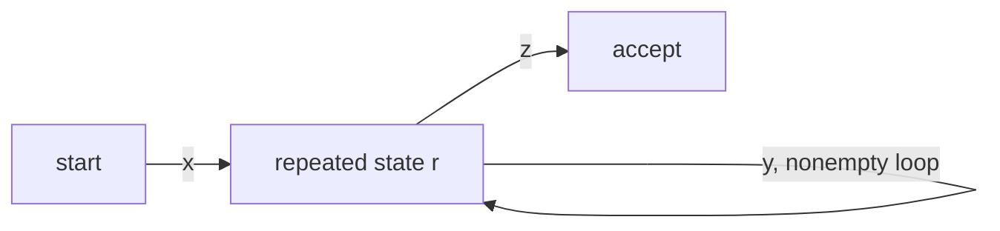
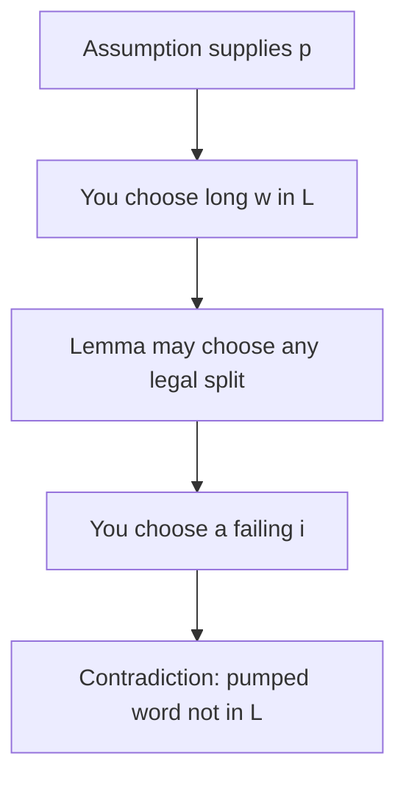

# ADS205 · El lema de bombeo

## Estado de generación del vídeo
PENDIENTE: material preparado; no se ha generado ni revisado ningún vídeo nuevo.

## Instrucciones
Explica la unidad en español siguiendo únicamente este material. Cita las fuentes y distingue práctica complementaria, respuestas suministradas y comentarios locales. Conserva fórmulas, identificadores, discrepancias y límites de evidencia. No inventes contenido, requisitos, resultados, dominio del estudiante ni predicciones de examen.

## Fuentes originales

## Edición española derivada
El hash indicado para cada documento identifica la fuente inglesa; el contenido mostrado es la traducción española. Los originales se conservan en la biblioteca.

### content/reviewed/ADS205/04/tutor.md
Hash de fuente inglesa: 524e6cacf8668571681b95ca5b464da44f714283701e3347613d10252b6f3384

---
title: "The Pumping Lemma · Tutor Notes"
course: ADS205
type: tutor-notes
status: reviewed
study_status: untested
language: en
cssclasses:
  - university-study
---

# El lema del bombeo

[[10_UNIVERSITY_CS/ADS205/Tutor Mode/00 Start Here|Tutor comienza aquí]] · [[10_UNIVERSITY_CS/ADS205/Tutor Mode/Unit 04 - The Pumping Lemma/02 Recall and Exam Practice|Recuerdo y práctica]] · [[10_UNIVERSITY_CS/ADS205/Unit 04 - The Pumping Lemma/01 Notes|Referencia ordinaria]]

## En 60 segundos

Cada ejecución suficientemente larga aceptada de un autómata finito repite un estado. La entrada consumida alrededor de ese bucle se puede repetir u omitir mientras el sufijo restante sigue la misma ruta. El lema de bombeo regular formaliza esto como una propiedad necesaria de los lenguajes regulares. Para demostrar la falta de regularidad, suponga una longitud de bombeo, elija un miembro largo del lenguaje que dependa de él, anule todas las divisiones permitidas y elija un exponente de bombeo que abandone el lenguaje. Después del estudio, debería poder enunciar los cuantificadores, derivar el lema de una ejecución de DFA y escribir contradicciones completas de igual conteo y longitud cuadrada.[^l3pump]

## Vista previa del concepto

> [!note] **Concepto — Estado repetido**
> **Significado en lenguaje sencillo:** Las transiciones `p` crean visitas de estado `p+1` en un DFA de estado `p`, por lo que dos visitas nombran el mismo estado.
> **Por qué es importante:** La entrada intermedia etiqueta un bucle.
> **Se conecta a:** memoria finita y subcadenas bombeables.
> **Fuente:** Conferencia 3, PDF, páginas 26–34.

> [!note] **Concepto — Condiciones de bombeo**
> **Significado en lenguaje sencillo:** El bucle no está vacío, se encuentra dentro de los primeros símbolos de entrada `p` y se puede repetir cualquier número de veces no negativo.
> **Por qué es importante:** Estos límites permiten que una prueba localice qué cambios.
> **Se conecta a:** lenguajes de bloque y espacios de longitud.
> **Fuente:** Conferencia 3, PDF p.32.

> [!note] **Concepto — Juego de cuantificadores**
> **Significado en lenguaje sencillo:** El lenguaje regular asumido proporciona `p` y una división potencialmente útil; la contradicción elige al testigo y a un exponente fallido.
> **Por qué es importante:** Refutar sólo una división conveniente no prueba nada.
> **Se conecta a:** estructura de prueba adversarial.
> **Fuente:** Conferencia 3, PDF, páginas 35–40.

> [!note] **Concepto — Necesario, no suficiente**
> **Significado en lenguaje sencillo:** Todo lenguaje regular satisface el lema de bombeo, pero encontrar un ejemplo que se pueda bombear no demuestra que sea un lenguaje regular.
> **Por qué es importante:** El lema es principalmente una herramienta de no regularidad aquí.
> **Se conecta a:** pruebas de construcción para regularidad.
> **Fuente:** Conferencia 3, PDF, páginas 24–32, 41.

## Instantánea de la evidencia del examen

**Nota de disponibilidad: 12 de octubre de 2026:** estas son observaciones históricas de la muestra parcial inspeccionada previamente, no un corpus actual recién inspeccionado. El PDF original del examen hash no está disponible; no se volvieron a calcular recuentos ni prioridades a partir de capturas no inspeccionadas.

| Tema | Observación positiva | Marcas conocidas | Demanda | Prioridad |
|---|---|---:|---|---|
| `a^n b^n` no está descrito por `a*b*` | 1 de 2 administraciones PARCIALES | 3 en 2324-B | Diagnóstico/contraejemplo | MEDIO sólo para la distinción |
| Bombeo regular directo a prueba de lemas | No hay observación directa en las páginas inspeccionadas | Desconocido | No observado | NO OBSERVADO EN MUESTRA PARCIAL DISPONIBLE |

Este no es un reclamo de exclusión. Las preguntas sobre bombeo sin contexto en otras partes de los documentos mixtos están fuera del alcance didáctico proporcionado por ADS205 y no se importan. No se justifica ningún nivel ALTO. Consulte [[10_UNIVERSITY_CS/ADS205/Tutor Mode/_System/past-paper-intelligence|inteligencia en artículos anteriores]].

## Antes de comenzar

Necesita ejecuciones de DFA, contradicciones y disciplina de cuantificadores.

> [!question] ¿No encontrar un DFA demuestra que no existe ningún DFA?

> [!success]- Comprueba tu respuesta
> No. Informa de una búsqueda fallida, no de una prueba que cubra todos los posibles autómatas finitos.
> Fuente: Conferencia 3, PDF, páginas 24–30.

## Una pregunta motivadora

¿Puede cualquier DFA reconocer exactamente

$$L=\{0^n1^n\mid n\ge0\}?$$

Un verificador propuesto puede tener tantos estados como desee su diseñador, pero el número se fija antes de que llegue la entrada. Probar muchas cadenas o rechazar una máquina candidata no resuelve la cuestión. El éxito requiere una prueba que se aplique a **cada** autómata finito.

| Desafío | Idea necesaria |
|---|---|
| Cubrir todos los números de estados posibles | Utilice una longitud de bombeo arbitraria `p` |
| Forzar un bucle en el bloque cero | Elija `0^p1^p` y use `|xy|≤p` |
| Cubrir todas las divisiones legales | Escriba `y=0^b` con `1≤b≤p` |
| Romper la igualdad | Bombea para cambiar los ceros mientras los unos permanecen fijos |

## Por qué una ejecución larga contiene un bucle

Supongamos que DFA `M` tiene estados `p=|Q|≥1` y acepta una palabra `w` de longitud mínima `p`. Durante las primeras transiciones `p` visita las posiciones `r0,r1,…,rp`: `p+1` visita pero solo `p` posibles identidades de estado. Por lo tanto `ra=rb` para algunos `0≤a<b≤p`.[^l3pump]

Sea `x` la cadena formada por los primeros `a` símbolos de entrada, `y` la formada por los siguientes `b-a` símbolos y `z` el resto. Entonces

$$w=xyz,\qquad |y|=b-a\ge1,\qquad |xy|=b\le p.$$

La lectura de `y` vuelve al mismo estado. Reemplazar ese bucle por cero, uno, dos o cualquier número finito de recorridos deja la máquina en el mismo estado antes de `z`; el sufijo sin cambios aún logra aceptación.

**Figura 1: el sufijo no puede detectar con qué frecuencia se ejecutó el bucle**

**Léelo:** `x` alcanza el estado `r`; cada copia de `y` vuelve a `r`; Por tanto, `z` parte del mismo estado.
**Conclusión clave:** El bombeo cambia la cadena sin cambiar el estado desde el cual se ejecuta el sufijo aceptado.
**Procedencia:** Diagrama Mermaid pedagógico derivada de la Conferencia 3, PDF, páginas 26–34.

> [!note] Lema de bombeo regular
> Si `L` es regular, existe algún número entero `p≥1` de modo que cada `w∈L` con `|w|≥p` tenga un `w=xyz` dividido que satisfaga `|y|≥1`, `|xy|≤p` y `xy^iz∈L` para cada número entero. `i≥0`.[^l3pump]

## Leer los cuantificadores como protocolo de prueba.

$$\exists p\;\forall w\;\exists(x,y,z)\;\forall i.$$

La división también está limitada por las tres condiciones anteriores. Por contradicción, niegue el orden operativo:

1. Asuma regularidad y acepte un `p` prometido arbitrariamente.
2. Elija un `w∈L` largo, que puede depender de `p`.
3. Considere una división legal arbitraria, no su división favorita.
4. Elija un `i` que pueda depender de esa división.
5. Demuestre que la palabra bombeada está fuera de `L`.

**Figura 2: Quién controla cada elección**

**Léelo:** Alterna entre el supuesto/lema y la prueba de contradicción.
**Conclusión clave:** Una prueba que selecciona una división conveniente omite la elección existencial del lema.
**Procedencia:** Diagrama cuantificador pedagógico derivado de la Conferencia 3, PDF, páginas 35–40.

> [!warning] Fuente taquigráfica
> “Para cualquier `i`” en la lección 3, p.35, debe leerse a través de los cuantificadores exactos: para cada división legal, encontrar un exponente fallido es suficiente. “Un ejemplo” en la página 40 significa una familia de testigos que depende de `p` arbitrario, con todas las divisiones legales cubiertas.

## Volver a la pregunta motivadora

Supongamos que `L={0^n1^n}` es regular y que `p` sea una longitud de bombeo. Elija `w=0^p1^p`, que pertenece a `L` y tiene una longitud `2p≥p`.

Para una división legal arbitraria, `x` y `y` se encuentran dentro de los primeros símbolos `p`, todos ceros. Por lo tanto

$$x=0^a,\quad y=0^b,\quad z=0^{p-a-b}1^p$$

para números enteros `a≥0`, `b≥1`, `a+b≤p`. Los ceros residuales en `z` son importantes: el lema no requiere `a+b=p`.

Bombea con `i=2`:

$$xy^2z=0^a0^{2b}0^{p-a-b}1^p=0^{p+b}1^p.$$

Porque `b≥1`, los ceros superan a los unos. La palabra bombeada no está en `L`. Esto frustra toda división legal, contradiciendo el lema. Por lo tanto, `L` no es regular, por lo que ningún DFA, NFA o expresión regular clásica lo reconoce.

> [!warning] Reparación de prueba de fuente
> La visualización de la lección 3, páginas 36 y 37, solo se divide con `a+b=p`. Incluir `0^(p-a-b)` en `z` cubre todas las divisiones permitidas preservando la misma contradicción.

## Transferencia trabajada: longitudes cuadradas

Dejar `S={0^(n^2) | n≥0}`. Suponga regularidad, tome la longitud de bombeo `p` y elija `0^(p^2)`. Cada bucle legal tiene una longitud `b` con `1≤b≤p`. Bombear dos veces produce longitud `p^2+b`. Ahora establezca ambos lados:

$$p^2<p^2+b\le p^2+p<(p+1)^2.$$

Ningún cuadrado entero se encuentra estrictamente entre cuadrados consecutivos, por lo que la palabra bombeada sale de `S`. El límite inferior por sí solo es insuficiente: un número mayor podría ser otro cuadrado. El límite superior es el paso decisivo que falta en la Conferencia 3 p.39.[^l3pump]

> [!question] Explícalo tú mismo
> ¿Por qué `i=1` nunca ayuda a producir una contradicción?

> [!success]- Consulta tu explicación
> `xy^1z=xyz=w`, el miembro original elegido del lenguaje.
> Fuente: Definición del lema de bombeo, Conferencia 3 p.32.

## Definiciones y distinciones

| Término A | Término B | Distinción decisiva | Fuente |
|---|---|---|---|
| Visita a un estado | Estado distinto | Una posición de la ejecución frente a la identidad de un estado; las visitas pueden repetirse | L3 págs. 33–34 |
| Longitud de bombeo | Longitud de la palabra | Cota fija que depende del lenguaje frente al tamaño de una entrada elegida | L3 pág.32 |
| Una división legal | Todas las divisiones legales | Ejemplo versus la cobertura requerida para la contradicción | L3 págs. 35–40 |
| Condición necesaria | Condición suficiente | Requerido de lenguajes regulares versus suficiente para demostrar regularidad | L3 págs. 24–32, 41 |
| Lema de bombeo regular | Lema de bombeo libre de contexto | Teorema diferente y estructura dividida; aquí sólo se suministra el primero | L3 págs. 25–41 |

## Revisión

### Comprensión total

Utilice el razonamiento completo anterior y la [[10_UNIVERSITY_CS/ADS205/Unit 04 - The Pumping Lemma/01 Notes|referencia ordinaria]] para obtener el registro completo de reparación en origen.

## Revisión de 5 minutos

- Las visitas `p+1` entre estados `p` fuerzan un estado repetido.
- El bucle `y` no está vacío y termina dentro de los primeros símbolos `p`.
- Desmentir regularidad: arbitraria `p`, elegida `w`, arbitraria descomposición válida, elección de un `i` que produce el fallo.
- La prueba de conteo igual cambia solo el bloque cero inicial.
- La prueba de longitud de cuadrados atrapa la nueva longitud entre cuadrados consecutivos.
- Pasar un intento de bombeo nunca demuestra regularidad.

## Recuperación de 60 segundos

Visitas `p+1` · `w=xyz` · `|y|≥1` · `|xy|≤p` · cada `i≥0` · división arbitraria · `0^p1^p` · espacio cuadrado

[^l3pump]: `Lecture 3 Regular Expression and Pumping Lemma.pdf`, PDF páginas 25–41.

## Extensión de fuente actual: cuantificadores dentro de la pertenencia del lenguaje

**Primero el problema:** El Tutorial 3 P6 pregunta por qué “al menos k” da un lenguaje B regular mientras que “como máximo k” da un C no regular, para palabras $1^kw$ con k≥1 existencial. Aquí `B={1^k w : k≥1 and w contains at least k ones}` y `C={1^k w : k≥1 and w contains at most k ones}`, con el sufijo binario w y k existencial elegidos por separado para cada palabra. Un miembro de lenguaje puede tener varias representaciones de prefijo/sufijo; nuestra prueba no puede ignorar esa libertad.

Para B, reemplace cualquier testigo k por 1: su primer 1 sigue siendo el prefijo y un 1 posterior permanece en el sufijo. Por el contrario, comenzar con 1 y tener un 1 posterior es suficiente con k=1. La expresión regular es $1(0\cup1)^*1(0\cup1)^*$. Esto no cuenta un k ilimitado; elimina esa búsqueda existencial.

Para C, coloque un separador en el testigo $1^p01^p$. Cuando se bombea un segmento inicial no vacío y, la ejecución inicial se reduce a p − t pero las p posteriores no. Cualquier nueva elección de prefijo k' debe encajar en la ejecución abreviada, por lo tanto k'≤p−t<p, mientras que el sufijo todavía contiene al menos p unos. Ninguna nueva representación puede restaurar la pertenencia. Esa verificación final es la transferencia importante de la prueba del conteo igual.

Fuente: Tutorial 3 actual, páginas 4–5, P6; celda 9 del cuaderno de soluciones. Su último “k>p” estricto debe ser “k≥p”; cualquiera de los dos es incompatible con el límite acortado, pero la desigualdad corregida se sigue exactamente de “como máximo k”. Una k global fija haría que ambos lenguajes fueran regulares; la solución fuente establece la interpretación existencial por palabra.

La [[10_UNIVERSITY_CS/ADS205/Original Sources/LM Core 2026-10-07/Forum Clarifications#L3 — Pumping lemma and all valid splits|confirmación del profesor del 6 de octubre]] admite divisiones válidas arbitrarias. La L3 actual cita el lema en la página 33, recuentos iguales en las páginas 37–38 y cuadrados en las páginas 39–40; Las referencias anteriores aquí identifican el original conservado de 42 páginas.

[[10_UNIVERSITY_CS/ADS205/Unit 04 - The Pumping Lemma/02 Exercises#T3 P1 — What one pumpable word does not show|P1.4–5]] · [[10_UNIVERSITY_CS/ADS205/Unit 04 - The Pumping Lemma/02 Exercises#T3 P4 — Order and ownership|P4]] · [[10_UNIVERSITY_CS/ADS205/Unit 04 - The Pumping Lemma/02 Exercises#T3 P5 — Diagnose both proposed proofs|P5 A/B]] · [[10_UNIVERSITY_CS/ADS205/Unit 04 - The Pumping Lemma/02 Exercises#T3 P6 — Similar definitions, different languages|P6]] todos conducen a tareas originales con ayuda local completa. La ocurrencia del tutorial no es la ocurrencia del examen.

### content/reviewed/ADS205/04/practice.md
Hash de fuente inglesa: 59b235bc0e9fb262090dcd3c2ed72897e1707a8355dca9f9f05f83659e11287d

---
title: "The Pumping Lemma · Recall and Exam Practice"
course: ADS205
type: tutor-practice
status: reviewed
study_status: untested
language: en
cssclasses:
  - university-study
---

# Recordar y practicar

[[10_UNIVERSITY_CS/ADS205/Tutor Mode/00 Start Here|Tutor Start Here]] · [[10_UNIVERSITY_CS/ADS205/Tutor Mode/Unit 04 - The Pumping Lemma/01 Tutor Notes|Tutor Notes]] · [[10_UNIVERSITY_CS/ADS205/Unit 04 - The Pumping Lemma/02 Exercises|Ejercicios ordinarios completos]]

No se observó ninguna pregunta directa y regular a prueba de bombeo en la muestra de evaluación parcial. Se observó una distinción de igual recuento/expresión regular. La práctica sigue basándose en las fuentes; no se implica ningún reclamo de examen futuro.

## Repaso activo atómico

### Tarjeta 01: ¿Por qué un DFA con p estados debe repetir un estado dentro de las primeras p transiciones de un ejecución suficientemente larga?
> [!success]- Respuesta
> Visitas `p+1` solo entre identidades estatales `p`.
>
> Fuente: Conferencia 3, PDF, páginas 33–34.

### Tarjeta 02: en el lema de bombeo para lenguajes regulares, ¿por qué la subcadena del bucle y no debe estar vacía?
> [!success]- Respuesta
> Las visitas repetidas ocurren en diferentes posiciones de entrada, por lo que `b-a≥1`.
>
> Fuente: Conferencia 3, PDF, páginas 32–34.

### Tarjeta 03: ¿Qué límite del lema de bombeo garantiza que la subcadena del bucle y termine dentro de los primeros p símbolos?
> [!success]- Respuesta
> La condición `|xy|≤p`.
>
> Fuente: Conferencia 3, PDF p.32.

### Tarjeta 04 — ¿Quién elige la longitud de bombeo?
> [!success]- Respuesta
> La afirmación de regularidad supuesta proporciona algún `p` válido.
>
> Fuente: Conferencia 3, PDF, páginas 32–35.

### Tarjeta 05: En una prueba de no regularidad que utiliza el lema de bombeo, ¿quién elige la palabra testigo y cuándo?
> [!success]- Respuesta
> La prueba de la contradicción, tras ver `p`.
>
> Fuente: Conferencia 3, PDF, páginas 35–40.

### Tarjeta 06 — ¿Debe una contradicción abarcar toda descomposición válida?
> [!success]- Respuesta
> Sí; el lema sólo necesita una división superviviente.
>
> Fuente: Conferencia 3, PDF, páginas 35–40.

### Tarjeta 07: En una contradicción con el lema de bombeo, ¿puede el exponente fallido i depender de la división legal elegida?
> [!success]- Respuesta
> Sí; cada división necesita al menos un exponente fallido.
>
> Fuente: Conferencia 3, PDF, páginas 35–40.

### Tarjeta 08: ¿Qué hace `i=0`?
> [!success]- Respuesta
> Elimina la subcadena del bucle `y`.
>
> Fuente: Conferencia 3, PDF p.32.

### Tarjeta 09: ¿El bombeo exitoso demuestra regularidad?
> [!success]- Respuesta
> No. El lema proporciona una condición necesaria, no una prueba inversa aquí.
>
> Fuente: Conferencia 3, PDF p.41.

### Tarjeta 10: Para $L=\{0^{n^2}:n\ge0\}$, ¿por qué $p^2+b>p^2$ por sí solo es insuficiente cuando se bombea un circuito con $1\le b\le p$?
> [!success]- Respuesta
> Un límite superior por debajo de `(p+1)^2`, no simplemente una longitud por encima de `p^2`.
>
> Fuente: Conferencia 3, PDF, páginas 38–39.

## Práctica progresiva

### Práctica 1: Identificar el movimiento ilegal

**PRÁCTICA COMPLEMENTARIA.** Una prueba elige `w=0^p1^p`, luego declara `x=ε,y=0,z=0^(p-1)1^p` y bombea. ¿Qué obligación falta?

> [!tip]- Sugerencia
> La división elegida es legal, pero ¿quién puede elegir la división del lema?

> [!success]- Solución
> La prueba derrota sólo una división legal. El lema promete la existencia de alguna escisión que bombee, por lo que una contradicción debe suponer una escisión jurídica arbitraria. Escriba `x=0^a,y=0^b,z=0^(p-a-b)1^p` con `b≥1` y `a+b≤p`; El bombeo luego derrota cada división.
>
> Fuente: Conferencia 3, PDF, páginas 35–37.

### Práctica 2: Prueba guiada de recuento igual

**PRÁCTICA COMPLEMENTARIA.** Demuestre que `{a^n b^(2n) | n≥0}` no es regular.

> [!tip]- Sugerencia
> Elija `a^p b^(2p)` para que cada `y` legal contenga solo `a`, luego bombee sin cambiar el recuento de `b`.

> [!success]- Solución
> Suponga regularidad con la longitud de bombeo `p` y elija `w=a^p b^(2p)`. Por cada división legal, `x=a^r`, `y=a^s`, `z=a^(p-r-s)b^(2p)` con `s≥1`. Bombear con `i=2`, obteniendo `a^(p+s)b^(2p)`. La pertenencia requeriría que el recuento de `b` fuera igual al doble del recuento de `a`, es decir, `2p+2s`, pero sigue siendo `2p`. Desde `s≥1`, la palabra bombeada está fuera del lenguaje, contradiciendo el lema.
>
> Fuente: Transferencia sintética de la Conferencia 3, PDF, páginas 36–37.

### Práctica 3: reparar el argumento del cuadrado

**PRÁCTICA COMPLEMENTARIA.** Explique por qué “`p^2+b>p^2`, luego no es un cuadrado” no es válido y proporcione la desigualdad completa.

> [!tip]- Sugerencia
> Un número mayor puede ser el siguiente cuadrado. Utilice `b≤p`.

> [!success]- Solución
> La inferencia no es válida porque `(p+1)^2` es un cuadrado más grande. Para una división legal, `1≤b≤p`; de ahí `p^2<p^2+b≤p^2+p<(p+1)^2`. La longitud bombeada se encuentra estrictamente entre cuadrados consecutivos y por lo tanto no puede ser cuadrada.
>
> Fuente: Conferencia 3, PDF, páginas 38–39, con la reparación del límite superior requerida.

> [!warning] RELEVANCIA DEL EXAMEN MEDIO
> La distinción de igual recuento versus expresión regular apareció una vez en la administración PARCIAL 2023-24. No se observó una prueba de bombeo regular y completa. Esta es sólo evidencia descriptiva.

### Práctica de evaluación: `a*b*` versus recuentos iguales

**EJERCICIO ORIGINAL DEL CURSO.** `ADS205-EXAMS.pdf`, PDF p.6 Q1(d), `INT201/23-24/S1` variante B, **3 puntos**: determine si `{a^n b^n | n≥0}` tiene la expresión regular `a*b*`.

> [!tip]- Sugerencia
> `a*b*` elige los dos conteos de repeticiones de forma independiente.

> [!success]- Solución
> **Falso.** `a*b*` denota `{a^i b^j | i,j≥0}` sin restricción de igualdad. Por ejemplo, `a` pertenece a `a*b*` al elegir `i=1,j=0`, pero no está en `{a^n b^n}`. De hecho, el lenguaje de recuento igual no es regular según la misma prueba de bombeo que `{0^n1^n}` después de cambiar el nombre de los símbolos, por lo que ninguna expresión regular clásica lo denota.
>
> **AUTOCOMPROBACIÓN SUGERIDA:** valor de verdad; contraejemplo decisivo; explicación de que las estrellas son independientes; enlace opcional a la prueba de no regularidad. No se proporcionó ningún esquema oficial.

### Práctica 5: planificación de pruebas independiente

**PRÁCTICA COMPLEMENTARIA.** Antes de escribir álgebra, cumpla con los cuatro roles para demostrar que `{0^n1^n}` no es regular: entrada arbitraria del supuesto, su testigo, descomposición arbitraria, su exponente.

> [!tip]- Sugerencia
> Utilice etiquetas de roles en lugar de seleccionar una división.

> [!success]- Solución
> La suposición proporciona una longitud de bombeo arbitraria `p`. Elija el testigo `w=0^p1^p`. Dejemos que el lema proporcione una descomposición jurídica arbitraria con `y=0^b`, `b≥1`. Elija `i=0` o `i=2`; cualquiera de los dos cambia solo el conteo de ceros. La separación de roles evita la inversión del cuantificador común.
>
> Fuente: Conferencia 3, PDF, páginas 35–37.

### Práctica 6: cuando bombear es la herramienta incorrecta

**PRÁCTICA COMPLEMENTARIA.** Un estudiante bombea con éxito varias palabras en un lenguaje y concluye que el lenguaje es regular. Reemplace esa conclusión con un siguiente paso válido.

> [!tip]- Sugerencia
> ¿Qué tipo de evidencia prueba la regularidad en las Unidades 02–03?

> [!success]- Solución
> Los ejemplos exitosos no establecen nada general. Para demostrar la regularidad, cree un DFA, NFA o una expresión regular y demuestre que reconoce exactamente el lenguaje; alternativamente derivarlo mediante operaciones de cierre verificadas. El lema de bombeo aquí es una propiedad necesaria utilizada para la contradicción, no un procedimiento de decisión suministrado o un teorema inverso.
>
> Fuente: Conferencia 3, PDF, páginas 24–32, 41.

## Navegación del ejercicio original

Las seis asignaciones de tareas fuente de la Unidad 04 conservan la ayuda local completa en la edición ordinaria:

- [[10_UNIVERSITY_CS/ADS205/Unit 04 - The Pumping Lemma/02 Exercises#L3 equal counts — Unbounded matching blocks|Prueba de no regularidad de recuento igual]]
- [[10_UNIVERSITY_CS/ADS205/Unit 04 - The Pumping Lemma/02 Exercises#L3 square lengths — Unary squares|Prueba de no regularidad de longitud cuadrada]]
- [[10_UNIVERSITY_CS/ADS205/Unit 04 - The Pumping Lemma/02 Exercises#L3 Q&A — What does the lemma establish?|Preguntas y respuestas sobre la conferencia]]
- [[10_UNIVERSITY_CS/ADS205/Unit 04 - The Pumping Lemma/02 Exercises#Practice — Find the unjustified choice|Diagnóstico de elección dividida]]
- [[10_UNIVERSITY_CS/ADS205/Unit 04 - The Pumping Lemma/02 Exercises#Practice transfer — Repair a square-length inference|Reparación de espacio cuadrado]]

## Tutorial actual 3 originales

Navegación para completar preguntas ordinarias y soluciones locales adyacentes:

- [[10_UNIVERSITY_CS/ADS205/Unit 04 - The Pumping Lemma/02 Exercises#T3 P1 — What one pumpable word does not show|P1.4–5: alcance de una reclamación por bombeo]]
- [[10_UNIVERSITY_CS/ADS205/Unit 04 - The Pumping Lemma/02 Exercises#T3 P4 — Order and ownership|P4: cuantificar el juego]]
- [[10_UNIVERSITY_CS/ADS205/Unit 04 - The Pumping Lemma/02 Exercises#T3 P5 — Diagnose both proposed proofs|P5 A/B: testigo inválido versus una división elegida]]
- [[10_UNIVERSITY_CS/ADS205/Unit 04 - The Pumping Lemma/02 Exercises#T3 P6 — Similar definitions, different languages|P6.1–2: B/C y testigos de pertenencia suplente]]

### Problema: auditar el último paso

**PRÁCTICA COMPLEMENTARIA**, basada en P6. Sea `C={1^k w : k≥1 and binary w contains at most k ones}`, con k existencial elegida para cada palabra. Una prueba bombea $1^p01^p$ y dice "la antigua k ya no funciona, por lo que la palabra está fuera de C". Explique el argumento que falta y proporciónelo.

> [!tip]- Sugerencia
> La pertenencia existencial puede usar una k diferente después del bombeo.

> [!success]- Solución
> Invalidar un testigo antiguo no excluye a todos los testigos posibles. La palabra bombeada es $1^{p-t}01^p$, con t≥1. Cualquier nuevo k'≥1 debe caber en su ejecución inicial, por lo k'≤p−t; su sufijo contiene al menos p unos, que exceden k'. Si p=t comienza con 0, excluyendo cada k' positivo. Por lo tanto, ninguna representación satisface C. Esto elimina todos los testigos de pertenencia, no solo el original.

## Recuperación atómica adicional del Tutorial 3

### Tarjeta 11: Para `C={1^k w : k≥1 and binary w has at most k ones}`, ¿se elige k un parámetro fijo global o un testigo de pertenencia para cada palabra?

> [!success]- Respuesta
> Existencialmente para cada palabra, no como un parámetro fijo para todo el lenguaje.
>
> Fuente: Tutorial 3 PDF págs.4–5, P6.

### Tarjeta 12: ¿Qué se debe descartar después de hablar con testigos existenciales de pertenencia?

> [!success]- Respuesta
> Cada posible nuevo testigo de pertenencia, no sólo el original.
>
> Fuente: Tutorial 3 PDF p.5, P6.2; Corrección explícita de la desigualdad fuente.
