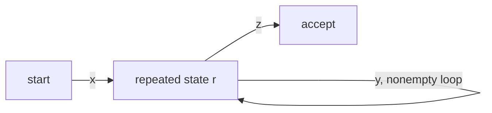
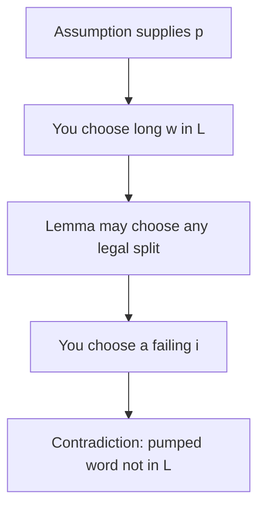

# ADS205 · The Pumping Lemma

## Video generation status
PENDING: source pack prepared; no cloud video has been generated or reviewed.

## Spanish video overview prompt
Explica esta unidad en español claro, paso a paso, para alguien que aprende de forma autodidacta. Usa únicamente el material incluido. Comienza con el problema motivador, presenta los conceptos, muestra un ejemplo visual fiel a las convenciones del curso, pausa para una pregunta y después explica la respuesta. Distingue práctica suplementaria de tareas oficiales y de soluciones oficiales. No inventes datos, fuentes, requisitos, capítulos pendientes, resultados de ejecución ni predicciones de examen. Conserva los límites y discrepancias indicados. Cierra con una actividad que el estudiante pueda intentar en Learning Uni. Cita el nombre del documento y su localizador cuando corresponda. Si falta evidencia, dilo; no rellenes el hueco. Mantén visibles las fórmulas y direcciones de flechas.

## Verified original file snapshots

## Source material

### Snapshot: content/reviewed/ADS205/04/tutor.md
SHA-256: 20f067f6700f84a87ef37fea13792fa156061b8697c3f3ce23661d6280ef5a7c

---
title: "The Pumping Lemma · Tutor Notes"
course: ADS205
type: tutor-notes
status: reviewed
study_status: untested
language: en
cssclasses:
  - university-study
---

# The Pumping Lemma

[[10_UNIVERSITY_CS/ADS205/Tutor Mode/00 Start Here|Tutor Start Here]] · [[10_UNIVERSITY_CS/ADS205/Tutor Mode/Unit 04 - The Pumping Lemma/02 Recall and Exam Practice|Recall and Practice]] · [[10_UNIVERSITY_CS/ADS205/Unit 04 - The Pumping Lemma/01 Notes|Ordinary reference]]

## In 60 Seconds

Every sufficiently long accepted run of a finite automaton repeats a state. The input consumed around that loop can be repeated or omitted while the remaining suffix follows the same path. The regular pumping lemma formalizes this as a necessary property of regular languages. To prove nonregularity, assume a pumping length, choose a long language member depending on it, defeat every permitted split, and choose a pumping exponent that leaves the language. After study, you should be able to state the quantifiers, derive the lemma from a DFA run, and write complete equal-count and square-length contradictions.[^l3pump]

## Concept Preview

> [!note] **Concept — Repeated state**
> **Plain-language meaning:** `p` transitions create `p+1` state visits in a `p`-state DFA, so two visits name the same state.
> **Why it matters:** The intervening input labels a loop.
> **Connects to:** finite memory and pumpable substrings.
> **Source:** Lecture 3, PDF pp.26–34.

> [!note] **Concept — Pumping conditions**
> **Plain-language meaning:** The loop is nonempty, lies within the first `p` input symbols, and can be repeated any nonnegative number of times.
> **Why it matters:** These bounds let a proof locate what changes.
> **Connects to:** block languages and length gaps.
> **Source:** Lecture 3, PDF p.32.

> [!note] **Concept — Quantifier game**
> **Plain-language meaning:** The assumed regular language supplies `p` and a potentially helpful split; the contradiction chooses the witness and a failing exponent.
> **Why it matters:** Refuting only one convenient split proves nothing.
> **Connects to:** adversarial proof structure.
> **Source:** Lecture 3, PDF pp.35–40.

> [!note] **Concept — Necessary, not sufficient**
> **Plain-language meaning:** Every regular language pumps, but finding a pumpable example does not prove a language regular.
> **Why it matters:** The lemma is mainly a nonregularity tool here.
> **Connects to:** construction proofs for regularity.
> **Source:** Lecture 3, PDF pp.24–32, 41.

## Exam Evidence Snapshot

| Topic | Positive observation | Known marks | Demand | Priority |
|---|---|---:|---|---|
| `a^n b^n` is not described by `a*b*` | 1 of 2 PARTIAL administrations | 3 in 2324-B | Diagnose/counterexample | MEDIUM for the distinction only |
| Direct regular pumping-lemma proof | No direct observation in inspected pages | Unknown | Not observed | NOT OBSERVED IN AVAILABLE PARTIAL SAMPLE |

This is not an exclusion claim. Context-free pumping questions elsewhere in the mixed papers are outside the supplied ADS205 teaching scope and are not imported. No HIGH tier is justified. See [[10_UNIVERSITY_CS/ADS205/Tutor Mode/_System/past-paper-intelligence|past-paper intelligence]].

## Before You Start

You need DFA runs, contradiction, and quantifier discipline.

> [!question] Does failing to find a DFA prove that no DFA exists?

> [!success]- Check your answer
> No. It reports a failed search, not a proof covering every possible finite automaton.
> Source: Lecture 3, PDF pp.24–30.

## A motivating question

Can any DFA recognize exactly

$$L=\{0^n1^n\mid n\ge0\}?$$

A proposed checker may have as many states as its designer wants, but the number is fixed before the input arrives. Testing many strings or rejecting one candidate machine does not settle the question. Success requires a proof applying to **every** finite automaton.

| Challenge | Needed idea |
|---|---|
| Cover every possible state count | Use an arbitrary pumping length `p` |
| Force a loop into the zero block | Choose `0^p1^p` and use `|xy|≤p` |
| Cover every legal split | Write `y=0^b` with `1≤b≤p` |
| Break equality | Pump to change zeros while ones remain fixed |

## Why a long run contains a loop

Assume DFA `M` has `p=|Q|≥1` states and accepts a word `w` of length at least `p`. During the first `p` transitions it visits positions `r0,r1,…,rp`: `p+1` visits but only `p` possible state identities. Therefore `ra=rb` for some `0≤a<b≤p`.[^l3pump]

Let `x` be the first `a` input symbols, `y` the next `b-a`, and `z` the rest. Then

$$w=xyz,\qquad |y|=b-a\ge1,\qquad |xy|=b\le p.$$

Reading `y` returns to the same state. Replacing that loop by zero, one, two, or any finite number of traversals leaves the machine at the same state before `z`; the unchanged suffix still reaches acceptance.

**Figure 1 — The suffix cannot detect how often the loop ran**

**Read it:** `x` reaches state `r`; each copy of `y` returns to `r`; `z` therefore begins from the same state.
**Key takeaway:** Pumping changes the string without changing the state from which the accepted suffix runs.
**Provenance:** Pedagogical Mermaid derived from Lecture 3, PDF pp.26–34.

> [!note] Regular pumping lemma
> If `L` is regular, some integer `p≥1` exists such that every `w∈L` with `|w|≥p` has a split `w=xyz` satisfying `|y|≥1`, `|xy|≤p`, and `xy^iz∈L` for every integer `i≥0`.[^l3pump]

## Read the quantifiers as a proof protocol

$$\exists p\;\forall w\;\exists(x,y,z)\;\forall i.$$

The split is also constrained by the three conditions above. For contradiction, negate the operational order:

1. Assume regularity and accept an arbitrary promised `p`.
2. Choose a long `w∈L`, allowed to depend on `p`.
3. Consider an arbitrary legal split, not your favourite split.
4. Choose an `i` that may depend on that split.
5. Prove the pumped word is outside `L`.

**Figure 2 — Who controls each choice**

**Read it:** Alternate between the assumption/lemma and the contradiction proof.
**Key takeaway:** A proof that selects one convenient split skips the lemma's existential choice.
**Provenance:** Pedagogical quantifier diagram derived from Lecture 3, PDF pp.35–40.

> [!warning] Source shorthand
> “For any `i`” on Lecture 3 p.35 should be read through the exact quantifiers: for each legal split, finding one failing exponent is enough. “One example” on p.40 means a witness family depending on arbitrary `p`, with every legal split covered.

## Return to the motivating question

Assume `L={0^n1^n}` is regular and let `p` be a pumping length. Choose `w=0^p1^p`, which belongs to `L` and has length `2p≥p`.

For an arbitrary legal split, `x` and `y` lie within the first `p` symbols, all zeros. Therefore

$$x=0^a,\quad y=0^b,\quad z=0^{p-a-b}1^p$$

for integers `a≥0`, `b≥1`, `a+b≤p`. The residual zeros in `z` matter: the lemma does not require `a+b=p`.

Pump with `i=2`:

$$xy^2z=0^a0^{2b}0^{p-a-b}1^p=0^{p+b}1^p.$$

Because `b≥1`, zeros outnumber ones. The pumped word is not in `L`. This defeats every legal split, contradicting the lemma. Thus `L` is not regular, so no DFA, NFA, or classical regex recognizes it.

> [!warning] Source proof repair
> Lecture 3 pp.36–37 display only splits with `a+b=p`. Including `0^(p-a-b)` in `z` covers all permitted splits while preserving the same contradiction.

## Worked transfer: square lengths

Let `S={0^(n^2) | n≥0}`. Assume regularity, take pumping length `p`, and choose `0^(p^2)`. Every legal loop has length `b` with `1≤b≤p`. Pumping twice produces length `p^2+b`. Now establish both sides:

$$p^2<p^2+b\le p^2+p<(p+1)^2.$$

No integer square lies strictly between consecutive squares, so the pumped word leaves `S`. The lower bound alone is insufficient: a larger number might be another square. The upper bound is the decisive missing step in Lecture 3 p.39.[^l3pump]

> [!question] Explain it yourself
> Why does `i=1` never help produce a contradiction?

> [!success]- Check your explanation
> `xy^1z=xyz=w`, the original chosen member of the language.
> Source: Pumping-lemma definition, Lecture 3 p.32.

## Definitions and distinctions

| Term A | Term B | Decisive distinction | Source |
|---|---|---|---|
| State visit | Distinct state | A run position versus a state identity; visits may repeat | L3 pp.33–34 |
| Pumping length | Word length | Fixed language-dependent bound versus size of one chosen input | L3 p.32 |
| One legal split | All legal splits | Example versus the coverage required for contradiction | L3 pp.35–40 |
| Necessary condition | Sufficient condition | Required of regular languages versus enough to prove regularity | L3 pp.24–32, 41 |
| Regular pumping lemma | Context-free pumping lemma | Different theorem and split structure; only the former is supplied here | L3 pp.25–41 |

## Review

### Full Understanding

Use the complete reasoning above and the [[10_UNIVERSITY_CS/ADS205/Unit 04 - The Pumping Lemma/01 Notes|ordinary reference]] for the full source-repair record.

## 5-Minute Review

- `p+1` visits among `p` states force a repeated state.
- The loop `y` is nonempty and ends within the first `p` symbols.
- To disprove regularity: arbitrary `p`, chosen `w`, arbitrary legal split, chosen failing `i`.
- Equal-count proof changes only the initial zero block.
- Square-length proof traps the new length between consecutive squares.
- Passing one pumping attempt never proves regularity.

## 60-Second Recall

`p+1` visits · `w=xyz` · `|y|≥1` · `|xy|≤p` · every `i≥0` · arbitrary split · `0^p1^p` · square gap

[^l3pump]: `Lecture 3 Regular Expression and Pumping Lemma.pdf`, PDF pp.25–41.

## Current-source extension — Quantifiers inside language membership

**Problem first:** Tutorial 3 P6 asks why “at least k” gives a regular language B while “at most k” gives nonregular C, for words $1^kw$ with existential k≥1. Here `B={1^k w : k≥1 and w contains at least k ones}` and `C={1^k w : k≥1 and w contains at most k ones}`, with binary suffix w and existential k chosen separately for each word. A language member may have several prefix/suffix representations; our proof cannot ignore that freedom.

For B, replace any witness k by 1: its first 1 remains the prefix and a later 1 remains in the suffix. Conversely, starting with 1 and having a later 1 is enough with k=1. The regex is $1(0\cup1)^*1(0\cup1)^*$. This does not count an unbounded k; it eliminates that existential search.

For C, put a separator into the witness $1^p01^p$. When a nonempty initial segment y is pumped down, the initial run shrinks to p−t but the later p ones do not. Any new prefix choice k' must fit into the shortened run, hence k'≤p−t<p, while the suffix still contains at least p ones. No new representation can restore membership. That final check is the important transfer from the equal-count proof.

Source: current Tutorial 3 pp.4–5, P6; solution notebook cell 9. Its last strict “k>p” should be “k≥p”; either is incompatible with the shortened bound, but the corrected inequality follows exactly from “at most k”. A fixed global k would make both languages regular; the source solution establishes the existential-per-word interpretation.

The [[10_UNIVERSITY_CS/ADS205/Original Sources/LM Core 2026-10-07/Forum Clarifications#L3 — Pumping lemma and all valid splits|6 October lecturer confirmation]] supports arbitrary valid splits. Current L3 cites the lemma on p.33, equal counts on pp.37–38 and squares on pp.39–40; earlier references here identify the preserved 42-page original.

[[10_UNIVERSITY_CS/ADS205/Unit 04 - The Pumping Lemma/02 Exercises#T3 P1 — What one pumpable word does not show|P1.4–5]] · [[10_UNIVERSITY_CS/ADS205/Unit 04 - The Pumping Lemma/02 Exercises#T3 P4 — Order and ownership|P4]] · [[10_UNIVERSITY_CS/ADS205/Unit 04 - The Pumping Lemma/02 Exercises#T3 P5 — Diagnose both proposed proofs|P5 A/B]] · [[10_UNIVERSITY_CS/ADS205/Unit 04 - The Pumping Lemma/02 Exercises#T3 P6 — Similar definitions, different languages|P6]] all lead to original tasks with complete local help. Tutorial occurrence is not exam-paper occurrence.

### Snapshot: content/reviewed/ADS205/04/practice.md
SHA-256: 14fbd1d5ad0e1a3ea3aa613f31031941ec2d57ae8f94b027238b745158e1a7fd

---
title: "The Pumping Lemma · Recall and Exam Practice"
course: ADS205
type: tutor-practice
status: reviewed
study_status: untested
language: en
cssclasses:
  - university-study
---

# Recall and Practice

[[10_UNIVERSITY_CS/ADS205/Tutor Mode/00 Start Here|Tutor Start Here]] · [[10_UNIVERSITY_CS/ADS205/Tutor Mode/Unit 04 - The Pumping Lemma/01 Tutor Notes|Tutor Notes]] · [[10_UNIVERSITY_CS/ADS205/Unit 04 - The Pumping Lemma/02 Exercises|Complete ordinary exercises]]

No direct regular pumping-proof question was observed in the partial assessment sample. One equal-count/regex distinction was observed. Practice remains source-based; no future-exam claim is implied.

## Atomic Recall

### Card 01 — Why must a DFA with p states repeat a state within the first p transitions of a sufficiently long run?
> [!success]- Answer
> `p+1` visits among only `p` state identities.
>
> Source: Lecture 3, PDF pp.33–34.

### Card 02 — In the pumping lemma for regular languages, why must the loop substring y be nonempty?
> [!success]- Answer
> The repeated visits occur at different input positions, so `b-a≥1`.
>
> Source: Lecture 3, PDF pp.32–34.

### Card 03 — Which pumping-lemma bound ensures that the loop substring y ends within the first p symbols?
> [!success]- Answer
> The condition `|xy|≤p`.
>
> Source: Lecture 3, PDF p.32.

### Card 04 — Who chooses the pumping length?
> [!success]- Answer
> The assumed regularity claim supplies some valid `p`.
>
> Source: Lecture 3, PDF pp.32–35.

### Card 05 — In a nonregularity proof using the pumping lemma, who chooses the witness word, and when?
> [!success]- Answer
> The contradiction proof, after seeing `p`.
>
> Source: Lecture 3, PDF pp.35–40.

### Card 06 — Must a contradiction cover every legal split?
> [!success]- Answer
> Yes; the lemma needs only one surviving split.
>
> Source: Lecture 3, PDF pp.35–40.

### Card 07 — In a pumping-lemma contradiction, may the failing exponent i depend on the chosen legal split?
> [!success]- Answer
> Yes; each split needs at least one failing exponent.
>
> Source: Lecture 3, PDF pp.35–40.

### Card 08 — What does `i=0` do?
> [!success]- Answer
> It removes the loop substring `y`.
>
> Source: Lecture 3, PDF p.32.

### Card 09 — Does successful pumping prove regularity?
> [!success]- Answer
> No. The lemma supplies a necessary condition, not a converse proof here.
>
> Source: Lecture 3, PDF p.41.

### Card 10 — For $L=\{0^{n^2}:n\ge0\}$, why is $p^2+b>p^2$ alone insufficient when pumping a loop with $1\le b\le p$?
> [!success]- Answer
> An upper bound below `(p+1)^2`, not merely a length above `p^2`.
>
> Source: Lecture 3, PDF pp.38–39.

## Progressive Practice

### Practice 1 — Identify the illegal move

**SUPPLEMENTARY PRACTICE.** A proof chooses `w=0^p1^p`, then declares `x=ε,y=0,z=0^(p-1)1^p` and pumps down. What obligation is missing?

> [!tip]- Hint
> The chosen split is legal, but who is allowed to choose the lemma's split?

> [!success]- Solution
> The proof defeats only one legal split. The lemma promises existence of some split that pumps, so a contradiction must take an arbitrary legal split. Write `x=0^a,y=0^b,z=0^(p-a-b)1^p` with `b≥1` and `a+b≤p`; pumping then defeats every split.
>
> Source: Lecture 3, PDF pp.35–37.

### Practice 2 — Guided equal-count proof

**SUPPLEMENTARY PRACTICE.** Prove `{a^n b^(2n) | n≥0}` is not regular.

> [!tip]- Hint
> Choose `a^p b^(2p)` so every legal `y` contains only `a`s, then pump it without changing the `b` count.

> [!success]- Solution
> Assume regularity with pumping length `p` and choose `w=a^p b^(2p)`. For every legal split, `x=a^r`, `y=a^s`, `z=a^(p-r-s)b^(2p)` with `s≥1`. Pump with `i=2`, obtaining `a^(p+s)b^(2p)`. Membership would require the `b` count to equal twice the `a` count, namely `2p+2s`, but it remains `2p`. Since `s≥1`, the pumped word is outside the language, contradicting the lemma.
>
> Source: Synthetic transfer from Lecture 3, PDF pp.36–37.

### Practice 3 — Repair the square argument

**SUPPLEMENTARY PRACTICE.** Explain why “`p^2+b>p^2`, therefore it is not a square” is invalid, and supply the complete inequality.

> [!tip]- Hint
> A larger number can be the next square. Use `b≤p`.

> [!success]- Solution
> The inference is invalid because `(p+1)^2` is a larger square. For a legal split, `1≤b≤p`; hence `p^2<p^2+b≤p^2+p<(p+1)^2`. The pumped length lies strictly between consecutive squares and therefore cannot be square.
>
> Source: Lecture 3, PDF pp.38–39, with the required upper-bound repair.

> [!warning] MEDIUM EXAM RELEVANCE
> The equal-count-versus-regex distinction appeared once in the 2023–24 PARTIAL administration. A full regular pumping proof was not observed. This is descriptive evidence only.

### Assessment Practice — `a*b*` versus equal counts

**ORIGINAL COURSE EXERCISE.** `ADS205-EXAMS.pdf`, PDF p.6 Q1(d), `INT201/23-24/S1` variant B, **3 marks**: determine whether `{a^n b^n | n≥0}` has regular expression `a*b*`.

> [!tip]- Hint
> `a*b*` chooses the two repetition counts independently.

> [!success]- Solution
> **False.** `a*b*` denotes `{a^i b^j | i,j≥0}` with no equality constraint. For example, `a` belongs to `a*b*` by choosing `i=1,j=0`, but it is not in `{a^n b^n}`. In fact the equal-count language is nonregular by the same pumping proof as `{0^n1^n}` after renaming symbols, so no classical regular expression denotes it.
>
> **SUGGESTED SELF-CHECK:** truth value; decisive counterexample; explanation that the stars are independent; optional link to the nonregularity proof. No official scheme was supplied.

### Practice 5 — Independent proof planning

**SUPPLEMENTARY PRACTICE.** Before writing algebra, fill the four roles for proving `{0^n1^n}` nonregular: arbitrary input from the assumption, your witness, arbitrary decomposition, your exponent.

> [!tip]- Hint
> Use role labels rather than selecting a split.

> [!success]- Solution
> The assumption supplies arbitrary pumping length `p`. Choose witness `w=0^p1^p`. Let the lemma supply an arbitrary legal decomposition with `y=0^b`, `b≥1`. Choose `i=0` or `i=2`; either changes only the zero count. The role separation prevents the common quantifier reversal.
>
> Source: Lecture 3, PDF pp.35–37.

### Practice 6 — When pumping is the wrong tool

**SUPPLEMENTARY PRACTICE.** A student successfully pumps several words in a language and concludes the language is regular. Replace that conclusion with a valid next step.

> [!tip]- Hint
> What kind of evidence proves regularity in Units 02–03?

> [!success]- Solution
> Successful examples establish nothing general. To prove regularity, construct a DFA, NFA, or regular expression and prove it recognizes exactly the language; alternatively derive it by verified closure operations. The pumping lemma here is a necessary property used for contradiction, not a supplied decision procedure or converse theorem.
>
> Source: Lecture 3, PDF pp.24–32, 41.

## Original Exercise Navigation

All six Unit 04 source-task mappings retain complete local help in the ordinary edition:

- [[10_UNIVERSITY_CS/ADS205/Unit 04 - The Pumping Lemma/02 Exercises#L3 equal counts — Unbounded matching blocks|Equal-count nonregularity proof]]
- [[10_UNIVERSITY_CS/ADS205/Unit 04 - The Pumping Lemma/02 Exercises#L3 square lengths — Unary squares|Square-length nonregularity proof]]
- [[10_UNIVERSITY_CS/ADS205/Unit 04 - The Pumping Lemma/02 Exercises#L3 Q&A — What does the lemma establish?|Lecture Q&A]]
- [[10_UNIVERSITY_CS/ADS205/Unit 04 - The Pumping Lemma/02 Exercises#Practice — Find the unjustified choice|Split-choice diagnosis]]
- [[10_UNIVERSITY_CS/ADS205/Unit 04 - The Pumping Lemma/02 Exercises#Practice transfer — Repair a square-length inference|Square-gap repair]]
