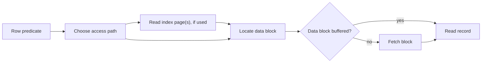

# SOE201 · Almacenamiento físico y organización de archivos

## Estado de generación del vídeo
PENDIENTE: material preparado; no se ha generado ni revisado ningún vídeo nuevo.

## Instrucciones
Explica la unidad en español siguiendo únicamente este material. Cita las fuentes y distingue práctica complementaria, respuestas suministradas y comentarios locales. Conserva fórmulas, identificadores, discrepancias y límites de evidencia. No inventes contenido, requisitos, resultados, dominio del estudiante ni predicciones de examen.

## Fuentes originales
- Lecture1b - Data Storage Structures.pdf (original en inglés) · SHA-256 d845e71836f530c08b400fa241131eace3506b5ed2561e1a799977cbab8e868f
- Lecture2a - Indexing Techniques (1).pdf (original en inglés) · SHA-256 cc64d4910c961b5d0b1cf77989ddc6cbe90fd428d9516c4d8ed051440ab1e101
- Lab1-Tutorial (1).pdf (original en inglés) · SHA-256 414dd799e75c3e142042f413f0516e75ca10ed1a827e5ba17fad5e327f91a332
- Lab1-Tutorial_Answers.pdf (original en inglés) · SHA-256 4e43c510e0c66be07e2ed6d5245fbe7843172e5c3c260c1f0b7da650dde57707

## Edición española derivada
El hash indicado para cada documento identifica la fuente inglesa; el contenido mostrado es la traducción española. Los originales se conservan en la biblioteca.

### content/reviewed/SOE201/01/tutor.md
Hash de fuente inglesa: eb5236ffbcb883adc86eaf0065a887a30f2a0245107cf0ed90768ee1d8bbcb20

---
title: "Unit 01 · Physical Storage · Tutor Notes"
course: SOE201
type: tutor-notes
status: reviewed
study_status: untested
language: en
cssclasses:
  - soe201-study
  - university-study
---

# Unidad 01: Almacenamiento físico, archivos e índices introductorios

[[10_UNIVERSITY_CS/SOE201/Tutor Mode/00 Start Here|Inicio del tutor]] · [[10_UNIVERSITY_CS/SOE201/Tutor Mode/Unit 01 - Physical Storage/02 Recall and Exam Practice|Recuerdo y práctica]] · [[10_UNIVERSITY_CS/SOE201/Unit 01 - Physical Storage/01 Notes|Notas de referencia]] · [[10_UNIVERSITY_CS/SOE201/Unit 01 - Physical Storage/03 Lab|Laboratorio de referencia]]

## En 60 segundos

Esta unidad explica cómo las filas lógicas se convierten en registros físicos, cómo los registros completos caben en bloques de tamaño fijo y cómo el orden de los archivos y la densidad del índice cambian la ruta hacia un registro. Las ideas centrales son:

1. En última instancia, una consulta necesita páginas, no bytes aislados;
2. la capacidad no dividida utiliza `floor(block size / item size)` antes de contar los bloques;
3. los grupos agrupados deben agruparse como grupos cuando la pregunta dice que permanecen juntos;
4. un índice primario sigue el orden físico de los archivos, mientras que denso/escaso describe la cobertura;
5. un índice es útil sólo si sus entradas pueden conducir a todas las coincidencias requeridas.

Después del estudio, debería poder calcular bloques de registro e índice, rastrear un modelo de lectura de disco y justificar una ruta de acceso sin inventar gastos generales ni resultados de rendimiento.

## Vista previa del concepto

> [!note] Página y buffer
> **Significado en lenguaje sencillo:** el DBMS transfiere una página/bloque y luego lee registros de la copia en memoria. Un impacto en el búfer evita la recuperación de la página de datos.
>
> **Por qué es importante:** el recuento de filas por sí solo no determina la E/S física.
>
> **Se conecta a:** empaquetado de registros, organización de archivos e índices.
>
> **Fuente:** `Lecture1b - Data Storage Structures.pdf`, PDF págs. 3–10.

> [!note] Factor de bloqueo
> **Significado en lenguaje sencillo:** el número máximo de registros completos y no divididos que caben en un bloque.
>
> **Por qué es importante:** redondear en el orden incorrecto cambia cada resultado posterior.
>
> **Se conecta a:** tamaño de índice denso y escaso.
>
> **Fuente:** `Lecture1b - Data Storage Structures.pdf`, PDF págs. 16–18; Tutorial Q3–Q6.

> [!note] Organización de archivos
> **Significado en lenguaje sencillo:** la regla física utilizada para colocar registros: montón, secuencial, hash o agrupado.
>
> **Por qué es importante:** la misma tabla lógica puede soportar costos de acceso y mantenimiento muy diferentes.
>
> **Se conecta a:** índices primarios y acceso a rangos.
>
> **Fuente:** `Lecture1b - Data Storage Structures.pdf`, PDF págs. 24–29.

> [!note] Índices densos y dispersos
> **Significado en lenguaje sencillo:** la cobertura densa normalmente tiene una entrada para cada aparición/registro de clave de búsqueda; muestras de cobertura escasa bloques de datos ordenados.
>
> **Por qué es importante:** una entrada escasa es segura sólo cuando el orden de los archivos permite que la búsqueda continúe con cada coincidencia.
>
> **Se conecta a:** rutas de acceso primarias versus secundarias.
>
> **Fuente:** `Lecture2a - Indexing Techniques (1).pdf`, PDF págs. 5–18.

## Instantánea de la evidencia del examen

| Tema | Artículos observados | Marcas conocidas | Demanda observada | Prioridad |
|---|---:|---:|---|---|
| Embalaje de registros/bloques y selección/tamaño de índice introductorio | 4/4 | 20 | calcular, discutir, justificar | **ALTA RELEVANCIA DEL EXAMEN** |
| Temporización del disco duro, registros variables y páginas ranuradas | 0/4 | 0 observado | no observado | NO OBSERVADO EN LA MUESTRA DE ANTERIOR DISPONIBLE |

Evidencia: [[10_UNIVERSITY_CS/SOE201/Tutor Mode/_System/past-paper-intelligence#Source-supported aggregates|inteligencia en artículos anteriores]]. El acontecimiento histórico no es una predicción.

## Antes de comenzar

Necesita división de enteros, límites máximos y la distinción entre una tupla lógica y un registro físico.

> [!question] Verificación de requisitos previos
> Un bloque de 4096 bytes almacena registros de 350 bytes no distribuidos. ¿Qué operación determina los registros por bloque: piso o techo?

> [!success]- Comprueba tu respuesta
> Piso: $\lfloor4096/350\rfloor=11$. Un duodécimo récord cruzaría el límite del bloque.
>
> Fuente: Tutorial Q3, `Lab1-Tutorial (1).pdf`, PDF p. 4.

## Una pregunta motivadora

**Caso sintético utilizando el modelo físico del Tutorial Q3.** Un registro tiene 25.000 registros fijos de 350 bytes en bloques de 4096 bytes. Los registros están ordenados por un `student_ID` de 10 bytes. Una entrada escasa del índice primario es la clave de 10 bytes más un puntero de 10 bytes.

1. ¿Cuántos bloques de datos se requieren?
2. ¿Cuántas entradas dispersas y bloques de índice se requieren?
3. ¿Por qué el índice es escaso sólo porque el archivo está ordenado según la misma clave de búsqueda?

**Criterios de éxito:** mantener los registros y las entradas sin dividir, mostrar los escalones del piso y del techo y explicar la invariante de acceso en lugar de informar solo los números.

| Pregunta | Conocimiento necesario |
|---|---|
| Bloques de datos | factor de bloqueo, techo de demanda récord |
| Bloques de índice | una entrada dispersa por bloque de datos, capacidad de entrada |
| Corrección | orden físico y selección de bloques candidatos |

## Aprende el mecanismo

### De tupla a búsqueda de página

Una tupla es una fila lógica. Su registro codificado vive dentro de una página/bloque. El búfer contiene copias de páginas en la memoria. Si se pierde el búfer, se recupera la página; en caso de acierto, el registro se puede leer desde la página de residente. Las páginas de índice y las páginas de datos son costos separados a menos que un problema las combine explícitamente.

**Figura 1: una búsqueda lógica se convierte en trabajo de página**

**Léelo:** siga la ruta del índice o la ruta directa del archivo; ambos convergen en un bloque de datos.

**Conclusión clave:** un índice breve no demuestra que una consulta sea barata cuando los registros calificados ocupan muchas páginas de datos dispersas.

**Procedencia:** enseñanza de la construcción de `Lecture1b`, PDF págs. 3–10, y `Lecture2a`, PDF págs. 5–18.

### Capacidad de registro completo

Para registros de tamaño de bloque $B$, tamaño de registro $R$ y $N$:

$$bfr=\left\lfloor\frac{B}{R}\right\rfloor, \qquad b=\left\lceil\frac{N}{bfr}\right\rceil.$$

`bfr` es el factor de bloqueo. Piso primero porque sólo caben discos enteros; techo en segundo lugar porque un bloque final parcialmente lleno todavía ocupa un bloque.

> [!warning] Trampa pedagógica: dividir el total de bytes directamente
> $\lceil NR/B\rceil$ permite que los bytes no utilizados de un bloque se combinen con otro. Eso contradice la condición de registro no dividido siempre que el resto no pueda contener otro registro completo.

### Grupos que deben permanecer juntos

El tutorial Q4 requiere un estudiante de 300 bytes y cinco registros de módulo de 200 bytes en el mismo bloque. El grupo indivisible es

$$G=300+5(200)=1300\text{ bytes}.$$

Luego, los grupos $\lfloor4096/1300\rfloor=3$ caben por bloque y se necesitan bloques $\lceil1000/3\rceil=334$. La agrupación de todos los bytes de estudiantes y módulos violaría la restricción de agrupación.

### Denso, escaso, primario y secundario son ejes diferentes

| Término | Pregunta decisiva |
|---|---|
| Índice primario | ¿El archivo de datos está físicamente ordenado por esta clave de búsqueda? |
| Índice secundario | ¿El índice está en un orden diferente al del archivo de datos? |
| Índice denso | ¿Está representado cada valor de clave de búsqueda, con una ruta a todos los registros que tienen ese valor? |
| Índice escaso | ¿Pueden las entradas representativas seleccionar un bloque/rango porque el orden de los archivos completa la búsqueda? |

Una clave primaria lógica no tiene por qué ser la clave de **índice** primaria. En el Tutorial Q6, el archivo está ordenado por `name` sin clave; un índice que sigue ese orden físico es primordial en la terminología de la conferencia.

### Capacidad del índice

Para entradas de longitud de clave $K$, longitud de puntero $P$ y $E$:

$$e=K+P,\qquad bfr_I=\left\lfloor\frac{B}{e}\right\rfloor,\qquad b_I=\left\lceil\frac{E}{bfr_I}\right\rceil.$$

Para un índice primario escaso en este curso, $E$ normalmente es el número de bloques de datos. Para obtener un índice denso, lea la pregunta: El tutorial Q4 requiere explícitamente una entrada por tupla de estudiantes.

### Fases de lectura del disco duro

El modelo fuente separa búsqueda, espera rotacional y transferencia:

$$T_{read}=T_{seek}+T_{rotation}+T_{transfer}.$$

Los casos mínimo, máximo y promedio eligen diferentes supuestos de búsqueda/rotación. Los promedios del tutorial Q2 buscan la mitad del máximo indicado y la rotación como media revolución, manteniendo al mismo tiempo el tiempo de transferencia completo. Esta es la aproximación del curso, no un punto de referencia de disco universal.

> [!question] Explícalo tú mismo
> ¿Por qué un índice disperso de ID desordenados puede perder un registro coincidente incluso si todas las entradas del índice son correctas?

> [!success]- Consulta tu explicación
> Los bloques de muestreo funcionan solo cuando el orden de los archivos hace que el bloque/rango seleccionado contenga todas las coincidencias posibles. Las identificaciones desordenadas pueden ocurrir fuera de ese rango.
>
> Fuente: `Lecture2a - Indexing Techniques (1).pdf`, PDF págs. 8–18; Tutorial Q6.

## Ejemplo resuelto: resuelve la pregunta motivadora

**Paso 1: registros de datos por bloque**

$$bfr=\lfloor4096/350\rfloor=11.$$

**Paso 2: Bloques de datos**

$$b=\lceil25000/11\rceil=\lceil2272.727\ldots\rceil=2273.$$

**Paso 3: entradas escasas**

Una entrada por bloque de datos proporciona entradas $E=2273$. Cada entrada es $10+10=20$ bytes.

**Paso 4: Entradas de índice por bloque y bloques de índice**

$$bfr_I=\lfloor4096/20\rfloor=204,$$

$$b_I=\lceil2273/204\rceil=\lceil11.142\ldots\rceil=12.$$

**Interpretación:** el índice disperso ocupa 12 bloques y selecciona entre 2273 bloques de datos ordenados. Una búsqueda aún necesita atravesar el índice y al menos el bloque de datos candidato; El estado de la caché no está especificado.

**Fuente:** Tutorial Q3, `Lab1-Tutorial (1).pdf`, PDF p. 4; respuesta proporcionada, `Lab1-Tutorial_Answers.pdf`, PDF p. 8.

## Volver a la pregunta motivadora

Las respuestas son **2273 bloques de datos**, **2273 entradas dispersas** y **12 bloques de índice**. El diseño disperso es correcto porque los bloques de datos están ordenados secuencialmente por `student_ID`; una entrada que representa un bloque identifica el rango candidato y la búsqueda continúa dentro de ese bloque. Elimine el supuesto de orden y el mismo muestreo ya no garantizará una búsqueda completa.

## Definiciones y distinciones

| Término A | Término B | Distinción decisiva | Fuente |
|---|---|---|---|
| Tupla | Registro | fila lógica versus representación física codificada | Conferencia 1b, págs. 3–4 |
| Página/bloque | Registro | unidad de transferencia/contenedor versus un artículo almacenado | Conferencia 1b, págs. 7–10 |
| Clave primaria | Clave de búsqueda | restricción de unicidad lógica versus atributos de búsqueda que pueden repetirse | Conferencia 2a, págs. 5–7 |
| Índice denso | Índice escaso | cobertura total directa versus cobertura representativa según el pedido | Conferencia 2a, págs. 8–18 |
| Índice primario | Índice secundario | sigue el orden de los archivos físicos frente a los índices en otro orden | Conferencia 2a, págs. 8–18 |

## Confusiones comunes

- **Techo demasiado pronto:** los registros por bloque utilizan el piso; Los bloques requeridos utilizan el techo.
- **Gastos generales inventados:** agregue encabezados de página o espacios solo cuando se proporcionen.
- **Clave lógica = orden físico:** no necesariamente.
- **Menos bloques de índice = más rápido:** la recuperación aún puede tocar muchos bloques de datos.
- **Escaso = una entrada por bloque arbitrario:** solo es seguro con una invariante de orden/enrutamiento.

## Revisión

### Comprensión total

Regrese a [[#Learn the mechanism]] y [[#Worked example — solve the motivating question]].

## Revisión de 5 minutos

1. Identifique el elemento indivisible: registro, grupo agrupado o entrada de índice.
2. Calcule elementos completos por bloque con piso.
3. Calcular bloques con techo.
4. Decida el recuento de entradas según la cobertura densa/escasa.
5. Verifique que el orden físico complete la ruta de acceso.
6. Mantenga separados los supuestos de nodo de índice, página de datos y búfer.

## Recuperación de 60 segundos

- tupla → registro → página → archivo
- golpe de buffer versus falla
- `floor(B/R)` luego `ceil(N/bfr)`
- grupo agrupado como elemento indivisible
- primaria versus secundaria
- denso versus escaso
- bytes de clave + bytes de puntero
- buscar + rotación + transferencia

## Fuentes

- `Lecture1b - Data Storage Structures.pdf`, PDF págs. 2–29.
- `Lecture2a - Indexing Techniques (1).pdf`, PDF págs. 5–18. `(2)` es un duplicado de bytes idénticos.
- `Lab1-Tutorial (1).pdf`, PDF págs. 2 a 8 y `Lab1-Tutorial_Answers.pdf`, páginas de respuestas citadas.
- `SOE201-EXAMS.pdf`, páginas de preguntas P23F/P23R/P24F/P24R inspeccionadas; ver [[10_UNIVERSITY_CS/SOE201/Tutor Mode/_System/past-paper-intelligence|inteligencia]].

### content/reviewed/SOE201/01/practice.md
Hash de fuente inglesa: df375f36aae1583c47179ab95e8090b2422d5c856dbb81c6aafea358bd5b1fa0

---
title: "Unit 01 · Recall and Exam Practice"
course: SOE201
type: tutor-practice
status: reviewed
study_status: untested
language: en
cssclasses:
  - soe201-study
  - university-study
---

# Unidad 01 — Recordatorio y práctica de exámenes

[[10_UNIVERSITY_CS/SOE201/Tutor Mode/Unit 01 - Physical Storage/01 Tutor Notes|Notas del tutor]] · [[10_UNIVERSITY_CS/SOE201/Unit 01 - Physical Storage/02 Exercises|Ejercicios de referencia]] · [[10_UNIVERSITY_CS/SOE201/Tutor Mode/_System/past-paper-intelligence|Evidencia del examen]]

Pruebe cada elemento con las referencias cerradas. Abra la pista solo si es necesario y luego compare cada paso del razonamiento con la solución completa.

## Repaso activo atómico

### Tarjeta 01: ¿Cuál es el factor de bloqueo para registros fijos no distribuidos?

> [!success]- Respuesta
> $\lfloor\text{block size}/\text{record size}\rfloor$: el número de registros completos que caben en un bloque.
>
> Fuente: Lecture1b, PDF págs. 16-18.

### Tarjeta 02: ¿Por qué el recuento de bloques finales se redondea hacia arriba?

> [!success]- Respuesta
> Cualquier registro restante necesita un bloque real incluso cuando ese bloque no esté lleno.
>
> Fuente: Lecture1b, PDF págs. 16-18.

### Tarjeta 03: ¿Qué hace que un índice sea principal en este curso?

> [!success]- Respuesta
> El orden de sus claves de búsqueda coincide con el orden secuencial físico del archivo de datos.
>
> Fuente: Lecture2a, PDF págs. 8–12.

### Tarjeta 04: ¿Qué representa un índice denso y cómo se manejan los valores de clave de búsqueda duplicados?

> [!success]- Respuesta
> Cada valor de clave de búsqueda en el archivo de datos tiene una entrada de índice. Los valores duplicados deben conducir a todos sus registros coincidentes, por ejemplo a través de una lista de ejecución o de puntero. Una entrada por registro es un diseño particular, no el único diseño denso.
>
> Fuente: Lecture2a, PDF págs. 8–18.

### Tarjeta 05: ¿Qué invariante hace que un índice primario escaso sea utilizable?

> [!success]- Respuesta
> Los datos ordenados permiten que una entrada representativa seleccione el bloque/rango que contiene el objetivo.
>
> Fuente: Lecture2a, PDF págs. 8–18.

### Tarjeta 06: ¿Cuál es el tamaño básico de una entrada de índice aquí?

> [!success]- Respuesta
> Bytes de clave de búsqueda más bytes de puntero, a menos que la fuente proporcione explícitamente una sobrecarga adicional.
>
> Fuente: Tutorial Q3–Q6.

### Tarjeta 07: ¿Cuáles son las fases de tiempo de lectura del disco duro?

> [!success]- Respuesta
> Tiempo de búsqueda, tiempo de espera rotacional y tiempo de transferencia.
>
> Fuente: Tutorial Q1–Q2; Conferencia 1b, PDF págs. 11-15.

### Tarjeta 08: ¿Por qué una página puede servir para varias filas?

> [!success]- Respuesta
> Varias filas pueden compartir la página recuperada, que permanece disponible mientras está almacenada en el búfer.
>
> Fuente: Lecture1b, PDF págs. 7–10.

### Tarjeta 09: un estudiante de 300 bytes y sus cinco registros de módulo de 200 bytes deben permanecer juntos. ¿Qué tamaño de grupo debe utilizar el cálculo de la capacidad del bloque y por qué?

> [!success]- Respuesta
> Un registro de estudiante de 300 bytes junto con sus cinco registros de módulo de 200 bytes: un grupo de 1300 bytes.
>
> Fuente: Tutorial Q4, PDF págs. 5–6.

### Tarjeta 10: ¿Por qué un índice pequeño no resulta una consulta barata?

> [!success]- Respuesta
> Los registros calificados pueden seguir ocupando muchas páginas de datos dispersas; el caché y la agrupación en clústeres no están especificados.
>
> Fuente: Lecture2a, PDF págs. 5–18.

## Práctica guiada → independiente → transferencia

> [!danger] ALTA RELEVANCIA DEL EXAMEN
> El embalaje de registros/bloques y el tamaño/selección del índice introductorio aparecen en 4/4 de los papeles inspeccionados, con 20 marcas observadas conocidas. Esta es una prioridad de estudio, no una predicción.

### Práctica 1: complete el método de embalaje

**PRÁCTICA COMPLEMENTARIA.** Un archivo tiene 12.000 registros no divididos de 180 bytes y bloques de 4096 bytes. Calcule la capacidad de registro y los bloques requeridos.

> [!tip]- Sugerencia
> Calcule registros completos por bloque antes de dividir el recuento de registros.

> [!success]- Solución
> **Capacidad:** Registros $\lfloor4096/180\rfloor=22$ porque $22(180)=3960$ y $23(180)=4140>4096$.
>
> **Bloques:** $\lceil12000/22\rceil=\lceil545.45\ldots\rceil=546$.
>
> **Interpretación:** el último bloque está parcialmente lleno. Dividir directamente el total de bytes entre 4096 combinaría incorrectamente fragmentos inutilizables entre bloques.
>
> Principios fuente: Lecture1b, PDF, págs. 16–18.

### Práctica 2: dimensionar un índice disperso

**PRÁCTICA COMPLEMENTARIA.** El archivo de la Práctica 1 está ordenado mediante una clave de búsqueda de 8 bytes. Una entrada escasa por bloque de datos utiliza esa clave y un puntero de 8 bytes. Calcule las entradas por bloque de índice y bloques de índice.

> [!tip]- Sugerencia
> Hay tantas entradas dispersas como bloques de datos de la Práctica 1.

> [!success]- Solución
> El tamaño de entrada es $8+8=16$ bytes. La capacidad es de entradas $\lfloor4096/16\rfloor=256$ por bloque de índice.
>
> Hay 546 entradas, por lo que los bloques de índice $\lceil546/256\rceil=3$.
>
> El resultado depende del archivo ordenado por esta clave de búsqueda. Sin ese orden, un representante por bloque no crearía una ruta de búsqueda completa.
>
> Principios fuente: Lecture2a, PDF, págs. 8–18.

> [!danger] ALTA RELEVANCIA DEL EXAMEN
> Lo siguiente conserva los datos fuente del Tutorial Q3, un patrón que coincide estrechamente con las preguntas históricas repetidas.

### Práctica 3 — EJERCICIO ORIGINAL DEL CURSO: Tutorial Q3

Para 25.000 registros de estudiantes de 350 bytes no distribuidos en bloques de 4096 bytes, calcule los bloques de datos. Luego, dimensione un índice primario disperso en un `student_ID` de 10 bytes con un puntero de 10 bytes.

**Fuente:** `Lab1-Tutorial (1).pdf`, PDF p. 4, P3.

> [!tip]- Sugerencia
> Utilice cuatro etapas: capacidad de datos → bloques de datos → capacidad de entrada de índice → bloques de índice.

> [!success]- Solución
> Capacidad de datos: registros/bloque $\lfloor4096/350\rfloor=11$.
>
> Bloques de datos: $\lceil25000/11\rceil=2273$.
>
> Entradas dispersas: una por bloque de datos, es decir, 2273.
>
> Tamaño de entrada: $10+10=20$ bytes; capacidad de índice $\lfloor4096/20\rfloor=204$.
>
> Bloques de índice: $\lceil2273/204\rceil=12$.
>
> El archivo está ordenado por `student_ID`, por lo que una entrada representativa puede seleccionar el bloque de datos candidato.
>
> Fuente de la respuesta: `Lab1-Tutorial_Answers.pdf`, PDF p. 8.

### Práctica 4: diagnosticar un atajo tentador

**PRÁCTICA COMPLEMENTARIA.** Un estudiante afirma que el Tutorial Q4 necesita bloques $\lceil(1000\cdot300+5000\cdot200)/4096\rceil=318$. Diagnostica el error y calcula la respuesta compatible con la fuente.

> [!tip]- Sugerencia
> Identificar el grupo físico indivisible antes de utilizar el tamaño de bloque.

> [!success]- Solución
> El acceso directo agrupa fragmentos de bytes en bloques no relacionados y rompe la regla de que cada estudiante y exactamente cinco registros de módulo residen en el mismo bloque.
>
> Un grupo es $300+5(200)=1300$ bytes. Un bloque contiene grupos $\lfloor4096/1300\rfloor=3$. Por lo tanto, se bloquea $\lceil1000/3\rceil=334$.
>
> Fuente: Tutorial Q4, `Lab1-Tutorial (1).pdf`, PDF págs. 5–6; respuesta PDF pág. 11.

### Práctica 5: Decisión independiente de la ruta de acceso

**PRÁCTICA COMPLEMENTARIA.** Un archivo se ordena físicamente por `surname`, el cual se repite. Las consultas solicitan cada fila con un apellido y los valores exactos de `student_ID`. Explique cuál de estas afirmaciones es defendible: (a) un índice de apellidos escaso puede seleccionar el primer bloque de candidatos y escanear la ejecución; (b) un índice disperso `student_ID` se completa automáticamente; (c) un índice secundario denso `student_ID` puede cubrir todos los ID.

> [!tip]- Sugerencia
> Separe el orden físico de la unicidad lógica y luego pruebe la cobertura completa.

> [!success]- Solución
> (a) es defendible si las corridas de apellidos duplicados se mantienen en orden físico y el índice puede llegar al comienzo de la corrida.
>
> (b) no es defendible: las identificaciones están desordenadas en el archivo, por lo que el muestreo de bloques puede perder coincidencias.
>
> (c) es defendible cuando el índice secundario denso tiene una entrada/puntero para cada registro requerido o identificación única.
>
> Principios fuente: Lecture2a, PDF págs. 8–18; Tutorial Q6.

### Práctica 6: Transferencia a una restricción de grupo de almacenamiento

**PRÁCTICA COMPLEMENTARIA.** Un pedido y sus cuatro líneas de pedido de 240 bytes deben permanecer en un bloque de 4096 bytes. El registro de pedido es de 320 bytes. Hay 2500 pedidos. Calcule bloques y explique por qué un cálculo de flujo de bytes no es válido.

> [!tip]- Sugerencia
> Trate cada pedido más sus cuatro líneas como un artículo no dividido.

> [!success]- Solución
> El tamaño del grupo es $320+4(240)=1280$ bytes. La capacidad es de grupos $\lfloor4096/1280\rfloor=3$ por bloque.
>
> Los bloques son $\lceil2500/3\rceil=834$.
>
> Un cálculo de flujo de bytes movería las líneas de pedido al espacio libre que pertenece a otro bloque y violaría la restricción de coubicación.
>
> Principio fuente: modelo de grupos agrupados del tutorial Q4, PDF, págs. 5–6. Los valores son sintéticos.

## Navegación de ejercicios original

La edición ordinaria aprobada contiene soluciones completas para todas las preguntas del Tutorial 1 proporcionadas:

| Tarea original | Solución completa |
|---|---|
| Temporización del disco duro Q1–Q2 | [[10_UNIVERSITY_CS/SOE201/Unit 01 - Physical Storage/01 Notes#Example 2 — HDD timing · Q1–Q2|Ejemplo resuelto]] |
| Récord del tercer trimestre y tamaño del índice disperso | [[10_UNIVERSITY_CS/SOE201/Unit 01 - Physical Storage/01 Notes#Example 1 — Registry storage and its index · Q3|Ejemplo resuelto]] |
| Grupos agrupados de estudiantes/módulos del cuarto trimestre | [[10_UNIVERSITY_CS/SOE201/Unit 01 - Physical Storage/01 Notes#Example 4 — Student and module groups · Q4|Ejemplo resuelto]] |
| Archivo de producto Q5 e índice escaso | [[10_UNIVERSITY_CS/SOE201/Unit 01 - Physical Storage/01 Notes#Example 5 — Product file · Q5|Ejemplo resuelto]] |
| Q6 orden físico y elección de índice | [[10_UNIVERSITY_CS/SOE201/Unit 01 - Physical Storage/01 Notes#Example 6 — A file ordered by a non-key name · Q6|Ejemplo resuelto]] |

## Autocomprobación sugerida

No se proporciona ningún esquema de marcado oficial. Compruebe si una respuesta: identifica el elemento indivisible, utiliza el piso y luego el techo, preserva las restricciones establecidas, dimensiona las entradas explícitamente y explica por qué la ruta de acceso está completa.
