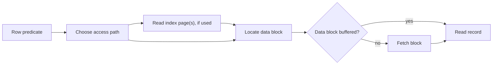

# SOE201 · Physical Storage and File Organization

## Video generation status
PENDING: source pack prepared; no cloud video has been generated or reviewed.

## Spanish video overview prompt
Explica esta unidad en español claro, paso a paso, para alguien que aprende de forma autodidacta. Usa únicamente el material incluido. Comienza con el problema motivador, presenta los conceptos, muestra un ejemplo visual fiel a las convenciones del curso, pausa para una pregunta y después explica la respuesta. Distingue práctica suplementaria de tareas oficiales y de soluciones oficiales. No inventes datos, fuentes, requisitos, capítulos pendientes, resultados de ejecución ni predicciones de examen. Conserva los límites y discrepancias indicados. Cierra con una actividad que el estudiante pueda intentar en Learning Uni. Cita el nombre del documento y su localizador cuando corresponda. Si falta evidencia, dilo; no rellenes el hueco. Mantén visibles las fórmulas y direcciones de flechas.

## Verified original file snapshots
- Lecture1b - Data Storage Structures.pdf · SHA-256 d845e71836f530c08b400fa241131eace3506b5ed2561e1a799977cbab8e868f
- Lecture2a - Indexing Techniques (1).pdf · SHA-256 cc64d4910c961b5d0b1cf77989ddc6cbe90fd428d9516c4d8ed051440ab1e101
- Lab1-Tutorial (1).pdf · SHA-256 414dd799e75c3e142042f413f0516e75ca10ed1a827e5ba17fad5e327f91a332
- Lab1-Tutorial_Answers.pdf · SHA-256 4e43c510e0c66be07e2ed6d5245fbe7843172e5c3c260c1f0b7da650dde57707

## Source material

### Snapshot: content/reviewed/SOE201/01/tutor.md
SHA-256: eb5236ffbcb883adc86eaf0065a887a30f2a0245107cf0ed90768ee1d8bbcb20

---
title: "Unit 01 · Physical Storage · Tutor Notes"
course: SOE201
type: tutor-notes
status: reviewed
study_status: untested
language: en
cssclasses:
  - soe201-study
  - university-study
---

# Unit 01 — Physical storage, files and introductory indexes

[[10_UNIVERSITY_CS/SOE201/Tutor Mode/00 Start Here|Tutor Start]] · [[10_UNIVERSITY_CS/SOE201/Tutor Mode/Unit 01 - Physical Storage/02 Recall and Exam Practice|Recall and practice]] · [[10_UNIVERSITY_CS/SOE201/Unit 01 - Physical Storage/01 Notes|Reference notes]] · [[10_UNIVERSITY_CS/SOE201/Unit 01 - Physical Storage/03 Lab|Reference lab]]

## In 60 Seconds

This unit explains how logical rows become physical records, how whole records fit into fixed-size blocks, and how file order and index density change the route to a record. The central ideas are:

1. a query ultimately needs pages, not isolated bytes;
2. unspanned capacity uses `floor(block size / item size)` before counting blocks;
3. clustered groups must be packed as groups when the question says they stay together;
4. a primary index follows physical file order, while dense/sparse describes coverage;
5. an index is useful only if its entries can lead to every required match.

After study, you should be able to calculate record and index blocks, trace a disk-read model, and justify an access path without inventing overhead or performance results.

## Concept Preview

> [!note] Page and buffer
> **Plain-language meaning:** the DBMS transfers a page/block and then reads records from the in-memory copy. A buffer hit avoids that data-page fetch.
>
> **Why it matters:** row count alone does not determine physical I/O.
>
> **Connects to:** record packing, file organisation and indexes.
>
> **Source:** `Lecture1b - Data Storage Structures.pdf`, PDF pp. 3–10.

> [!note] Blocking factor
> **Plain-language meaning:** the maximum number of whole, unspanned records that fit in one block.
>
> **Why it matters:** rounding in the wrong order changes every later result.
>
> **Connects to:** dense and sparse index sizing.
>
> **Source:** `Lecture1b - Data Storage Structures.pdf`, PDF pp. 16–18; Tutorial Q3–Q6.

> [!note] File organisation
> **Plain-language meaning:** the physical rule used to place records—heap, sequential, hashed or clustered.
>
> **Why it matters:** the same logical table can support very different access and maintenance costs.
>
> **Connects to:** primary indexes and range access.
>
> **Source:** `Lecture1b - Data Storage Structures.pdf`, PDF pp. 24–29.

> [!note] Dense and sparse indexes
> **Plain-language meaning:** dense coverage normally has an entry for every search-key occurrence/record; sparse coverage samples ordered data blocks.
>
> **Why it matters:** a sparse entry is safe only when the file order lets the search continue to every match.
>
> **Connects to:** primary versus secondary access paths.
>
> **Source:** `Lecture2a - Indexing Techniques (1).pdf`, PDF pp. 5–18.

## Exam Evidence Snapshot

| Topic | Observed papers | Known marks | Observed demand | Priority |
|---|---:|---:|---|---|
| Record/block packing and introductory index sizing/selection | 4/4 | 20 | calculate, discuss, justify | **HIGH EXAM RELEVANCE** |
| HDD timing, variable records and slotted pages | 0/4 | 0 observed | not observed | NOT OBSERVED IN AVAILABLE PAST-PAPER SAMPLE |

Evidence: [[10_UNIVERSITY_CS/SOE201/Tutor Mode/_System/past-paper-intelligence#Source-supported aggregates|past-paper intelligence]]. Historical occurrence is not a prediction.

## Before You Start

You need integer division, ceilings and the distinction between a logical tuple and a physical record.

> [!question] Prerequisite check
> A 4096-byte block stores unspanned 350-byte records. Which operation determines records per block: floor or ceiling?

> [!success]- Check your answer
> Floor: $\lfloor4096/350\rfloor=11$. A twelfth record would cross the block boundary.
>
> Source: Tutorial Q3, `Lab1-Tutorial (1).pdf`, PDF p. 4.

## A motivating question

**Synthetic case using Tutorial Q3's physical model.** A registry has 25,000 fixed 350-byte records in 4096-byte blocks. Records are ordered by a 10-byte `student_ID`. A sparse primary-index entry is the 10-byte key plus a 10-byte pointer.

1. How many data blocks are required?
2. How many sparse entries and index blocks are required?
3. Why is the index sparse only because the file is ordered on the same search key?

**Success criteria:** keep records and entries unspanned, show both floor and ceiling steps, and explain the access invariant rather than reporting numbers alone.

| Question | Knowledge needed |
|---|---|
| Data blocks | blocking factor, ceiling of record demand |
| Index blocks | one sparse entry per data block, entry capacity |
| Correctness | physical order and candidate-block selection |

## Learn the mechanism

### From tuple to page fetch

A tuple is a logical row. Its encoded record lives inside a page/block. The buffer holds page copies in memory. On a buffer miss, the page is fetched; on a hit, the record can be read from the resident page. Index pages and data pages are separate costs unless a problem explicitly combines them.

**Figure 1 — A logical lookup becomes page work**

**Read it:** follow either the index route or direct file route; both converge on a data block.

**Key takeaway:** a short index does not prove a query is cheap when qualifying records occupy many scattered data pages.

**Provenance:** teaching construction from `Lecture1b`, PDF pp. 3–10, and `Lecture2a`, PDF pp. 5–18.

### Whole-record capacity

For block size $B$, record size $R$, and $N$ records:

$$bfr=\left\lfloor\frac{B}{R}\right\rfloor, \qquad b=\left\lceil\frac{N}{bfr}\right\rceil.$$

`bfr` is the blocking factor. Floor first because only whole records fit; ceiling second because a partially filled final block still occupies a block.

> [!warning] Pedagogical trap — dividing total bytes directly
> $\lceil NR/B\rceil$ permits unused bytes from one block to combine with another. That contradicts the unspanned-record condition whenever the remainder cannot hold another complete record.

### Groups that must stay together

Tutorial Q4 requires one 300-byte student and five 200-byte module records in the same block. The indivisible group is

$$G=300+5(200)=1300\text{ bytes}.$$

Then $\lfloor4096/1300\rfloor=3$ groups fit per block and $\lceil1000/3\rceil=334$ blocks are needed. Pooling all student and module bytes would violate the clustering constraint.

### Dense, sparse, primary and secondary are different axes

| Term | Decisive question |
|---|---|
| Primary index | Is the data file physically ordered by this search key? |
| Secondary index | Is the index on a different order from the data file? |
| Dense index | Is every search-key value represented, with a route to all records having that value? |
| Sparse index | Can representative entries select a block/range because the file order completes the search? |

A logical primary key need not be the primary **index** key. In Tutorial Q6 the file is ordered by the non-key `name`; an index following that physical order is primary in the lecture terminology.

### Index capacity

For key length $K$, pointer length $P$, and $E$ entries:

$$e=K+P,\qquad bfr_I=\left\lfloor\frac{B}{e}\right\rfloor,\qquad b_I=\left\lceil\frac{E}{bfr_I}\right\rceil.$$

For a sparse primary index in this course, $E$ is normally the number of data blocks. For a dense index, read the question: Tutorial Q4 explicitly requires one entry per student tuple.

### HDD read phases

The source model separates seek, rotational waiting and transfer:

$$T_{read}=T_{seek}+T_{rotation}+T_{transfer}.$$

Minimum, maximum and average cases choose different seek/rotation assumptions. Tutorial Q2 averages seek as half the stated maximum and rotation as half a revolution, while retaining the full transfer time. This is the course approximation, not a universal disk benchmark.

> [!question] Explain it yourself
> Why can a sparse index on unordered IDs miss a matching record even if every index entry is correct?

> [!success]- Check your explanation
> Sampling blocks works only when file order makes the selected block/range contain every possible match. Unordered IDs can occur outside that range.
>
> Source: `Lecture2a - Indexing Techniques (1).pdf`, PDF pp. 8–18; Tutorial Q6.

## Worked example — solve the motivating question

**Step 1 — Data records per block**

$$bfr=\lfloor4096/350\rfloor=11.$$

**Step 2 — Data blocks**

$$b=\lceil25000/11\rceil=\lceil2272.727\ldots\rceil=2273.$$

**Step 3 — Sparse entries**

One entry per data block gives $E=2273$ entries. Each entry is $10+10=20$ bytes.

**Step 4 — Index entries per block and index blocks**

$$bfr_I=\lfloor4096/20\rfloor=204,$$

$$b_I=\lceil2273/204\rceil=\lceil11.142\ldots\rceil=12.$$

**Interpretation:** the sparse index occupies 12 blocks and selects among 2273 ordered data blocks. A lookup still needs its index traversal and at least the candidate data block; cache state is unspecified.

**Source:** Tutorial Q3, `Lab1-Tutorial (1).pdf`, PDF p. 4; supplied answer, `Lab1-Tutorial_Answers.pdf`, PDF p. 8.

## Return to the motivating question

The answers are **2273 data blocks**, **2273 sparse entries**, and **12 index blocks**. The sparse design is correct because data blocks are sequentially ordered by `student_ID`; an entry representing a block identifies the candidate range, and the search continues within that block. Remove the order assumption and the same sampling no longer guarantees complete lookup.

## Definitions and distinctions

| Term A | Term B | Decisive distinction | Source |
|---|---|---|---|
| Tuple | Record | logical row versus encoded physical representation | Lecture1b, pp. 3–4 |
| Page/block | Record | transfer/container unit versus one stored item | Lecture1b, pp. 7–10 |
| Primary key | Search key | logical uniqueness constraint versus lookup attribute(s) that may repeat | Lecture2a, pp. 5–7 |
| Dense index | Sparse index | direct complete coverage versus representative coverage relying on order | Lecture2a, pp. 8–18 |
| Primary index | Secondary index | follows physical file order versus indexes another order | Lecture2a, pp. 8–18 |

## Common confusions

- **Ceiling too early:** records per block uses floor; required blocks uses ceiling.
- **Invented overhead:** add page headers or slots only when supplied.
- **Logical key = physical order:** not necessarily.
- **Fewer index blocks = faster:** retrieval may still touch many data blocks.
- **Sparse = one entry per arbitrary block:** only safe with an ordering/routing invariant.

## Review

### Full Understanding

Return to [[#Learn the mechanism]] and [[#Worked example — solve the motivating question]].

## 5-Minute Review

1. Identify the indivisible item: record, clustered group or index entry.
2. Compute whole items per block with floor.
3. Compute blocks with ceiling.
4. Decide entry count from dense/sparse coverage.
5. Verify that physical order makes the access path complete.
6. Keep index-node, data-page and buffer assumptions separate.

## 60-Second Recall

- tuple → record → page → file
- buffer hit versus miss
- `floor(B/R)` then `ceil(N/bfr)`
- clustered group as indivisible item
- primary versus secondary
- dense versus sparse
- key bytes + pointer bytes
- seek + rotation + transfer

## Sources

- `Lecture1b - Data Storage Structures.pdf`, PDF pp. 2–29.
- `Lecture2a - Indexing Techniques (1).pdf`, PDF pp. 5–18. `(2)` is a byte-identical duplicate.
- `Lab1-Tutorial (1).pdf`, PDF pp. 2–8, and `Lab1-Tutorial_Answers.pdf`, cited answer pages.
- `SOE201-EXAMS.pdf`, inspected P23F/P23R/P24F/P24R question pages; see [[10_UNIVERSITY_CS/SOE201/Tutor Mode/_System/past-paper-intelligence|intelligence]].

### Snapshot: content/reviewed/SOE201/01/practice.md
SHA-256: df375f36aae1583c47179ab95e8090b2422d5c856dbb81c6aafea358bd5b1fa0

---
title: "Unit 01 · Recall and Exam Practice"
course: SOE201
type: tutor-practice
status: reviewed
study_status: untested
language: en
cssclasses:
  - soe201-study
  - university-study
---

# Unit 01 — Recall and exam practice

[[10_UNIVERSITY_CS/SOE201/Tutor Mode/Unit 01 - Physical Storage/01 Tutor Notes|Tutor notes]] · [[10_UNIVERSITY_CS/SOE201/Unit 01 - Physical Storage/02 Exercises|Reference exercises]] · [[10_UNIVERSITY_CS/SOE201/Tutor Mode/_System/past-paper-intelligence|Exam evidence]]

Attempt each item with references closed. Open the hint only if needed, then compare every reasoning step with the complete solution.

## Atomic recall

### Card 01 — What is the blocking factor for unspanned fixed records?

> [!success]- Answer
> $\lfloor\text{block size}/\text{record size}\rfloor$: the number of complete records that fit in one block.
>
> Source: Lecture1b, PDF pp. 16–18.

### Card 02 — Why is the final block count rounded upward?

> [!success]- Answer
> Any remaining record needs a real block even when that block is not full.
>
> Source: Lecture1b, PDF pp. 16–18.

### Card 03 — What makes an index primary in this course?

> [!success]- Answer
> Its search-key order matches the physical sequential order of the data file.
>
> Source: Lecture2a, PDF pp. 8–12.

### Card 04 — What does a dense index represent, and how are duplicate search-key values handled?

> [!success]- Answer
> Every search-key value in the data file has an index entry. Duplicate values must lead to all their matching records, for example via a run or pointer list. One entry per record is a particular layout, not the only dense layout.
>
> Source: Lecture2a, PDF pp. 8–18.

### Card 05 — What invariant makes a sparse primary index usable?

> [!success]- Answer
> Ordered data lets a representative entry select the block/range containing the target.
>
> Source: Lecture2a, PDF pp. 8–18.

### Card 06 — What is an index entry's basic size here?

> [!success]- Answer
> Search-key bytes plus pointer bytes, unless the source explicitly supplies additional overhead.
>
> Source: Tutorial Q3–Q6.

### Card 07 — What are the HDD read-time phases?

> [!success]- Answer
> Seek time, rotational waiting and transfer time.
>
> Source: Tutorial Q1–Q2; Lecture1b, PDF pp. 11–15.

### Card 08 — Why can one page fetch serve several rows?

> [!success]- Answer
> Several rows may share the fetched page, which remains available while buffered.
>
> Source: Lecture1b, PDF pp. 7–10.

### Card 09 — One 300-byte student and its five 200-byte module records must stay together. What group size must the block-capacity calculation use, and why?

> [!success]- Answer
> One 300-byte student record together with its five 200-byte module records: a 1300-byte group.
>
> Source: Tutorial Q4, PDF pp. 5–6.

### Card 10 — Why does a small index not prove a cheap query?

> [!success]- Answer
> Qualifying records may still occupy many scattered data pages; cache and clustering are unspecified.
>
> Source: Lecture2a, PDF pp. 5–18.

## Guided → independent → transfer practice

> [!danger] HIGH EXAM RELEVANCE
> Record/block packing and introductory index sizing/selection appear in 4/4 inspected papers, with 20 known observed marks. This is a study priority, not a prediction.

### Practice 1 — Complete the packing method

**SUPPLEMENTARY PRACTICE.** A file has 12,000 unspanned 180-byte records and 4096-byte blocks. Calculate record capacity and required blocks.

> [!tip]- Hint
> Compute whole records per block before dividing the record count.

> [!success]- Solution
> **Capacity:** $\lfloor4096/180\rfloor=22$ records because $22(180)=3960$ and $23(180)=4140>4096$.
>
> **Blocks:** $\lceil12000/22\rceil=\lceil545.45\ldots\rceil=546$.
>
> **Interpretation:** the last block is partially filled. Directly dividing total bytes by 4096 would incorrectly combine unusable fragments across blocks.
>
> Source principles: Lecture1b, PDF pp. 16–18.

### Practice 2 — Size a sparse index

**SUPPLEMENTARY PRACTICE.** The file in Practice 1 is ordered by an 8-byte search key. One sparse entry per data block uses that key and an 8-byte pointer. Calculate entries per index block and index blocks.

> [!tip]- Hint
> There are as many sparse entries as data blocks from Practice 1.

> [!success]- Solution
> Entry size is $8+8=16$ bytes. Capacity is $\lfloor4096/16\rfloor=256$ entries per index block.
>
> There are 546 entries, so $\lceil546/256\rceil=3$ index blocks.
>
> The result depends on the file being ordered by this search key. Without that order, one representative per block would not create a complete search route.
>
> Source principles: Lecture2a, PDF pp. 8–18.

> [!danger] HIGH EXAM RELEVANCE
> The following preserves the source data of Tutorial Q3, a pattern closely matching repeated historical questions.

### Practice 3 — ORIGINAL COURSE EXERCISE: Tutorial Q3

For 25,000 unspanned 350-byte student records in 4096-byte blocks, calculate data blocks. Then size a sparse primary index on a 10-byte `student_ID` with a 10-byte pointer.

**Source:** `Lab1-Tutorial (1).pdf`, PDF p. 4, Q3.

> [!tip]- Hint
> Use four stages: data capacity → data blocks → index-entry capacity → index blocks.

> [!success]- Solution
> Data capacity: $\lfloor4096/350\rfloor=11$ records/block.
>
> Data blocks: $\lceil25000/11\rceil=2273$.
>
> Sparse entries: one per data block, so 2273.
>
> Entry size: $10+10=20$ bytes; index capacity $\lfloor4096/20\rfloor=204$.
>
> Index blocks: $\lceil2273/204\rceil=12$.
>
> The file is ordered by `student_ID`, so a representative entry can select the candidate data block.
>
> Answer source: `Lab1-Tutorial_Answers.pdf`, PDF p. 8.

### Practice 4 — Diagnose a tempting shortcut

**SUPPLEMENTARY PRACTICE.** A student claims Tutorial Q4 needs $\lceil(1000\cdot300+5000\cdot200)/4096\rceil=318$ blocks. Diagnose the error and calculate the source-compliant answer.

> [!tip]- Hint
> Identify the indivisible physical group before using the block size.

> [!success]- Solution
> The shortcut pools byte fragments across unrelated blocks and breaks the rule that each student and exactly five module records reside in the same block.
>
> One group is $300+5(200)=1300$ bytes. A block holds $\lfloor4096/1300\rfloor=3$ groups. Therefore $\lceil1000/3\rceil=334$ blocks.
>
> Source: Tutorial Q4, `Lab1-Tutorial (1).pdf`, PDF pp. 5–6; answer PDF p. 11.

### Practice 5 — Independent access-path decision

**SUPPLEMENTARY PRACTICE.** A file is physically ordered by `surname`, which repeats. Queries ask for every row with one surname and for exact `student_ID` values. Explain which of these claims is defensible: (a) a sparse surname index can select the first candidate block and scan the run; (b) a sparse `student_ID` index is automatically complete; (c) a dense `student_ID` secondary index can cover every ID.

> [!tip]- Hint
> Separate physical order from logical uniqueness, then test complete coverage.

> [!success]- Solution
> (a) is defensible if duplicate surname runs are kept in physical order and the index can reach the run's beginning.
>
> (b) is not defensible: IDs are unordered in the file, so block sampling can miss matches.
>
> (c) is defensible when the dense secondary index has an entry/pointer for every required record or unique ID.
>
> Source principles: Lecture2a, PDF pp. 8–18; Tutorial Q6.

### Practice 6 — Transfer to a storage-group constraint

**SUPPLEMENTARY PRACTICE.** An order and its four 240-byte line items must remain in one 4096-byte block. The order record is 320 bytes. There are 2500 orders. Calculate blocks and explain why a byte-stream calculation is invalid.

> [!tip]- Hint
> Treat each order plus its four lines as one unspanned item.

> [!success]- Solution
> Group size is $320+4(240)=1280$ bytes. Capacity is $\lfloor4096/1280\rfloor=3$ groups per block.
>
> Blocks are $\lceil2500/3\rceil=834$.
>
> A byte-stream calculation would move line items into spare space belonging to another block and violate the co-location constraint.
>
> Source principle: Tutorial Q4's clustered-group model, PDF pp. 5–6. Values are synthetic.

## Original exercise navigation

The approved ordinary edition contains complete worked solutions for all supplied Tutorial 1 questions:

| Original task | Complete solution |
|---|---|
| Q1–Q2 HDD timing | [[10_UNIVERSITY_CS/SOE201/Unit 01 - Physical Storage/01 Notes#Example 2 — HDD timing · Q1–Q2|Worked example]] |
| Q3 record and sparse-index sizing | [[10_UNIVERSITY_CS/SOE201/Unit 01 - Physical Storage/01 Notes#Example 1 — Registry storage and its index · Q3|Worked example]] |
| Q4 clustered student/module groups | [[10_UNIVERSITY_CS/SOE201/Unit 01 - Physical Storage/01 Notes#Example 4 — Student and module groups · Q4|Worked example]] |
| Q5 product file and sparse index | [[10_UNIVERSITY_CS/SOE201/Unit 01 - Physical Storage/01 Notes#Example 5 — Product file · Q5|Worked example]] |
| Q6 physical order and index choice | [[10_UNIVERSITY_CS/SOE201/Unit 01 - Physical Storage/01 Notes#Example 6 — A file ordered by a non-key name · Q6|Worked example]] |

## Suggested self-check

No official marking scheme is supplied. Check whether an answer: identifies the indivisible item, uses floor then ceiling, preserves stated constraints, sizes entries explicitly, and explains why the access path is complete.
