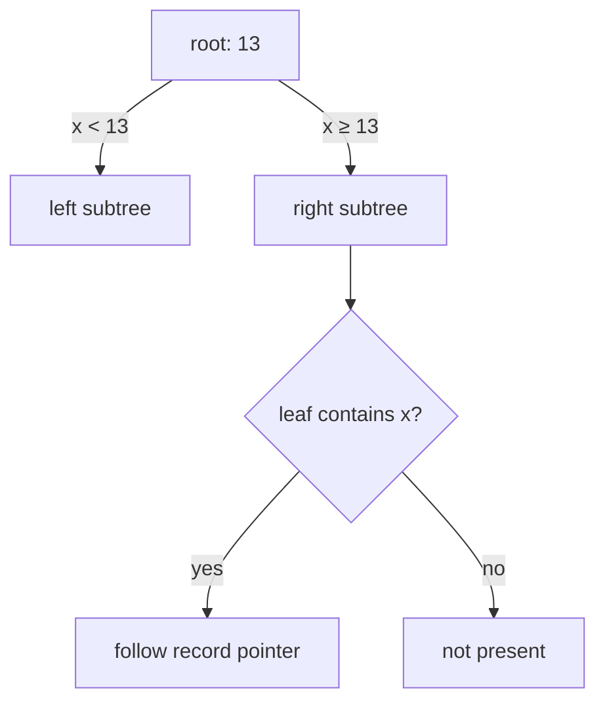

# SOE201 · Indexación de árbol B+

## Estado de generación del vídeo
PENDIENTE: material preparado; no se ha generado ni revisado ningún vídeo nuevo.

## Instrucciones
Explica la unidad en español siguiendo únicamente este material. Cita las fuentes y distingue práctica complementaria, respuestas suministradas y comentarios locales. Conserva fórmulas, identificadores, discrepancias y límites de evidencia. No inventes contenido, requisitos, resultados, dominio del estudiante ni predicciones de examen.

## Fuentes originales
- Lecture2b - B+Tree Indexing (1).pdf (original en inglés) · SHA-256 020c3166574d9c040882391c85b3c1a8875eccdf5798651330f76d7a4623a827

## Edición española derivada
El hash indicado para cada documento identifica la fuente inglesa; el contenido mostrado es la traducción española. Los originales se conservan en la biblioteca.

### content/reviewed/SOE201/02/tutor.md
Hash de fuente inglesa: ea99860ddbf5638e06d987c3ea9a9c268d0e831a47264358d693a66fe4dffb9e

---
title: "Unit 02 · B+ Tree Indexing · Tutor Notes"
course: SOE201
type: tutor-notes
status: reviewed
study_status: untested
language: en
cssclasses:
  - soe201-study
  - university-study
---

# Unidad 02 — Indexación de árboles B+

[[10_UNIVERSITY_CS/SOE201/Tutor Mode/00 Start Here|Inicio del tutor]] · [[10_UNIVERSITY_CS/SOE201/Tutor Mode/Unit 02 - B+ Tree Indexing/02 Recall and Exam Practice|Recuerdo y práctica]] · [[10_UNIVERSITY_CS/SOE201/Unit 02 - B+ Tree Indexing/01 Notes|Notas de referencia]]

## En 60 segundos

Un árbol B+ es un índice ordenado equilibrado. Ruta de nodos internos por rangos de separadores; Las hojas contienen las entradas clave de búsqueda y están vinculadas para escaneos de rango. En este curso, ordenar $n$ significa como máximo punteros secundarios $n$ en un nodo interno y, por lo tanto, como máximo claves de hoja $n-1$. La búsqueda sigue los límites de una hoja. La inserción divide los nodos desbordados. La eliminación repara el desbordamiento utilizando la regla **combinar primero, de lo contrario redistribuir** de la conferencia. La raíz tiene reglas especiales de ocupación.

Después del estudio, debería poder rastrear el acceso de búsqueda/rango, aplicar la inserción y eliminación de un estado a la vez y validar la ocupación, el orden, el enrutamiento, los enlaces de hoja y la profundidad igual.

## Vista previa del concepto

> [!note] Límite del separador
> **Significado en lenguaje sencillo:** una clave interna divide los rangos secundarios; no es en sí mismo una prueba de que existe un registro.
>
> **Por qué es importante:** la pertenencia se confirma solo en una hoja.
>
> **Se conecta a:** búsqueda y mantenimiento de separadores.
>
> **Fuente:** `Lecture2b - B+Tree Indexing (1).pdf`, PDF págs. 4–9.

> [!note] Ocupación
> **Significado en lenguaje sencillo:** los nodos no raíz tienen capacidades mínimas y máximas; se permite que la raíz sea más pequeña.
>
> **Por qué es importante:** el desbordamiento provoca la división y el desbordamiento provoca la reparación.
>
> **Se conecta a:** inserción, eliminación y altura.
>
> **Fuente:** Lecture2b, PDF págs. 4–6, 12–27.

> [!note] Copiar versus promocionar
> **Significado en lenguaje sencillo:** una división de hoja copia un límite hacia arriba mientras retiene las claves de datos en las hojas; una división interna promueve un separador.
>
> **Por qué es importante:** al tratar ambas divisiones de manera idéntica se pierde una clave de hoja con capacidad de búsqueda o se duplica el enrutamiento incorrectamente.
>
> **Se conecta a:** divisiones en cascada.
>
> **Fuente:** Lecture2b, PDF págs. 12–18.

> [!note] Fusión-primera eliminación
> **Significado en lenguaje sencillo:** cuando un nodo tiene un desbordamiento insuficiente, el algoritmo proporcionado primero se fusiona con un hermano elegible si el contenido combinado encaja; de lo contrario, se redistribuye.
>
> **Por qué es importante:** determina el árbol intermedio exacto que esperan los ejemplos fuente.
>
> **Se conecta a:** eliminación principal y contracción de raíz.
>
> **Fuente:** Lecture2b, PDF págs. 19–27.

## Instantánea de la evidencia del examen

| Tema | Artículos observados | Marcas conocidas | Demanda observada | Prioridad |
|---|---:|---:|---|---|
| Eliminación y reparación | 3/4 | 6 | explicar, describir, dibujar | **ALTA RELEVANCIA DEL EXAMEN** |
| Seguimiento de búsqueda | 1/4 | 2 | describir | MEDIO |
| Inserción, capacidad y escaneo de rango | 0/4 | 0 observado | no observado | NO OBSERVADO EN LA MUESTRA DE ANTERIOR DISPONIBLE |

Evidencia: [[10_UNIVERSITY_CS/SOE201/Tutor Mode/_System/past-paper-intelligence#Source-supported aggregates|inteligencia en artículos anteriores]].

## Antes de comenzar

Recuerde claves ordenadas, punteros y la distinción entre un bloque de índice y un bloque de datos.

> [!question] Verificación de requisitos previos
> Si un nodo interno tiene separadores `[10, 20]`, ¿cuántos rangos secundarios tiene?

> [!success]- Comprueba tu respuesta
> Tres: valores inferiores a 10, valores de 10 a inferiores a 20 y valores al menos de 20.
>
> Principio fuente: Lecture2b, PDF, págs. 4–9.

## Una pregunta motivadora

Utilice el árbol inicial de orden exacto 4 de Lecture2b, PDF p. 34:

```text
                 [7 | 13 | 19]
             /       |       |       \
          [4,5]    [7,9]  [13,17]  [19,25,31]
```

Aplique **insertar 33, insertar 11, eliminar 25** en ese orden. ¿Cómo puede el árbol permanecer equilibrado mientras solo cambian los nodos locales? ¿Qué evidencia prueba que el árbol final es válido?

| Pregunta | Conocimiento necesario |
|---|---|
| Insertar 33 y 11 | desbordamiento de hojas, división, separador copiado, capacidad principal |
| Eliminar 25 | prueba de desbordamiento insuficiente, reparación de fusión primero, reparación principal/raíz |
| Validar | hojas clasificadas, límites de distribución, ocupación, igual profundidad |

## Aprende el mecanismo

### Orden y ocupación del curso

Para pedido $n$:

| Nodo | Mínimo | Máximo |
|---|---:|---:|
| interno no raíz | Punteros secundarios $\lceil n/2\rceil$ | Punteros $n$ |
| hoja sin raíz | Teclas $\lceil(n-1)/2\rceil$ | Teclas $n-1$ |
| raíz interna | 2 punteros infantiles | Punteros $n$ |
| raíz que es una hoja | 0 llaves | Teclas $n-1$ |

Para el orden 4, las hojas no raíz contienen de 2 a 3 claves y los nodos internos no raíz tienen de 2 a 4 hijos. Cuente los punteros secundarios, no las etiquetas separadoras, al comprobar un nodo interno.

### La búsqueda es enrutamiento por intervalos

En igualdad de separadores, diríjase directamente hacia el rango que comienza en ese límite. Continúe hasta una hoja, luego compare las claves de las hojas reales. Un separador interno puede permanecer como límite válido después de que se haya eliminado la clave de hoja igual; no es necesario duplicarlo en una hoja debajo de los ejemplos de límites retenidos de la conferencia.



**Figura 1: un separador elige un rango, no una pertenencia**

**Léelo:** la igualdad toma la rama derecha; sólo la hoja decide la presencia.

**Conclusión clave:** la corrección del enrutamiento tiene que ver con los rangos, no con si cada separador está almacenado actualmente como una clave de hoja.

**Procedencia:** construcción didáctica de Lecture2b, PDF págs. 4–9.

### Los escaneos de rango utilizan hojas vinculadas

Descienda una vez a la primera hoja que pueda contener el límite inferior, luego escanee a través de los enlaces de las hojas hasta que se exceda el límite superior. El índice preserva el orden; un índice hash no proporciona esta ruta.

### Inserción: copiar en las hojas, promocionar internamente

1. Ruta hacia la hoja objetivo.
2. Insértelos en orden si queda capacidad.
3. En el desbordamiento de hojas, divida las entradas ordenadas. Mantenga todas las claves de datos en las hojas y **copie** la primera clave de la nueva hoja derecha en la hoja principal.
4. Si el padre se desborda, divida el nodo interno y **promueva** su separador intermedio; ese separador deja a los hijos internos divididos.
5. Si la raíz se divide, cree una nueva raíz. Todas las hojas permanecen a la misma profundidad.

> [!warning] Confusión común
> Una división de hoja y una división interna no son intercambiables. Las entradas de hoja representan claves que se pueden buscar, por lo que se copia el límite. Los separadores internos solo se enrutan, por lo que se promueve el separador intermedio.

### Eliminación: eliminar, probar, reparar hacia arriba

1. Dirigirse a la hoja y retirar la llave si está presente.
2. Si la ocupación sigue siendo válida, actualice un separador solo cuando su rango de ruta lo requiera.
3. Si el nodo tiene un desbordamiento insuficiente, aplique la regla de la conferencia: fusione con un hermano elegible cuando el contenido combinado encaje; de lo contrario, redistribuya y ajuste el límite principal.
4. Una combinación elimina un puntero padre-hijo y su separador. Esto puede hacer que el padre se desborde por debajo, por lo que la reparación puede propagarse hacia arriba.
5. Si a la raíz le queda un hijo, reemplace la raíz con ese hijo; la altura disminuye en uno.

La elección entre hermanos no es universalmente fija cuando ambas partes cumplen la regla. Indique y utilice una opción consistente y respaldada en lugar de afirmar que la fuente prescribe una.

> [!question] Explícalo tú mismo
> ¿Por qué eliminar una clave de hoja puede provocar una contracción de la raíz aunque la mayor parte del árbol no haya cambiado?

> [!success]- Consulta tu explicación
> El desbordamiento de las hojas puede provocar una fusión; eliminar el puntero principal correspondiente puede propagar el desbordamiento hacia arriba hasta que la raíz tenga un solo hijo.
>
> Fuente: Lecture2b, PDF págs. 19–27.

### Altura y costo de acceso

Si $h$ cuenta los bordes desde la raíz hasta la hoja, una búsqueda de igualdad sin caché visita los nodos de índice $h+1$. Obtener el registro de datos puede requerir otra lectura de la página de datos. La residencia de la caché puede reducir las lecturas físicas, por lo que la altura es un límite estructural según un modelo de caché establecido, no una latencia medida.

## Ejemplo resuelto: la secuencia de actualización de apertura

Hojas iniciales: `[4,5]`, `[7,9]`, `[13,17]`, `[19,25,31]`; raíz `[7,13,19]`.

**Insertar 33**

La hoja más a la derecha se convierte en `[19,25,31,33]` y se desborda. Divídalo en `[19,25]` y `[31,33]`; copie el límite 31 hacia arriba. La raíz tendría cinco hijos, por lo que también se desborda. Promueva 19 a una nueva raíz, produciendo dos hijos internos cuyos rangos de hojas permanecen ordenados.

**Insertar 11**

Ruta a través del subárbol interno izquierdo hasta la hoja `[7,9]`. Insertar para obtener `[7,9,11]`; esto está dentro de la capacidad de la hoja, por lo que no se produce división.

**Eliminar 25**

Ruta a `[19,25]`; la eliminación deja a `[19]`, por debajo del mínimo de dos. Según la regla de combinación primero de la conferencia, combínela con el hermano elegible `[31,33]` para formar `[19,31,33]` y luego elimine el puntero/límite principal redundante. El nodo interno derecho ahora tiene solo un hijo, por debajo del mínimo de dos. Fusionarlo con el hermano interno izquierdo: sus hijos 3 + 1 encajan en el orden 4. Mueva el antiguo separador de raíz 19 hacia abajo entre los rangos fusionados. La vieja raíz entonces tiene un hijo, así que contráigala. La nueva raíz es `[7,13,19]` con hijos de cuatro hojas.

Las hojas finales son `[4,5] → [7,9,11] → [13,17] → [19,31,33]`.

**Validación:** cada clave superviviente aparece una vez; el orden de las hojas y los enlaces son correctos; todas las hojas comparten una profundidad; cada hoja que no es raíz tiene de 2 a 3 claves; los rangos internos contienen sus claves de hoja; la raíz final tiene cuatro hijos, cada hoja está un borde debajo de ella y el nivel adicional temporal ha desaparecido.

**Fuente:** Lecture2b, PDF págs. 34–37; secuencia ilustrada completa en [[10_UNIVERSITY_CS/SOE201/Unit 02 - B+ Tree Indexing/01 Notes#Solve the opening case|notas de referencia]].

## Volver a la pregunta motivadora

El árbol se mantiene equilibrado porque cada desbordamiento o desbordamiento se repara localmente y la reparación se propaga sólo cuando su padre viola la capacidad. La prueba se basa en invariantes: claves ordenadas, rangos correctos, ocupación válida, hojas vinculadas e igual profundidad, sin parecido con un solo dibujo.

## Definiciones y distinciones

| Término A | Término B | Distinción decisiva | Fuente |
|---|---|---|---|
| separador | clave de hoja | límite de enrutamiento versus entrada de clave con capacidad de búsqueda | Conferencia 2b, págs. 4–9 |
| división de hojas | división interna | copiar el mínimo de la hoja derecha versus promover el separador central | Conferencia 2b, págs. 12-18 |
| fusionar | redistribución | combinar nodos y eliminar un puntero principal en lugar de mover entradas manteniendo ambos nodos | Conferencia 2b, págs. 19–27 |
| recuento de bordes de altura | visitas a nodos | un camino de bordes $h$ visita los nodos de índice $h+1$ | Conferencia 2b, págs. 10-11 |

## Revisión

### Comprensión total

Regrese a [[#Learn the mechanism]] y [[#Worked example — the opening update sequence]].

## Revisión de 5 minutos

- ruta por rangos y confirmación en una hoja;
- las hojas están ordenadas y unidas;
- el orden controla el máximo de punteros/teclas;
- ejemplares partidos en hoja; promueve la división interna;
- la eliminación utiliza la combinación primero; de lo contrario, redistribuye;
- la reparación puede propagar y contraer la raíz;
- validar invariantes después de cada operación.

## Recuperación de 60 segundos

- orden = punteros internos máximos
- hoja máx = orden − 1
- excepción raíz
- caminos de igualdad correctos
- pertenencia en la hoja
- copiar versus promocionar
- fusionar vs redistribuir
- contracción de la raíz
- escaneo de rango de hojas vinculadas

## Fuentes

- `Lecture2b - B+Tree Indexing (1).pdf`, PDF págs. 2–37; pag. 38 es contexto de lectura.
- `SOE201-EXAMS.pdf`: P23F A4, P23R A3 y P24R A3–A4; inventario exacto en inteligencia de papel pasado.


### content/reviewed/SOE201/02/practice.md
Hash de fuente inglesa: 88a12a82d2c31cc7180ea51e5f55633190ac9da33932a791f88965598a03771b

---
title: "Unit 02 · Recall and Exam Practice"
course: SOE201
type: tutor-practice
status: reviewed
study_status: untested
language: en
cssclasses:
  - soe201-study
  - university-study
---

# Unidad 02 — Recordatorio y práctica de exámenes

[[10_UNIVERSITY_CS/SOE201/Tutor Mode/Unit 02 - B+ Tree Indexing/01 Tutor Notes|Notas del tutor]] · [[10_UNIVERSITY_CS/SOE201/Unit 02 - B+ Tree Indexing/02 Exercises|Ejercicios de referencia]]

## Repaso activo atómico

### Tarjeta 01: ¿Qué significa el orden del árbol B+ en este curso?
> [!success]- Respuesta
> El número máximo de punteros secundarios en un nodo interno.
>
> Fuente: Lecture2b, PDF págs. 4–6.

### Tarjeta 02: ¿Cuántas llaves puede contener como máximo una hoja de pedido-$n$?
> [!success]- Respuesta
> Entradas de clave de búsqueda $n-1$.
>
> Fuente: Lecture2b, PDF págs. 4–6.

### Tarjeta 03: en una búsqueda de árbol B+, ¿dónde se confirma la pertenencia clave?
> [!success]- Respuesta
> En la hoja alcanzada, no en un separador interno.
>
> Fuente: Lecture2b, PDF págs. 7–9.

### Tarjeta 04: En la convención de árbol B+ de este curso, ¿qué rango secundario se elige cuando la clave de búsqueda es igual a un separador?
> [!success]- Respuesta
> Ruta hacia la sierra de la derecha comenzando en dicho separador.
>
> Fuente: Lecture2b, PDF págs. 7–9.

### Tarjeta 05: Después de dividir la hoja de un árbol B+, ¿qué clave se copia en la hoja principal?
> [!success]- Respuesta
> La primera clave de la nueva hoja derecha se copia en la principal.
>
> Fuente: Lecture2b, PDF págs. 12-18.

### Tarjeta 06: Después de dividir un nodo interno del árbol B+, ¿qué separador se promueve?
> [!success]- Respuesta
> El separador del medio se mueve hacia el padre y se elimina de los hijos divididos.
>
> Fuente: Lecture2b, PDF págs. 12-18.

### Tarjeta 07: ¿Qué preferencia de reparación utiliza la conferencia después del desbordamiento insuficiente?
> [!success]- Respuesta
> Fusionarse primero cuando una combinación de hermanos elegibles encaje; de lo contrario redistribuir.
>
> Fuente: Lecture2b, PDF págs. 19–27.

### Tarjeta 08: ¿Cuándo la eliminación reduce la altura de un árbol B+?
> [!success]- Respuesta
> Cuando una raíz interna queda con un hijo y ese hijo la reemplaza.
>
> Fuente: Lecture2b, PDF págs. 19–27.

### Tarjeta 09 — ¿Por qué están unidas las hojas?
> [!success]- Respuesta
> Para continuar los escaneos de rango ordenados sin regresar a la raíz para cada clave siguiente.
>
> Fuente: Lecture2b, PDF págs. 4–9.

### Tarjeta 10: ¿Qué debe compartir cada ruta de raíz a hoja?
> [!success]- Respuesta
> La misma profundidad; esta es la invariante de equilibrio de altura del árbol.
>
> Fuente: Lecture2b, PDF págs. 4–6.

## Practica

### Práctica 1: búsqueda guiada

**EJERCICIO DEL CURSO ORIGINAL: se transcriben datos de enrutamiento relevantes.** La raíz `[33]` tiene un `[11,22]` interno izquierdo y un `[44]` interno derecho. El hijo interno izquierdo para claves de al menos 22 es la hoja `[29]`; el hijo interno derecho para claves inferiores a 44 es la hoja `[37,41]`. Trace busca 29, 31 y 33. Indique cada ruta y decida la pertenencia solo en la hoja.

Fuente: Lecture2b, PDF págs. 8–9; los otros niños no son visitados por estas búsquedas.

> [!tip]- Sugerencia
> En cada separador elija un intervalo; no informe el éxito hasta la comparación de hojas.

> [!success]- Solución
> Los tres comienzan en la raíz `[33]`. Los valores 29 y 31 se dirigen a la izquierda a `[11,22]` interno, luego a la hoja `[29]`; 29 están presentes y 31 ausentes. El valor 33 se dirige a la derecha en igualdad, luego a la izquierda en `[44]` interno, llegando a la hoja `[37,41]`; 33 está ausente.
>
> El separador de raíces 33 es un límite de ruta, no una prueba de una entrada de hoja.
>
> Fuente: Lecture2b, PDF págs. 8–9.

### Práctica 2 — Inserción guiada

**PRÁCTICA COMPLEMENTARIA.** Un pedido de 4 hojas `[10,20,30]` recibe 25. Muestre la división de hojas y el separador de padres.

> [!tip]- Sugerencia
> Clasifique cuatro claves, divídalas en dos hojas legales y copie la primera clave de la hoja derecha.

> [!success]- Solución
> El desbordamiento ordenado es `[10,20,25,30]`. Una división legal e igualitaria es `[10,20]` y `[25,30]`. Copie 25 en el padre como límite para la nueva hoja derecha. Todas las claves de datos permanecen en hojas.
>
> Principio fuente: Lecture2b, PDF págs. 12-18. Los valores son sintéticos.

> [!danger] ALTA RELEVANCIA DEL EXAMEN
> La eliminación/reparación de B+ se observa directamente en 3/4 artículos (6 puntos conocidos), incluidas las actualizaciones de diagramas. Esta es evidencia descriptiva, no una predicción.

### Práctica 3 — EJERCICIO DEL CURSO ORIGINAL: borre 5, luego 11

**EJERCICIO DEL CURSO ORIGINAL.** Utilice este árbol inicial de orden 3. Elimine 5, luego elimine 11 del árbol resultante. Elija un hermano legal de manera consistente, use la reparación de combinación primero y muestre ambos estados intermedios.

![[10_UNIVERSITY_CS/SOE201/Unit 02 - B+ Tree Indexing/Attachments/delete-initial.svg]]

Equivalente de texto: raíz `[11]`; interior izquierdo `[5,7]` con hojas `[2,3]`, `[5]`, `[7]`; interior derecho `[13]` con hojas `[11]`, `[13,17]`. Fuente: Lecture2b, PDF págs. 31–32.

> [!tip]- Sugerencia
> Trate esto como una secuencia. Después de la primera eliminación, comienza la segunda a partir del árbol modificado.

> [!success]- Solución
> Después de eliminar 5, combine la hoja vacía con su hermana izquierda `[2,3]`. Eliminar el límite 5: la raíz `[11]` ahora tiene la `[7]` interna izquierda sobre `[2,3]`, `[7]` y la `[13]` interna derecha sin cambios sobre `[11]`, `[13,17]`.
>
> Luego elimine 11 y combine su hoja vacía con `[13,17]`. El nodo interno derecho tiene un hijo, así que fusionelo con el nodo interno izquierdo: 2 + 1 hijos encajan en el orden 3. Baje el separador 11 y contraiga la raíz anterior. La raíz final `[7,11]` tiene hojas `[2,3]`, `[7]`, `[13,17]`. El separador 11 sigue siendo un límite de rango válido, aunque 11 ya no es una clave de hoja.
>
> ![[10_UNIVERSITY_CS/SOE201/Unit 02 - B+ Tree Indexing/Attachments/delete5.svg]]
> ![[10_UNIVERSITY_CS/SOE201/Unit 02 - B+ Tree Indexing/Attachments/delete5-11.svg]]
>
> Los controles decisivos después de cada paso son: cada llave restante presente una vez, orden/enlace de las hojas, ocupación legal y profundidad igual. Los dibujos completos específicos de la fuente se conservan en [[10_UNIVERSITY_CS/SOE201/Unit 02 - B+ Tree Indexing/02 Exercises#C2 — Two deletion paths from the same initial tree|Solución completa C2]].
>
> Fuente: Lecture2b, PDF págs. 31–33. La solución ordinaria vinculada se utiliza porque el estado del diagrama fuente es esencial y ya está completamente auditado.

> [!danger] ALTA RELEVANCIA DEL EXAMEN
> Este elemento complementario practica el patrón de eliminación histórica repetida sin copiar una pregunta impresa.

### Práctica 4: Decisión de eliminación independiente

**PRÁCTICA COMPLEMENTARIA.** En un árbol de orden 4, la hoja A contiene `[4,7]`, la hoja B contiene `[10,13,16]` y su padre separa B en 10. Eliminar 7. Indique si desea fusionar o redistribuir según la regla del curso, luego muestre el resultado.

> [!tip]- Sugerencia
> Después de la eliminación, A se desborda. Pruebe si A y B juntos caben en una hoja antes de redistribuirlos.

> [!success]- Solución
> A pasa a ser `[4]`, por debajo del mínimo de dos. Combinado con B habría cuatro claves, superando el máximo de tres de la hoja, por lo que la fusión es imposible. Redistribuya la clave más pequeña 10 de B a A.
>
> Las hojas nuevas son A `[4,10]` y B `[13,16]`; actualice el límite principal de 10 a 13. Ambas hojas ahora satisfacen la ocupación.
>
> Principio fuente: Lecture2b, PDF, págs. 19–27. Los valores son sintéticos.

### Práctica 5: diagnosticar tres afirmaciones

**PRÁCTICA COMPLEMENTARIA.** Diagnosticar: (a) todo separador interno debe ocurrir en una hoja; (b) una búsqueda de rango repite la búsqueda de raíz para cada respuesta; (c) altura 3 significa tres visitas al ganglio índice.

> [!tip]- Sugerencia
> Utilice límites retenidos, vínculos de hojas y la diferencia entre aristas y nodos.

> [!success]- Solución
> (a) Falso según la convención de límites retenidos de la conferencia; un separador puede seguir siendo un límite de rango válido después de que desaparezca la clave de hoja.
>
> (b) Falso; descienda una vez y luego siga las hojas enlazadas.
>
> (c) Falso cuando la altura cuenta los bordes: tres bordes visitan cuatro nodos índice. Indique la convención explícitamente.
>
> Fuente: Lecture2b, PDF págs. 7–11 y 19–27.

### Práctica 6 — Transferencia: elija árbol B+ o hash

**PRÁCTICA COMPLEMENTARIA.** Una carga de trabajo realiza búsquedas de ID exactas, paginación ordenada y consultas de rango frecuentes. Explique por qué un árbol B+ sigue siendo una elección coherente de índice único incluso si un índice hash puede acortar algunas rutas de igualdad.

> [!tip]- Sugerencia
> Compare el orden mantenido y las hojas vinculadas con las direcciones de depósito calculadas.

> [!success]- Solución
> El árbol B+ admite la igualdad mediante enrutamiento de altura logarítmica y rango/paginación mediante hojas vinculadas ordenadas. Un índice hash está organizado por dirección de depósito y no proporciona recorrido de clave adyacente. La respuesta es una compensación de la carga de trabajo, no una afirmación de velocidad universal; el caché, la agrupación en clústeres y la implementación permanecen sin especificar.
>
> Fuente: Lecture2b, PDF págs. 2–11; Conferencia 3a, PDF págs. 41–43.

## Navegación de ejercicios original

Todas las tareas proporcionadas por Lecture2b están asignadas a soluciones auditadas completas en la edición ordinaria:

- [[10_UNIVERSITY_CS/SOE201/Unit 02 - B+ Tree Indexing/02 Exercises#B1 — Find 29, 31, and 33|búsquedas de fuentes]]
- [[10_UNIVERSITY_CS/SOE201/Unit 02 - B+ Tree Indexing/02 Exercises#B2 — Insert Adams, then follow the name deletions|actualizaciones de nombre]]
- [[10_UNIVERSITY_CS/SOE201/Unit 02 - B+ Tree Indexing/02 Exercises#C1 — Construct the order-3 tree|construcción orden-3]]
- [[10_UNIVERSITY_CS/SOE201/Unit 02 - B+ Tree Indexing/02 Exercises#C2 — Two deletion paths from the same initial tree|dos rutas de eliminación]]
- [[10_UNIVERSITY_CS/SOE201/Unit 02 - B+ Tree Indexing/02 Exercises#E1 — The sequential order-4 update exercise|secuencia de orden 4]]

No se proporcionó ningún esquema de calificación oficial; Las soluciones enseñan un razonamiento completo en lugar de marcas a nivel de frase.
