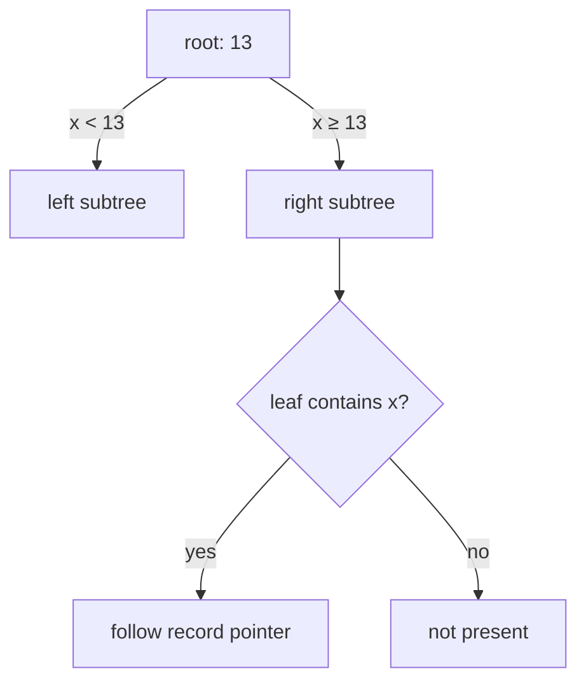

# SOE201 · B+ Tree Indexing

## Video generation status
PENDING: source pack prepared; no cloud video has been generated or reviewed.

## Spanish video overview prompt
Explica esta unidad en español claro, paso a paso, para alguien que aprende de forma autodidacta. Usa únicamente el material incluido. Comienza con el problema motivador, presenta los conceptos, muestra un ejemplo visual fiel a las convenciones del curso, pausa para una pregunta y después explica la respuesta. Distingue práctica suplementaria de tareas oficiales y de soluciones oficiales. No inventes datos, fuentes, requisitos, capítulos pendientes, resultados de ejecución ni predicciones de examen. Conserva los límites y discrepancias indicados. Cierra con una actividad que el estudiante pueda intentar en Learning Uni. Cita el nombre del documento y su localizador cuando corresponda. Si falta evidencia, dilo; no rellenes el hueco. Mantén visibles las fórmulas y direcciones de flechas.

## Verified original file snapshots
- Lecture2b - B+Tree Indexing (1).pdf · SHA-256 020c3166574d9c040882391c85b3c1a8875eccdf5798651330f76d7a4623a827

## Source material

### Snapshot: content/reviewed/SOE201/02/tutor.md
SHA-256: ea99860ddbf5638e06d987c3ea9a9c268d0e831a47264358d693a66fe4dffb9e

---
title: "Unit 02 · B+ Tree Indexing · Tutor Notes"
course: SOE201
type: tutor-notes
status: reviewed
study_status: untested
language: en
cssclasses:
  - soe201-study
  - university-study
---

# Unit 02 — B+ tree indexing

[[10_UNIVERSITY_CS/SOE201/Tutor Mode/00 Start Here|Tutor Start]] · [[10_UNIVERSITY_CS/SOE201/Tutor Mode/Unit 02 - B+ Tree Indexing/02 Recall and Exam Practice|Recall and practice]] · [[10_UNIVERSITY_CS/SOE201/Unit 02 - B+ Tree Indexing/01 Notes|Reference notes]]

## In 60 Seconds

A B+ tree is a balanced ordered index. Internal nodes route by separator ranges; leaves hold the searchable key entries and are linked for range scans. In this course, order $n$ means at most $n$ child pointers in an internal node and therefore at most $n-1$ leaf keys. Lookup follows boundaries to a leaf. Insertion splits overflowing nodes. Deletion repairs underflow using the lecture's **merge-first, otherwise redistribute** rule. The root has special occupancy rules.

After study, you should be able to trace lookup/range access, apply insertion and deletion one state at a time, and validate occupancy, order, routing, leaf links and equal depth.

## Concept Preview

> [!note] Separator boundary
> **Plain-language meaning:** an internal key divides child ranges; it is not itself proof that a record exists.
>
> **Why it matters:** membership is confirmed only at a leaf.
>
> **Connects to:** lookup and separator maintenance.
>
> **Source:** `Lecture2b - B+Tree Indexing (1).pdf`, PDF pp. 4–9.

> [!note] Occupancy
> **Plain-language meaning:** non-root nodes have minimum and maximum capacities; the root is allowed to be smaller.
>
> **Why it matters:** overflow triggers splitting and underflow triggers repair.
>
> **Connects to:** insertion, deletion and height.
>
> **Source:** Lecture2b, PDF pp. 4–6, 12–27.

> [!note] Copy versus promote
> **Plain-language meaning:** a leaf split copies a boundary upward while retaining data keys in leaves; an internal split promotes a separator.
>
> **Why it matters:** treating both splits identically loses a searchable leaf key or duplicates routing incorrectly.
>
> **Connects to:** cascading splits.
>
> **Source:** Lecture2b, PDF pp. 12–18.

> [!note] Merge-first deletion
> **Plain-language meaning:** when a node underflows, the supplied algorithm first merges with an eligible sibling if the combined content fits; otherwise it redistributes.
>
> **Why it matters:** it determines the exact intermediate tree expected by the source examples.
>
> **Connects to:** parent deletion and root contraction.
>
> **Source:** Lecture2b, PDF pp. 19–27.

## Exam Evidence Snapshot

| Topic | Observed papers | Known marks | Observed demand | Priority |
|---|---:|---:|---|---|
| Deletion and repair | 3/4 | 6 | explain, describe, draw | **HIGH EXAM RELEVANCE** |
| Lookup trace | 1/4 | 2 | describe | MEDIUM |
| Insertion, capacity and range scan | 0/4 | 0 observed | not observed | NOT OBSERVED IN AVAILABLE PAST-PAPER SAMPLE |

Evidence: [[10_UNIVERSITY_CS/SOE201/Tutor Mode/_System/past-paper-intelligence#Source-supported aggregates|past-paper intelligence]].

## Before You Start

Recall ordered keys, pointers and the distinction between an index block and a data block.

> [!question] Prerequisite check
> If an internal node has separators `[10, 20]`, how many child ranges does it have?

> [!success]- Check your answer
> Three: values below 10, values from 10 to below 20, and values at least 20.
>
> Source principle: Lecture2b, PDF pp. 4–9.

## A motivating question

Use the exact order-4 initial tree from Lecture2b, PDF p. 34:

```text
                 [7 | 13 | 19]
             /       |       |       \
          [4,5]    [7,9]  [13,17]  [19,25,31]
```

Apply **insert 33, insert 11, delete 25** in that order. How can the tree remain balanced while only local nodes change? What evidence proves the final tree is valid?

| Question | Knowledge needed |
|---|---|
| Insert 33 and 11 | leaf overflow, split, copied separator, parent capacity |
| Delete 25 | underflow test, merge-first repair, parent/root repair |
| Validate | sorted leaves, range boundaries, occupancy, equal depth |

## Learn the mechanism

### Course order and occupancy

For order $n$:

| Node | Minimum | Maximum |
|---|---:|---:|
| non-root internal | $\lceil n/2\rceil$ child pointers | $n$ pointers |
| non-root leaf | $\lceil(n-1)/2\rceil$ keys | $n-1$ keys |
| internal root | 2 child pointers | $n$ pointers |
| root that is a leaf | 0 keys | $n-1$ keys |

For order 4, non-root leaves hold 2–3 keys and non-root internal nodes have 2–4 children. Count child pointers, not separator labels, when checking an internal node.

### Lookup is interval routing

At separator equality, route right into the range beginning at that boundary. Continue until a leaf, then compare actual leaf keys. An internal separator may remain as a valid boundary after the equal leaf key has been deleted; it need not be duplicated in a leaf under the lecture's retained-boundary examples.



**Figure 1 — A separator chooses a range, not membership**

**Read it:** equality takes the right branch; only the leaf decides presence.

**Key takeaway:** routing correctness is about ranges, not whether every separator is currently stored as a leaf key.

**Provenance:** teaching construction from Lecture2b, PDF pp. 4–9.

### Range scans use linked leaves

Descend once to the first leaf that can contain the lower bound, then scan right through leaf links until the upper bound is exceeded. The index preserves order; a hash index does not provide this route.

### Insertion: copy at leaves, promote internally

1. Route to the target leaf.
2. Insert in sorted order if capacity remains.
3. On leaf overflow, split the ordered entries. Keep all data keys in leaves and **copy** the first key of the new right leaf into the parent.
4. If the parent overflows, split the internal node and **promote** its middle separator; that separator leaves the split internal children.
5. If the root splits, create a new root. All leaves remain at the same depth.

> [!warning] Common confusion
> A leaf split and an internal split are not interchangeable. Leaf entries represent searchable keys, so the boundary is copied. Internal separators route only, so the middle separator is promoted.

### Deletion: remove, test, repair upward

1. Route to the leaf and remove the key if present.
2. If occupancy remains valid, update a separator only when its routing range requires it.
3. If the node underflows, apply the lecture's rule: merge with an eligible sibling when combined content fits; otherwise redistribute and adjust the parent boundary.
4. A merge deletes one parent child pointer and its separator. This may make the parent underflow, so repair can propagate upward.
5. If the root has one remaining child, replace the root with that child; height decreases by one.

Sibling choice is not universally fixed when both sides satisfy the rule. State and use a consistent supported choice rather than claiming the source prescribes one.

> [!question] Explain it yourself
> Why can deleting one leaf key cause a root contraction even though most of the tree is unchanged?

> [!success]- Check your explanation
> Leaf underflow can cause a merge; deleting the corresponding parent pointer can propagate underflow upward until the root has only one child.
>
> Source: Lecture2b, PDF pp. 19–27.

### Height and access cost

If $h$ counts edges from root to leaf, an uncached equality lookup visits $h+1$ index nodes. Fetching the data record can require another data-page read. Cache residency can reduce physical reads, so height is a structural bound under a stated cache model, not a measured latency.

## Worked example — the opening update sequence

Initial leaves: `[4,5]`, `[7,9]`, `[13,17]`, `[19,25,31]`; root `[7,13,19]`.

**Insert 33**

The rightmost leaf becomes `[19,25,31,33]` and overflows. Split it into `[19,25]` and `[31,33]`; copy boundary 31 upward. The root would have five children, so it also overflows. Promote 19 into a new root, producing two internal children whose leaf ranges remain ordered.

**Insert 11**

Route through the left internal subtree to leaf `[7,9]`. Insert to obtain `[7,9,11]`; this is within leaf capacity, so no split occurs.

**Delete 25**

Route to `[19,25]`; deletion leaves `[19]`, below the minimum of two. Under the lecture's merge-first rule, merge it with eligible sibling `[31,33]` to form `[19,31,33]`, then delete the redundant parent pointer/boundary. The right internal node now has only one child, below the minimum of two. Merge it with the left internal sibling: their 3 + 1 children fit order 4. Move the old root separator 19 down between the merged ranges. The old root then has one child, so contract it. The new root is `[7,13,19]` with four leaf children.

The final leaves are `[4,5] → [7,9,11] → [13,17] → [19,31,33]`.

**Validation:** every surviving key appears once; leaf order and links are correct; all leaves share a depth; each non-root leaf has 2–3 keys; internal ranges contain their leaf keys; the final root has four children, every leaf is one edge below it, and the temporary extra level has disappeared.

**Source:** Lecture2b, PDF pp. 34–37; full illustrated sequence in [[10_UNIVERSITY_CS/SOE201/Unit 02 - B+ Tree Indexing/01 Notes#Solve the opening case|reference notes]].

## Return to the motivating question

The tree stays balanced because each overflow or underflow is repaired locally and the repair propagates only when its parent violates capacity. The proof is invariant-based: sorted keys, correct ranges, valid occupancy, linked leaves and equal depth—not resemblance to one drawing.

## Definitions and distinctions

| Term A | Term B | Decisive distinction | Source |
|---|---|---|---|
| separator | leaf key | routing boundary versus searchable key entry | Lecture2b, pp. 4–9 |
| leaf split | internal split | copy right-leaf minimum versus promote middle separator | Lecture2b, pp. 12–18 |
| merge | redistribution | combine nodes and remove a parent pointer versus move entries while keeping both nodes | Lecture2b, pp. 19–27 |
| height edge count | node visits | a path of $h$ edges visits $h+1$ index nodes | Lecture2b, pp. 10–11 |

## Review

### Full Understanding

Return to [[#Learn the mechanism]] and [[#Worked example — the opening update sequence]].

## 5-Minute Review

- route by ranges and confirm at a leaf;
- leaves are ordered and linked;
- order controls maximum pointers/keys;
- leaf split copies; internal split promotes;
- deletion uses merge-first, otherwise redistribute;
- repair may propagate and contract the root;
- validate invariants after every operation.

## 60-Second Recall

- order = max internal pointers
- leaf max = order − 1
- root exception
- equality routes right
- membership at leaf
- copy vs promote
- merge vs redistribute
- root contraction
- linked-leaf range scan

## Sources

- `Lecture2b - B+Tree Indexing (1).pdf`, PDF pp. 2–37; p. 38 is reading context.
- `SOE201-EXAMS.pdf`: P23F A4, P23R A3 and P24R A3–A4; exact inventory in past-paper intelligence.


### Snapshot: content/reviewed/SOE201/02/practice.md
SHA-256: 88a12a82d2c31cc7180ea51e5f55633190ac9da33932a791f88965598a03771b

---
title: "Unit 02 · Recall and Exam Practice"
course: SOE201
type: tutor-practice
status: reviewed
study_status: untested
language: en
cssclasses:
  - soe201-study
  - university-study
---

# Unit 02 — Recall and exam practice

[[10_UNIVERSITY_CS/SOE201/Tutor Mode/Unit 02 - B+ Tree Indexing/01 Tutor Notes|Tutor notes]] · [[10_UNIVERSITY_CS/SOE201/Unit 02 - B+ Tree Indexing/02 Exercises|Reference exercises]]

## Atomic recall

### Card 01 — What does B+ tree order mean in this course?
> [!success]- Answer
> The maximum number of child pointers in an internal node.
>
> Source: Lecture2b, PDF pp. 4–6.

### Card 02 — How many keys can an order-$n$ leaf hold at most?
> [!success]- Answer
> $n-1$ search-key entries.
>
> Source: Lecture2b, PDF pp. 4–6.

### Card 03 — In a B+ tree lookup, where is key membership confirmed?
> [!success]- Answer
> At the reached leaf, not at an internal separator.
>
> Source: Lecture2b, PDF pp. 7–9.

### Card 04 — In this course’s B+ tree convention, which child range is chosen when the search key equals a separator?
> [!success]- Answer
> Route to the right-hand range beginning at that separator.
>
> Source: Lecture2b, PDF pp. 7–9.

### Card 05 — After splitting a B+ tree leaf, which key is copied into the parent?
> [!success]- Answer
> The first key of the new right leaf is copied into the parent.
>
> Source: Lecture2b, PDF pp. 12–18.

### Card 06 — After splitting a B+ tree internal node, which separator is promoted?
> [!success]- Answer
> The middle separator moves to the parent and is removed from the split children.
>
> Source: Lecture2b, PDF pp. 12–18.

### Card 07 — What repair preference does the lecture use after underflow?
> [!success]- Answer
> Merge first when an eligible sibling combination fits; otherwise redistribute.
>
> Source: Lecture2b, PDF pp. 19–27.

### Card 08 — When does deletion reduce the height of a B+ tree?
> [!success]- Answer
> When an internal root is left with one child and that child replaces it.
>
> Source: Lecture2b, PDF pp. 19–27.

### Card 09 — Why are leaves linked?
> [!success]- Answer
> To continue ordered range scans without returning to the root for each next key.
>
> Source: Lecture2b, PDF pp. 4–9.

### Card 10 — What must every root-to-leaf path share?
> [!success]- Answer
> The same depth; this is the tree's height-balance invariant.
>
> Source: Lecture2b, PDF pp. 4–6.

## Practice

### Practice 1 — Guided lookup

**ORIGINAL COURSE EXERCISE — relevant routing data transcribed.** Root `[33]` has left internal `[11,22]` and right internal `[44]`. The left internal child for keys at least 22 is leaf `[29]`; the right internal child for keys below 44 is leaf `[37,41]`. Trace searches for 29, 31 and 33. State each route and decide membership only at the leaf.

Source: Lecture2b, PDF pp.8–9; the other children are not visited by these searches.

> [!tip]- Hint
> At each separator choose an interval; do not report success until the leaf comparison.

> [!success]- Solution
> All three start at root `[33]`. Values 29 and 31 route left to internal `[11,22]`, then to leaf `[29]`; 29 is present and 31 absent. Value 33 routes right at equality, then left at internal `[44]`, reaching leaf `[37,41]`; 33 is absent.
>
> The root separator 33 is a routing boundary, not proof of a leaf entry.
>
> Source: Lecture2b, PDF pp. 8–9.

### Practice 2 — Guided insertion

**SUPPLEMENTARY PRACTICE.** An order-4 leaf `[10,20,30]` receives 25. Show the leaf split and parent separator.

> [!tip]- Hint
> Sort four keys, split into two legal leaves and copy the right leaf's first key.

> [!success]- Solution
> Sorted overflow is `[10,20,25,30]`. A legal even split is `[10,20]` and `[25,30]`. Copy 25 into the parent as the boundary for the new right leaf. All data keys remain in leaves.
>
> Source principle: Lecture2b, PDF pp. 12–18. Values are synthetic.

> [!danger] HIGH EXAM RELEVANCE
> B+ deletion/repair is directly observed in 3/4 papers (6 known marks), including diagram updates. This is descriptive evidence, not a prediction.

### Practice 3 — ORIGINAL COURSE EXERCISE: delete 5, then 11

**ORIGINAL COURSE EXERCISE.** Use this order-3 starting tree. Delete 5, then delete 11 from the resulting tree. Choose a legal sibling consistently, use merge-first repair and show both intermediate states.

![[10_UNIVERSITY_CS/SOE201/Unit 02 - B+ Tree Indexing/Attachments/delete-initial.svg]]

Text equivalent: root `[11]`; left internal `[5,7]` with leaves `[2,3]`, `[5]`, `[7]`; right internal `[13]` with leaves `[11]`, `[13,17]`. Source: Lecture2b, PDF pp.31–32.

> [!tip]- Hint
> Treat this as one sequence. After the first deletion, the second begins from the changed tree.

> [!success]- Solution
> After deleting 5, merge the empty leaf with its left sibling `[2,3]`. Remove boundary 5: root `[11]` now has left internal `[7]` over `[2,3]`, `[7]`, and unchanged right internal `[13]` over `[11]`, `[13,17]`.
>
> Then delete 11 and merge its empty leaf with `[13,17]`. The right internal node has one child, so merge it with the left internal node: 2 + 1 children fit order 3. Bring down separator 11 and contract the old root. Final root `[7,11]` has leaves `[2,3]`, `[7]`, `[13,17]`. Separator 11 remains a valid range boundary although 11 is no longer a leaf key.
>
> ![[10_UNIVERSITY_CS/SOE201/Unit 02 - B+ Tree Indexing/Attachments/delete5.svg]]
> ![[10_UNIVERSITY_CS/SOE201/Unit 02 - B+ Tree Indexing/Attachments/delete5-11.svg]]
>
> The decisive checks after each step are: every remaining key present once, leaf order/linkage, legal occupancy and equal depth. The complete source-specific drawings are preserved at [[10_UNIVERSITY_CS/SOE201/Unit 02 - B+ Tree Indexing/02 Exercises#C2 — Two deletion paths from the same initial tree|C2 complete solution]].
>
> Source: Lecture2b, PDF pp. 31–33. The linked ordinary solution is used because the source diagram state is essential and already fully audited.

> [!danger] HIGH EXAM RELEVANCE
> This supplementary item practises the repeated historical deletion pattern without copying a paper question.

### Practice 4 — Independent deletion decision

**SUPPLEMENTARY PRACTICE.** In an order-4 tree, leaf A contains `[4,7]`, leaf B contains `[10,13,16]`, and their parent separates B at 10. Delete 7. State whether to merge or redistribute under the course rule, then show the result.

> [!tip]- Hint
> After deletion, A underflows. Test whether A and B together fit in one leaf before redistributing.

> [!success]- Solution
> A becomes `[4]`, below the minimum of two. Combined with B there would be four keys, exceeding the leaf maximum of three, so merge is impossible. Redistribute the smallest key 10 from B to A.
>
> New leaves are A `[4,10]` and B `[13,16]`; update the parent boundary from 10 to 13. Both leaves now satisfy occupancy.
>
> Source principle: Lecture2b, PDF pp. 19–27. Values are synthetic.

### Practice 5 — Diagnose three claims

**SUPPLEMENTARY PRACTICE.** Diagnose: (a) every internal separator must occur in a leaf; (b) a range search repeats root lookup for every answer; (c) height 3 means three index-node visits.

> [!tip]- Hint
> Use retained boundaries, leaf links, and the difference between edges and nodes.

> [!success]- Solution
> (a) False under the lecture's retained-boundary convention; a separator can remain a valid range boundary after that leaf key is gone.
>
> (b) False; descend once, then follow linked leaves.
>
> (c) False when height counts edges: three edges visit four index nodes. State the convention explicitly.
>
> Source: Lecture2b, PDF pp. 7–11 and 19–27.

### Practice 6 — Transfer: choose B+ tree or hashing

**SUPPLEMENTARY PRACTICE.** A workload performs exact ID lookups, ordered pagination and frequent range queries. Explain why a B+ tree remains a coherent single-index choice even if a hash index may shorten some equality routes.

> [!tip]- Hint
> Compare maintained order and linked leaves with computed bucket addresses.

> [!success]- Solution
> The B+ tree supports equality by logarithmic-height routing and range/pagination by ordered linked leaves. A hash index is organised by bucket address and provides no adjacent-key traversal. The answer is a workload trade-off, not a universal speed claim; cache, clustering and implementation remain unspecified.
>
> Source: Lecture2b, PDF pp. 2–11; Lecture3a, PDF pp. 41–43.

## Original exercise navigation

All supplied Lecture2b tasks are mapped to complete audited solutions in the ordinary edition:

- [[10_UNIVERSITY_CS/SOE201/Unit 02 - B+ Tree Indexing/02 Exercises#B1 — Find 29, 31, and 33|source lookups]]
- [[10_UNIVERSITY_CS/SOE201/Unit 02 - B+ Tree Indexing/02 Exercises#B2 — Insert Adams, then follow the name deletions|name updates]]
- [[10_UNIVERSITY_CS/SOE201/Unit 02 - B+ Tree Indexing/02 Exercises#C1 — Construct the order-3 tree|order-3 construction]]
- [[10_UNIVERSITY_CS/SOE201/Unit 02 - B+ Tree Indexing/02 Exercises#C2 — Two deletion paths from the same initial tree|two deletion paths]]
- [[10_UNIVERSITY_CS/SOE201/Unit 02 - B+ Tree Indexing/02 Exercises#E1 — The sequential order-4 update exercise|order-4 sequence]]

No official marking scheme was supplied; solutions teach complete reasoning rather than phrase-level marks.
