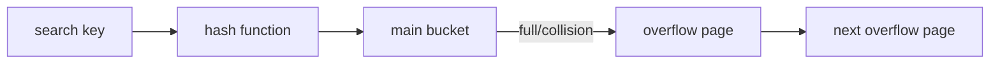

# SOE201 · Hash Indexing

## Video generation status
PENDING: source pack prepared; no cloud video has been generated or reviewed.

## Spanish video overview prompt
Explica esta unidad en español claro, paso a paso, para alguien que aprende de forma autodidacta. Usa únicamente el material incluido. Comienza con el problema motivador, presenta los conceptos, muestra un ejemplo visual fiel a las convenciones del curso, pausa para una pregunta y después explica la respuesta. Distingue práctica suplementaria de tareas oficiales y de soluciones oficiales. No inventes datos, fuentes, requisitos, capítulos pendientes, resultados de ejecución ni predicciones de examen. Conserva los límites y discrepancias indicados. Cierra con una actividad que el estudiante pueda intentar en Learning Uni. Cita el nombre del documento y su localizador cuando corresponda. Si falta evidencia, dilo; no rellenes el hueco. Mantén visibles las fórmulas y direcciones de flechas.

## Verified original file snapshots
- Lecture3a - Hash Indexing.pdf · SHA-256 7e234269c43624f66f33eb97d9417d8a69623232104bff0de6202e23b23836dc

## Source material

### Snapshot: content/reviewed/SOE201/03/tutor.md
SHA-256: fe1c02160f2de1945dda60892fe31a2a6c397a8539dec5d0fcab85e9c0f7dfee

---
title: "Unit 03 · Hash Indexing · Tutor Notes"
course: SOE201
type: tutor-notes
status: reviewed
study_status: untested
language: en
cssclasses:
  - soe201-study
  - university-study
---

# Unit 03 — Hash indexing

[[10_UNIVERSITY_CS/SOE201/Tutor Mode/00 Start Here|Tutor Start]] · [[10_UNIVERSITY_CS/SOE201/Tutor Mode/Unit 03 - Hash Indexing/02 Recall and Exam Practice|Recall and practice]] · [[10_UNIVERSITY_CS/SOE201/Unit 03 - Hash Indexing/01 Notes|Reference notes]]

## In 60 Seconds

Hashing computes a bucket address from a search key. A collision means several keys share a bucket, so lookup still compares actual keys. Static hashing keeps a fixed main address set and uses overflow chains when buckets fill. Extendable hashing adds a directory: global depth says how many high-order hash bits the directory reads; each bucket's local depth says how many bits distinguish that bucket. A full bucket may split with or without directory doubling. Some collisions cannot be separated by more bits, so overflow can still be necessary.

You should be able to trace fixed-width hashes, split/alias states, deletion/coalescing and workload choice without assuming hash order or constant worst-case lookup.

## Concept Preview

> [!note] Collision
> **Plain-language meaning:** different search keys can map to the same bucket address.
>
> **Why it matters:** the hash gives a candidate bucket, not guaranteed equality.
>
> **Connects to:** overflow chains and failed lookup.
>
> **Source:** `Lecture3a - Hash Indexing.pdf`, PDF pp. 2–12.

> [!note] Global depth
> **Plain-language meaning:** the number of high-order hash bits currently used by the directory.
>
> **Why it matters:** the directory has $2^i$ pointer entries.
>
> **Connects to:** directory doubling.
>
> **Source:** Lecture3a, PDF pp. 13–18.

> [!note] Local depth
> **Plain-language meaning:** the number of prefix bits that uniquely identify one physical bucket.
>
> **Why it matters:** it determines alias count and whether a split needs directory growth.
>
> **Connects to:** $2^{i-i_j}$ shared directory pointers.
>
> **Source:** Lecture3a, PDF pp. 13–21.

> [!note] Full-hash collision
> **Plain-language meaning:** keys share every available hash bit, so another split cannot separate them.
>
> **Why it matters:** overflow is then necessary under the supplied model.
>
> **Connects to:** the Taiyuan rollback case.
>
> **Source:** Lecture3a, PDF pp. 32–40.

## Exam Evidence Snapshot

| Topic | Observed papers | Known marks | Observed demand | Priority |
|---|---:|---:|---|---|
| Static/extendable hash trade-offs | 2/4 | 4 | state disadvantage/advantages | MEDIUM EXAM RELEVANCE |
| Hash calculations, splits, coalescing and overflow traces | 0/4 | 0 observed | not observed | NOT OBSERVED IN AVAILABLE PAST-PAPER SAMPLE |

The two observations assess different variants and short-answer depth, so HIGH is not justified.

## Before You Start

You need modulo arithmetic, fixed-width binary and the distinction between a directory pointer and a physical bucket.

> [!question] Prerequisite check
> Write $1$ as a three-bit value.

> [!success]- Check your answer
> `001`. Leading zeros determine high-order prefix routing.
>
> Source principle: Lecture3a, PDF pp. 13–18.

## A motivating question

Use the source's numeric state on Lecture3a, PDF p. 23. Bucket capacity is three; $h(x)=x\bmod8$ is written in exactly three bits. Global depth is 1. One bucket holds `[9]`; the other holds `[4,5,7]`.

Insert 13, then explain:

1. why the directory must double;
2. which old entries move after splitting;
3. why a later insertion may still require overflow even after several splits.

## Learn the mechanism

### Static hashing

With a fixed set of $B$ buckets, a function such as $h(v)=(av+b)\bmod B$ chooses a main bucket. If it is full, add an overflow page. Lookup reads the main bucket and follows its chain until finding the key or exhausting candidates.

**Figure 1 — Static hash lookup follows one address and its chain**

**Read it:** the hash selects the chain; actual key comparisons decide the result.

**Key takeaway:** growth concentrated at one address lengthens that chain even when other buckets are empty.

**Provenance:** teaching construction from Lecture3a, PDF pp. 7–12.

Static hashing is simple, but fixed capacity creates a trade-off: too few buckets create overflow; too many waste space. If all keys collide, worst-case lookup grows with the chain. Hashing gives no sorted next-key route for range queries.

### Extendable hashing: directory versus buckets

Let $i$ be global depth and $i_j$ a bucket's local depth.

| Quantity | Meaning |
|---|---|
| $2^i$ | directory pointer entries |
| $i_j\le i$ | bits distinguishing bucket $j$ |
| $2^{i-i_j}$ | directory aliases pointing to bucket $j$ |

Physical buckets are **at most** $2^i$; equality is possible. The strict inequality printed on lecture p. 13 excludes the valid case where every directory entry reaches a distinct bucket, so Tutor Mode records the corrected bound and preserves the source discrepancy.

### Insertion decision

1. Compute the fixed-width hash.
2. Read the first $i$ high-order bits and follow that directory entry.
3. Insert if the bucket has room.
4. If full and $i_j<i$, split the bucket using the next bit; the directory already has enough detail.
5. If full and $i_j=i<b$, double the directory, increment $i$, then split.
6. Redistribute old and new entries; recheck capacity.
7. If available bits or the source's split limit cannot separate the entries, use overflow under the lecture's rollback convention.

> [!warning] Common confusion
> Doubling the directory does not duplicate data buckets. It duplicates pointers first; only the overflowing bucket is split.

### Deletion and coalescing

Remove the key from its bucket/overflow chain. Two buddy buckets can coalesce only when they share the same local depth, differ in the relevant last prefix bit, and their combined entries fit one bucket. The survivor's local depth decreases. If no bucket now needs the current global depth, the directory can contract.

### Hash versus ordered index

| Workload | Hash index | B+ tree |
|---|---|---|
| exact equality | direct candidate bucket, collision check | root-to-leaf route |
| ordered range | no adjacent-key path | linked leaves support scan |
| skew/collisions | chains or repeated splits | depends on balanced occupancy |
| growth | overflow or directory/bucket changes | splits/merges along a path |

This is a mechanism comparison, not a universal benchmark.

> [!question] Explain it yourself
> At global depth 3, why can a local-depth-1 bucket have four directory aliases?

> [!success]- Check your explanation
> One prefix bit is fixed and two directory bits remain free, giving $2^{3-1}=4$ combinations.
>
> Source: Lecture3a, PDF pp. 13–18.

## Worked example — insert 13

$h(13)=13\bmod8=5=101_2$. At global depth 1, prefix `1` routes to full bucket `[4,5,7]`. Its local depth equals global depth, so double the directory from 2 to 4 pointers and increase global depth to 2. Split by the first two bits:

- 4 hashes to `100`, prefix `10`;
- 5 hashes to `101`, prefix `10`;
- 7 hashes to `111`, prefix `11`;
- 13 hashes to `101`, prefix `10`.

The resulting buckets are `10 → [4,5,13]` and `11 → [7]`, each with local depth 2. The old `[9]` bucket has hash `001` and local depth 1, so both directory entries `00` and `01` still alias it.

**Source:** Lecture3a, PDF pp. 23–28.

## Return to the motivating question

The directory doubled because the overflowing bucket already used all directory bits. Only that bucket split; the `[9]` bucket remained shared. Redistribution used fixed-width high-order prefixes. More splitting cannot solve keys that share every available hash bit, so the supplied algorithm eventually rolls back the failed split and uses overflow.

## Definitions and distinctions

| Term A | Term B | Decisive distinction | Source |
|---|---|---|---|
| hash address | search key | candidate location versus actual value compared in the bucket | Lecture3a, pp. 2–12 |
| directory entry | physical bucket | pointer slot versus storage container | Lecture3a, pp. 13–18 |
| global depth | local depth | bits read by directory versus bits distinguishing one bucket | Lecture3a, pp. 13–21 |
| directory doubling | bucket split | duplicate pointer table versus redistribute one bucket | Lecture3a, pp. 19–31 |
| collision | duplicate key | same address versus same search-key value | Lecture3a, pp. 2–12 |

## Review

### Full Understanding

Return to [[#Learn the mechanism]] and [[#Worked example — insert 13]].

## 5-Minute Review

- hash to a candidate bucket, then compare keys;
- static hashing uses fixed main buckets and overflow;
- directory size is $2^i$;
- bucket aliases are $2^{i-i_j}$;
- keep leading zeros and read high-order bits from the left;
- split without doubling when $i_j<i$;
- double then split when $i_j=i$ and bits remain;
- coalesce only valid buddies that fit;
- range workloads favour ordered indexes.

## 60-Second Recall

- collision ≠ equality
- main bucket + overflow
- fixed-width hash
- high-order prefix
- global depth
- local depth
- alias formula
- double versus split
- buddy coalescing
- equality versus range

## Sources

- `Lecture3a - Hash Indexing.pdf`, PDF pp. 2–43; `(1)` is byte-identical.
- `SOE201-EXAMS.pdf`: P24F A4 and P24R A5.

### Snapshot: content/reviewed/SOE201/03/practice.md
SHA-256: ec2d2fa949057be80e79b0612ae01cd59b590b3f8caa9b2390cfb1864f4a4549

---
title: "Unit 03 · Recall and Exam Practice"
course: SOE201
type: tutor-practice
status: reviewed
study_status: untested
language: en
cssclasses:
  - soe201-study
  - university-study
---

# Unit 03 — Recall and exam practice

[[10_UNIVERSITY_CS/SOE201/Tutor Mode/Unit 03 - Hash Indexing/01 Tutor Notes|Tutor notes]] · [[10_UNIVERSITY_CS/SOE201/Unit 03 - Hash Indexing/02 Exercises|Reference exercises]]

## Atomic recall

### Card 01 — What does a hash function return for lookup?
> [!success]- Answer
> A candidate bucket address; actual keys must still be compared.
>
> Source: Lecture3a, PDF pp. 2–12.

### Card 02 — What handles a full static bucket?
> [!success]- Answer
> One or more linked overflow pages under the source model.
>
> Source: Lecture3a, PDF pp. 7–12.

### Card 03 — In this course’s extendable hashing, what does global depth measure?
> [!success]- Answer
> The number of high-order hash bits currently read by the directory.
>
> Source: Lecture3a, PDF pp. 13–18.

### Card 04 — What does a bucket’s local depth measure in extendable hashing?
> [!success]- Answer
> The number of prefix bits that distinguish one physical bucket.
>
> Source: Lecture3a, PDF pp. 13–21.

### Card 05 — How many directory entries exist at global depth $i$?
> [!success]- Answer
> $2^i$ pointer entries.
>
> Source: Lecture3a, PDF pp. 13–18.

### Card 06 — At global depth $i$, how many directory entries point to one bucket of local depth $i_j$?
> [!success]- Answer
> $2^{i-i_j}$ directory pointers.
>
> Source: Lecture3a, PDF pp. 13–18.

### Card 07 — When can a full extendable-hash bucket split without doubling the directory?
> [!success]- Answer
> When its local depth is less than the global depth.
>
> Source: Lecture3a, PDF pp. 19–31.

### Card 08 — Why preserve leading zeros?
> [!success]- Answer
> High-order prefix routing depends on the fixed-width bit positions.
>
> Source: Lecture3a, PDF pp. 13–18.

### Card 09 — When can buddy buckets coalesce?
> [!success]- Answer
> Equal local depth, correct buddy prefixes, and combined entries fitting one bucket.
>
> Source: Lecture3a, PDF p. 22.

### Card 10 — Why is hashing poor for ordered range scans?
> [!success]- Answer
> Bucket addresses do not preserve adjacent search-key order.
>
> Source: Lecture3a, PDF pp. 41–43.

## Practice

### Practice 1 — Reproduce a source calculation

**ORIGINAL COURSE EXERCISE.** The source encodes MUSIC as 13, 21, 19, 9, 3 and uses modulo 8. Compute its bucket.

> [!tip]- Hint
> Add the supplied values before taking the remainder.

> [!success]- Solution
> Sum: $13+21+19+9+3=65$. Then $65\bmod8=1$, so the source bucket is 1.
>
> This preserves the supplied teaching encoding; punctuation and a complete character mapping are unspecified.
>
> Source: Lecture3a, PDF p. 5.

### Practice 2 — Directory aliases

**SUPPLEMENTARY PRACTICE.** A directory has global depth 4. How many entries point to a local-depth-2 bucket, and what does that not tell you?

> [!tip]- Hint
> Apply $2^{i-i_j}$, then separate pointer count from stored-record count.

> [!success]- Solution
> $2^{4-2}=4$ directory entries alias the bucket.
>
> This does not reveal the bucket's number of records, overflow length, capacity or physical page address; it only describes shared directory pointers.
>
> Source principle: Lecture3a, PDF pp. 13–18.

### Practice 3 — ORIGINAL COURSE EXERCISE: insert 13

**ORIGINAL COURSE EXERCISE — starting state transcribed.** Use bucket capacity 3 and the three-bit hash $h(x)=x\bmod8$, reading high-order bits. Global depth is 1: directory `0` points to `[9]` and `1` to `[4,5,7]`; both buckets have local depth 1. Insert 13. Show directory entries, bucket contents and local depths after repair.

Source: Lecture3a, PDF p.23; solution pp.24–28.

> [!tip]- Hint
> The target bucket is full and its local depth equals global depth.

> [!success]- Solution
> $h(13)=5=101_2$, so prefix `1` reaches `[4,5,7]`. Double the directory to global depth 2, split the bucket, and redistribute by two-bit prefix.
>
> `10 → [4,5,13]`; `11 → [7]`. Entries `00` and `01` continue to alias `[9]`, whose local depth remains 1. Both new buckets have local depth 2.
>
> Source: Lecture3a, PDF pp. 23–28.

### Practice 4 — Diagnose an impossible split claim

**SUPPLEMENTARY PRACTICE.** A student says keys 5, 13, 21 and 29 under three-bit $x\bmod8$ can always be separated by increasing directory depth. Diagnose the claim.

> [!tip]- Hint
> Compute every full three-bit hash, not only the current prefix.

> [!success]- Solution
> All four remainders are 5, written `101`. They share every available hash bit. Directory depth cannot exceed the three-bit representation, and another split would send them together again.
>
> Under the supplied model, overflow is required once the split limit is reached. A different hash function could change the distribution, but that is a design change.
>
> Source principle: Lecture3a, PDF pp. 23–31 and 32–40.

> [!warning] MEDIUM EXAM RELEVANCE
> Hash-index trade-offs appear in 2/4 papers (4 known marks), but the observations are short and split across static and extendable variants.

### Practice 5 — Short comparative explanation

**SUPPLEMENTARY PRACTICE.** State one disadvantage of static hashing and two advantages of extendable hashing, with conditions.

> [!tip]- Hint
> Discuss growth, overflow and local reorganisation; avoid unconditional speed claims.

> [!success]- Solution
> Static hashing fixes the main address set, so growth or skew can create long overflow chains; preallocating extra buckets can waste space.
>
> Extendable hashing can grow its directory and split only an overflowing bucket, avoiding whole-file rehashing for many expansions. It can also contract/coalesce after deletions when buddy conditions hold.
>
> These advantages do not remove collisions, directory cost or full-hash overflow.
>
> Source: Lecture3a, PDF pp. 7–22 and 41–43.

### Practice 6 — Transfer: workload choice

**SUPPLEMENTARY PRACTICE.** Service A performs only exact equality lookups on stable IDs. Service B performs equality plus ordered ranges. Choose a default index family for each and state one uncertainty.

> [!tip]- Hint
> Match the required navigation, not a memorised ranking.

> [!success]- Solution
> Service A can favour hashing because a reproducible address narrows equality lookup to a candidate chain. Service B favours a B+ tree because leaf order supports both equality and ranges.
>
> Neither choice proves measured speed: distribution, cache, bucket/node size, clustering and implementation are unspecified.
>
> Source: Lecture3a, PDF pp. 41–43; Lecture2b, PDF pp. 7–11.

## Original exercise navigation

- [[10_UNIVERSITY_CS/SOE201/Unit 03 - Hash Indexing/02 Exercises#B1 — Reproduce the supplied hash calculations|source hash calculations]]
- [[10_UNIVERSITY_CS/SOE201/Unit 03 - Hash Indexing/02 Exercises#B2 — Follow the source lookup for 5|lookup for 5]]
- [[10_UNIVERSITY_CS/SOE201/Unit 03 - Hash Indexing/02 Exercises#C1 — Insert 13 into the original two-bucket index|insert 13]]
- [[10_UNIVERSITY_CS/SOE201/Unit 03 - Hash Indexing/02 Exercises#C2 — Another Comp.Sci. record|department overflow]]
- [[10_UNIVERSITY_CS/SOE201/Unit 03 - Hash Indexing/02 Exercises#E1 — Taiyuan and the two-split rollback rule|Taiyuan rollback/overflow]]

No official marking scheme was supplied.
