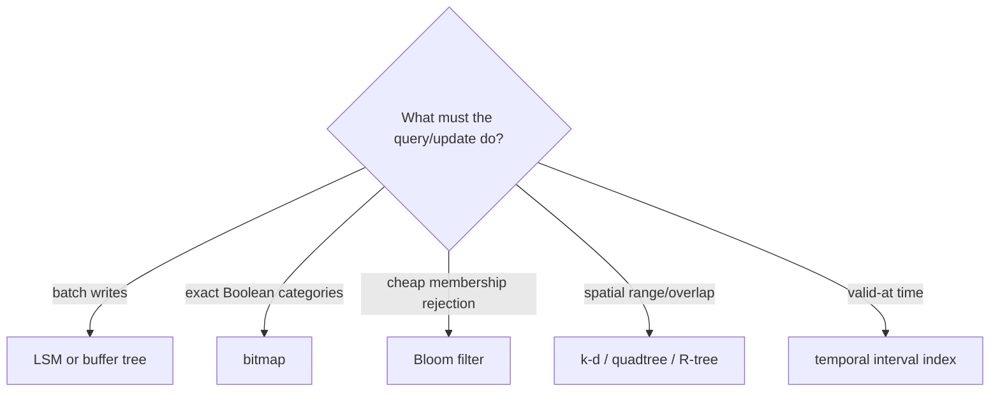

# SOE201 · Indexación avanzada

## Estado de generación del vídeo
PENDIENTE: material preparado; no se ha generado ni revisado ningún vídeo nuevo.

## Instrucciones
Explica la unidad en español siguiendo únicamente este material. Cita las fuentes y distingue práctica complementaria, respuestas suministradas y comentarios locales. Conserva fórmulas, identificadores, discrepancias y límites de evidencia. No inventes contenido, requisitos, resultados, dominio del estudiante ni predicciones de examen.

## Fuentes originales
- Lecture3b - Advanced Indexing.pdf (original en inglés) · SHA-256 6d45e35e6b5f91ece72aa7c8687a9716526bec3e19f29f7dbe2117e279da835a

## Edición española derivada
El hash indicado para cada documento identifica la fuente inglesa; el contenido mostrado es la traducción española. Los originales se conservan en la biblioteca.

### content/reviewed/SOE201/04/tutor.md
Hash de fuente inglesa: 4909056a2dd9f1856e00362d303b207dbb2eaba8d01ba86f94495c73ff36c63e

---
title: "Unit 04 · Advanced Indexing · Tutor Notes"
course: SOE201
type: tutor-notes
status: reviewed
study_status: untested
language: en
cssclasses:
  - soe201-study
  - university-study
---

# Unidad 04 — Indexación avanzada

[[10_UNIVERSITY_CS/SOE201/Tutor Mode/00 Start Here|Inicio del tutor]] · [[10_UNIVERSITY_CS/SOE201/Tutor Mode/Unit 04 - Advanced Indexing/02 Recall and Exam Practice|Recuerdo y práctica]] · [[10_UNIVERSITY_CS/SOE201/Unit 04 - Advanced Indexing/01 Notes|Notas de referencia]] · [[10_UNIVERSITY_CS/SOE201/Unit 04 - Advanced Indexing/03 Lab|Laboratorio de referencia]]

## En 60 segundos

Diferentes predicados necesitan diferentes estructuras. Actualizaciones por lotes de LSM y árboles de búfer; los índices de mapas de bits calculan conjuntos exactos; Los filtros Bloom rechazan de forma económica a los no miembros definidos, pero pueden arrojar falsos positivos; Los árboles k-d, quadtrees y R-trees podan regiones espaciales; Los índices temporales localizan las versiones por intervalo válido. La pregunta correcta no es "¿qué índice es más rápido?" pero "¿qué mecanismo preserva el predicado y la carga de trabajo que necesitamos?"

Después del estudio, debería poder seleccionar un mecanismo, rastrear su estado intermedio, distinguir los resultados exactos de los candidatos y explicar sus ventajas y desventajas sin convertir los ejemplos de los proveedores en un comportamiento universal.

## Vista previa del concepto

> [!note] Árbol LSM
> **Significado en lenguaje sencillo:** acumula entradas más nuevas en la memoria y fusiona lotes ordenados en niveles de disco más grandes.
>
> **Por qué es importante:** convierte escrituras dispersas en trabajo secuencial por lotes, pero agrega fusiones y lecturas de varios niveles.
>
> **Fuente:** `Lecture3b - Advanced Indexing.pdf`, PDF págs. 4–6.

> [!note] Índice de mapa de bits
> **Significado en lenguaje sencillo:** un vector de bits alineado representa qué posiciones de registro tienen un valor.
>
> **Por qué es importante:** Las operaciones booleanas devuelven rápidamente posiciones candidatas exactas para atributos adecuados de baja cardinalidad.
>
> **Fuente:** Lecture3b, PDF págs. 8–10.

> [!note] Filtro de floración
> **Significado en lenguaje sencillo:** un filtro de pertenencia probabilístico compacto sin falsos negativos según su modelo, pero posibles falsos positivos.
>
> **Por qué es importante:** puede evitar búsquedas costosas cuando cualquier bit requerido es cero.
>
> **Fuente:** Lecture3b, PDF págs. 11–12.

> [!note] Poda espacial
> **Significado en lenguaje sencillo:** partición o regiones enlazadas para que una consulta examine solo objetos plausibles.
>
> **Por qué es importante:** un hit de región delimitadora aún puede necesitar un predicado de geometría exacta.
>
> **Fuente:** Lecture3b, PDF págs. 13–20.

> [!note] Intervalo temporal
> **Significado en lenguaje sencillo:** una versión es válida durante un intervalo de tiempo, posiblemente con un final abierto.
>
> **Por qué es importante:** las búsquedas actuales e históricas pueden requerir diferentes rutas de acceso.
>
> **Fuente:** Lecture3b, PDF págs. 21–22.

## Instantánea de la evidencia del examen

| Tema | Artículos observados | Marcas conocidas | Demanda observada | Prioridad |
|---|---:|---:|---|---|
| Técnica/selección de índice espacial | 3/4 | 6 | nombre, indicar una solicitud | **ALTA RELEVANCIA DEL EXAMEN** |
| LSM, buffer, mapa de bits, Bloom e índices temporales | 0/4 | 0 observado | no observado | NO OBSERVADO EN LA MUESTRA DE ANTERIOR DISPONIBLE |

ALTO se aplica al mensaje de selección espacial recurrente, no a toda la unidad. Las preguntas históricas tenían una profundidad de respuesta corta.

## Antes de comenzar

Recuerde el acceso ordenado al árbol B+, el acceso de igualdad de hash, los pares booleanos AND/OR y de coordenadas.

> [!question] Verificación de requisitos previos
> ¿Cuál es el AND bit a bit de `101010` y `110011`?

> [!success]- Comprueba tu respuesta
> `100010`: una posición es 1 sólo cuando ambos bits de entrada son 1.
>
> Principio fuente: Lecture3b, PDF págs. 8–10.

## Una pregunta motivadora

Un sistema de campus recibe actualizaciones frecuentes de activos y admite cuatro consultas:

1. ingerir actualizaciones sin escrituras dispersas en el disco de un solo registro;
2. devolver registros que sean tanto `sensor` como `active`;
3. rechazar la mayoría de las identificaciones ausentes antes de buscar una estructura de disco;
4. busque objetos del mapa dentro de un rectángulo y la versión válida en el momento 5.

Ninguna estructura es automáticamente la mejor. Relacione cada predicado con un mecanismo e indique qué trabajo adicional o incertidumbre queda.

## Aprende el mecanismo

### Un mapa de decisiones



**Figura 1: elección por predicado y carga de trabajo**

**Léelo:** comience con la operación requerida, no con una estructura de datos favorita.

**Conclusión clave:** cada rama cambia el significado de "coincidencia" y el trabajo aún requiere.

**Procedencia:** síntesis didáctica de Lecture3b, PDF págs. 2–22.

### Árboles LSM y árboles de amortiguamiento

Un árbol LSM mantiene las entradas ordenadas más recientes en la memoria ($L_0$) y fusiona lotes en niveles de disco más grandes. Con el factor de crecimiento $k$, la relación de umbral simplificada es $T_{i+1}=kT_i$. Si son $T_0=100$ y $k=4$, entonces las entradas $T_1=400$ y $T_2=1600$.

La combinación escanea entradas ordenadas y produce salidas ordenadas. Esto reduce el trabajo de inserción disperso pero reescribe entradas más antiguas y una búsqueda puede buscar en varios niveles. Un lápida de eliminación debe permanecer hasta que las versiones relevantes más antiguas ya no puedan reaparecer.

Un árbol de búfer conserva un árbol de búsqueda pero almacena las actualizaciones pendientes en búferes internos. Cuando un búfer se llena, divide las actualizaciones por rango secundario y empuja los lotes hacia abajo. Las consultas deben tener en cuenta las actualizaciones almacenadas en búfer relevantes.

| Estructura | Lotes donde? | Leer consecuencia |
|---|---|---|
| LSM | a través de niveles ordenados de memoria/disco | buscar/conciliar niveles relevantes |
| árbol de amortiguamiento | dentro de los nodos internos del árbol de búsqueda | inspeccionar ruta más actualizaciones pendientes |

### Los índices de mapa de bits son álgebra de conjuntos exactos

Todos los mapas de bits comparten el mismo orden de posición de registro. Para los mapas de bits de origen `m=11010` y `L1=10010`, la conjunción es:

```text
  11010
& 10010
= 10010
```

Las posiciones con 1 satisfacen ambos predicados. El espacio del mapa de bits crece con el recuento de registros × valores indexados distintos, por lo que una cardinalidad muy alta y actualizaciones frecuentes de cambios de posición pueden debilitar el diseño básico.

### Los filtros Bloom responden "definitivamente no" o "posiblemente"

La inserción establece cada bit seleccionado por las funciones hash del elemento. La consulta vuelve a calcular esas posiciones:

- cualquier cero → definitivamente ausente;
- todos unos → posiblemente presentes; verificar en la estructura real.

Los falsos positivos ocurren cuando otros elementos insertados configuran todos los bits consultados. Según la aproximación idealizada de la conferencia, después de insertar valores $n$, hashes $k$ y bits $m$:

$$p\approx\left(1-e^{-kn/m}\right)^k.$$

El 10% y el 1% de la conferencia son ilustraciones redondeadas; las notas de referencia derivan aproximadamente 9,52% y 0,819% según su modelo declarado. Un filtro Bloom no devuelve el registro por sí mismo y normalmente no admite la eliminación sin un diseño extendido.

### Las estructuras espaciales podan diferentes formas.

| Estructura | Partición/encuadernado | Lección natural |
|---|---|---|
| árbol kd | divisiones de coordenadas alternas | Poda de punto/rango por eje |
| árbol cuádruple | cuadrantes espaciales recursivamente iguales | adapta resolución subdividiendo regiones ocupadas |
| Árbol R | rectángulos delimitadores sobre objetos/grupos | maneja rectángulos/polígonos y superposiciones; verificar la geometría exacta |

Un rectángulo delimitador puede superponerse a una consulta incluso cuando la forma exacta del objeto contenido no lo hace. Los índices espaciales producen candidatos; el predicado final aún puede rechazar candidatos falsos.

### Indexación temporal

La conferencia separa las entradas abiertas actuales de los intervalos cerrados históricos. Los ejemplos del tutor utilizan intervalos medio abiertos `[start,end)` porque el origen no define completamente la inclusión de puntos finales. Según esa convención declarada, `[1,5)` es válido en 4 pero no en 5, mientras que `[5,∞)` comienza en 5.

> [!question] Explícalo tú mismo
> ¿Por qué un resultado Bloom “posiblemente presente” es diferente de un mapa de bits Y un resultado?

> [!success]- Consulta tu explicación
> Los bits de Bloom pueden ser compartidos por elementos no relacionados, por lo que todo uno es solo un candidato. Mapa de bits alineado Y representa exactamente las posiciones de los registros indexados.
>
> Fuente: Lecture3b, PDF págs. 8–12.

## Ejemplo resuelto: resuelve las preguntas del campus

1. **Escribe:** use un LSM o un árbol de búfer para la propagación por lotes. LSM hereda el trabajo de fusión y búsqueda de varios niveles; un árbol de búfer hereda la visibilidad de actualización pendiente a lo largo de la ruta.
2. **Categorías:** `sensor=101010` Y `active=110011` dan `100010`, por lo que las posiciones de registro 0 y 4 coinciden cuando el bit más a la izquierda es la posición 0.
3. **Rechazo de ID ausente:** utilice un filtro Bloom. Un bit cero demuestra ausencia; todos requieren la búsqueda real.
4. **Rectángulo del mapa:** utilice k-d/quadtree para la partición de puntos o un árbol R para objetos delimitados; Siempre pruebe el predicado espacial exacto después de la poda.
5. **Tiempo 5:** según la convención explícita de semiabierto, la versión anterior `[1,5)` está excluida y la nueva versión `[5,∞)` es válida.

## Volver a la pregunta motivadora

El problema se resuelve componiendo estructuras, no seleccionando un ganador. Cada mecanismo responde a un predicado diferente y conlleva un costo residual diferente: fusiones, actualizaciones almacenadas en búfer, mantenimiento de mapas de bits, verificación de Bloom, pruebas de geometría exacta o manejo de límites de intervalo.

## Definiciones y distinciones

| Término A | Término B | Distinción decisiva | Fuente |
|---|---|---|---|
| Nivel LSM | buffer de nodo de árbol de buffer | nivel de versión ordenado versus actualizaciones pendientes adjuntas a un nodo del árbol de búsqueda | Conferencia 3b, págs. 4–7 |
| mapa de bits | Filtro de floración | representación exacta de conjuntos alineados versus filtro de pertenencia probabilística | Conferencia 3b, págs. 8-12 |
| falso positivo | falso negativo | candidato devuelto por artículo ausente versus artículo presente perdido; el modelo Bloom estándar permite sólo lo primero | Conferencia 3b, págs. 11-12 |
| árbol kd | árbol cuádruple | división de datos/eje versus subdivisión recursiva de regiones iguales | Conferencia 3b, págs. 13-17 |
| R-árbol enlazado | geometría exacta | rectángulo de poda versus predicado de objeto final | Conferencia 3b, págs. 18-20 |

## Revisión

### Comprensión total

Regrese a [[#Learn the mechanism]] y [[#Worked example — solve the campus questions]].

## Revisión de 5 minutos

- escrituras por lotes con niveles LSM o buffers de nodos;
- los mapas de bits calculan conjuntos alineados exactos;
- Bloom cero significa ausente, todo uno significa verificar;
- los índices espaciales podan regiones pero pueden devolver candidatos;
- k-d, quadtree y R-tree codifican diferentes organizaciones espaciales;
- las respuestas temporales dependen de la semántica de intervalos;
- elegir por predicado, patrón de actualización y trabajo restante.

## Recuperación de 60 segundos

- Niveles de fusión de LSM
- vida útil de la lápida
- propagación almacenada en búfer
- mapa de bits alineado
- Bloom falso positivo
- división del eje k-d
- cuadrantes de cuatro árboles
- Rectángulo delimitador del árbol R
- verificación de geometría exacta
- límite del intervalo temporal

## Fuentes

- `Lecture3b - Advanced Indexing.pdf`, PDF págs. 2–22; pag. 23 es contexto de lectura.
- `SOE201-EXAMS.pdf`: P23F A5, P23R A4 y P24F A5.


### content/reviewed/SOE201/04/practice.md
Hash de fuente inglesa: bd85890c9a4d51d5d3f785549346cab78c6e1e62fa923aad581f633d64e0eb2d

---
title: "Unit 04 · Recall and Exam Practice"
course: SOE201
type: tutor-practice
status: reviewed
study_status: untested
language: en
cssclasses:
  - soe201-study
  - university-study
---

# Unidad 04 — Recordatorio y práctica de exámenes

[[10_UNIVERSITY_CS/SOE201/Tutor Mode/Unit 04 - Advanced Indexing/01 Tutor Notes|Notas del tutor]] · [[10_UNIVERSITY_CS/SOE201/Unit 04 - Advanced Indexing/02 Exercises|Ejercicios de referencia]] · [[10_UNIVERSITY_CS/SOE201/Unit 04 - Advanced Indexing/03 Lab|Laboratorio de referencia]]

## Repaso activo atómico

### Tarjeta 01: ¿Qué hace un lote de árbol LSM?
> [!success]- Respuesta
> Actualizaciones ordenadas, fusionando lotes de memoria en niveles de disco ordenados más grandes.
>
> Fuente: Lecture3b, PDF págs. 4–6.

### Tarjeta 02: ¿Qué debe conciliar una búsqueda de LSM?
> [!success]- Respuesta
> Versiones y lápidas relevantes en todos los niveles buscados.
>
> Fuente: Lecture3b, PDF págs. 4–6.

### Tarjeta 03: ¿Qué contiene un búfer interno de árbol de búfer?
> [!success]- Respuesta
> Actualizaciones pendientes a la espera de ser particionadas y enviadas a rangos secundarios.
>
> Fuente: Lecture3b, PDF p. 7.

### Tarjeta 04: ¿Qué invariante de posición de registro debe mantenerse antes de combinar dos índices de mapa de bits?
> [!success]- Respuesta
> El mismo orden récord-posición.
>
> Fuente: Lecture3b, PDF págs. 8–10.

### Tarjeta 05: Si algún bit de filtro Bloom consultado es cero, ¿qué se puede concluir con el modelo estándar de solo inserción?
> [!success]- Respuesta
> El elemento consultado está definitivamente ausente en el modelo de filtro.
>
> Fuente: Lecture3b, PDF págs. 11–12.

### Tarjeta 06: Si todos los bits del filtro Bloom consultados son uno, ¿qué puedes concluir y qué debe suceder a continuación?
> [!success]- Respuesta
> Sólo posible pertenencia; la estructura real debe verificarlo.
>
> Fuente: Lecture3b, PDF págs. 11–12.

### Tarjeta 07 - ¿Cómo divide el espacio un árbol k-d?
> [!success]- Respuesta
> Mediante divisiones de coordenadas recursivas, normalmente dimensiones alternas.
>
> Fuente: Lecture3b, PDF págs. 15-16.

### Tarjeta 08: ¿Cómo divide un árbol cuádruple el espacio bidimensional?
> [!success]- Respuesta
> Recursivamente en cuatro cuadrantes espaciales iguales.
>
> Fuente: Lecture3b, PDF p. 17.

### Tarjeta 09: ¿A qué se vincula una entrada interna del árbol R?
> [!success]- Respuesta
> Un rectángulo delimitador mínimo que cubra objetos o regiones secundarias.
>
> Fuente: Lecture3b, PDF págs. 18–20.

### Tarjeta 10: ¿Por qué los supuestos de parámetros temporales pueden cambiar una respuesta?
> [!success]- Respuesta
> Se puede incluir o excluir una versión en el límite según la convención de intervalo.
>
> Fuente: Lecture3b, PDF págs. 21–22; regla de punto final sin confirmar.

## Practica

### Práctica 1: razonamiento de umbrales

**PRÁCTICA COMPLEMENTARIA.** Un nivel de memoria LSM contiene 200 entradas y los umbrales de nivel crecen en un factor 5. Calcule los dos umbrales siguientes y explique lo que los números no prueban.

> [!tip]- Sugerencia
> Aplicar repetidamente $T_{i+1}=kT_i$.

> [!success]- Solución
> Entradas $T_1=5(200)=1000$ y $T_2=5(1000)=5000$.
>
> Estos son umbrales de capacidad en el modelo simplificado. No prueban la latencia real, la amplificación de escritura, la plenitud simultánea ni la configuración de un producto en particular.
>
> Principio fuente: Lecture3b, PDF, págs. 4–6.

### Práctica 2 — TAREA TRABAJADA DEL CURSO ORIGINAL: conjunción de mapa de bits

Utilizando los mapas de bits de origen `m=11010` y `L1=10010`, calcule `m AND L1` e interprete el resultado.

> [!tip]- Sugerencia
> Compare las posiciones alineadas una por una.

> [!success]- Solución
> `11010 AND 10010 = 10010`.
>
> Las posiciones 1 identifican registros que satisfacen ambos valores indexados, asumiendo que cada mapa de bits usa el mismo orden de registros.
>
> Fuente: Lecture3b, PDF págs. 9–10.

### Práctica 3 — Diagnóstico de Bloom

**PRÁCTICA COMPLEMENTARIA.** Un valor consultado se asigna a los bits 2, 6 y 9. Los bits 2 y 9 son 1 pero el bit 6 es 0. ¿Qué se puede concluir? ¿Qué pasa si los tres son 1?

> [!tip]- Sugerencia
> Separar el rechazo definitivo de la aceptación del candidato.

> [!success]- Solución
> Con el bit 6 igual a 0, el valor está definitivamente ausente en el modelo de filtro.
>
> Si los tres son 1, el valor sólo posiblemente esté presente porque otras inserciones pueden haber establecido esos bits. Verificar en la estructura subyacente.
>
> Fuente: Lecture3b, PDF págs. 11–12.

> [!danger] ALTA RELEVANCIA DEL EXAMEN
> La selección de índice espacial aparece en 3/4 de los artículos inspeccionados (6 puntos conocidos), siempre en profundidad de respuestas cortas. Esta es una prioridad basada en evidencia, no una predicción.

### Práctica 4: Seleccionar una estructura espacial

**PRÁCTICA COMPLEMENTARIA.** Elija una estructura defendible para (a) consultas de rango de puntos con división de coordenadas repetidas, (b) subdividir de forma adaptativa un mapa en cuadrantes iguales y (c) indexar rectángulos/polígonos. Indique un cheque residual.

> [!tip]- Sugerencia
> Haga coincidir cada descripción con el árbol k-d, quadtree o R-tree.

> [!success]- Solución
> (a) árbol k-d; (b) árbol cuádruple; (c) Árbol R.
>
> Para objetos espaciales acotados, una superposición de árbol R produce candidatos. Aplique el predicado de geometría exacta después porque los rectángulos delimitadores pueden superponerse incluso cuando los objetos no lo hacen.
>
> Fuente: Lecture3b, PDF págs. 13–20.

### Práctica 5 — Transferencia de límites temporales

**PRÁCTICA COMPLEMENTARIA.** Es válida la versión A `[2,7)` y la versión B `[7,∞)`. ¿Cuál es válido a las 6 y 7? ¿Qué se debe decir antes de responder una pregunta oficial?

> [!tip]- Sugerencia
> Aplique la convención de semiabierto declarada y luego identifique la brecha de origen.

> [!success]- Solución
> A las 6, A es válida. En 7, A está excluido y B es válido.
>
> Antes de responder una pregunta oficial, indique o confirme la convención de punto final porque Lecture3b no especifica completamente la inclusión. La regla semiabierta aquí es una suposición pedagógica.
>
> Fuente: Lecture3b, PDF págs. 21–22.

### Práctica 6 — Transferencia: redactar un plan de índice

**PRÁCTICA COMPLEMENTARIA.** Un almacén de telemetría tiene ráfagas de escritura, un filtro de estado de baja cardinalidad, búsquedas frecuentes de dispositivos ausentes y consultas en ventanas de mapas. Proponer una composición y explicar por qué ningún componente reemplaza a los demás.

> [!tip]- Sugerencia
> Asigne cada característica de carga de trabajo a lotes, conjuntos exactos, rechazo y poda espacial.

> [!success]- Solución
> Utilice una estructura LSM/búfer para escritura por lotes, un mapa de bits para combinaciones de estado exactas, un filtro Bloom para rechazar muchas búsquedas de dispositivos ausentes antes del acceso al disco y un índice espacial para ventanas de mapas.
>
> Los componentes responden a diferentes predicados. Los positivos de Bloom todavía necesitan verificación; los candidatos espaciales necesitan pruebas exactas; las posiciones de los mapas de bits necesitan mantenimiento; las escrituras por lotes crean un trabajo de fusión/visibilidad.
>
> Principios fuente: Lecture3b, PDF, págs. 2–22. El escenario es sintético.

## Navegación de ejercicios original

- [[10_UNIVERSITY_CS/SOE201/Unit 04 - Advanced Indexing/02 Exercises#B1 — Reconstruct the lecture bitmaps and original AND query|mapas de bits de conferencia]]
- [[10_UNIVERSITY_CS/SOE201/Unit 04 - Advanced Indexing/02 Exercises#B2 — Read the original temporal course table|tabla temporal fuente]]
- [[10_UNIVERSITY_CS/SOE201/Unit 04 - Advanced Indexing/02 Exercises#C1 — LSM thresholds, merge work, and tombstones|Práctica LSM]]
- [[10_UNIVERSITY_CS/SOE201/Unit 04 - Advanced Indexing/02 Exercises#D1 — Trace a spatial range and reject a false candidate|traza espacial]]
- [[10_UNIVERSITY_CS/SOE201/Unit 04 - Advanced Indexing/02 Exercises#E1 — Compare k-d and quadtree subdivision|k-d versus quadtree]]

No se proporcionó ningún esquema de calificación oficial.
