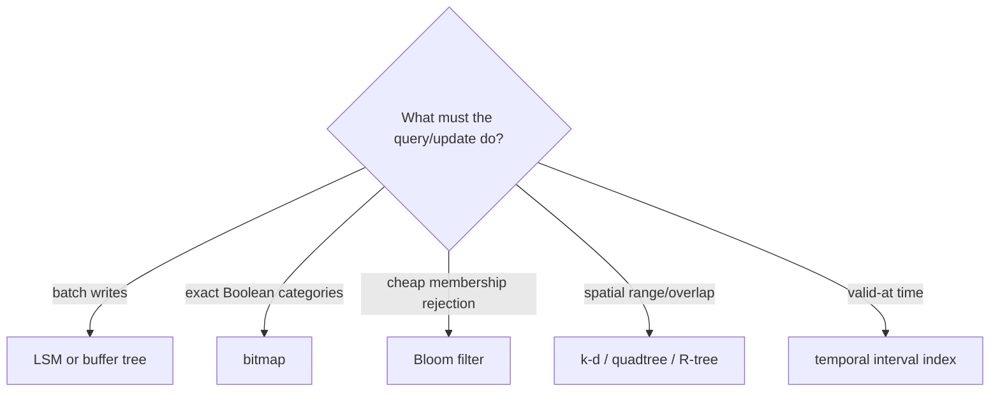

# SOE201 · Advanced Indexing

## Video generation status
PENDING: source pack prepared; no cloud video has been generated or reviewed.

## Spanish video overview prompt
Explica esta unidad en español claro, paso a paso, para alguien que aprende de forma autodidacta. Usa únicamente el material incluido. Comienza con el problema motivador, presenta los conceptos, muestra un ejemplo visual fiel a las convenciones del curso, pausa para una pregunta y después explica la respuesta. Distingue práctica suplementaria de tareas oficiales y de soluciones oficiales. No inventes datos, fuentes, requisitos, capítulos pendientes, resultados de ejecución ni predicciones de examen. Conserva los límites y discrepancias indicados. Cierra con una actividad que el estudiante pueda intentar en Learning Uni. Cita el nombre del documento y su localizador cuando corresponda. Si falta evidencia, dilo; no rellenes el hueco. Mantén visibles las fórmulas y direcciones de flechas.

## Verified original file snapshots
- Lecture3b - Advanced Indexing.pdf · SHA-256 6d45e35e6b5f91ece72aa7c8687a9716526bec3e19f29f7dbe2117e279da835a

## Source material

### Snapshot: content/reviewed/SOE201/04/tutor.md
SHA-256: 4909056a2dd9f1856e00362d303b207dbb2eaba8d01ba86f94495c73ff36c63e

---
title: "Unit 04 · Advanced Indexing · Tutor Notes"
course: SOE201
type: tutor-notes
status: reviewed
study_status: untested
language: en
cssclasses:
  - soe201-study
  - university-study
---

# Unit 04 — Advanced indexing

[[10_UNIVERSITY_CS/SOE201/Tutor Mode/00 Start Here|Tutor Start]] · [[10_UNIVERSITY_CS/SOE201/Tutor Mode/Unit 04 - Advanced Indexing/02 Recall and Exam Practice|Recall and practice]] · [[10_UNIVERSITY_CS/SOE201/Unit 04 - Advanced Indexing/01 Notes|Reference notes]] · [[10_UNIVERSITY_CS/SOE201/Unit 04 - Advanced Indexing/03 Lab|Reference lab]]

## In 60 Seconds

Different predicates need different structures. LSM and buffer trees batch updates; bitmap indexes compute exact sets; Bloom filters cheaply reject definite non-members but may return false positives; k-d trees, quadtrees and R-trees prune spatial regions; temporal indexes locate versions by valid interval. The right question is not “which index is fastest?” but “which mechanism preserves the predicate and workload we need?”

After study, you should be able to select a mechanism, trace its intermediate state, distinguish exact results from candidates, and explain its trade-offs without turning vendor examples into universal behaviour.

## Concept Preview

> [!note] LSM tree
> **Plain-language meaning:** accumulate newer entries in memory and merge sorted batches into larger disk levels.
>
> **Why it matters:** converts scattered writes into batched sequential work but adds merges and multi-level reads.
>
> **Source:** `Lecture3b - Advanced Indexing.pdf`, PDF pp. 4–6.

> [!note] Bitmap index
> **Plain-language meaning:** one aligned bit vector represents which record positions have a value.
>
> **Why it matters:** Boolean operations return exact candidate positions quickly for suitable low-cardinality attributes.
>
> **Source:** Lecture3b, PDF pp. 8–10.

> [!note] Bloom filter
> **Plain-language meaning:** a compact probabilistic membership filter with no false negatives under its model, but possible false positives.
>
> **Why it matters:** it can avoid expensive lookups when any required bit is zero.
>
> **Source:** Lecture3b, PDF pp. 11–12.

> [!note] Spatial pruning
> **Plain-language meaning:** partition or bound regions so a query examines only plausible objects.
>
> **Why it matters:** a bounding-region hit may still need an exact geometry predicate.
>
> **Source:** Lecture3b, PDF pp. 13–20.

> [!note] Temporal interval
> **Plain-language meaning:** a version is valid over a time interval, possibly with an open end.
>
> **Why it matters:** current and historical lookups may require different access paths.
>
> **Source:** Lecture3b, PDF pp. 21–22.

## Exam Evidence Snapshot

| Topic | Observed papers | Known marks | Observed demand | Priority |
|---|---:|---:|---|---|
| Spatial-index technique/selection | 3/4 | 6 | name, state an application | **HIGH EXAM RELEVANCE** |
| LSM, buffer, bitmap, Bloom and temporal indexes | 0/4 | 0 observed | not observed | NOT OBSERVED IN AVAILABLE PAST-PAPER SAMPLE |

HIGH applies to the recurring spatial selection prompt, not the whole unit. Historical questions were short-answer depth.

## Before You Start

Recall B+ tree ordered access, hash equality access, Boolean AND/OR and coordinate pairs.

> [!question] Prerequisite check
> What is the bitwise AND of `101010` and `110011`?

> [!success]- Check your answer
> `100010`: a position is 1 only when both input bits are 1.
>
> Source principle: Lecture3b, PDF pp. 8–10.

## A motivating question

A campus system receives frequent asset updates and supports four queries:

1. ingest updates without scattered one-record disk writes;
2. return records that are both `sensor` and `active`;
3. reject most absent IDs before searching a disk structure;
4. find map objects inside a rectangle and the version valid at time 5.

No single structure is automatically best. Match each predicate to a mechanism and state what extra work or uncertainty remains.

## Learn the mechanism

### A decision map



**Figure 1 — Choose by predicate and workload**

**Read it:** start with the required operation, not a favourite data structure.

**Key takeaway:** each branch changes the meaning of a “match” and the work still required.

**Provenance:** teaching synthesis from Lecture3b, PDF pp. 2–22.

### LSM trees and buffer trees

An LSM tree keeps newer ordered entries in memory ($L_0$) and merges batches into larger disk levels. With growth factor $k$, the simplified threshold relation is $T_{i+1}=kT_i$. If $T_0=100$ and $k=4$, then $T_1=400$ and $T_2=1600$ entries.

Merging scans ordered inputs and produces ordered output. This reduces scattered insert work but rewrites older entries, and a lookup may search several levels. A deletion tombstone must remain until older relevant versions can no longer reappear.

A buffer tree retains a search tree but stores pending updates in internal buffers. When a buffer fills, it partitions updates by child range and pushes batches downward. Queries must account for relevant buffered updates.

| Structure | Batches where? | Read consequence |
|---|---|---|
| LSM | across memory/disk sorted levels | search/reconcile relevant levels |
| buffer tree | inside internal search-tree nodes | inspect path plus pending updates |

### Bitmap indexes are exact set algebra

All bitmaps share the same record-position order. For source bitmaps `m=11010` and `L1=10010`, the conjunction is:

```text
  11010
& 10010
= 10010
```

Positions with 1 satisfy both predicates. Bitmap space grows with record count × distinct indexed values, so very high cardinality and frequent position-changing updates can weaken the basic design.

### Bloom filters answer “definitely not” or “possibly”

Insertion sets every bit selected by the element's hash functions. Query recomputes those positions:

- any zero → definitely absent;
- all ones → possibly present; verify in the real structure.

False positives occur when other inserted elements set all queried bits. Under the lecture's idealised approximation, after $n$ inserted values, $k$ hashes and $m$ bits:

$$p\approx\left(1-e^{-kn/m}\right)^k.$$

The lecture's 10% and 1% are rounded illustrations; the reference notes derive approximately 9.52% and 0.819% under their stated model. A Bloom filter does not itself return the record and ordinarily does not support deletion without an extended design.

### Spatial structures prune different shapes

| Structure | Partition/bound | Natural lesson |
|---|---|---|
| k-d tree | alternating coordinate splits | point/range pruning by axis |
| quadtree | recursively equal spatial quadrants | adapts resolution by subdividing occupied regions |
| R-tree | bounding rectangles over objects/groups | handles rectangles/polygons and overlap; verify exact geometry |

A bounding rectangle can overlap a query even when the contained object's exact shape does not. Spatial indexes produce candidates; the final predicate may still reject false candidates.

### Temporal indexing

The lecture separates current open-ended entries from historical closed intervals. Tutor examples use half-open intervals `[start,end)` because the source does not fully define endpoint inclusion. Under that declared convention, `[1,5)` is valid at 4 but not 5, while `[5,∞)` begins at 5.

> [!question] Explain it yourself
> Why is a Bloom “possibly present” result different from a bitmap AND result?

> [!success]- Check your explanation
> Bloom bits can be shared by unrelated elements, so all-one is only a candidate. Aligned bitmap AND exactly represents the indexed record positions.
>
> Source: Lecture3b, PDF pp. 8–12.

## Worked example — solve the campus questions

1. **Writes:** use an LSM or buffer tree to batch propagation. LSM inherits merge and multi-level lookup work; a buffer tree inherits pending-update visibility along the path.
2. **Categories:** `sensor=101010` AND `active=110011` gives `100010`, so record positions 0 and 4 match when the leftmost bit is position 0.
3. **Absent-ID rejection:** use a Bloom filter. A zero bit proves absence; all ones require the real lookup.
4. **Map rectangle:** use k-d/quadtree for point partitioning or an R-tree for bounded objects; always test the exact spatial predicate after pruning.
5. **Time 5:** under the explicit half-open convention, the old `[1,5)` version is excluded and the new `[5,∞)` version is valid.

## Return to the motivating question

The problem is solved by composing structures, not selecting one winner. Each mechanism answers a different predicate and carries a different residual cost: merges, buffered updates, bitmap maintenance, Bloom verification, exact geometry testing or interval-boundary handling.

## Definitions and distinctions

| Term A | Term B | Decisive distinction | Source |
|---|---|---|---|
| LSM level | buffer-tree node buffer | sorted version level versus pending updates attached to a search-tree node | Lecture3b, pp. 4–7 |
| bitmap | Bloom filter | exact aligned set representation versus probabilistic membership filter | Lecture3b, pp. 8–12 |
| false positive | false negative | candidate returned for absent item versus missed present item; standard Bloom model permits only the former | Lecture3b, pp. 11–12 |
| k-d tree | quadtree | data/axis split versus recursive equal-region subdivision | Lecture3b, pp. 13–17 |
| R-tree bound | exact geometry | pruning rectangle versus final object predicate | Lecture3b, pp. 18–20 |

## Review

### Full Understanding

Return to [[#Learn the mechanism]] and [[#Worked example — solve the campus questions]].

## 5-Minute Review

- batch writes with LSM levels or node buffers;
- bitmaps compute exact aligned sets;
- Bloom zero means absent, all-one means verify;
- spatial indexes prune regions but may return candidates;
- k-d, quadtree and R-tree encode different spatial organisation;
- temporal answers depend on interval semantics;
- choose by predicate, update pattern and remaining work.

## 60-Second Recall

- LSM merge levels
- tombstone lifetime
- buffered propagation
- aligned bitmap
- Bloom false positive
- k-d axis split
- quadtree quadrants
- R-tree bounding rectangle
- exact geometry check
- temporal interval boundary

## Sources

- `Lecture3b - Advanced Indexing.pdf`, PDF pp. 2–22; p. 23 is reading context.
- `SOE201-EXAMS.pdf`: P23F A5, P23R A4 and P24F A5.


### Snapshot: content/reviewed/SOE201/04/practice.md
SHA-256: bd85890c9a4d51d5d3f785549346cab78c6e1e62fa923aad581f633d64e0eb2d

---
title: "Unit 04 · Recall and Exam Practice"
course: SOE201
type: tutor-practice
status: reviewed
study_status: untested
language: en
cssclasses:
  - soe201-study
  - university-study
---

# Unit 04 — Recall and exam practice

[[10_UNIVERSITY_CS/SOE201/Tutor Mode/Unit 04 - Advanced Indexing/01 Tutor Notes|Tutor notes]] · [[10_UNIVERSITY_CS/SOE201/Unit 04 - Advanced Indexing/02 Exercises|Reference exercises]] · [[10_UNIVERSITY_CS/SOE201/Unit 04 - Advanced Indexing/03 Lab|Reference lab]]

## Atomic recall

### Card 01 — What does an LSM tree batch?
> [!success]- Answer
> Ordered updates, merging memory batches into larger sorted disk levels.
>
> Source: Lecture3b, PDF pp. 4–6.

### Card 02 — What must an LSM lookup reconcile?
> [!success]- Answer
> Relevant versions and tombstones across every searched level.
>
> Source: Lecture3b, PDF pp. 4–6.

### Card 03 — What does a buffer-tree internal buffer hold?
> [!success]- Answer
> Pending updates waiting to be partitioned and pushed toward child ranges.
>
> Source: Lecture3b, PDF p. 7.

### Card 04 — What record-position invariant must hold before combining two bitmap indexes?
> [!success]- Answer
> The same record-position order.
>
> Source: Lecture3b, PDF pp. 8–10.

### Card 05 — If any queried Bloom-filter bit is zero, what can you conclude under the standard insertion-only model?
> [!success]- Answer
> The queried element is definitely absent under the filter model.
>
> Source: Lecture3b, PDF pp. 11–12.

### Card 06 — If all queried Bloom-filter bits are one, what can you conclude and what must happen next?
> [!success]- Answer
> Only possible membership; the real structure must verify it.
>
> Source: Lecture3b, PDF pp. 11–12.

### Card 07 — How does a k-d tree divide space?
> [!success]- Answer
> By recursive coordinate splits, typically alternating dimensions.
>
> Source: Lecture3b, PDF pp. 15–16.

### Card 08 — How does a quadtree divide two-dimensional space?
> [!success]- Answer
> Recursively into four equal spatial quadrants.
>
> Source: Lecture3b, PDF p. 17.

### Card 09 — What does an R-tree internal entry bound?
> [!success]- Answer
> A minimum bounding rectangle covering objects or child regions.
>
> Source: Lecture3b, PDF pp. 18–20.

### Card 10 — Why can temporal endpoint assumptions change an answer?
> [!success]- Answer
> A version at the boundary may be included or excluded depending on interval convention.
>
> Source: Lecture3b, PDF pp. 21–22; endpoint rule unconfirmed.

## Practice

### Practice 1 — Threshold reasoning

**SUPPLEMENTARY PRACTICE.** An LSM memory level holds 200 entries and level thresholds grow by factor 5. Calculate the next two thresholds and explain what the numbers do not prove.

> [!tip]- Hint
> Repeatedly apply $T_{i+1}=kT_i$.

> [!success]- Solution
> $T_1=5(200)=1000$ and $T_2=5(1000)=5000$ entries.
>
> These are capacity thresholds in the simplified model. They do not prove actual latency, write amplification, simultaneous fullness or a particular product's configuration.
>
> Source principle: Lecture3b, PDF pp. 4–6.

### Practice 2 — ORIGINAL COURSE WORKED TASK: bitmap conjunction

Using source bitmaps `m=11010` and `L1=10010`, compute `m AND L1` and interpret the result.

> [!tip]- Hint
> Compare aligned positions one at a time.

> [!success]- Solution
> `11010 AND 10010 = 10010`.
>
> The 1 positions identify records satisfying both indexed values, assuming every bitmap uses the same record order.
>
> Source: Lecture3b, PDF pp. 9–10.

### Practice 3 — Bloom diagnosis

**SUPPLEMENTARY PRACTICE.** A queried value maps to bits 2, 6 and 9. Bits 2 and 9 are 1 but bit 6 is 0. What can be concluded? What if all three are 1?

> [!tip]- Hint
> Separate definitive rejection from candidate acceptance.

> [!success]- Solution
> With bit 6 equal to 0, the value is definitely absent under the filter model.
>
> If all three are 1, the value is only possibly present because other insertions may have set those bits. Verify in the underlying structure.
>
> Source: Lecture3b, PDF pp. 11–12.

> [!danger] HIGH EXAM RELEVANCE
> Spatial-index selection appears in 3/4 inspected papers (6 known marks), always at short-answer depth. This is evidence-based priority, not a prediction.

### Practice 4 — Select a spatial structure

**SUPPLEMENTARY PRACTICE.** Choose a defensible structure for (a) point range queries with repeated coordinate splitting, (b) adaptively subdividing a map into equal quadrants, and (c) indexing rectangles/polygons. State one residual check.

> [!tip]- Hint
> Match each description to k-d tree, quadtree or R-tree.

> [!success]- Solution
> (a) k-d tree; (b) quadtree; (c) R-tree.
>
> For bounded spatial objects, an R-tree overlap produces candidates. Apply the exact geometry predicate afterward because bounding rectangles can overlap even when objects do not.
>
> Source: Lecture3b, PDF pp. 13–20.

### Practice 5 — Temporal boundary transfer

**SUPPLEMENTARY PRACTICE.** Version A is valid `[2,7)` and version B `[7,∞)`. Which is valid at 6 and 7? What must be stated before answering an official question?

> [!tip]- Hint
> Apply the declared half-open convention, then identify the source gap.

> [!success]- Solution
> At 6, A is valid. At 7, A is excluded and B is valid.
>
> Before answering an official question, state or confirm the endpoint convention because Lecture3b does not fully specify inclusion. The half-open rule here is a pedagogical assumption.
>
> Source: Lecture3b, PDF pp. 21–22.

### Practice 6 — Transfer: compose an index plan

**SUPPLEMENTARY PRACTICE.** A telemetry store has write bursts, a low-cardinality status filter, frequent absent-device lookups and map-window queries. Propose a composition and explain why no component replaces the others.

> [!tip]- Hint
> Map each workload feature to batching, exact sets, rejection and spatial pruning.

> [!success]- Solution
> Use an LSM/buffered structure for write batching, a bitmap for exact status combinations, a Bloom filter to reject many absent-device lookups before disk access, and a spatial index for map windows.
>
> The components answer different predicates. Bloom positives still need verification; spatial candidates need exact testing; bitmap positions need maintenance; batched writes create merge/visibility work.
>
> Source principles: Lecture3b, PDF pp. 2–22. Scenario is synthetic.

## Original exercise navigation

- [[10_UNIVERSITY_CS/SOE201/Unit 04 - Advanced Indexing/02 Exercises#B1 — Reconstruct the lecture bitmaps and original AND query|lecture bitmaps]]
- [[10_UNIVERSITY_CS/SOE201/Unit 04 - Advanced Indexing/02 Exercises#B2 — Read the original temporal course table|source temporal table]]
- [[10_UNIVERSITY_CS/SOE201/Unit 04 - Advanced Indexing/02 Exercises#C1 — LSM thresholds, merge work, and tombstones|LSM practice]]
- [[10_UNIVERSITY_CS/SOE201/Unit 04 - Advanced Indexing/02 Exercises#D1 — Trace a spatial range and reject a false candidate|spatial trace]]
- [[10_UNIVERSITY_CS/SOE201/Unit 04 - Advanced Indexing/02 Exercises#E1 — Compare k-d and quadtree subdivision|k-d versus quadtree]]

No official marking scheme was supplied.
