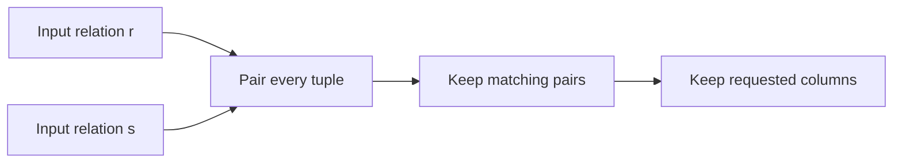

# SOE201 · Álgebra relacional

## Estado de generación del vídeo
PENDIENTE: material preparado; no se ha generado ni revisado ningún vídeo nuevo.

## Instrucciones
Explica la unidad en español siguiendo únicamente este material. Cita las fuentes y distingue práctica complementaria, respuestas suministradas y comentarios locales. Conserva fórmulas, identificadores, discrepancias y límites de evidencia. No inventes contenido, requisitos, resultados, dominio del estudiante ni predicciones de examen.

## Fuentes originales
- Lecture4a - Review of Relational Algebra.pdf (original en inglés) · SHA-256 46d28f1cc8755de1e9dd0a5217ee2966e9efb9af5f4bfc287b6ec7ed4256484d

## Edición española derivada
El hash indicado para cada documento identifica la fuente inglesa; el contenido mostrado es la traducción española. Los originales se conservan en la biblioteca.

### content/reviewed/SOE201/05/tutor.md
Hash de fuente inglesa: 4b4a24da73f030b833d4eb43eb32f00783e857abd580492c55fd78b6d2c8114f

---
course: SOE201
type: tutor-notes
language: en
---
# Álgebra relacional

Edición de tutor web de `Lecture4a - Review of Relational Algebra.pdf`, PDF, páginas 1–40. Las diapositivas suministradas son la autoridad. Los ejemplos marcados como complementarios son variaciones de enseñanza, no preguntas de exámenes oficiales.

## En 60 segundos

Es más fácil razonar una consulta cuando se trata cada resultado intermedio como una relación. La selección mantiene filas clasificatorias; la proyección mantiene columnas con nombre; las operaciones de conjuntos combinan relaciones compatibles; tuplas de pares de productos; cambiar el nombre resuelve los nombres. Las uniones y divisiones expresan combinaciones comunes. Estos operadores explican el significado de una consulta antes de elegir cómo la ejecuta un DBMS.

**Objetivo:** rastrear una consulta desde sus relaciones de entrada hasta su resultado, explicar la eliminación de duplicados y traducir "ambos" o "todos" a la operación correcta. Fuente: Lecture4a, PDF págs. 2,6–9,26–39.

## Antes de comenzar

Debe distinguir una fila de una columna y leer comparaciones simples. Las unidades de almacenamiento e indexación anteriores explican las rutas de acceso; Esta unidad explica qué tuplas debe regresar eventualmente la ruta de acceso. El álgebra relacional utiliza semántica de conjuntos: las tuplas duplicadas desaparecen y el orden de las tuplas es irrelevante. SQL puede usar semántica de bolsa, así que no asuma silenciosamente que cada consulta SQL tiene este comportamiento duplicado. Fuente: Lecture4a, PDF, páginas 6–7.

## Una pregunta motivadora

El banco pregunta: "¿Qué clientes tienen una cuenta en **cada** sucursal de Brooklyn?" ¿Por qué es insuficiente encontrar clientes en una sucursal de Brooklyn? Tenga esta pregunta en mente mientras aprende a los operadores. Esta es la consulta fuente en Lecture4a, PDF p.39.

## 1. Describe la relación antes de cambiarla.

Un **esquema** nombra los atributos; una **instancia** es el conjunto actual de tuplas sobre ese esquema. Un atributo tiene un dominio de valores permitidos. Las diapositivas presentan valores atómicos y `null` como valor desconocido; no establecen las reglas lógicas completas de tres valores de SQL, por lo que los ejemplos establecidos a continuación utilizan valores comunes y conocidos.

Una superclave identifica de forma única tuplas en cada instancia válida. Una clave candidata es una superclave **mínima**: eliminar cualquier atributo destruye esa garantía. Elija una clave candidata como clave principal. Una restricción de clave externa vincula valores a una relación referenciada. `{ID, name}` puede ser una superclave sin ser clave candidata cuando `{ID}` ya es suficiente. Fuente: Lecture4a, PDF, páginas 3–5.

## 2. La selección mantiene filas; la proyección mantiene las columnas

La selección es $\sigma_p(r)=\{t\in r\mid p(t)\}$. Su predicado puede comparar atributos o constantes y combinar términos con AND, OR y NOT. Conserva los atributos de entrada.

El ejemplo de origen contiene `(a,a,1,7)`, `(a,b,5,7)`, `(b,b,12,3)`, `(b,b,23,10)` sobre `(A,B,C,D)`. La aplicación de $\sigma_{A=B\land D>5}$ mantiene la primera y la cuarta tupla: la tercera tiene igual `A,B` pero no cumple la segunda condición. Fuente: Lecture4a, PDF, páginas 10-11.

Projection $\pi_{A_1,\ldots,A_k}(r)$ mantiene solo los atributos nombrados y luego elimina las tuplas resultantes duplicadas. La proyección de origen de `(A,B,C)` a `(A,C)` convierte cuatro filas en `{(a,1),(b,1),(b,2)}` porque dos filas de entrada se asignan a `(a,1)`. Fuente: Lecture4a, PDF, páginas 12-13.

> [!question]- Pruebe antes de continuar
> ¿Puede la proyección aumentar el número de tuplas en álgebra relacional de conjuntos?

> [!success]- Verificar
> No. Cada tupla de entrada produce una tupla proyectada y los duplicados pueden colapsar. Esta es una consecuencia basada en definiciones de Lecture4a, PDF, páginas 12-13.

## 3. Combina conjuntos compatibles

Union $r\cup s$ mantiene tuplas presentes en cualquiera de las entradas. La diferencia $r-s$ mantiene las tuplas presentes en `r` y ausentes en `s`. La intersección $r\cap s$ mantiene tuplas en ambos y se puede expresar como $r-(r-s)$.

Estas operaciones requieren la misma aridad y dominios de atributos compatibles; alinear los atributos correspondientes. Combinan **tuplas completas**, no celdas seleccionadas de forma independiente. La diferencia es direccional: $r-s$ suele diferir de $s-r$.

Para el origen `r={(a,1),(a,2),(b,1)}` y `s={(a,2),(b,3)}`, la unión agrega `(b,3)` una vez; la diferencia es `{(a,1),(b,1)}`; la intersección es `{(a,2)}`. Fuente: Lecture4a, PDF págs. 14–17,27–28.

## 4. Tuplas de pares de productos; cambiar el nombre hace que el emparejamiento sea inequívoco

El producto cartesiano $r\times s$ empareja cada tupla de `r` con cada tupla de `s`, concatenando sus atributos. Con nombres de atributos separados, dos tuplas de entrada emparejadas con cuatro dan ocho tuplas de salida. Si los nombres se superponen, cambie el nombre o califique los atributos antes de hacer referencia a ellos. Luego, la fuente selecciona los pares `A=C` coincidentes del producto. Fuente: Lecture4a, PDF, páginas 18-20.

Cambiar nombre $\rho_x(E)$ le da a una expresión un nombre de relación; su forma extendida también nombra los atributos. Es particularmente útil cuando una relación debe compararse con otra copia de sí misma. Cambiar el nombre cambia los identificadores, no los valores almacenados. Fuente: Lecture4a, PDF p.21.

Visualización complementaria de la composición en Lecture4a, PDF, páginas 18-24.

## 5. La unión natural coincide con todos los atributos comunes

Una unión natural combina tuplas que coinciden en **todos** los nombres de atributos comunes. La salida incluye esos atributos comunes una vez, más los atributos únicos de cada entrada.

Si los esquemas son `(A,B,C,D)` y `(E,B,D)`, se requiere acuerdo tanto en `B` como en `D`, no solo en uno. La fuente define esto como un producto, una selección coincidente y una proyección que elimina columnas comunes duplicadas. Una unión natural puede restringir accidentalmente un atributo del mismo nombre no relacionado; Inspeccione los esquemas primero. Fuente: Lecture4a, PDF, páginas 29–30.

## 6. La división responde a una pregunta general

Deje que `r` tenga los atributos `(A,B)` y deje que `s` enumere los valores `B` requeridos. Luego, $r\div s$ mantiene cada candidato `A` cuyo emparejamiento con **cada** `B` en `s` ocurre en `r`.

En el ejemplo de la página 32 de la fuente, `s={1,2}`. Tanto `a` como `b` tienen emparejamientos con 1 y 2; `g` y `d` no lo hacen. La respuesta es `{a,b}`. Los emparejamientos adicionales no descalifican a un candidato. Fuente: Lecture4a, PDF, páginas 31–33.

La construcción del operador básico es más fácil de leer como “candidatos menos fracasos”:

$$C=\pi_{R-S}(r),\qquad M=(C\times s)-\pi_{R-S,S}(r)$$
$$r\div s=C-\pi_{R-S}(M).$$

`M` contiene emparejamientos requeridos que faltan. Proyecte los atributos de sus candidatos y luego elimínelos. La proyección de reordenamiento de atributos alinea la resta. Los candidatos proceden de `C`; esto evita tratar la frase de “relación más grande” de la diapositiva como una búsqueda ilimitada sobre valores arbitrarios. Fuente: Lecture4a, PDF págs. 34–35.

## 7. Leer una expresión de adentro hacia afuera

Para clientes con préstamos de Perryridge, primero conecte al prestatario y al préstamo mediante `loan_number`, seleccione `branch_name=Perryridge` y proyecte `customer_name`. Las diapositivas también muestran cómo filtrar la entrada del préstamo antes que el producto. Estas expresiones conservan la respuesta deseada, pero pueden dar lugar a diferentes cantidades de trabajo intermedio. Fuente: Lecture4a, PDF p.24.

Para encontrar el saldo de cuenta más grande sin un operador agregado, cambie el nombre de una segunda copia a `d`, busque cada cuenta cuyo saldo sea menor que otra, proyecte esos saldos no máximos y réstelos de todos los saldos. Esto mantiene el **valor de saldo** máximo, incluido el caso en que varias cuentas lo comparten. Fuente: Lecture4a, PDF p.25.

La tarea nombra relaciones intermedias temporales, haciendo legible una expresión larga. No es una actualización de tabla persistente. Fuente: Lecture4a, PDF p.35.

## Volver a la pregunta motivadora

Cree pares de cliente/sucursal desde `depositor` unidos con `account`. Seleccione por separado las sucursales de Brooklyn y proyecte los nombres de sus sucursales. Divida los pares por la relación de rama requerida, siguiendo la página 39. Unirse a una sucursal de Brooklyn sólo prueba “al menos una”; La división verifica cada rama en el conjunto requerido.

## Definiciones y distinciones

| Necesidad | Operación | Verifique primero |
| --- | --- | --- |
| Tuplas calificadas | Selección | Predicado se refiere a atributos disponibles |
| Atributos seleccionados | Proyección | Establecer eliminación de duplicados |
| Cualquiera/ambos/solo en primero | Unión / intersección / diferencia | Arity y compatibilidad de dominios |
| Cada emparejamiento de tuplas | Producto | Los nombres son inequívocos |
| Coincidencia de valores compartidos | Unión natural | Todos los nombres de atributos comunes |
| Cada emparejamiento requerido | División | Los atributos del divisor pertenecen al dividendo |

Fuente: Lecture4a, PDF, páginas 8–35. Las opciones de escaneo/índice físico pertenecen a la siguiente unidad; estas expresiones establecen resultados lógicos.

## Revisión

Explicar de memoria los seis operadores básicos. Traza la proyección fuente y explica por qué desaparece una fila. Distinga “en ambas ramas nombradas” de “en todas las ramas de una relación”. Luego intente realizar las traducciones de la consulta original en Recordar y practicar con las notas cerradas.

## Fuentes y alcance

Se inspeccionó el texto de las 40 páginas PDF de `Lecture4a - Review of Relational Algebra.pdf` para esta edición; La fórmula de división en la página 34 también se inspeccionó visualmente. Las diapositivas recomiendan el capítulo 2 del libro de texto en la página 40. Esta edición cubre la conferencia suministrada; no afirma que se haya revisado todo el capítulo del libro de texto. No se introducen nuevas afirmaciones ni calificaciones de trabajos anteriores.

### content/reviewed/SOE201/05/practice.md
Hash de fuente inglesa: 1bc2046e019dcd3684f451539cecb965f0dbb2f4e27e82d25982e1924cbc2028

# Álgebra relacional: recordar y practicar

Edición de tutores web. La nueva práctica a continuación es **PRÁCTICA COMPLEMENTARIA**, no una tarea oficial ni un esquema de calificación. Fuentes: Lecture4a - Revisión de Álgebra Relacional.pdf. Inténtelo antes de abrir la ayuda.

## Repaso activo atómico

### Tarjeta 01: ¿Qué cambia la selección?
> [!success]- Respuesta
> La selección mantiene las tuplas que satisfacen un predicado; conserva el esquema de atributos.
>
> Fuente: Lecture4a - Review of Relational Algebra.pdf, PDF págs. 10–11.

### Tarjeta 02 — ¿Qué cambia la proyección?
> [!success]- Respuesta
> La proyección mantiene los atributos nombrados. En el álgebra relacional de conjuntos, las tuplas de resultados idénticos colapsan a uno.
>
> Fuente: Lecture4a - Review of Relational Algebra.pdf, PDF págs. 12-13.

### Tarjeta 03 — ¿Qué es la compatibilidad para la unión?
> [!success]- Respuesta
> Igualdad de igualdad y dominios de atributos correspondientes compatibles; alinear nombres/orden antes de una operación establecida.
>
> Fuente: Lecture4a - Review of Relational Algebra.pdf, PDF págs. 14–18.

### Tarjeta 04: ¿Es la diferencia conmutativa?
> [!success]- Respuesta
> No. r−s mantiene tuplas en r ausentes de s; s-r hace la pregunta opuesta.
>
> Fuente: Lecture4a - Review of Relational Algebra.pdf, PDF págs. 16–17.

### Tarjeta 05: ¿Qué tamaño tiene un producto cartesiano?
> [!success]- Respuesta
> Cada tupla de la izquierda se empareja con cada tupla de la derecha: |r×s|=|r|·|s|. Cambie el nombre de los nombres de atributos ambiguos.
>
> Fuente: Lecture4a - Review of Relational Algebra.pdf, PDF págs. 19–22.

### Tarjeta 06: ¿Con qué coincide la combinación natural?
> [!success]- Respuesta
> Igualdad de todos los atributos con nombres comunes, luego queda una copia de cada atributo común.
>
> Fuente: Lecture4a - Review of Relational Algebra.pdf, PDF págs. 26–29.

### Tarjeta 07 — ¿Por qué cambiar el nombre de una relación?
> [!success]- Respuesta
> Nombrar un resultado intermedio o distinguir copias de una misma relación y sus atributos.
>
> Fuente: Lecture4a - Revisión de Álgebra Relacional.pdf, PDF p. 22.

### Tarjeta 08: Para las relaciones r(X,Y) y s(Y), ¿qué devuelve la división r ÷ s y de dónde provienen los valores candidatos de X?
> [!success]- Respuesta
> Devuelve X tuplas de πX(r) que ocurren en r emparejadas con cada tupla Y en s. Se permiten emparejamientos Y adicionales; si s está vacío, todos los candidatos en πX(r) califican.
>
> Fuente: Lecture4a - Review of Relational Algebra.pdf, PDF págs. 30–34.

### Tarjeta 09: Para r(X,Y) y s(Y), ¿cómo implementan la división los candidatos menos los fracasos?
> [!success]- Respuesta
> Inicio T=πX(r). Los pares que faltan son (T×s)−r. Proyecte sus valores de X y reste los candidatos fallidos de T.
>
> Fuente: Lecture4a - Revisión de Álgebra Relacional.pdf, PDF p. 34.

### Tarjeta 10: ¿Cómo puede la diferencia encontrar un máximo?
> [!success]- Respuesta
> Cambie el nombre de una segunda copia, busque valores más pequeños que algún otro valor y reste esos valores no máximos de todos los valores. Los empates persisten.
>
> Fuente: Lecture4a - Revisión de Álgebra Relacional.pdf, PDF p. 25.

### Tarjeta 11: ¿Cómo responden el prestatario y el depositante a ambos versus a cualquiera?
> [!success]- Respuesta
> Intersectar los nombres de clientes proyectados para ambos; unirlos para cualquiera de los dos.
>
> Fuente: Lecture4a - Review of Relational Algebra.pdf, PDF págs. 14–18, 36.

### Tarjeta 12: ¿La proyección de álgebra es igual a SQL SELECT ordinario?
> [!success]- Respuesta
> No necesariamente: esta conferencia utiliza conjuntos; SQL sin DISTINCT puede conservar duplicados y tiene un comportamiento NULL adicional.
>
> Fuente: Lecture4a - Review of Relational Algebra.pdf, PDF págs. 12–13; calificación de semántica de conjuntos.

## Práctica progresiva

### Práctica 1: Selección y luego proyección

**PRÁCTICA COMPLEMENTARIA.** Deje cuenta(nombre_sucursal,saldo)={(Centro,500),(Uptown,500),(Centro,900)}. Evaluar π_balance(σ_branch_name=Downtown(cuenta)).

> [!tip]- Sugerencia
> Mantenga primero las filas del centro y luego elimine los valores proyectados duplicados.

> [!success]- Solución
> La selección da {(Centro,500),(Centro,900)}. La proyección da {500.900}. Seleccionar Centro después de proyectar solo el saldo no es válido: nombre_sucursal fue descartado.
>
> Fuente: Lecture4a - Review of Relational Algebra.pdf, PDF págs. 10–13.

### Práctica 2: Ambos, cualquiera, solo

**PRÁCTICA COMPLEMENTARIA.** nombres de prestatarios={A,B}; nombres de depositantes={B,C}. Encuentre clientes con ambos, cualquiera de los dos y préstamos únicamente.

> [!tip]- Sugerencia
> Elija intersección, unión y diferencia ordenada.

> [!success]- Solución
> Ambos={B}; cualquiera={A,B,C}; solo préstamos={A}. Sólo los depósitos serían {C}; el orden de diferencia importa.
>
> Fuente: Lecture4a - Review of Relational Algebra.pdf, PDF págs. 14–18, 36.

### Práctica 3: únete sin coincidencias accidentales

**PRÁCTICA COMPLEMENTARIA.** prestatario(nombre_cliente,número_préstamo)={(A,L1),(B,L2)}; préstamo(número_préstamo,nombre_sucursal,monto)={(L1,Perryridge,1500),(L2,Centro,900)}. Encuentre prestatarios de Perryridge.

> [!tip]- Sugerencia
> Únase al número_préstamo, seleccione sucursal, nombre del proyecto.

> [!success]- Solución
> π_nombre_cliente(σ_nombre_sucursal=Perryridge(prestatario ⋈ préstamo))={A}. El único atributo común es número_préstamo. Con producto y selección, califica los dos atributos número_préstamo y equiparalos.
>
> Fuente: Lecture4a - Review of Relational Algebra.pdf, PDF págs. 24, 26–29.

### Práctica 4: División por cada valor requerido

**PRÁCTICA COMPLEMENTARIA.** r(nombre,rama)={(A,D),(A,U),(B,D),(C,U)} y s(rama)={D,U}. Calcule r÷s usando los pares faltantes.

> [!tip]- Sugerencia
> Construya pares candidatos×requeridos y reste los pares presentes.

> [!success]- Solución
> Candidatos={A,B,C}. Pares faltantes={(B,U),(C,D)}. Candidatos fallidos={B,C}. Resultado={A}. La pertenencia en alguna rama requerida es insuficiente.
>
> Fuente: Lecture4a - Review of Relational Algebra.pdf, PDF págs. 30–34, 39.

### Práctica 5 — Máximo con empates

**PRÁCTICA COMPLEMENTARIA.** Cuatro filas de cuentas tienen saldos 500, 900, 900 y 200 (una lista de valores, no un conjunto matemático). Utilice una copia renombrada para describir una consulta máxima.

> [!tip]- Sugerencia
> Un saldo no máximo es menor que al menos otro saldo.

> [!success]- Solución
> La proyección establecida da {200.500.900}. Los valores no máximos son {200.500}; la diferencia da {900}. Las tuplas de clientes/cuentas que regresan con un saldo de 900 pueden retener varias cuentas; la relación de valor en sí tiene un 900.
>
> Fuente: Lecture4a - Revisión de Álgebra Relacional.pdf, PDF p. 25.

### Práctica 6: traducir las consultas de la conferencia

**PRÁCTICA COMPLEMENTARIA.** Utilice `loan(loan_number,branch_name,amount)` y `borrower(customer_name,loan_number)`. Escriba expresiones de álgebra relacional establecidas para (a) todas las tuplas de préstamos con un monto superior a 1200; (b) nombre del cliente, número de préstamo y monto del préstamo de cada prestatario; (c) nombres de clientes con al menos un préstamo en el Downtown y al menos uno en Uptown. Ambas relaciones comparten únicamente `loan_number`.

Fuente: Lecture4a, PDF págs. 23,37–38.

> [!tip]- Sugerencia
> Usar selección; unirse más proyección; luego una intersección de dos relaciones de nombres.

> [!success]- Solución
> σ_monto>1200(préstamo).
> π_nombre_cliente,número_préstamo,monto(prestatario ⋈ préstamo).
> π_customer_name(σ_branch_name=Downtown(prestatario ⋈ préstamo)) ∩ π_customer_name(σ_branch_name=Uptown(prestatario ⋈ préstamo)).
>
> Fuente: Lecture4a - Review of Relational Algebra.pdf, PDF págs. 23, 37–38.

### Práctica 7: Límite divisor vacío

**PRÁCTICA COMPLEMENTARIA.** Si s está vacío, ¿cuál es r÷s bajo el universo candidato πX(r)?

> [!tip]- Sugerencia
> Cada par requerido está presente cuando no hay requisitos.

> [!success]- Solución
> T×s está vacío, por lo que los pares faltantes y los candidatos fallidos están vacíos. El resultado es T=πX(r). No inventa valores de X ausentes de ese universo candidato.
>
> Fuente: Lecture4a - Revisión de Álgebra Relacional.pdf, PDF p. 34; límite derivado de la fórmula mostrada.

