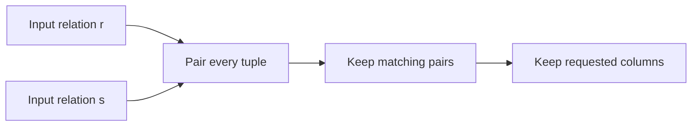

# SOE201 · Relational Algebra

## Video generation status
PENDING: source pack prepared; no cloud video has been generated or reviewed.

## Spanish video overview prompt
Explica esta unidad en español claro, paso a paso, para alguien que aprende de forma autodidacta. Usa únicamente el material incluido. Comienza con el problema motivador, presenta los conceptos, muestra un ejemplo visual fiel a las convenciones del curso, pausa para una pregunta y después explica la respuesta. Distingue práctica suplementaria de tareas oficiales y de soluciones oficiales. No inventes datos, fuentes, requisitos, capítulos pendientes, resultados de ejecución ni predicciones de examen. Conserva los límites y discrepancias indicados. Cierra con una actividad que el estudiante pueda intentar en Learning Uni. Cita el nombre del documento y su localizador cuando corresponda. Si falta evidencia, dilo; no rellenes el hueco. Mantén visibles las fórmulas y direcciones de flechas.

## Verified original file snapshots
- Lecture4a - Review of Relational Algebra.pdf · SHA-256 46d28f1cc8755de1e9dd0a5217ee2966e9efb9af5f4bfc287b6ec7ed4256484d

## Source material

### Snapshot: content/reviewed/SOE201/05/tutor.md
SHA-256: 4b4a24da73f030b833d4eb43eb32f00783e857abd580492c55fd78b6d2c8114f

---
course: SOE201
type: tutor-notes
language: en
---
# Relational Algebra

Web tutor edition from `Lecture4a - Review of Relational Algebra.pdf`, PDF pp.1–40. The supplied slides are the authority. Examples marked supplementary are teaching variations, not official exam questions.

## In 60 Seconds

A query becomes easier to reason about when you treat each intermediate result as a relation. Selection keeps qualifying rows; projection keeps named columns; set operations combine compatible relations; product pairs tuples; rename resolves names. Joins and division express common combinations. These operators explain the meaning of a query before you choose how a DBMS executes it.

**Goal:** trace a query from its input relations to its result, explain duplicate removal, and translate “both” or “all” into the right operation. Source: Lecture4a, PDF pp.2,6–9,26–39.

## Before You Start

You need to distinguish a row from a column and read simple comparisons. The earlier storage and indexing units explain access paths; this unit explains which tuples the access path must eventually return. Relational algebra uses set semantics: duplicate tuples disappear and tuple order is irrelevant. SQL can use bag semantics, so do not silently assume every SQL query has this duplicate behaviour. Source: Lecture4a, PDF pp.6–7.

## A motivating question

The bank asks: “Which customers hold an account at **every** Brooklyn branch?” Why is finding customers at one Brooklyn branch insufficient? Keep this question in mind while learning the operators. This is the source query on Lecture4a, PDF p.39.

## 1. Describe the relation before changing it

A **schema** names the attributes; an **instance** is the current set of tuples over that schema. An attribute has a domain of allowed values. The slides introduce atomic values and `null` as an unknown value; they do not establish the full SQL three-valued logic rules, so the set examples below use ordinary, known values.

A superkey uniquely identifies tuples in every valid instance. A candidate key is a **minimal** superkey: removing any attribute destroys that guarantee. Choose one candidate key as the primary key. A foreign-key constraint links values to a referenced relation. `{ID, name}` may be a superkey without being a candidate key when `{ID}` already suffices. Source: Lecture4a, PDF pp.3–5.

## 2. Selection keeps rows; projection keeps columns

Selection is $\sigma_p(r)=\{t\in r\mid p(t)\}$. Its predicate can compare attributes or constants and combine terms with AND, OR and NOT. It retains the input attributes.

The source example contains `(a,a,1,7)`, `(a,b,5,7)`, `(b,b,12,3)`, `(b,b,23,10)` over `(A,B,C,D)`. Applying $\sigma_{A=B\land D>5}$ keeps the first and fourth tuples: the third has equal `A,B` but fails the second condition. Source: Lecture4a, PDF pp.10–11.

Projection $\pi_{A_1,\ldots,A_k}(r)$ keeps only the named attributes, then removes duplicate resulting tuples. The source projection from `(A,B,C)` to `(A,C)` turns four rows into `{(a,1),(b,1),(b,2)}` because two input rows map to `(a,1)`. Source: Lecture4a, PDF pp.12–13.

> [!question]- Try before continuing
> Can projection increase the number of tuples in set relational algebra?

> [!success]- Check
> No. Each input tuple produces one projected tuple, and duplicates can collapse. This is a definition-based consequence of Lecture4a, PDF pp.12–13.

## 3. Combine compatible sets

Union $r\cup s$ keeps tuples present in either input. Difference $r-s$ keeps tuples present in `r` and absent from `s`. Intersection $r\cap s$ keeps tuples in both and can be expressed as $r-(r-s)$.

These operations require the same arity and compatible attribute domains; align the corresponding attributes. They combine **whole tuples**, not independently selected cells. Difference is directional: $r-s$ usually differs from $s-r$.

For the source `r={(a,1),(a,2),(b,1)}` and `s={(a,2),(b,3)}`, union adds `(b,3)` once; difference is `{(a,1),(b,1)}`; intersection is `{(a,2)}`. Source: Lecture4a, PDF pp.14–17,27–28.

## 4. Product pairs tuples; rename makes the pairing unambiguous

Cartesian product $r\times s$ pairs every tuple of `r` with every tuple of `s`, concatenating their attributes. With disjoint attribute names, two input tuples paired with four give eight output tuples. If names overlap, rename or qualify attributes before referring to them. The source then selects matching `A=C` pairs from the product. Source: Lecture4a, PDF pp.18–20.

Rename $\rho_x(E)$ gives an expression a relation name; its extended form also names the attributes. It is particularly useful when a relation must be compared with another copy of itself. Rename changes identifiers, not the stored values. Source: Lecture4a, PDF p.21.

Supplementary visualisation of the composition on Lecture4a, PDF pp.18–24.

## 5. Natural join matches every common attribute

A natural join combines tuples that agree on **all** common attribute names. The output includes those common attributes once, plus the attributes unique to each input.

If schemas are `(A,B,C,D)` and `(E,B,D)`, agreement is required on both `B` and `D`, not just one. The source defines this as a product, a matching selection, and a projection that removes duplicate common columns. A natural join can accidentally constrain an unrelated same-named attribute; inspect the schemas first. Source: Lecture4a, PDF pp.29–30.

## 6. Division answers an all-of question

Let `r` have attributes `(A,B)` and let `s` list required `B` values. Then $r\div s$ keeps each candidate `A` whose pairing with **every** `B` in `s` occurs in `r`.

In the source p.32 example, `s={1,2}`. Both `a` and `b` have pairings with 1 and 2; `g` and `d` do not. The answer is `{a,b}`. Extra pairings do not disqualify a candidate. Source: Lecture4a, PDF pp.31–33.

The basic-operator construction is easiest to read as “candidates minus failures”:

$$C=\pi_{R-S}(r),\qquad M=(C\times s)-\pi_{R-S,S}(r)$$
$$r\div s=C-\pi_{R-S}(M).$$

`M` contains required pairings that are missing. Project their candidate attributes, then remove those candidates. The attribute-reordering projection aligns the subtraction. Candidates are drawn from `C`; this avoids treating the slide's “largest relation” phrase as an unbounded search over arbitrary values. Source: Lecture4a, PDF pp.34–35.

## 7. Read an expression from the inside out

For customers with Perryridge loans, first connect borrower and loan by `loan_number`, select `branch_name=Perryridge`, and project `customer_name`. The slides also show filtering the loan input before the product. These expressions preserve the intended answer but can lead to different amounts of intermediate work. Source: Lecture4a, PDF p.24.

To find the largest account balance without an aggregate operator, rename a second copy as `d`, find each account whose balance is less than another, project those nonmaximum balances, and subtract them from all balances. This keeps the maximum **balance value**, including the case where multiple accounts share it. Source: Lecture4a, PDF p.25.

Assignment names temporary intermediate relations, making a long expression readable. It is not a persistent table update. Source: Lecture4a, PDF p.35.

## Return to the motivating question

Build customer/branch pairs from `depositor` joined with `account`. Separately select the Brooklyn branches and project their branch names. Divide the pairs by that required branch relation, following p.39. Joining to one Brooklyn branch only proves “at least one”; division checks every branch in the required set.

## Definitions and distinctions

| Need | Operation | Check first |
| --- | --- | --- |
| Qualifying tuples | Selection | Predicate refers to available attributes |
| Selected attributes | Projection | Set duplicate removal |
| Either / both / only in first | Union / intersection / difference | Arity and domain compatibility |
| Every tuple pairing | Product | Names are unambiguous |
| Matching shared values | Natural join | All common attribute names |
| Every required pairing | Division | Divisor attributes belong to the dividend |

Source: Lecture4a, PDF pp.8–35. Physical scan/index choices belong to the next unit; these expressions establish logical results.

## Review

Explain the six basic operators from memory. Trace the source projection and explain why a row disappears. Distinguish “at both named branches” from “at all branches in a relation”. Then attempt the original query translations in Recall & practice with the notes closed.

## Sources and scope

All 40 PDF pages of `Lecture4a - Review of Relational Algebra.pdf` were text inspected for this edition; the division formula on p.34 was also inspected visually. The slides recommend textbook chapter 2 on p.40. This edition covers the supplied lecture; it does not claim that the whole textbook chapter has been reviewed. No new past-paper claims or grades are introduced.

### Snapshot: content/reviewed/SOE201/05/practice.md
SHA-256: 1bc2046e019dcd3684f451539cecb965f0dbb2f4e27e82d25982e1924cbc2028

# Relational algebra: recall and practice

Web tutor edition. New practice below is **SUPPLEMENTARY PRACTICE**, not an official assignment or marking scheme. Sources: Lecture4a - Review of Relational Algebra.pdf. Attempt before opening help.

## Atomic Recall

### Card 01 — What does selection change?
> [!success]- Answer
> Selection keeps tuples satisfying a predicate; it preserves the attribute schema.
>
> Source: Lecture4a - Review of Relational Algebra.pdf, PDF pp. 10–11.

### Card 02 — What does projection change?
> [!success]- Answer
> Projection keeps named attributes. In set relational algebra identical result tuples collapse to one.
>
> Source: Lecture4a - Review of Relational Algebra.pdf, PDF pp. 12–13.

### Card 03 — What is union compatibility?
> [!success]- Answer
> Equal arity and compatible corresponding attribute domains; align names/order before a set operation.
>
> Source: Lecture4a - Review of Relational Algebra.pdf, PDF pp. 14–18.

### Card 04 — Is difference commutative?
> [!success]- Answer
> No. r−s keeps tuples in r absent from s; s−r asks the opposite question.
>
> Source: Lecture4a - Review of Relational Algebra.pdf, PDF pp. 16–17.

### Card 05 — How large is a Cartesian product?
> [!success]- Answer
> Every left tuple pairs with every right tuple: |r×s|=|r|·|s|. Rename ambiguous attribute names.
>
> Source: Lecture4a - Review of Relational Algebra.pdf, PDF pp. 19–22.

### Card 06 — What does natural join match?
> [!success]- Answer
> Equality of all attributes with common names, then one copy of each common attribute remains.
>
> Source: Lecture4a - Review of Relational Algebra.pdf, PDF pp. 26–29.

### Card 07 — Why rename a relation?
> [!success]- Answer
> To name an intermediate result or distinguish copies of the same relation and their attributes.
>
> Source: Lecture4a - Review of Relational Algebra.pdf, PDF p. 22.

### Card 08 — For relations r(X,Y) and s(Y), what does division r ÷ s return, and where do candidate X values come from?
> [!success]- Answer
> Return X tuples from πX(r) that occur in r paired with every Y tuple in s. Extra Y pairings are allowed; if s is empty, every candidate in πX(r) qualifies.
>
> Source: Lecture4a - Review of Relational Algebra.pdf, PDF pp. 30–34.

### Card 09 — For r(X,Y) and s(Y), how does candidates minus failures implement division?
> [!success]- Answer
> Start T=πX(r). Missing pairs are (T×s)−r. Project their X values and subtract those failed candidates from T.
>
> Source: Lecture4a - Review of Relational Algebra.pdf, PDF p. 34.

### Card 10 — How can difference find a maximum?
> [!success]- Answer
> Rename a second copy, find values smaller than some other value, and subtract those nonmaximum values from all values. Ties remain.
>
> Source: Lecture4a - Review of Relational Algebra.pdf, PDF p. 25.

### Card 11 — How do borrower and depositor answer both versus either?
> [!success]- Answer
> Intersect projected customer names for both; union them for either.
>
> Source: Lecture4a - Review of Relational Algebra.pdf, PDF pp. 14–18, 36.

### Card 12 — Does algebra projection equal ordinary SQL SELECT?
> [!success]- Answer
> Not necessarily: this lecture uses sets; SQL without DISTINCT can preserve duplicates and has additional NULL behavior.
>
> Source: Lecture4a - Review of Relational Algebra.pdf, PDF pp. 12–13; set-semantics qualification.

## Progressive Practice

### Practice 1 — Selection then projection

**SUPPLEMENTARY PRACTICE.** Let account(branch_name,balance)={(Downtown,500),(Uptown,500),(Downtown,900)}. Evaluate π_balance(σ_branch_name=Downtown(account)).

> [!tip]- Hint
> Keep Downtown rows first, then remove duplicate projected values.

> [!success]- Solution
> Selection gives {(Downtown,500),(Downtown,900)}. Projection gives {500,900}. Selecting Downtown after projecting only balance is invalid: branch_name was discarded.
>
> Source: Lecture4a - Review of Relational Algebra.pdf, PDF pp. 10–13.

### Practice 2 — Both, either, only

**SUPPLEMENTARY PRACTICE.** borrower names={A,B}; depositor names={B,C}. Find customers with both, either, and loans only.

> [!tip]- Hint
> Choose intersection, union and ordered difference.

> [!success]- Solution
> Both={B}; either={A,B,C}; loans only={A}. Deposits only would be {C}; difference order matters.
>
> Source: Lecture4a - Review of Relational Algebra.pdf, PDF pp. 14–18, 36.

### Practice 3 — Join without accidental matches

**SUPPLEMENTARY PRACTICE.** borrower(customer_name,loan_number)={(A,L1),(B,L2)}; loan(loan_number,branch_name,amount)={(L1,Perryridge,1500),(L2,Downtown,900)}. Find Perryridge borrowers.

> [!tip]- Hint
> Join on loan_number, select branch, project name.

> [!success]- Solution
> π_customer_name(σ_branch_name=Perryridge(borrower ⋈ loan))={A}. The only common attribute is loan_number. With product and selection, qualify the two loan_number attributes and equate them.
>
> Source: Lecture4a - Review of Relational Algebra.pdf, PDF pp. 24, 26–29.

### Practice 4 — Division by every required value

**SUPPLEMENTARY PRACTICE.** r(name,branch)={(A,D),(A,U),(B,D),(C,U)} and s(branch)={D,U}. Compute r÷s using missing pairs.

> [!tip]- Hint
> Build candidate×required pairs and subtract present pairs.

> [!success]- Solution
> Candidates={A,B,C}. Missing pairs={(B,U),(C,D)}. Failed candidates={B,C}. Result={A}. Membership in some required branch is insufficient.
>
> Source: Lecture4a - Review of Relational Algebra.pdf, PDF pp. 30–34, 39.

### Practice 5 — Maximum with ties

**SUPPLEMENTARY PRACTICE.** Four account rows have balances 500, 900, 900 and 200 (a list of values, not a mathematical set). Use a renamed copy to describe a maximum query.

> [!tip]- Hint
> A nonmaximum balance is smaller than at least one other balance.

> [!success]- Solution
> Set projection gives {200,500,900}. Nonmaximum values are {200,500}; difference gives {900}. Returning customer/account tuples with balance 900 can retain multiple accounts; the value relation itself has one 900.
>
> Source: Lecture4a - Review of Relational Algebra.pdf, PDF p. 25.

### Practice 6 — Translate the lecture queries

**SUPPLEMENTARY PRACTICE.** Use `loan(loan_number,branch_name,amount)` and `borrower(customer_name,loan_number)`. Write set relational-algebra expressions for (a) all loan tuples with amount above 1200; (b) customer name, loan number and amount for each borrower’s loan; (c) names of customers with at least one loan at Downtown and at least one at Uptown. Both relations share only `loan_number`.

Source: Lecture4a, PDF pp.23,37–38.

> [!tip]- Hint
> Use selection; join plus projection; then an intersection of two name relations.

> [!success]- Solution
> σ_amount>1200(loan).
> π_customer_name,loan_number,amount(borrower ⋈ loan).
> π_customer_name(σ_branch_name=Downtown(borrower ⋈ loan)) ∩ π_customer_name(σ_branch_name=Uptown(borrower ⋈ loan)).
>
> Source: Lecture4a - Review of Relational Algebra.pdf, PDF pp. 23, 37–38.

### Practice 7 — Empty divisor boundary

**SUPPLEMENTARY PRACTICE.** If s is empty, what is r÷s under the candidate universe πX(r)?

> [!tip]- Hint
> Every required pair is present when there are no requirements.

> [!success]- Solution
> T×s is empty, so missing pairs and failed candidates are empty. The result is T=πX(r). It does not invent X values absent from that candidate universe.
>
> Source: Lecture4a - Review of Relational Algebra.pdf, PDF p. 34; boundary derived from displayed formula.

