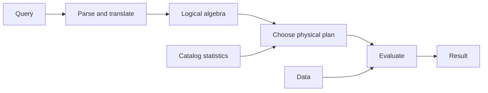

# SOE201 · Evaluación de consultas

## Estado de generación del vídeo
PENDIENTE: material preparado; no se ha generado ni revisado ningún vídeo nuevo.

## Instrucciones
Explica la unidad en español siguiendo únicamente este material. Cita las fuentes y distingue práctica complementaria, respuestas suministradas y comentarios locales. Conserva fórmulas, identificadores, discrepancias y límites de evidencia. No inventes contenido, requisitos, resultados, dominio del estudiante ni predicciones de examen.

## Fuentes originales
- Lecture4b - Query Evaluation Basics.pdf (original en inglés) · SHA-256 57ae492af3aa04701f166a09f718ec350b454881b8a08cb99eb372abc7ad635c

## Edición española derivada
El hash indicado para cada documento identifica la fuente inglesa; el contenido mostrado es la traducción española. Los originales se conservan en la biblioteca.

### content/reviewed/SOE201/06/tutor.md
Hash de fuente inglesa: ffda9c09c1e10d66b231c7185cd755725ddd44436e275ed4d6afd08e42a5e854

---
course: SOE201
type: tutor-notes
language: en
---
# Conceptos básicos de evaluación de consultas

Edición de tutor web de `Lecture4b - Query Evaluation Basics.pdf`, PDF, páginas 1–12.

## En 60 segundos

Un DBMS analiza y traduce una consulta, optimiza un plan y luego lo evalúa. Una expresión de álgebra describe el resultado lógico; un plan físico agrega opciones de implementación. Los planes equivalentes pueden tener diferentes costos estimados. El modelo de disco simple de la conferencia es $b\,t_T+s\,t_S$, donde `b` son transferencias, `s` son búsquedas y los tiempos usan la misma unidad. Fuente: Lecture4b, PDF, páginas 4–11.

## Antes de comenzar

Utilice la unidad anterior para identificar la selección y la proyección. Utilice el almacenamiento y la indexación para explicar qué hace una ruta de acceso a índice o escaneo. No necesita credenciales de base de datos para conocer el proceso lógico o calcular el modelo de costos proporcionado.

## Una pregunta motivadora

Dos planes devuelven saldos de cuentas inferiores a 2500. Uno escanea el archivo de la cuenta; el otro utiliza un índice de equilibrio. ¿Por qué resultados iguales pueden requerir un trabajo diferente y qué evidencia se necesita antes de aplicar cualquiera de los planes más rápidamente? Esto sigue el ejemplo fuente en Lecture4b, PDF p.8.

## 1. Siga la consulta en tres etapas

**Análisis y traducción:** verifique la sintaxis de la consulta y verifique las relaciones referenciadas, luego forme una representación interna y una expresión de álgebra. **Optimización:** considerar expresiones y formas equivalentes de implementar sus operaciones. **Evaluación:** el motor de ejecución sigue el plan seleccionado y devuelve respuestas. El optimizador consulta estadísticas; el motor de ejecución accede a los datos. Fuente: Lecture4b, PDF págs.4–7,9.

Representación complementaria del canal de origen, PDF p.4.

## 2. Separar la equivalencia lógica de la estrategia física

La fuente compara:

$$\sigma_{balance<2500}(\pi_{balance}(account))$$
$$\pi_{balance}(\sigma_{balance<2500}(account)).$$

Ambos mantienen los mismos valores de equilibrio distintos según el modelo establecido de la conferencia. En el primero, el predicado todavía tiene su atributo `balance` requerido después de la proyección. Mover una selección arbitraria más allá de una proyección que elimina un atributo que necesita no es válido. Fuente: Lecture4b, PDF p.8; Conferencia 4a, PDF, páginas 10-13.

La misma expresión lógica puede utilizar diferentes algoritmos. Un plan de evaluación física anota una estrategia detallada: por ejemplo, usar un índice o escanear linealmente y descartar las tuplas fallidas. La existencia de un índice no prueba por sí sola que el plan elegido lo utilice o que gane con los datos reales. Fuente: Lecture4b, PDF págs. 8–9.

## 3. Las estimaciones dependen de la descripción de la base de datos.

El optimizador realiza estimaciones utilizando información del catálogo, como recuentos de tuplas, tamaños de tuplas y recuentos de bloques de relaciones. Elige entre planes de evaluación equivalentes utilizando el costo estimado. Una estimación es un modelo de trabajo esperado, no una medición del tiempo de ejecución observado. La conferencia enumera cuestiones posteriores sobre algoritmos y optimización, pero no proporciona aquí sus derivaciones; Los algoritmos de unión y la enumeración de planes avanzados permanecen fuera de esta unidad. Fuente: Lecture4b, PDF p.9.

## 4. Calcular el costo del disco sin mezclar unidades.

La conferencia enumera el acceso al disco, la CPU y los recursos de red. Ignora la CPU en el modelo simplificado y advierte que los sistemas reales la tienen en cuenta; Los sistemas paralelos también necesitan costos de red. Para simplificar, trata los costos de transferencia de lectura y escritura por igual.

$$\text{estimated disk time}=b\,t_T+s\,t_S.$$

`tT` es el tiempo de transferencia por bloque y `tS` es el tiempo por búsqueda. Con los valores HDD de la diapositiva, `tT=0.1 ms` y `tS=4 ms`. **Cálculo complementario:** 100 transferencias y 2 búsquedas dan `100×0.1+2×4=18 ms`; 20 transferencias y 10 búsquedas dan `20×0.1+10×4=42 ms`. Menos transferencias aún pueden tener un costo mayor si las búsquedas aumentan lo suficiente. Modelo fuente y constantes: Lecture4b, PDF, páginas 10-11.

Los valores SSD del portaobjetos son rangos: busque 20–90 µs y transfiera 2–10 µs. Son ejemplos de fuentes para bloques de 4 KB, no garantías de referencia actuales. Convierta unidades antes de comparar: `1 ms = 1000 µs`. No compares un valor en microsegundos con uno en milisegundos como si sus números tuvieran la misma unidad. Fuente: Lecture4b, PDF p.11.

## 5. ¿Qué convertiría un reclamo en evidencia?

Primero establezca resultados lógicos iguales. Luego distinga el trabajo estimado del modelo del plan de ejecución observado y el tiempo transcurrido. El JDBC Task 2 suministrado mide solo `executeQuery`; su intervalo transcurrido no es idéntico al modelo de disco abstracto de esta diapositiva. Consulte los horarios prácticos separados para ese límite de tarea. Fuentes: Lecture4b, PDF págs. 8–11; `Lab2-JDBCandIndex-tasks.pdf`, PDF p.3.

## Volver a la pregunta motivadora

Ambos planes candidatos deben devolver los mismos saldos calificados. Calcule su trabajo utilizando estadísticas de datos y el modelo indicado, luego inspeccione el plan elegido si hay una ejecución de DBMS disponible. Un escaneo puede ser competitivo cuando la ruta del índice genera un acceso costoso. Esta conferencia brinda el marco de decisión; no prueba que la opción indexada de la fuente siempre gane.

## Revisión

Dibuje de memoria el proceso de tres etapas. Nombra dos estadísticas del catálogo. Explique por qué la equivalencia lógica no requiere una estrategia de ejecución idéntica. Calcule una estimación del disco con unidades consistentes y luego indique qué costos de recursos se omitieron. Pruebe la calculadora en Try & explore antes de comprobar los problemas resueltos.

## Fuentes y alcance

Se inspeccionó el texto de las 12 páginas PDF de `Lecture4b - Query Evaluation Basics.pdf`; Se comprobó visualmente el modelo de costes de la página 11. La recomendación de lectura de la página 12 es el libro de texto, séptima edición, §§15.1–15.2; No se afirma que el capítulo completo haya sido revisado. No se hacen nuevas afirmaciones sobre la frecuencia de evaluación ni suposiciones sobre la versión del DBMS.

### content/reviewed/SOE201/06/practice.md
Hash de fuente inglesa: 450fe85707c7ea4e28421be4fe3239b64ecfdcb85fe527b0b47accf23097aeb8

# Evaluación de consultas: recordar y practicar

Edición de tutores web. La nueva práctica a continuación es **PRÁCTICA COMPLEMENTARIA**, no una tarea oficial ni un esquema de calificación. Fuentes: Lecture4b - Conceptos básicos de evaluación de consultas.pdf. Inténtelo antes de abrir la ayuda.

## Repaso activo atómico

### Tarjeta 01: ¿Cuáles son las tres etapas de procesamiento de consultas y en qué etapa se ejecuta el plan elegido?
> [!success]- Respuesta
> Análisis/traducción, optimización y evaluación. La evaluación ejecuta el plan elegido.
>
> Fuente: Lecture4b - Conceptos básicos de evaluación de consultas.pdf, PDF págs. 2–3.

### Tarjeta 02: ¿El álgebra equivalente implica el mismo costo?
> [!success]- Respuesta
> No. Se pueden calcular resultados equivalentes mediante diferentes algoritmos y rutas de acceso con diferentes costos.
>
> Fuente: Lecture4b - Conceptos básicos de evaluación de consultas.pdf, PDF págs. 4–7.

### Tarjeta 03: ¿Qué agrega un plan de consulta?
> [!success]- Respuesta
> Algoritmos concretos y opciones de evaluación para operaciones de álgebra.
>
> Fuente: Lecture4b - Conceptos básicos de evaluación de consultas.pdf, PDF págs. 4–6.

### Tarjeta 04: ¿Qué información ayuda a estimar los costos?
> [!success]- Respuesta
> Estadísticas del catálogo como tamaño de relación, tamaño de tupla y valores distintos; Las estimaciones pueden diferir de la ejecución medida.
>
> Fuente: Lecture4b - Conceptos básicos de evaluación de consultas.pdf, PDF p. 7.

### Tarjeta 05: indique la fórmula de tiempo de disco estimado de la conferencia y defina sus recuentos y unidades de tiempo.
> [!success]- Respuesta
> b·tT+s·tS, donde b cuenta los bloques transferidos y s cuenta las búsquedas; ambos parámetros de tiempo deben utilizar unidades compatibles.
>
> Fuente: Lecture4b - Conceptos básicos de evaluación de consultas.pdf, PDF p. 11.

### Tarjeta 06: ¿Por qué menos bloques transferidos pueden ser aún más lentos?
> [!success]- Respuesta
> Un plan puede ahorrar transferencias y al mismo tiempo agregar búsquedas costosas. Compara ambos términos.
>
> Fuente: Lecture4b - Conceptos básicos de evaluación de consultas.pdf, PDF págs. 10–11.

### Tarjeta 07 — ¿Qué se omite en la comparación simplificada?
> [!success]- Respuesta
> La conferencia se centra en el acceso al disco y normalmente ignora la CPU y la red en el modelo. El tiempo real transcurrido tiene factores adicionales.
>
> Fuente: Lecture4b - Conceptos básicos de evaluación de consultas.pdf, PDF págs. 8–10.

### Tarjeta 08: ¿Qué es 1 milisegundo en microsegundos?
> [!success]- Respuesta
> 1000 microsegundos. Convierta unidades antes de agregar términos de tiempo.
>
> Fuente: Lecture4b - Conceptos básicos de evaluación de consultas.pdf, PDF p. 11; conversión de unidades.

## Práctica progresiva

### Práctica 1: Diagnóstico de tuberías

**PRÁCTICA COMPLEMENTARIA.** ¿El análisis es una opción basada en costos? ¿Dónde se ejecuta el plan?

> [!tip]- Sugerencia
> Separe la comprensión de la consulta de la elección y ejecución de un plan.

> [!success]- Solución
> El análisis/traducción verifica la consulta y produce una representación interna. La optimización compara los planes de evaluación de candidatos utilizando costos estimados. La evaluación ejecuta el plan seleccionado.
>
> Fuente: Lecture4b - Conceptos básicos de evaluación de consultas.pdf, PDF págs. 2–7.

### Práctica 2: Comparación de planes de HDD

**PRÁCTICA COMPLEMENTARIA.** Utilizando el ejemplo de la lección tT=0.1 ms y tS=4 ms, compare A: b=100,s=2 y B: b=20,s=10.

> [!tip]- Sugerencia
> Multiplicar los conteos por sus respectivos costos de tiempo.

> [!success]- Solución
> A=100×0,1+2×4=18 ms. B=20×0,1+10×4=42 ms. A es más barato en este modelo a pesar de tener más bloques. Estos recuentos de planes son un ejemplo complementario, no un punto de referencia medido.
>
> Fuente: Lecture4b - Conceptos básicos de evaluación de consultas.pdf, PDF p. 11.

### Práctica 3: conversión de unidades SSD

**PRÁCTICA COMPLEMENTARIA.** Tome tT=5 µs y tS=50 µs (dentro de los rangos mostrados), b=100,s=2. Indique el costo en µs y ms.

> [!tip]- Sugerencia
> Primero agregue los microsegundos y luego divida entre 1000.

> [!success]- Solución
> 100×5+2×50=600 µs=0,6 ms. Estas constantes y recuentos seleccionados ilustran el modelo; no caracterizan todos los SSD ni garantizan una latencia de consulta real.
>
> Fuente: Lecture4b - Conceptos básicos de evaluación de consultas.pdf, PDF p. 11.

### Práctica 4: Reescritura segura

**PRÁCTICA COMPLEMENTARIA.** Compare π_balance(σ_balance<2500(cuenta)) y σ_balance<2500(π_balance(cuenta)). ¿Funcionaría el mismo intercambio para un predicado nombre_rama?

> [!tip]- Sugerencia
> Preguntar si los atributos del predicado sobreviven a la proyección.

> [!success]- Solución
> El predicado de equilibrio sigue siendo evaluable en ambas expresiones, por lo que los resultados del conjunto coinciden. Un predicado de nombre_sucursal no se puede evaluar después de proyectar solo el saldo. La equivalencia semántica debe establecerse antes de la comparación de costos.
>
> Fuente: Lecture4b - Conceptos básicos de evaluación de consultas.pdf, PDF p. 8.

### Práctica 5: Estimación versus medición

**PRÁCTICA COMPLEMENTARIA.** Un modelo predice 18 ms pero una ejecución reporta 26 ms. ¿Esto por sí solo demuestra que el optimizador está equivocado?

> [!tip]- Sugerencia
> Identificar omisiones del modelo y límites de medición.

> [!success]- Solución
> No. Los recuentos y estadísticas estimados de bloqueo/búsqueda pueden diferir de los valores reales; La CPU, la red, el almacenamiento en caché y el trabajo del cliente pueden afectar la medición transcurrida. Compare límites similares e inspeccione los planes/estadísticas reales antes de concluir.
>
> Fuente: Lecture4b - Conceptos básicos de evaluación de consultas.pdf, PDF págs. 7–11.

