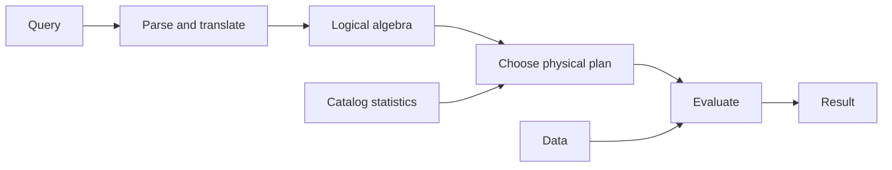

# SOE201 · Query Evaluation

## Video generation status
PENDING: source pack prepared; no cloud video has been generated or reviewed.

## Spanish video overview prompt
Explica esta unidad en español claro, paso a paso, para alguien que aprende de forma autodidacta. Usa únicamente el material incluido. Comienza con el problema motivador, presenta los conceptos, muestra un ejemplo visual fiel a las convenciones del curso, pausa para una pregunta y después explica la respuesta. Distingue práctica suplementaria de tareas oficiales y de soluciones oficiales. No inventes datos, fuentes, requisitos, capítulos pendientes, resultados de ejecución ni predicciones de examen. Conserva los límites y discrepancias indicados. Cierra con una actividad que el estudiante pueda intentar en Learning Uni. Cita el nombre del documento y su localizador cuando corresponda. Si falta evidencia, dilo; no rellenes el hueco. Mantén visibles las fórmulas y direcciones de flechas.

## Verified original file snapshots
- Lecture4b - Query Evaluation Basics.pdf · SHA-256 57ae492af3aa04701f166a09f718ec350b454881b8a08cb99eb372abc7ad635c

## Source material

### Snapshot: content/reviewed/SOE201/06/tutor.md
SHA-256: ffda9c09c1e10d66b231c7185cd755725ddd44436e275ed4d6afd08e42a5e854

---
course: SOE201
type: tutor-notes
language: en
---
# Query Evaluation Basics

Web tutor edition from `Lecture4b - Query Evaluation Basics.pdf`, PDF pp.1–12.

## In 60 Seconds

A DBMS parses and translates a query, optimises a plan, then evaluates it. An algebra expression describes the logical result; a physical plan adds implementation choices. Equivalent plans can have different estimated costs. The lecture's simple disk model is $b\,t_T+s\,t_S$, where `b` is transfers, `s` is seeks, and the times use the same unit. Source: Lecture4b, PDF pp.4–11.

## Before You Start

Use the preceding unit to identify selection and projection. Use storage and indexing to explain what a scan or index access path does. You do not need database credentials to learn the logical pipeline or calculate the supplied cost model.

## A motivating question

Two plans return account balances below 2500. One scans the account file; the other uses a balance index. Why can equal results require different work, and what evidence is needed before calling either plan faster? This follows the source example on Lecture4b, PDF p.8.

## 1. Follow the query through three stages

**Parsing and translation:** check query syntax and verify the referenced relations, then form an internal representation and an algebra expression. **Optimisation:** consider equivalent expressions and ways of implementing their operations. **Evaluation:** the execution engine follows the selected plan and returns answers. The optimiser consults statistics; the execution engine accesses data. Source: Lecture4b, PDF pp.4–7,9.

Supplementary rendering of the source pipeline, PDF p.4.

## 2. Separate logical equivalence from physical strategy

The source compares:

$$\sigma_{balance<2500}(\pi_{balance}(account))$$
$$\pi_{balance}(\sigma_{balance<2500}(account)).$$

Both keep the same distinct balance values under the lecture's set model. In the first, the predicate still has its required `balance` attribute after projection. Moving an arbitrary selection past a projection that removes an attribute it needs is invalid. Source: Lecture4b, PDF p.8; Lecture4a, PDF pp.10–13.

The same logical expression may use different algorithms. A physical evaluation plan annotates detailed strategy: for example, use an index or scan linearly and discard failing tuples. The existence of an index does not by itself prove that the chosen plan uses it or that it wins for the actual data. Source: Lecture4b, PDF pp.8–9.

## 3. Estimates depend on the database description

The optimiser estimates using catalog information such as tuple counts, tuple sizes and relation block counts. It chooses among equivalent evaluation plans using estimated cost. An estimate is a model of expected work, not an observed runtime measurement. The lecture lists later algorithm and optimisation questions but does not supply their derivations here; join algorithms and advanced plan enumeration remain outside this unit. Source: Lecture4b, PDF p.9.

## 4. Calculate disk cost without mixing units

The lecture lists disk access, CPU and network resources. It ignores CPU in the simplified model and warns that real systems account for it; parallel systems also need network costs. It treats read and write transfer costs equally for simplicity.

$$\text{estimated disk time}=b\,t_T+s\,t_S.$$

`tT` is transfer time per block and `tS` is time per seek. With the slide's HDD values, `tT=0.1 ms` and `tS=4 ms`. **Supplementary calculation:** 100 transfers and 2 seeks give `100×0.1+2×4=18 ms`; 20 transfers and 10 seeks give `20×0.1+10×4=42 ms`. Fewer transfers can still have higher cost if seeks increase enough. Source model and constants: Lecture4b, PDF pp.10–11.

The slide's SSD values are ranges: seek 20–90 µs and transfer 2–10 µs. They are source examples for 4 KB blocks, not current benchmark guarantees. Convert units before comparing: `1 ms = 1000 µs`. Do not compare a value in microseconds with one in milliseconds as if their numbers had the same unit. Source: Lecture4b, PDF p.11.

## 5. What would turn a claim into evidence?

First establish equal logical results. Then distinguish the model's estimated work from the observed execution plan and elapsed time. The supplied JDBC Task 2 measures only `executeQuery`; its elapsed interval is not identical to this slide's abstract disk model. Consult the separate timing practical for that task boundary. Sources: Lecture4b, PDF pp.8–11; `Lab2-JDBCandIndex-tasks.pdf`, PDF p.3.

## Return to the motivating question

Both candidate plans must return the same qualifying balances. Estimate their work using data statistics and the stated model, then inspect the chosen plan if a DBMS run is available. A scan can be competitive when the index route causes costly access. This lecture gives the decision framework; it does not prove that the source's indexed option always wins.

## Review

Draw the three-stage pipeline from memory. Name two catalog statistics. Explain why logical equivalence does not require identical execution strategy. Calculate a disk estimate with consistent units, then state which resource costs were omitted. Try the calculator in Try & explore before checking the worked problems.

## Sources and scope

All 12 PDF pages of `Lecture4b - Query Evaluation Basics.pdf` were text inspected; the cost model on p.11 was visually checked. The p.12 reading recommendation is textbook 7th edition §§15.1–15.2; the whole chapter is not claimed reviewed. No new assessment-frequency claims or DBMS-version assumptions are made.

### Snapshot: content/reviewed/SOE201/06/practice.md
SHA-256: 450fe85707c7ea4e28421be4fe3239b64ecfdcb85fe527b0b47accf23097aeb8

# Query evaluation: recall and practice

Web tutor edition. New practice below is **SUPPLEMENTARY PRACTICE**, not an official assignment or marking scheme. Sources: Lecture4b - Query Evaluation Basics.pdf. Attempt before opening help.

## Atomic Recall

### Card 01 — What are the three query-processing stages, and which stage runs the chosen plan?
> [!success]- Answer
> Parsing/translation, optimization, and evaluation. Evaluation executes the chosen plan.
>
> Source: Lecture4b - Query Evaluation Basics.pdf, PDF pp. 2–3.

### Card 02 — Does equivalent algebra imply equal cost?
> [!success]- Answer
> No. Equivalent results can be computed by different algorithms and access paths with different costs.
>
> Source: Lecture4b - Query Evaluation Basics.pdf, PDF pp. 4–7.

### Card 03 — What does a query plan add?
> [!success]- Answer
> Concrete algorithms and evaluation choices for algebra operations.
>
> Source: Lecture4b - Query Evaluation Basics.pdf, PDF pp. 4–6.

### Card 04 — What information helps cost estimates?
> [!success]- Answer
> Catalog statistics such as relation size, tuple size and distinct values; estimates may differ from measured execution.
>
> Source: Lecture4b - Query Evaluation Basics.pdf, PDF p. 7.

### Card 05 — State the lecture’s estimated disk-time formula and define its counts and time units.
> [!success]- Answer
> b·tT+s·tS, where b counts transferred blocks and s counts seeks; both time parameters must use compatible units.
>
> Source: Lecture4b - Query Evaluation Basics.pdf, PDF p. 11.

### Card 06 — Why can fewer transferred blocks still be slower?
> [!success]- Answer
> A plan may save transfers while adding expensive seeks. Compare both terms.
>
> Source: Lecture4b - Query Evaluation Basics.pdf, PDF pp. 10–11.

### Card 07 — What is omitted from the simplified comparison?
> [!success]- Answer
> The lecture focuses on disk access and typically ignores CPU and network in the model. Real elapsed time has additional factors.
>
> Source: Lecture4b - Query Evaluation Basics.pdf, PDF pp. 8–10.

### Card 08 — What is 1 millisecond in microseconds?
> [!success]- Answer
> 1000 microseconds. Convert units before adding time terms.
>
> Source: Lecture4b - Query Evaluation Basics.pdf, PDF p. 11; unit conversion.

## Progressive Practice

### Practice 1 — Pipeline diagnostic

**SUPPLEMENTARY PRACTICE.** Is parsing a cost-based choice? Where is the plan executed?

> [!tip]- Hint
> Separate understanding the query from choosing and running a plan.

> [!success]- Solution
> Parsing/translation checks the query and produces an internal representation. Optimization compares candidate evaluation plans using estimated costs. Evaluation executes the selected plan.
>
> Source: Lecture4b - Query Evaluation Basics.pdf, PDF pp. 2–7.

### Practice 2 — HDD plan comparison

**SUPPLEMENTARY PRACTICE.** Using the lecture example tT=0.1 ms and tS=4 ms, compare A: b=100,s=2 and B: b=20,s=10.

> [!tip]- Hint
> Multiply counts by their respective time costs.

> [!success]- Solution
> A=100×0.1+2×4=18 ms. B=20×0.1+10×4=42 ms. A is cheaper in this model despite more blocks. These plan counts are a supplementary example, not a measured benchmark.
>
> Source: Lecture4b - Query Evaluation Basics.pdf, PDF p. 11.

### Practice 3 — SSD unit conversion

**SUPPLEMENTARY PRACTICE.** Take tT=5 µs and tS=50 µs (within the displayed ranges), b=100,s=2. Give cost in µs and ms.

> [!tip]- Hint
> Add in microseconds first, then divide by 1000.

> [!success]- Solution
> 100×5+2×50=600 µs=0.6 ms. These selected constants and counts illustrate the model; they do not characterize every SSD or guarantee real query latency.
>
> Source: Lecture4b - Query Evaluation Basics.pdf, PDF p. 11.

### Practice 4 — Safe rewrite

**SUPPLEMENTARY PRACTICE.** Compare π_balance(σ_balance<2500(account)) and σ_balance<2500(π_balance(account)). Would the same interchange work for a branch_name predicate?

> [!tip]- Hint
> Ask whether the predicate attributes survive projection.

> [!success]- Solution
> The balance predicate remains evaluable in both expressions, so the set results agree. A branch_name predicate cannot be evaluated after projecting only balance. Semantic equivalence must be established before cost comparison.
>
> Source: Lecture4b - Query Evaluation Basics.pdf, PDF p. 8.

### Practice 5 — Estimate versus measurement

**SUPPLEMENTARY PRACTICE.** A model predicts 18 ms but an execution reports 26 ms. Does this alone prove the optimizer wrong?

> [!tip]- Hint
> Identify model omissions and measurement boundaries.

> [!success]- Solution
> No. Estimated block/seek counts and statistics may differ from actual values; CPU, network, caching and client work may affect elapsed measurement. Compare like boundaries and inspect actual plans/statistics before concluding.
>
> Source: Lecture4b - Query Evaluation Basics.pdf, PDF pp. 7–11.

