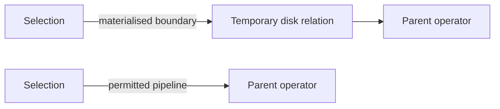

# SOE201 · Planes de consulta, materialización y pipeline

## Estado de generación del vídeo
PENDIENTE: material preparado; no se ha generado ni revisado ningún vídeo nuevo.

## Instrucciones
Explica la unidad en español siguiendo únicamente este material. Cita las fuentes y distingue práctica complementaria, respuestas suministradas y comentarios locales. Conserva fórmulas, identificadores, discrepancias y límites de evidencia. No inventes contenido, requisitos, resultados, dominio del estudiante ni predicciones de examen.

## Fuentes originales

## Edición española derivada
El hash indicado para cada documento identifica la fuente inglesa; el contenido mostrado es la traducción española. Los originales se conservan en la biblioteca.

### content/reviewed/SOE201/09/tutor.md
Hash de fuente inglesa: 03610070cb2cf0754ce35d240a7ff48dffdf2486e97ddce22d7411fa0debf8ad

---
course: SOE201
language: en
study_status: untested
---

# Planes de consulta, materialización y pipeline

## En 60 segundos

**Caso inicial inventado con fines didácticos.** Dos operadores forman un plan válido. El productor cuesta 500 transferencias de bloques y produce una relación intermedia de 40 bloques. Al consumidor le cuesta 200 transferencias, incluida la lectura de esos 40 bloques. Sus fórmulas excluyen las escrituras de salida. ¿Se puede comparar un frontera materializada con un pipeline permitida sin contar una lectura dos veces?

Tu objetivo es identificar el algoritmo, la frontera entre operadores y la convención de costes antes de sumar. Requisitos previos: álgebra relacional de la unidad05 y evaluación física de las unidades06–08. Esta lección cubre Lecture6a PDF pp.3–12; la identidad y los objetivos están en pp.1–2. Las reglas de reescritura de pp.13–28 se explican por separado en [[content/reviewed/SOE201/10/tutor|Unidad10]]. La p.29 enumera lecturas; siguen pendientes Lecture6b y la práctica guiada de Lab5. No se afirma haber medido ninguna base de datos ni obtenido un resultado oficial de evaluación.

## Separar una expresión lógica de su plan de evaluación

Una expresión relacional especifica el resultado requerido. Un plan de evaluación también elige un algoritmo para cada operación y coordina su ejecución. Por tanto, una misma expresión lógica puede tener diferentes planes físicos. Por ejemplo, el resultado de una selección puede almacenarse antes de que su padre lo consuma o pasarse directamente a través de un pipeline permitido. Resultados equivalentes no implican un trabajo de disco idéntico. Fuente: Lecture6a págs. 3–4,9,11–12.

Para cada arista del árbol de expresión, pregunte: ¿qué produce el hijo, qué requiere el padre y debe almacenarse el resultado intermedio? No asuma que cambiar una arista permite cambiar predicados o descartar tuplas.

## Almacenar un resultado intermedio o pasar tuplas

**Materialización** completa una operación intermedia, escribe su resultado como una relación temporal y luego deja que una operación posterior lo consuma. En el ejemplo de la clase, la selección alimenta una combinación (join) y esta alimenta una proyección. La materialización es generalmente aplicable en el modelo de evaluación suministrado, pero el almacenamiento temporal añade trabajo. **Pipelining** permite que un padre consuma tuplas mientras su hijo las produce, evitando una relación de disco temporal cuando esté permitido. Fuente: Lecture6a págs.4–7.

**Figura 1: Límites alternativos, no resultados de consulta diferentes.** Léalo de izquierda a derecha: la ruta superior almacena una relación intermedia; el camino inferior pasa tuplas a su consumidor. Conclusión clave: eliminar un archivo temporal requiere un estrategia de ejecución permitida. Este diagrama de enseñanza resume el árbol fuente en PDF p.5; No es un ejercicio extra oficial.

## Contar escrituras sin contar lecturas dos veces

Las fórmulas del operador de la clase omiten las escrituras de salida. Para la evaluación materializada, agregue las escrituras intermedias a la suma de los costes del operador; Es posible que el coste del operador consumidor ya incluya las lecturas correspondientes. Las escrituras finales de salida de consultas permanecen excluidas a menos que se soliciten explícitamente. Fuente: Lecture6a p.6, con el contraste de transmisión en la p.7.

Regrese al caso de apertura. Primero identifique el desglose de costes:

| Concepto | Con materialización | Con pipeline |
|---|---:|---:|
| Trabajo del productor | 500 | 500 |
| Trabajo del consumidor aparte de la lectura intermedia | 160 | 160 |
| Leer relación intermedia desde el disco | 40 | 0 |
| Escribir relación intermedia al disco | 40 | 0 |
| Transferencias totales de bloques | 740 | 660 |

El coste con materialización es $500+200+40=740$. El 200 ya contiene la lectura de 40 bloques: agregar otros 40 para lectura daría incorrectamente 780. Bajo el supuesto sintético de que el resto del trabajo no cambia y el pipeline está permitido, el coste con pipeline es $500+(200-40)=660$. El ahorro es de 80 transferencias, una escritura intermedia y una lectura intermedia. Estos son recuentos de transferencias, no milisegundos; Los desplazamientos del cabezal (seeks) y el trabajo de CPU quedan fuera del modelo. Si los dos algoritmos cambian, vuelva a calcular sus costes en lugar de restar mecánicamente 80.

## Explicar las fases de empujar, tirar y bloquear

Una canalización **impulsada por el productor (push)** envía tuplas al padre a través de un búfer. Cuando ese buffer está lleno, el operador hijo espera por espacio. Una canalización **impulsada por la demanda (pull)** comienza con una solicitud para la siguiente tupla de salida; cada operador solicita tuplas de sus hijos según sea necesario y retiene el estado entre solicitudes. Por lo tanto, una canalización no significa que no se necesite memoria ni estado. Fuente: Lecture6a p.8.

La canalización no es posible en todas las fases. La clasificación externa puede necesitar un procesamiento preliminar de toda la entrada; una combinación hash tiene una fase de construcción preliminar. Esto evita afirmar que cada operador puede transmitir inmediatamente su resultado final desde su primera tupla de entrada. No establece que cada fase de cada algoritmo deba siempre materializar su resultado. Fuente: Lecture6a p.7; la distinción de fases es una aclaración local de esa limitación establecida.

## Aplique la convención del curso antes de comparar planes

La lección 6a, página 10, ofrece una convención específica: una arista etiquetada como pipeline permite la canalización; se supone que una arista sin etiquetar no lo permite. Para las combinaciones (joins), a menos que se indique explícitamente lo contrario, la fuente selecciona la familia de bucles anidados para su tratamiento de canalización. Conserve estas anotaciones en los ejercicios del curso en lugar de reemplazarlas con suposiciones sobre un DBMS arbitrario. Esta es una regla de modelado de cursos, no una declaración universal de que todas las demás implementaciones de combinación nunca podrán canalizarse.

Utilice este método: identifique el resultado lógico; elija los algoritmos de operador indicados; inspeccionar cada límite; lecturas y escrituras intermedias separadas; calcular costes en una unidad; luego verifique qué componentes del coste y política de escritura de la salida final están excluidos. Un optimizador basado en costes elige utilizando estimaciones, por lo que no se garantiza que el ganador estimado sea la ejecución medida más rápida. Fuente: Lecture6a págs.9-12. El ejemplo inicial establece un ahorro condicional de 80 transferencias, no una afirmación incondicional de que la canalización es siempre más rápida.

### content/reviewed/SOE201/09/practice.md
Hash de fuente inglesa: 100e08bd65c67ca72626c3595df6831898f3e4373ff1db2843287ac86597ac1f

# Recordar y practicar

PRÁCTICA COMPLEMENTARIA derivada de Lecture6a PDF pp.3–12. Los casos numéricos a continuación son construcciones didácticas, no tareas de Lab5 ni un esquema de calificación oficial. Las preguntas originales de Lab5 y los temas restantes de las clases aún están pendientes de revisión por separado.

## Repaso activo atómico

### Tarjeta 01 — ¿Qué agrega un plan de evaluación a una expresión lógica?

> [!success]- Respuesta
> Algoritmos para operaciones individuales y estrategia para coordinar su ejecución.
>
> Fuente: Lecture6a p.9.

### Tarjeta 02 — ¿Qué almacena la materialización?

> [!success]- Respuesta
> Un resultado intermedio como relación temporal para que lo consuman operaciones posteriores.
>
> Fuente: Lecture6a págs.4–6.

### Tarjeta 03 — ¿Qué coste se debe agregar a las sumas del operador de la clase?

> [!success]- Respuesta
> Escrituras de resultados intermedios; compruebe si sus lecturas ya están incluidas en los operadores consumidores.
>
> Fuente: Lecture6a p.6; aclaración de la contabilidad local.

### Tarjeta 04: ¿Qué sucede cuando un búfer push está lleno?

> [!success]- Respuesta
> El productor espera hasta que el consumidor cree espacio.
>
> Fuente: Lecture6a p.8.

### Tarjeta 05: ¿Qué debe retener un operador pull entre solicitudes?

> [!success]- Respuesta
> Estado que indica dónde reanudar cuando se solicita la siguiente tupla.
>
> Fuente: Lecture6a p.8.

### Tarjeta 06: ¿Qué significa una arista del plan sin etiquetar en esta clase?

> [!success]- Respuesta
> Se supone que la canalización no está disponible en esa arista según la convención del curso.
>
> Fuente: Lecture6a p.10.

## Práctica resuelta

### Problema 1: auditar el desglose de transferencias

PRÁCTICA COMPLEMENTARIA. Un productor cuesta 300 transferencias. Su resultado intermedio ocupa 25 bloques. Al consumidor le cuesta 90 transferencias incluyendo la lectura de esos 25 bloques. Ambas fórmulas omiten las escrituras de salida. Calcule los costes materializados y con pipeline permitido, asumiendo que el resto del trabajo no cambia. Excluir escrituras de salida final. Modelo fuente: Lecture6a págs.6–7.

> [!tip]- Sugerencia
> Dividir los 90 del consumidor en su lectura intermedia y su trabajo restante.

> [!success]- Solución
> El otro trabajo del consumidor es 90−25=65 transferencias. La materialización cuesta 300+65+25+25=415 transferencias: trabajo de productor, trabajo restante del consumidor, lectura intermedia y escritura intermedia. El pipeline cuesta 300+65=365 transferencias. Ahorra 50 transferencias. No vuelvas a sumar la lectura intermedia a 300+90: esa suma ya la incluye. Si la canalización está prohibida o cambia los algoritmos, el resultado de 365 transferencias no se aplica.

### Problema 2: diagnosticar un búfer push lleno

PRÁCTICA COMPLEMENTARIA. Un productor tiene una tupla lista, pero el búfer entre operadores está lleno. Un estudiante propone descartar una tupla antigua para que el productor siga funcionando. ¿Es esta una ejecución válida de la misma consulta? Contraste de control de empujar y tirar. Fuente: Lecture6a p.8.

> [!tip]- Sugerencia
> Separar quién inicia la producción de la obligación de preservar las tuplas requeridas.

> [!success]- Solución
> No. Eliminar una tupla requerida cambia el resultado. En el modelo push descrito, el productor espera hasta que el consumidor elimina tuplas y hay espacio disponible. En el modelo pull, las solicitudes se propagan de padre a hijo a medida que se necesitan resultados; los operadores mantienen su posición entre solicitudes. Ninguno de los enfoques permite descartar resultados válidos. Esperar es control de flujo, no evidencia de que no existe un pipeline.

### Problema 3: detectar una afirmación injustificada sobre pipeline

PRÁCTICA COMPLEMENTARIA. Un ejercicio muestra una arista sin etiquetar desde una combinación hash hasta su padre. Un estudiante dice: "El pipeline siempre ahorra E/S de disco, por lo que eliminaré la escritura intermedia". ¿Qué hay que comprobar antes de aceptar ese cálculo? Fuente: Lecture6a págs.7,10.

> [!tip]- Sugerencia
> Consulta tanto la anotación del ejercicio como las fases del algoritmo.

> [!success]- Solución
> Según la convención de la clase, una arista sin etiquetar no permite asumir un pipeline. La combinación hash también tiene un procesamiento preliminar, por lo que la capacidad de transmisión no se puede inferir únicamente del nombre de la operación. Conservar la frontera materializada a menos que el ejercicio permita explícitamente otra estrategia. Si se proporciona permiso, identifique qué fases fluyen y si el padre puede consumirlas, luego vuelva a calcular el desglose de costes. Esta no es una prohibición universal para todas las implementaciones de hash-join canalizadas.
