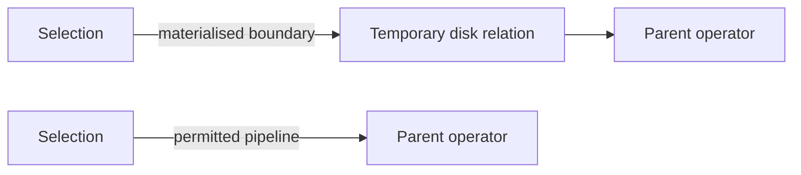

# SOE201 · Query Plans, Materialisation and Pipelining

## Video generation status
PENDING: source pack prepared; no cloud video has been generated or reviewed.

## Spanish video overview prompt
Explica esta unidad en español claro, paso a paso, para alguien que aprende de forma autodidacta. Usa únicamente el material incluido. Comienza con el problema motivador, presenta los conceptos, muestra un ejemplo visual fiel a las convenciones del curso, pausa para una pregunta y después explica la respuesta. Distingue práctica suplementaria de tareas oficiales y de soluciones oficiales. No inventes datos, fuentes, requisitos, capítulos pendientes, resultados de ejecución ni predicciones de examen. Conserva los límites y discrepancias indicados. Cierra con una actividad que el estudiante pueda intentar en Learning Uni. Cita el nombre del documento y su localizador cuando corresponda. Si falta evidencia, dilo; no rellenes el hueco. Mantén visibles las fórmulas y direcciones de flechas.

## Verified original file snapshots

## Source material

### Snapshot: content/reviewed/SOE201/09/tutor.md
SHA-256: 03610070cb2cf0754ce35d240a7ff48dffdf2486e97ddce22d7411fa0debf8ad

---
course: SOE201
language: en
study_status: untested
---

# Query Plans, Materialisation and Pipelining

## In 60 Seconds

**Synthetic opening case.** Two operators form a legal plan. The producer costs 500 block transfers and produces a 40-block intermediate relation. The consumer costs 200 transfers, including reading those 40 blocks. Their formulas exclude output writes. Can you compare a materialised boundary with a permitted pipeline without counting a read twice?

Your goal is to identify the algorithm, the boundary between operators and the cost convention before adding numbers. Prerequisites: Unit 05 relational algebra and Units 06–08 physical evaluation. This lesson covers Lecture6a PDF pp.3–12, with identity/outcomes on pp.1–2. Algebraic rewrite rules on pp.13–28 are taught separately in [[content/reviewed/SOE201/10/tutor|Unit10]]. Page29 lists reading; Lecture6b and Lab5 guided teaching remain pending. No database timing or official assessment result is claimed.

## Separate a Logical Expression From Its Evaluation Plan

A relational expression specifies the required result. An evaluation plan also chooses an algorithm for each operation and coordinates their execution. The same logical expression can therefore have different physical plans. For example, a selection result may be stored before its parent consumes it, or passed directly along a legal pipeline. Equivalent results do not imply identical disk work. Source: Lecture6a pp.3–4,9,11–12.

For each edge in the expression tree, ask: what does the child produce, what does the parent require, and must the intermediate result be stored? Do not assume that changing an edge permits changing predicates or discarding tuples.

## Store an Intermediate Result or Pass Tuples On

**Materialisation** completes an intermediate operation, writes its result as a temporary relation, then lets a later operation consume it. In the lecture's example, selection feeds a join and the join feeds projection. Materialisation is generally applicable in the supplied evaluation model, but temporary storage adds work. **Pipelining** lets a parent consume tuples while its child is producing them, avoiding a temporary disk relation where permitted. Source: Lecture6a pp.4–7.

**Figure 1 — Alternative boundaries, not different query results.** Read it from left to right: the upper path stores an intermediate relation; the lower path passes tuples to its consumer. Key takeaway: removing a temporary file requires a legal execution arrangement. This teaching diagram abstracts the source tree on PDF p.5; it is not an extra official exercise.

## Count Writes Without Counting Reads Twice

The lecture's operator formulas omit output writes. For materialised evaluation, add the intermediate writes to the sum of operator costs; the consuming operator's cost may already include the corresponding reads. Final query-output writes remain excluded unless explicitly requested. Source: Lecture6a p.6, with the streaming contrast on p.7.

Return to the opening case. First identify the ledger:

| Item | Materialised | Pipelined |
|---|---:|---:|
| Producer work | 500 | 500 |
| Consumer work other than the intermediate read | 160 | 160 |
| Read intermediate relation from disk | 40 | 0 |
| Write intermediate relation to disk | 40 | 0 |
| Total block transfers | 740 | 660 |

Materialised cost is $500+200+40=740$. The 200 already contains the 40-block read: adding another 40 for reading would incorrectly give 780. Under the synthetic assumption that all other work is unchanged and streaming is legal, pipelined cost is $500+(200-40)=660$. The saving is 80 transfers, one intermediate write and one intermediate read. These are transfer counts, not milliseconds; seeks and CPU are not modelled. If the two algorithms change, recompute their costs instead of mechanically subtracting 80.

## Explain Push, Pull and Blocking Phases

A **producer-driven (push)** pipeline sends tuples to the parent through a buffer. When that buffer is full, the child waits for space. A **demand-driven (pull)** pipeline starts with a request for the next output tuple; each operator requests tuples from its children as needed and retains state between requests. A pipeline therefore does not mean that no memory or state is needed. Source: Lecture6a p.8.

Pipelining is not possible across every phase. External sorting may need preliminary processing of the whole input; a hash join has a preliminary build phase. This prevents a claim that every operator can immediately stream its final result from its first input tuple. It does not establish that every phase of every such algorithm must always materialise its output. Source: Lecture6a p.7; the phase distinction is a local clarification of that stated limitation.

## Apply the Course Convention Before Comparing Plans

Lecture6a p.10 gives a specific convention: an edge labelled pipeline permits pipelining; an unlabelled edge is assumed not to permit it. For joins, unless explicitly stated otherwise, the source singles out the nested-loop family for its pipelining treatment. Preserve these annotations in course exercises rather than replacing them with assumptions about an arbitrary DBMS. This is a course modelling rule, not a universal statement that all other join implementations can never pipeline.

Use this method: identify the logical result; choose the stated operator algorithms; inspect every boundary; separate intermediate reads and writes; calculate costs in one unit; then check which cost components and final-output policy are excluded. A cost-based optimiser chooses using estimates, so the estimated winner is not guaranteed to be the fastest measured execution. Source: Lecture6a pp.9–12. The opening example establishes a conditional 80-transfer saving, not an unconditional claim that pipelining is always faster.

### Snapshot: content/reviewed/SOE201/09/practice.md
SHA-256: 100e08bd65c67ca72626c3595df6831898f3e4373ff1db2843287ac86597ac1f

# Recall and Practice

SUPPLEMENTARY PRACTICE derived from Lecture6a PDF pp.3–12. The numerical cases below are teaching constructions, not Lab5 tasks or an official marking scheme. Original Lab5 questions and remaining lecture topics are still pending separate review.

## Atomic recall

### Card 01 — What does an evaluation plan add to a logical expression?

> [!success]- Answer
> Algorithms for individual operations and a strategy for coordinating their execution.
>
> Source: Lecture6a p.9.

### Card 02 — What does materialisation store?

> [!success]- Answer
> An intermediate result as a temporary relation for later operations to consume.
>
> Source: Lecture6a pp.4–6.

### Card 03 — Which cost must be added to the lecture's operator sums?

> [!success]- Answer
> Intermediate-result writes; check whether their reads are already included in the consuming operators.
>
> Source: Lecture6a p.6; local bookkeeping clarification.

### Card 04 — What happens when a push buffer is full?

> [!success]- Answer
> The producer waits until the consumer creates space.
>
> Source: Lecture6a p.8.

### Card 05 — What must a pull operator retain between requests?

> [!success]- Answer
> State indicating where to resume when the next tuple is requested.
>
> Source: Lecture6a p.8.

### Card 06 — What does an unlabelled plan edge mean in this lecture?

> [!success]- Answer
> Pipelining is assumed unavailable on that edge under the course convention.
>
> Source: Lecture6a p.10.

## Worked practice

### Problem 1 — Audit the transfer ledger

SUPPLEMENTARY PRACTICE. A producer costs 300 transfers. Its intermediate result occupies 25 blocks. The consumer costs 90 transfers including reading those 25 blocks. Both formulas omit output writes. Compute materialised and legal pipelined costs, assuming all other work is unchanged. Exclude final-output writes. Source model: Lecture6a pp.6–7.

> [!tip]- Hint
> Split the consumer's 90 into its intermediate read and its remaining work.

> [!success]- Solution
> The consumer's other work is 90−25=65 transfers. Materialisation costs 300+65+25+25=415 transfers: producer, other consumer work, intermediate read and intermediate write. The pipeline costs 300+65=365 transfers. It saves 50 transfers. Do not add the intermediate read again to 300+90: that sum already includes it. If pipelining is forbidden or changes the algorithms, the 365 comparison does not apply.

### Problem 2 — Diagnose a full push buffer

SUPPLEMENTARY PRACTICE. A producer has a tuple ready, but the inter-operator buffer is full. A student proposes discarding an old tuple to keep the producer running. Is this a valid execution of the same query? Contrast push and pull control. Source: Lecture6a p.8.

> [!tip]- Hint
> Separate who initiates production from the obligation to preserve required tuples.

> [!success]- Solution
> No. Dropping a required tuple changes the result. In the described push model, the producer waits until the consumer removes tuples and space becomes available. In the pull model, requests propagate from parent to child as outputs are needed; operators retain their position between requests. Neither approach licenses discarding valid results. Waiting is flow control, not evidence that no pipeline exists.

### Problem 3 — Challenge an unjustified streaming claim

SUPPLEMENTARY PRACTICE. An exercise shows an unlabelled edge from a hash join to its parent. A student says, “Pipelining always saves disk I/O, so I will remove the intermediate write.” What must be checked before accepting that calculation? Source: Lecture6a pp.7,10.

> [!tip]- Hint
> Check both the exercise annotation and the algorithm's phases.

> [!success]- Solution
> Under the lecture's convention, an unlabelled edge does not permit assuming a pipeline. The hash join also has preliminary processing, so streaming capability cannot be inferred from the operation name alone. Retain the materialised boundary unless the exercise explicitly permits another strategy. If permission is supplied, identify which phases stream and whether the parent can consume them, then recompute the ledger. This is not a universal prohibition on all pipelined hash-join implementations.
