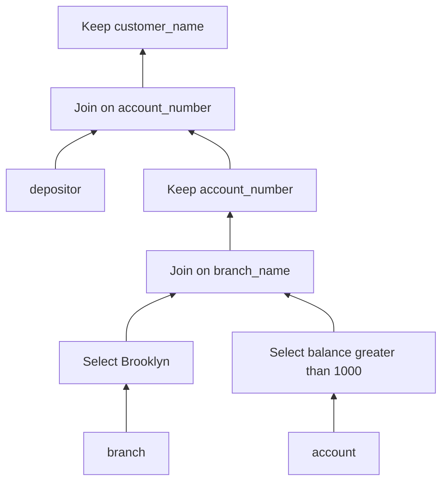

# SOE201 · Expresiones equivalentes y reescrituras seguras de consultas

## Estado de generación del vídeo
PENDIENTE: material preparado; no se ha generado ni revisado ningún vídeo nuevo.

## Instrucciones
Explica la unidad en español siguiendo únicamente este material. Cita las fuentes y distingue práctica complementaria, respuestas suministradas y comentarios locales. Conserva fórmulas, identificadores, discrepancias y límites de evidencia. No inventes contenido, requisitos, resultados, dominio del estudiante ni predicciones de examen.

## Fuentes originales

## Edición española derivada
El hash indicado para cada documento identifica la fuente inglesa; el contenido mostrado es la traducción española. Los originales se conservan en la biblioteca.

### content/reviewed/SOE201/10/tutor.md
Hash de fuente inglesa: a22ee758dda1ffd1c0a4c319c30882661f30709e230419d37edd655e9ffd7c2e

---
course: SOE201
language: en
study_status: untested
---

# Expresiones equivalentes y reescrituras de consultas seguras

## En 60 segundos

**Consulta inicial de la fuente.** Encuentra nombres de clientes para cuentas en sucursales de Brooklyn con saldo superior a 1000. ¿Puedes filtrar y estrechar las relaciones intermedias sin cambiar los nombres que se devuelven?

Lecture6a p.21 proporciona `branch(branch_name, branch_city, assets)`, `account(account_number, branch_name, balance)` y `depositor(customer_name, account_number)`. Las combinaciones naturales conectan los nombres compartidos. La expresión inicial es $\pi_{customer\_name}(\sigma_{branch\_city=Brooklyn\land balance>1000}(branch\bowtie(account\bowtie depositor)))$.

Requisitos previos: Unidad 05 álgebra relacional; Unidad09: planes lógicos y físicos. Esta lección cubre Lecture6a PDF, páginas 13 a 28. La consulta de apertura sigue el texto de la página 23: **saldo > 1000**. En cambio, el diagrama de la página 24 imprime **saldo < 1000**. Esos predicados dan resultados diferentes; preserve esta discrepancia de fuente y utilice el objetivo de la página 23 a lo largo de esta lección. La página 25 ilustra la proyección con una consulta más sencilla exclusiva de Brooklyn; el ejemplo combinado aquí es una derivación complementaria, no una solución oficial copiada. Lecture6b y Lab5 permanecen separados como trabajo docente pendiente; la página 29 enumera las lecturas no importadas aquí.

## Establecer la equivalencia antes de mover operadores

Las expresiones equivalentes devuelven el mismo conjunto de tuplas para **cada instancia de base de datos válida**, no solo para la muestra de hoy. El orden de las tuplas no importa en este modelo de conjunto. SQL normalmente utiliza multiconjuntos: los valores distintos iguales por sí solos no prueban la equivalencia cuando los recuentos duplicados difieren. El siguiente mapa de reglas utiliza álgebra relacional de conjuntos y combinaciones internas; no es una licencia para reescribir combinaciones externas o SQL arbitrario. Fuente: págs. 14-16.

| Regla | Transformación segura | Condición que comprobar |
|---|---|---|
| 1 | Divida una selección conjuntiva en dos selecciones. | Conserva ambos predicados de la conjunción. |
| 2 | Intercambia el orden de dos selecciones. | Ambos predicados siguen siendo evaluables. |
| 3 | Contraiga las proyecciones anidadas a la proyección exterior. | Cada atributo externo debe sobrevivir a cada proyección interna. |
| 4 | Sustituye la selección sobre un producto cartesiano por una combinación theta; incorpora la selección sobre una combinación theta a su predicado. | Mantenga la conjunción completa de predicados. |
| 5 | Intercambie entradas de combinación theta interna o de combinación natural. | Conservar las identidades de los atributos y la misma condición. |
| 6 | Reasociar combinaciones naturales; reasociar combinaciones theta con predicados movidos a límites válidos. | Los atributos a los que se hace referencia de cada predicado deben existir en su nuevo límite. |

Para la regla 3, $\pi_A(\pi_{A,B}(R))=\pi_A(R)$, pero $\pi_A(\pi_B(R))$ no es una expresión bien tipada cuando A y B difieren. La condición de esquema retenido hace explícita la suposición detrás de la notación abreviada de la clase.

Para la regla 6b, $(E_1\bowtie_{\theta_1}E_2)\bowtie_{\theta_2\land\theta_3}E_3=E_1\bowtie_{\theta_1\land\theta_3}(E_2\bowtie_{\theta_2}E_3)$, donde $\theta_2$ se refiere solo a E2/E3 y los otros predicados son evaluables en sus límites mostrados. La reasociación preserva las condiciones; no borra un enlace a E1.

## Adelantar selecciones donde existan sus atributos

La regla 7 permite que un predicado que se refiere sólo a una entrada de una combinación pase a esa entrada. Una conjunción puede dividirse cuando cada predicado pertenece a su respectiva entrada. Fuente: p.17; árbol visual en la p.18; ejemplos bancarios págs. 22-24.

Para la consulta de apertura, mueva `branch_city = Brooklyn` a la sucursal y `balance > 1000` a la cuenta. Vuelva a asociar las combinaciones naturales internas para combinar las dos entradas filtradas antes del depositante. La combinación todavía usa `branch_name` y la combinación posterior todavía usa `account_number`.

Un predicado que compara atributos de dos entradas debe esperar hasta que ambas estén presentes. Para una combinación theta complementaria de `R(x)` y `S(y)`, `x < y` no se puede evaluar solo en R. Escribirlo bajo R no significa "filtrar antes"; produce una expresión no válida.

La selección temprana puede reducir el número de tuplas intermedias. Por sí solo no establece un ahorro medido de tiempo de ejecución: la selectividad, las rutas de acceso y los algoritmos físicos siguen siendo importantes.

## Conservar las claves al adelantar proyecciones

La regla8 permite la proyección temprana cuando conserva los atributos de salida final **y todos los atributos necesarios para los predicados de combinación restantes**. Si una entrada necesita atributos de combinación adicionales, manténgalos temporalmente y elimínelos con una proyección final. Fuente: p.19; esquema bancario p.21; ejemplo resuelto de proyección pág.25.

Después de que la sucursal filtrada se une a la cuenta filtrada, su esquema incluye `branch_name`, `branch_city`, `assets`, `account_number`, `balance`. Sólo `account_number` debe cruzar esta frontera para combinarse con depositor; depositor proporciona `customer_name`. Eliminar el account_number antes de esa combinación eliminaría el enlace requerido. El plan de apertura combinado es:

**Figura 1: Preservar la clave de la siguiente combinación.** Lea de abajo hacia arriba: las selecciones eliminan filas no deseadas, la primera combinación vincula sucursales y cuentas, luego la proyección elimina las columnas innecesarias manteniendo el account_number. La última combinación proporciona nombres y la proyección final elimina su clave auxiliar. Esta es una combinación suplementaria del predicado de la página 23 y el patrón de proyección de la página 25, no el diagrama inconsistente de la página 24. En este modelo de conjunto, fusionar valores intermedios idénticos de account_number no cambia el conjunto final de nombres; las multiplicidades duplicadas de SQL requieren una verificación por separado.

## Comprobar operaciones de conjuntos y contraejemplos

| Regla | Identidad válida de álgebra de conjuntos | Límite |
|---|---|---|
| 9 | La unión y la intersección son conmutativas. | La diferencia no conmuta. |
| 10 | La unión y la intersección son asociativas. | La diferencia no es asociativa. |
| 11 | La selección se distribuye entre unión, intersección y diferencia. | Las entradas deben tener esquemas compatibles; el predicado debe ser válido en ambos. |
| 12 | La proyección distribuye sobre la unión. | No extienda esta regla a la intersección o diferencia. |

Fuente: p.20. Por ejemplo, $\sigma_p(R-S)=\sigma_p(R)-\sigma_p(S)$ y $\pi_A(R\cup S)=\pi_A(R)\cup\pi_A(S)$. La compatibilidad de la unión requiere dominios/esquemas de atributos coincidentes, no simplemente el mismo número de filas.

**Contraejemplo complementario.** En el esquema (a,b), sean R={(1,x)} y S={(1,y)}, con x diferente de y. La intersección de R y S está vacía, por lo que su proyección sobre a también está vacía. Pero ambas proyecciones separadas son {1}, cuya intersección es {1}. Por lo tanto, la proyección no se distribuye sobre la intersección. Asimismo, proyectar R menos S da {1}, mientras que restar las proyecciones separadas da el conjunto vacío. Un contraejemplo válido refuta una supuesta equivalencia universal.

## Comparar órdenes de combinación sin inventar costes

Para la consulta inicial, un plan que conserva el resultado es: filtrar branch por Brooklyn; filtrar account por balance >1000; combinar ambas relaciones por branch_name; conservar account_number; combinar con depositor por account_number; proyectar customer_name. Cada predicado movido tiene sus atributos, cada combinación tiene su clave y ambas condiciones de la página 23 permanecen presentes.

El ejemplo de orden de combinación de la clase compara `(r1 join r2) join r3` con `r1 join (r2 join r3)`: elegir un primer intermedio más pequeño puede reducir el trabajo posterior. Para Brooklyn, las páginas 26 y 27 sugieren que la sucursal filtrada unida a la cuenta puede ser más pequeña que la cuenta unida al depositante. Esta es una expectativa declarada, no estadísticas medidas ni prueba de que un plan físico siempre gana. La proyección estrecha las tuplas; la selección puede reducir su recuento. Ninguno proporciona un coste de E/S sin tamaños, algoritmos y la convención de salida de la Unidad09.

Utilice un método repetible: indique el predicado objetivo y la semántica de conjunto o multiconjunto; enumerar atributos; aplicar una regla válida nombrada; conservar claves y condiciones; comparar tamaños intermedios; Sólo entonces estime los costes físicos. Los optimizadores enumeran sistemáticamente alternativas, pero el tiempo y el espacio limitan esa búsqueda (p.28). Antes de declarar la equivalencia, resuelva también las inconsistencias de fuente: el >1000 de la p.23 y el <1000 de la p.24 no pueden ser objetivos intercambiables.

### content/reviewed/SOE201/10/practice.md
Hash de fuente inglesa: f58b269e7e032458707693e0bf2271a647057497fd3b51673fae34062a08fb20

# Recordar y practicar

Todas las comprobaciones, tarjetas y problemas que aparecen a continuación son prácticas docentes complementarias derivadas de Lecture6a, páginas 13 a 28. No son preguntas de Lab5, un esquema de respuestas oficial o evidencia de dominio. Utilice la consulta p.23 saldo >1000; p.24 imprime la desigualdad opuesta.

## Repaso activo atómico

### Tarjeta 01: ¿Qué deben devolver las expresiones de álgebra de conjuntos equivalentes?
> [!success]- Respuesta
> El mismo conjunto de tuplas en cada instancia de base de datos válida; el orden de las tuplas es irrelevante.
>
> Fuente: Lecture6a p.14.

### Tarjeta 02: ¿Cuándo puede pasar la selección a una entrada de una combinación?
> [!success]- Respuesta
> Cuando su predicado se refiere sólo a atributos disponibles en esa entrada.
>
> Fuente: Lecture6a p.17, Regla7.

### Tarjeta 03 — ¿Qué debe retener una proyección temprana?
> [!success]- Respuesta
> Atributos de salida final y atributos requeridos por cada combinación o predicado restante.
>
> Fuente: Lecture6a p.19, Regla8; pág.25.

### Tarjeta 04: ¿Sobre qué operación de conjunto se distribuye la proyección aquí?
> [!success]- Respuesta
> Unión; generalmente no se distribuye sobre la intersección o la diferencia.
>
> Fuente: Lecture6a p.20, Regla 12; contraejemplos complementarios.

### Tarjeta 05: ¿Por qué una muestra coincidente es insuficiente para demostrar la equivalencia?
> [!success]- Respuesta
> La equivalencia requiere resultados coincidentes en cada instancia válida; un solo contraejemplo lo desmiente.
>
> Fuente: Lecture6a p.14.

### Tarjeta 06: ¿Un resultado intermedio más pequeño demuestra que el plan físico es el más rápido?
> [!success]- Respuesta
> No. Compara los costes estimados utilizando tamaños de relación, algoritmos y convenciones de ejecución; las estimaciones no establecen el tiempo de ejecución medido.
>
> Fuente: Lecture6a págs. 11–12,26–28.

## Práctica resuelta

### Problema 1: conservar el vínculo con el depositante
PRÁCTICA COMPLEMENTARIA. Vuelva a escribir la consulta de apertura Brooklyn/saldo >1000. Después de unir la sucursal y la cuenta filtradas, ¿qué atributos deben sobrevivir para la combinación natural restante y el resultado final? Explica cada reescritura.

> [!tip]- Sugerencia
> Ubica branch_city, balance, branch_name, account_number y customer_name en el esquema de origen. Un valor ausente en el resultado final aún puede ser esencial para una unión.

> [!success]- Solución
> La regla6 reasocia las combinaciones naturales internas. La regla7 mueve branch_city=Brooklyn a branch y balance>1000 a account. Combina estas entradas por branch_name. La regla8 permite conservar account_number en el resultado intermedio para la siguiente combinación; depositor proporciona customer_name. Combina por account_number y después proyecta customer_name. Mantener solo branch_name perdería el vínculo cuenta/depositante. Mantener columnas adicionales es correcto pero menos estrecho. Esta derivación combinada utiliza el predicado de la página 23 y el patrón de proyección de la página 25; no afirma una aceleración medida ni una equivalencia de multiconjuntos de SQL.

### Problema 2: refutar una regla de proyección sobregeneralizada
PRÁCTICA COMPLEMENTARIA. R={(1,x)} y S={(1,y)} tienen esquema (a,b), con x diferente de y. Compare la proyección sobre a antes y después de la intersección y diferencia.

> [!tip]- Sugerencia
> Compara primero las tuplas completas. Luego compare las relaciones proyectadas de una columna.

> [!success]- Solución
> La intersección de R y S está vacía; su proyección está vacía. Ambas proyecciones separadas son {1}; su intersección es {1}. R menos S es R, cuya proyección es {1}. La diferencia de las proyecciones separadas es {1} menos {1}, por lo tanto, vacía. Ambas distribuciones propuestas fracasan. La regla 12 promete distribución sobre la unión, no estas operaciones. Los ejemplos utilizan semántica de conjuntos y esquemas compatibles.

### Problema 3: Detectar la discrepancia de desigualdad de origen
PRÁCTICA COMPLEMENTARIA. Una sucursal B de Brooklyn tiene la cuenta A_high con saldo 1500 y la cuenta A_low con saldo 500. El depositante vincula C_high con A_high y C_low con A_low. Compara el objetivo del texto de la página 23 con la desigualdad del diagrama de la página 24. ¿Qué pasaría si ambos saldos fueran exactamente 1000?

> [!tip]- Sugerencia
> Evalúe estricto > y estricto < por separado. Una cuenta en el límite no satisface ninguno de los dos predicados.

> [!success]- Solución
> Con saldo>1000, el conjunto final de nombres es {C_high}. Con saldo <1000, es {C_low}. Difieren, por lo que reemplazar un predicado por otro no es una reescritura de equivalencia. Si ambos saldos fueran 1000, ambos resultados estarían vacíos; este acuerdo único no demostraría una equivalencia universal. La lección utiliza explícitamente el objetivo >1000 de la página 23 y registra el diagrama conflictivo de la página 24. Estas filas se inventaron para exponer la discrepancia, no se descargaron datos de prueba oficiales.
