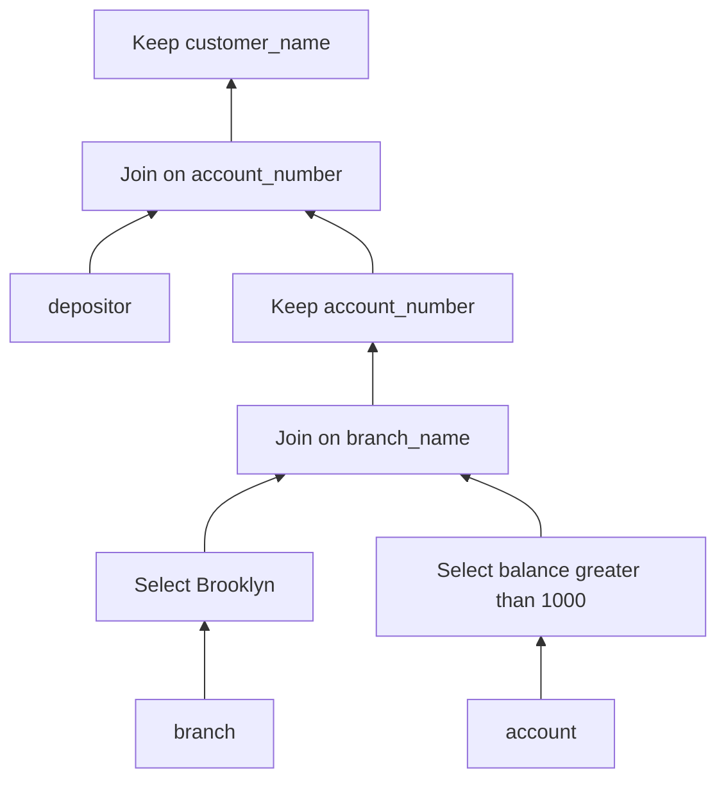

# SOE201 · Equivalent Expressions and Safe Query Rewrites

## Video generation status
PENDING: source pack prepared; no cloud video has been generated or reviewed.

## Spanish video overview prompt
Explica esta unidad en español claro, paso a paso, para alguien que aprende de forma autodidacta. Usa únicamente el material incluido. Comienza con el problema motivador, presenta los conceptos, muestra un ejemplo visual fiel a las convenciones del curso, pausa para una pregunta y después explica la respuesta. Distingue práctica suplementaria de tareas oficiales y de soluciones oficiales. No inventes datos, fuentes, requisitos, capítulos pendientes, resultados de ejecución ni predicciones de examen. Conserva los límites y discrepancias indicados. Cierra con una actividad que el estudiante pueda intentar en Learning Uni. Cita el nombre del documento y su localizador cuando corresponda. Si falta evidencia, dilo; no rellenes el hueco. Mantén visibles las fórmulas y direcciones de flechas.

## Verified original file snapshots

## Source material

### Snapshot: content/reviewed/SOE201/10/tutor.md
SHA-256: a22ee758dda1ffd1c0a4c319c30882661f30709e230419d37edd655e9ffd7c2e

---
course: SOE201
language: en
study_status: untested
---

# Equivalent Expressions and Safe Query Rewrites

## In 60 Seconds

**Source opening query.** Find customer names for accounts at Brooklyn branches with balance greater than 1000. Can you filter and narrow the intermediate relations without changing which names are returned?

Lecture6a p.21 supplies `branch(branch_name, branch_city, assets)`, `account(account_number, branch_name, balance)` and `depositor(customer_name, account_number)`. Natural joins connect the shared names. The starting expression is $\pi_{customer\_name}(\sigma_{branch\_city=Brooklyn\land balance>1000}(branch\bowtie(account\bowtie depositor)))$.

Prerequisites: Unit05 relational algebra; Unit09 logical versus physical plans. This lesson covers Lecture6a PDF pp.13–28. The opening query follows the text on p.23: **balance > 1000**. The p.24 diagram instead prints **balance < 1000**. Those predicates give different results; preserve this source discrepancy and use the p.23 target throughout this lesson. Page25 illustrates projection with a simpler Brooklyn-only query; the combined example here is a supplementary derivation, not a copied official solution. Lecture6b and Lab5 remain separate pending teaching work; p.29 lists reading not imported here.

## Establish Equivalence Before Moving Operators

Equivalent expressions return the same set of tuples for **every legal database instance**, not merely today's sample. Tuple order does not matter in this set model. SQL normally uses multisets: equal distinct values alone do not prove equivalence when duplicate counts differ. The following rule map uses set relational algebra and inner joins; it is not a license to rewrite outer joins or arbitrary SQL. Source: pp.14–16.

| Rule | Safe transformation | Condition to check |
|---|---|---|
| 1 | Split a conjunctive selection into two selections. | Preserve both conjuncts. |
| 2 | Exchange the order of two selections. | Both predicates remain evaluable. |
| 3 | Collapse nested projections to the outer projection. | Every outer attribute must survive every inner projection. |
| 4 | Replace selection over Cartesian product with theta join; fold selection over theta join into its predicate. | Keep the complete conjunction of predicates. |
| 5 | Exchange inner theta-join or natural-join inputs. | Retain attribute identities and the same condition. |
| 6 | Reassociate natural joins; reassociate theta joins with predicates moved to valid boundaries. | Each predicate's referenced attributes must exist at its new boundary. |

For Rule3, $\pi_A(\pi_{A,B}(R))=\pi_A(R)$, but $\pi_A(\pi_B(R))$ is not a well-typed expression when A and B differ. The retained-schema condition makes explicit the assumption behind the lecture's shorthand.

For Rule6b, $(E_1\bowtie_{\theta_1}E_2)\bowtie_{\theta_2\land\theta_3}E_3=E_1\bowtie_{\theta_1\land\theta_3}(E_2\bowtie_{\theta_2}E_3)$, where $\theta_2$ refers only to E2/E3 and the other predicates are evaluable at their displayed boundaries. Reassociation preserves conditions; it does not erase a link to E1.

## Push Selections Where Their Attributes Exist

Rule7 permits a predicate referring only to one join input to move onto that input. A conjunction can split when each conjunct belongs to its respective input. Source: p.17; visual tree on p.18; banking examples pp.22–24.

For the opening query, move `branch_city = Brooklyn` onto branch and `balance > 1000` onto account. Reassociate the inner natural joins to combine the two filtered inputs before depositor. The join still uses `branch_name`, and the later join still uses `account_number`.

A predicate comparing attributes from two inputs must wait until both are present. For a supplementary theta join of `R(x)` and `S(y)`, `x < y` cannot be evaluated on R alone. Writing it under R does not mean “filter earlier”; it produces an invalid expression.

Early selection can reduce the number of intermediate tuples. It does not by itself establish a measured runtime saving: selectivity, access paths and physical algorithms still matter.

## Keep Join Keys When Pushing Projections

Rule8 permits early projection when it retains the final output attributes **and every attribute needed by the remaining join predicates**. If an input needs extra join attributes, keep them temporarily and remove them with a final projection. Source: p.19; banking schema p.21; worked projection p.25.

After the filtered branch joins the filtered account, its schema includes `branch_name`, `branch_city`, `assets`, `account_number`, `balance`. Only `account_number` must cross this boundary to join depositor; depositor supplies `customer_name`. Dropping account_number before that join would remove its required link. The combined opening plan is:

**Figure 1 — Preserve the next join's key.** Read bottom to top: selections remove unwanted rows, the first join links branches and accounts, then projection removes unneeded columns while retaining account_number. The last join supplies names and the final projection removes its auxiliary key. This is a supplementary combination of the p.23 predicate and p.25 projection pattern, not the inconsistent p.24 diagram. In this set model, merging identical intermediate account_number values does not change the final set of names; SQL duplicate multiplicities require a separate check.

## Check Set Operations and Counterexamples

| Rule | Valid set-algebra identity | Boundary |
|---|---|---|
| 9 | Union and intersection commute. | Difference does not commute. |
| 10 | Union and intersection associate. | Difference does not associate. |
| 11 | Selection distributes over union, intersection and difference. | Inputs must have compatible schemas; predicate must be valid on both. |
| 12 | Projection distributes over union. | Do not extend this rule to intersection or difference. |

Source: p.20. For example, $\sigma_p(R-S)=\sigma_p(R)-\sigma_p(S)$ and $\pi_A(R\cup S)=\pi_A(R)\cup\pi_A(S)$. Union compatibility requires matching attribute domains/schema, not simply the same number of rows.

**Supplementary counterexample.** On schema (a,b), let R={(1,x)} and S={(1,y)}, with x different from y. R intersect S is empty, so projecting it onto a is empty. But both separate projections are {1}, whose intersection is {1}. Projection therefore does not distribute over intersection. Likewise, projecting R minus S gives {1}, while subtracting the separate projections gives the empty set. One legal counterexample disproves a purported universal equivalence.

## Compare Join Orders Without Inventing Costs

For the opening query, a valid result-preserving plan is: filter branch to Brooklyn; filter account to balance >1000; join them on branch_name; retain account_number; join depositor on account_number; project customer_name. Each moved predicate has its attributes, each join has its key, and both conditions from p.23 remain present.

The lecture's join-order example compares `(r1 join r2) join r3` with `r1 join (r2 join r3)`: choosing a smaller first intermediate can reduce later work. For Brooklyn, pp.26–27 suggest that filtered branch joined with account may be smaller than account joined with depositor. This is a stated expectation, not measured statistics or proof that one physical plan always wins. Projection narrows tuples; selection can reduce their count. Neither supplies an I/O cost without sizes, algorithms and the output convention from Unit09.

Use a repeatable method: state the target predicate and set/multiset semantics; list attributes; apply a named valid rule; preserve keys and conditions; compare intermediate sizes; only then estimate physical costs. Optimisers systematically enumerate alternatives, but time and space limit that search (p.28). Before declaring equivalence, also resolve source inconsistencies: p.23's >1000 and p.24's <1000 cannot be interchangeable targets.

### Snapshot: content/reviewed/SOE201/10/practice.md
SHA-256: f58b269e7e032458707693e0bf2271a647057497fd3b51673fae34062a08fb20

# Recall and Practice

All checks, cards and problems below are supplementary teaching practice derived from Lecture6a pp.13–28. They are not Lab5 questions, an official answer scheme or evidence of mastery. Use the p.23 balance >1000 query; p.24 prints the opposite inequality.

## Atomic recall

### Card 01 — What must equivalent set-algebra expressions return?
> [!success]- Answer
> The same set of tuples on every legal database instance; tuple order is irrelevant.
>
> Source: Lecture6a p.14.

### Card 02 — When can selection move to one join input?
> [!success]- Answer
> When its predicate refers only to attributes available in that input.
>
> Source: Lecture6a p.17, Rule7.

### Card 03 — What must an early projection retain?
> [!success]- Answer
> Final output attributes and attributes required by every remaining join or predicate.
>
> Source: Lecture6a p.19, Rule8; p.25.

### Card 04 — Over which set operation does projection distribute here?
> [!success]- Answer
> Union; it does not generally distribute over intersection or difference.
>
> Source: Lecture6a p.20, Rule12; supplementary counterexamples.

### Card 05 — Why is one matching sample insufficient to prove equivalence?
> [!success]- Answer
> Equivalence requires matching results on every legal instance; a single counterexample disproves it.
>
> Source: Lecture6a p.14.

### Card 06 — Does a smaller intermediate prove the fastest physical plan?
> [!success]- Answer
> No. Compare estimated costs using relation sizes, algorithms and execution conventions; estimates do not establish measured runtime.
>
> Source: Lecture6a pp.11–12,26–28.

## Worked practice

### Problem 1 — Preserve the link to depositor
SUPPLEMENTARY PRACTICE. Rewrite the opening Brooklyn/balance >1000 query. After joining filtered branch and account, which attributes must survive for the remaining natural join and final output? Explain each rewrite.

> [!tip]- Hint
> Locate branch_city, balance, branch_name, account_number and customer_name in the source schema. A value absent from the final output may still be essential to a join.

> [!success]- Solution
> Rule6 reassociates the inner natural joins. Rule7 moves branch_city=Brooklyn onto branch and balance>1000 onto account. Join those inputs on branch_name. Rule8 permits keeping account_number from this intermediate because the next join uses it; depositor supplies customer_name. Join on account_number, then project customer_name. Keeping only branch_name would lose the account/depositor link. Retaining extra columns is correct but less narrow. This combined derivation uses p.23's predicate and p.25's projection pattern; it does not assert a measured speedup or SQL multiset equivalence.

### Problem 2 — Disprove an overgeneralised projection rule
SUPPLEMENTARY PRACTICE. R={(1,x)} and S={(1,y)} have schema (a,b), with x different from y. Compare projection onto a before and after intersection and difference.

> [!tip]- Hint
> Compare full tuples first. Then compare the projected one-column relations.

> [!success]- Solution
> R intersect S is empty; its projection is empty. Both separate projections are {1}; their intersection is {1}. R minus S is R, whose projection is {1}. The separate projections' difference is {1} minus {1}, hence empty. Both proposed distributions fail. Rule12 promises distribution over union, not these operations. The examples use set semantics and compatible schemas.

### Problem 3 — Detect the source inequality discrepancy
SUPPLEMENTARY PRACTICE. A Brooklyn branch B has account A_high with balance1500 and account A_low with balance500. Depositor links C_high to A_high and C_low to A_low. Compare the p.23 text target with the p.24 diagram's inequality. What if both balances were exactly1000?

> [!tip]- Hint
> Evaluate strict > and strict < separately. An account at the boundary satisfies neither predicate.

> [!success]- Solution
> With balance>1000, the final name set is {C_high}. With balance<1000, it is {C_low}. They differ, so replacing one predicate with the other is not an equivalence rewrite. If both balances were1000, both results would be empty; this single agreement would not prove universal equivalence. The lesson explicitly uses p.23's >1000 target and records p.24's conflicting diagram. These rows are invented to expose the discrepancy, not downloaded official test data.
