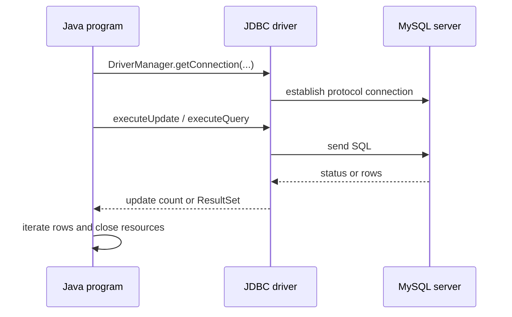

# SOE201 · Laboratorio 02: JDBC e índice

## Estado de generación del vídeo
PENDIENTE: material preparado; no se ha generado ni revisado ningún vídeo nuevo.

## Instrucciones
Explica la unidad en español siguiendo únicamente este material. Cita las fuentes y distingue práctica complementaria, respuestas suministradas y comentarios locales. Conserva fórmulas, identificadores, discrepancias y límites de evidencia. No inventes contenido, requisitos, resultados, dominio del estudiante ni predicciones de examen.

## Fuentes originales
- Lab2-JDBCandIndex.pdf (original en inglés) · SHA-256 f853598c81b96795f83b9303766551b961a232d4683439edb1fb1596b00daa3f
- Database#1 Create privilege.pdf (original en inglés) · SHA-256 28cf26ecf1a84f2d5aa0d3d60bda642e4839510e36d74b8cce9abb8912ebe573

## Edición española derivada
El hash indicado para cada documento identifica la fuente inglesa; el contenido mostrado es la traducción española. Los originales se conservan en la biblioteca.

### content/reviewed/SOE201/lab-02/tutor.md
Hash de fuente inglesa: 0c42d7659cfcda4cf9a6a90d69d98285c54636198b0c46537ca4d3e31cce7df4

---
title: "Lab 02 · JDBC and Index · Tutor Notes"
course: SOE201
type: tutor-lab-notes
status: reviewed
study_status: untested
language: en
cssclasses:
  - soe201-study
  - university-study
---

# Laboratorio 02: JDBC e índice

[[10_UNIVERSITY_CS/SOE201/Tutor Mode/00 Start Here|Tutor Inicio]] · [[10_UNIVERSITY_CS/SOE201/Tutor Mode/Lab 02 - JDBC and Index/02 Recall and Exam Practice|Recuerdo y práctica]] · [[10_UNIVERSITY_CS/SOE201/Labs/Lab 02 - JDBC and Index/03 Lab|Laboratorio de referencia]]

> [!info] Actualización web local
> Se libera la tarea 2. Esta adaptación conserva las explicaciones de configuración originales y actualiza los límites de lanzamiento/tiempo de ejecución utilizando la hoja de tareas más nueva y la referencia de laboratorio ordinaria. No se realizó conexión universitaria.

## En 60 segundos

JDBC es la API de Java que se utiliza aquí para conectarse a MySQL, enviar SQL y leer resultados. Los dos programas suministrados se diferencian por una acción importante en la base de datos: `JDBCandIndex.java` intenta crear `numIndex` antes de ejecutar la misma consulta lógica. Esa diferencia **no** prueba que se utilizó el índice o que la consulta se volvió más rápida. Los detalles del entorno de origen contienen contradicciones de host, nombre de archivo, ancho de esquema y configuración que deben confirmarse antes de la ejecución.

Esta es una unidad práctica a nivel de curso, no una nueva unidad teórica. Se publican las tareas 1.1 y 1.2; La tarea 2 ahora está publicada en Lab2-JDBCandIndex-tasks.pdf, p. 3; consulte el segmento de estudio independiente Tiempo de consulta publicada.

## Vista previa del concepto

> [!note] Ciclo de vida JDBC
> **Significado en lenguaje sencillo:** cargar/registrar el controlador, conectarse, crear una declaración, ejecutar SQL, procesar el resultado y luego cerrar los recursos.
>
> **Por qué es importante:** cada etapa tiene un modo de falla diferente.
>
> **Fuente:** `Lab2-JDBCandIndex.pdf`, PDF págs. 12–23.

> [!note] Conexión específica del controlador
> **Significado en lenguaje sencillo:** la fuente utiliza MySQL Connector/J y la clase de controlador `com.mysql.cj.jdbc.Driver`.
>
> **Por qué es importante:** esta es una configuración específica del laboratorio, no una conclusión de DBMS para todo el curso.
>
> **Fuente:** Lab2, PDF págs. 5, 10, 18.

> [!note] Límite del experimento del índice
> **Significado en lenguaje sencillo:** crear un índice no es lo mismo que observar al optimizador seleccionarlo o medir una aceleración.
>
> **Por qué es importante:** la evidencia requiere un método de plan/cronometraje que los programas suministrados no contienen.
>
> **Fuente:** `JDBC.java`; `JDBCandIndex.java`.

## Instantánea de la evidencia del examen

La muestra de cuatro artículos suministrada no contiene ninguna pregunta JDBC/Lab 02: **NO OBSERVADO EN LA MUESTRA DE ANTERIORES DISPONIBLES**. Esto no significa que el laboratorio carezca de importancia o quede excluido.

## Antes de comenzar

Necesita clases/métodos básicos de Java, SQL `SELECT`/`CREATE INDEX` y la diferencia entre compilación y conectividad en tiempo de ejecución.

> [!question] Verificación de requisitos previos
> Si el código Java se compila sin contactar una base de datos, ¿qué no ha demostrado la compilación?

> [!success]- Comprueba tu respuesta
> No ha demostrado la disponibilidad del controlador en tiempo de ejecución, las credenciales, el acceso a la red, el estado del esquema, el éxito de SQL o el comportamiento del plan de consulta.
>
> Límite de origen: archivos Java suministrados y registro de validación Lab 02 ordinario.

## Una pregunta motivadora

Dos programas emiten la misma consulta para las filas donde `num=7`; Primero se crea un índice en `num`. ¿Qué evidencia justificaría cada una de estas afirmaciones?

Primero, la declaración de índice fue exitosa;
2. MySQL usó el índice;
3. la ejecución indexada fue más rápida;
4. el conjunto de resultados permaneció lógicamente equivalente.

Los programas suministrados respaldan la inspección en origen, pero no las cuatro conclusiones.

## Aprende el mecanismo

### Arquitectura y ciclo de vida

**Figura 1: ruta de solicitud JDBC**

**Léelo:** Java habla a través del controlador JDBC específico de DBMS; La ejecución de SQL ocurre en el servidor.

**Conclusión clave:** el éxito de la compilación y el éxito de la base de datos en tiempo de ejecución son pruebas diferentes.

**Procedencia:** enseñanza de la construcción de Lab2, PDF págs. 10–23.

### Lo que realmente configura la fuente

El laboratorio identifica MySQL, MySQL Connector/J y `com.mysql.cj.jdbc.Driver`. PDF pág. 10 llama a Connector/J 9.4.0 actual en el momento de la diapositiva, pero las versiones de servidor/JDK/motor de almacenamiento no se suministran. La fuente Java contiene marcadores de posición para el nombre de la base de datos, nombre de usuario y contraseña; no publique ni confirme credenciales reales.

### Nuevo folleto de configuración: función y límites

`Database#1 Create privilege.pdf` es un folleto de requisitos previos de dos páginas para la interfaz phpMyAdmin de la escuela. Dice:

- utilizar `http://csse-mysql.xjtlu.edu.cn`;
- introducir el nombre de usuario de la universidad sin el punto y conservar mayúsculas y minúsculas;
- muestra una contraseña inicial del curso y muestra la creación manual de una base de datos con el nombre del nombre de usuario;
- Después de la creación, utilice la interfaz SQL para crear tablas.

El modo Tutor no repite la contraseña mostrada. Trátelo como sensible y potencialmente obsoleto; Utilice las instrucciones oficiales actuales. No se contactó con ningún servicio universitario.

> [!warning] Contradicción de fuente: creación de base de datos
> `Database#1 Create privilege.pdf`, PDF pág. 2 le dice al usuario que cree manualmente la base de datos con el nombre de nombre de usuario. `Lab2-JDBCandIndex.pdf`, PDF pág. 7 dice que no es necesario crearlo explícitamente porque se crea después de iniciar sesión.
>
> **Interpretación más segura:** estos pueden describir diferentes versiones de interfaz o estados de aprovisionamiento. Confirmar el comportamiento actual con el instructor; no cree esquemas adicionales mediante conjeturas.

### Otras discrepancias de fuentes

| Fuente A | Fuente B | Conflicto | Acción más segura |
|---|---|---|---|
| Laboratorio2 pág. 6: anfitrión `10.7.1.127` | Laboratorio2 pág. 11: `10.7.1.36/[DATABASE_NAME]`; Java utiliza `.127` | dirección actual del servidor poco clara | obtener detalles de conexión oficiales actuales |
| Laboratorio2 pág. 11: `JDBCIndex.java` | archivos suministrados: `JDBC.java`, `JDBCandIndex.java` | el nombre del archivo no coincide | utilizar nombres de archivos proporcionados; confirmar expectativa de presentación |
| SQL declara `mmatch varchar(12)` | los datos suministrados incluyen valores más largos | la importación puede truncarse/error por modo de servidor | inspeccionar las advertencias de importación reales antes de cambiar el esquema |
| Laboratorio2 pág. 24: `java.Date` | pag. 25 mesa: `java.sql.Date` | la redacción del tipo difiere | utilice el tipo JDBC completo de la tabla de mapeo |

### Dos programas, cuatro reclamos distintos

`JDBC.java` se conecta y consulta a `Orf_Motif` para obtener la clave/valor configurado. `JDBCandIndex.java` primero emite una declaración `CREATE INDEX numIndex ON Orf_Motif(num)` y luego ejecuta la misma consulta lógica.

| Reclamo | Pruebas requeridas | ¿Código suministrado solo? |
|---|---|---|
| se intentó la declaración de índice | inspección de código | si |
| creación del índice exitosa | respuesta/estado del servidor de ejecución | no |
| índice seleccionado optimizador | plan de ejecución como `EXPLAIN` | no |
| consulta indexada fue más rápida | sincronización/medición controlada | no |
| las filas devueltas son equivalentes | comparar conjuntos de resultados reales | sin evidencia de tiempo de ejecución |

El análisis estático del conjunto de datos encuentra 614 filas proporcionadas con `num=7`, pero ese no es un resultado de consulta MySQL observado.

### Interfaces de declaración

- `Statement`: SQL fijo construido en código.
- `PreparedStatement`: marcadores de posición de parámetros para valores; mejora la separación de la estructura SQL de los datos externos y admite la reutilización.
- `CallableStatement`: invoca procedimientos almacenados.

La fuente presenta los tres. No hace que todos los identificadores SQL sean parametrizables; Los identificadores de tabla/columna/índice necesitan una construcción segura deliberada.

> [!question] Explícalo tú mismo
> ¿Por qué la creación de `numIndex` no establece un árbol B+ físico o una aceleración medida?

> [!success]- Consulta tu explicación
> La fuente no confirma el tipo de motor/índice de almacenamiento, no inspecciona un plan de ejecución ni mide ejecuciones comparables. La creación, la selección y la ejecución son derechos separados.
>
> Fuente: archivos Java suministrados; Lab2, PDF págs. 10–23.

## Ejemplo resuelto: matriz de evidencia

Supongamos que una ejecución informa la creación exitosa del índice y luego devuelve 614 filas. Eso establecería sólo el estado del servidor ejecutado y el recuento de resultados para esa ejecución. Para mostrar la selección de índice, capture un plan. Para mostrar la velocidad, defina caché caliente/fría, pruebas repetidas, carga idéntica de datos/servidor y límites de tiempo. Para mostrar la equivalencia lógica, compare los conjuntos de resultados con y sin el índice.

Esta antigua explicación distingue el razonamiento estático de la ejecución. La referencia de laboratorio ordinaria actualizada ahora informa una ejecución local histórica con 607 filas; consulte Tiempo de consulta publicada para conocer sus límites y limitaciones exactos. Esta aplicación web no ha ejecutado ningún experimento de base de datos.

## Volver a la pregunta motivadora

1. **Creación exitosa:** necesita una respuesta/estado real del servidor.
2. **Índice utilizado:** necesita un plan.
3. **Más rápido:** necesita una medición controlada.
4. **Resultados equivalentes:** necesidades comparadas con conjuntos de resultados reales.

La inspección de las fuentes por sí sola prueba únicamente qué afirmaciones intentan los programas.

## Definiciones y distinciones

| Término A | Término B | Distinción decisiva | Fuente |
|---|---|---|---|
| éxito en tiempo de compilación | éxito en tiempo de ejecución | Sintaxis/tipos de Java versus ejecución de controlador/red/servidor/esquema | Java suministrado; Laboratorio2 |
| índice creado | índice seleccionado | el objeto de esquema existe versus el optimizador lo elige para una consulta | proporcionado Java |
| producción esperada | producción observada | predicción razonada/fuente versus ejecución registrada | Protocolo del tutor |
| Declaración | Declaración preparada | cadena SQL directa versus valores parametrizados/operación preparada reutilizable | Lab2, págs. 20–23 |

## Revisión

### Comprensión total

Regrese a [[#Learn the mechanism]] y [[#Worked example — evidence matrix]].

## Revisión de 5 minutos

- El controlador JDBC media Java↔MySQL;
- conectar → declaración → ejecutar → resultado → cerrar;
- los detalles de aprovisionamiento del host/base de datos entran en conflicto y requieren confirmación actual;
- nunca exponer credenciales ni contactar infraestructura sin autorización;
- la creación y selección del índice, la velocidad y la equivalencia de resultados necesitan evidencia diferente;
- Se libera la tarea 2; consulte el segmento Tiempos de consulta publicados.

## Recuperación de 60 segundos

- Conector/J
- clase de conductor
- marcadores de posición de conexión
- ejecutarActualización vs ejecutarQuery
- Cursor de conjunto de resultados
- cerrar recursos
- crear ≠ seleccionar ≠ más rápido
- contradicción configuración-fuente
- Tarea 2 publicada: segmento de tiempo separado

## Fuentes

- `Lab2-JDBCandIndex.pdf`, las 26 páginas PDF.
- `Database#1 Create privilege.pdf`, ambas páginas, SHA-256 `28cf26ecf1a84f2d5aa0d3d60bda642e4839510e36d74b8cce9abb8912ebe573`.
- `JDBC.java`, 76 líneas; `JDBCandIndex.java`, 85 líneas; `yeast_prosite.sql`.

### content/reviewed/SOE201/lab-02/practice.md
Hash de fuente inglesa: 00deaebb443eb3368c6d71bb507781aa29f21f9032c3e0c4cbe37826dead7be9

---
title: "Lab 02 · Recall and Practice"
course: SOE201
type: tutor-practice
status: reviewed
study_status: untested
language: en
cssclasses:
  - soe201-study
  - university-study
---

# Laboratorio 02: recordar y practicar

[[10_UNIVERSITY_CS/SOE201/Tutor Mode/Lab 02 - JDBC and Index/01 Tutor Notes|Notas del tutor]] · [[10_UNIVERSITY_CS/SOE201/Labs/Lab 02 - JDBC and Index/03 Lab|Laboratorio de referencia]]

**Evidencia de evaluación:** NO OBSERVADO EN LA MUESTRA DE TRABAJOS ANTERIORES DISPONIBLES. Se trata de comprobaciones de laboratorio basadas en fuentes, no afirmaciones de formato de examen compatibles.

> [!info] Actualización web local
> Se libera la tarea 2. Esta adaptación conserva las explicaciones de configuración originales y actualiza los límites de lanzamiento/tiempo de ejecución utilizando la hoja de tareas más nueva y la referencia de laboratorio ordinaria. No se realizó conexión universitaria.

## Repaso activo atómico

### Tarjeta 01: ¿Qué significa JDBC?
> [!success]- Respuesta
> Conectividad de bases de datos Java.
>
> Fuente: Lab2, PDF p. 13.

### Tarjeta 02: ¿Qué clase de controlador utiliza la fuente?
> [!success]- Respuesta
> `com.mysql.cj.jdbc.Driver`.
>
> Fuente: Lab2, PDF p. 18.

### Tarjeta 03: ¿Qué método ejecuta una consulta que devuelve filas?
> [!success]- Respuesta
> `executeQuery`, devolviendo un `ResultSet`.
>
> Fuente: Lab2, PDF págs. 20–22; Java suministrado.

### Tarjeta 04: ¿Qué método es adecuado para `CREATE INDEX`?
> [!success]- Respuesta
> `executeUpdate`, porque la declaración cambia el estado del esquema en lugar de devolver filas de consulta.
>
> Fuente: `JDBCandIndex.java`.

### Tarjeta 05: ¿Qué hace `ResultSet.next()`?
> [!success]- Respuesta
> Avanza el cursor a la siguiente fila e informa si existe alguna.
>
> Fuente: Lab2, PDF págs. 21–22.

### Tarjeta 06: ¿Qué prueba la selección del índice?
> [!success]- Respuesta
> Un plan de ejecución observado o evidencia de servidor equivalente, no solo la creación de índices.
>
> Límite de origen: archivos Java proporcionados.

### Tarjeta 07: ¿Qué prueba una aceleración?
> [!success]- Respuesta
> Mediciones controladas en condiciones comparables de datos, caché, servidor y sincronización.
>
> Límite de origen: archivos Java proporcionados.

### Tarjeta 08: ¿Qué llamada Java exacta le pide la Tarea 2 del Laboratorio 02 publicado que programe el tiempo?
> [!success]- Respuesta
> La hoja de tareas más nueva publica solo el tiempo rs = stmt.executeQuery(sql); Antes y después de la indexación. Consulte el segmento Tiempos de consulta publicados.
>
> Fuente: Lab2-JDBCandIndex-tasks.pdf, PDF p. 3 (reemplaza el marcador de posición de versión original de Lab2 p. 2).

### Tarjeta 09: ¿Qué desacuerdo entre los dos documentos de configuración de JDBC necesita confirmación?
> [!success]- Respuesta
> El folleto de privilegios requiere la creación manual de la base de datos, mientras que Lab2 dice que el aprovisionamiento es automático.
>
> Fuente: privilegio PDF p. 2; Laboratorio2 pág. 7.

### Tarjeta 10: ¿El recuento estático de 614 registros fuente analizados establece el número devuelto por MySQL para num=7?
> [!success]- Respuesta
> No. Es un recuento estático del análisis del SQL proporcionado, no un resultado SELECT observado. La ejecución local registrada arrojó 607 filas para num=7; ese recuento histórico también es específico del entorno y no es un resultado prometido para una importación futura.
>
> Fuente: acta de convalidación de curso ordinario.

## Practica

### Práctica 1: seguimiento del ciclo de vida de JDBC

**PRÁCTICA COMPLEMENTARIA.** Colóquelos en orden de dependencia: iterar resultados, obtener conexión, cerrar recursos, crear declaración, ejecutar consulta.

> [!tip]- Sugerencia
> Preguntar qué objeto requiere cada operación posterior.

> [!success]- Solución
> Obtener conexión → crear declaración → ejecutar consulta → iterar resultados → cerrar resultado/declaración/conexión.
>
> Los errores pueden requerir una limpieza más temprana, por lo que el código de producción normalmente utiliza una gestión de recursos limitada, como probar con recursos.
>
> Fuente: Lab2, PDF págs. 16–23.

### Práctica 2 — TAREA ORIGINAL DEL CURSO 1.1 razonamiento

Explique qué se debe configurar antes de que se pueda ejecutar `JDBC.java` y qué evidencia proporcionaría una ejecución exitosa.

> [!tip]- Sugerencia
> Separe el controlador/classpath, los valores de conexión, el estado de la base de datos y el resultado de la consulta.

> [!success]- Solución
> Configurar Connector/J en el classpath de tiempo de ejecución, URL oficial actual del servidor/base de datos, nombre de usuario y contraseña; asegúrese de que se importe `Orf_Motif`.
>
> Una ejecución exitosa mostraría que este entorno se conectó y ejecutó la consulta, con un conjunto de resultados observado. No establecería el rendimiento general ni una versión de DBMS para todo el curso.
>
> Fuente: Lab2, PDF págs. 4–23; `JDBC.java`.

### Práctica 3 — TAREA ORIGINAL DEL CURSO 1.2 razonamiento

Explique el cambio de estado adicional que intentó `JDBCandIndex.java` y las tres comprobaciones necesarias antes de afirmar una mejora.

> [!tip]- Sugerencia
> Piensa en el resultado de la creación, el plan y la medición.

> [!success]- Solución
> Intenta `CREATE INDEX numIndex ON Orf_Motif(num)` antes de la consulta.
>
> Verifique que la creación se haya realizado correctamente (y maneje un índice existente), inspeccione el plan de ejecución para ver si MySQL lo seleccionó y compare los tiempos/resultados controlados con la ejecución sin índice. Verifique también la equivalencia de resultados lógicos.
>
> Fuente: `JDBCandIndex.java`; Tarea Lab2 1.2.

### Práctica 4: diagnosticar una segunda ejecución

**PRÁCTICA COMPLEMENTARIA.** La primera ejecución indexada se realiza correctamente; el segundo falla antes de realizar la consulta. Dé una hipótesis basada en fuentes y una respuesta segura.

> [!tip]- Sugerencia
> Identificar el estado del esquema persistente creado por la primera ejecución.

> [!success]- Solución
> Es posible que `numIndex` ya exista, por lo que repetir el `CREATE INDEX` incondicional puede fallar. Inspeccionar el error real del servidor y el estado del esquema; no deje caer ni altere objetos silenciosamente sin las instrucciones actuales del laboratorio.
>
> Fuente: `JDBCandIndex.java`; Notas ordinarias de Lab 02.

### Práctica 5: Resolver documentos de configuración contradictorios

**PRÁCTICA COMPLEMENTARIA.** Un documento dice que se debe crear manualmente la base de datos con el nombre de usuario; otro dice que el inicio de sesión lo crea automáticamente. ¿Qué debe hacer un estudiante?

> [!tip]- Sugerencia
> Conserve ambas fuentes y evite adivinar sobre un servicio en vivo.

> [!success]- Solución
> Trate el comportamiento de aprovisionamiento como no confirmado, utilice las instrucciones oficiales actuales del laboratorio/instructor, inspeccione la interfaz sin crear esquemas duplicados y nunca reutilice la contraseña inicial impresa como credencial general.
>
> Fuente: `Database#1 Create privilege.pdf`, pág. 2; Laboratorio2, pág. 7.

### Práctica 6 — Transferencia: diseñar una tabla de evidencia

**PRÁCTICA COMPLEMENTARIA.** Proponer columnas de evidencia para comparar los dos programas sin afirmar un desempeño no respaldado.

> [!tip]- Sugerencia
> Incluir entorno, esquema, plan, resultado y procedencia temporal.

> [!success]- Solución
> Registro de marca de tiempo, servidor/versión si se confirma, hash/recuento del conjunto de datos, existencia de índice y resultado DDL, consulta exacta, plan de ejecución, suma de verificación/recuento del conjunto de resultados, protocolo de ejecución/caché, tiempos repetidos y errores.
>
> Este diseño soportaría observaciones acotadas; No demostraría una velocidad universal en todos los entornos.
>
> Principios básicos: materiales Lab 02 suministrados; Los campos son orientación de ingeniería complementaria.

## Límite de tarea oficial

- Las tareas 1.1 y 1.2 están asignadas arriba y en el laboratorio ordinario.
- La tarea 2 se publica en la hoja de tareas más nueva, p. 3; el segmento de sincronización separado contiene su recorrido basado en la fuente.
- No se accedió a infraestructura universitaria, credencial o base de datos remota.
