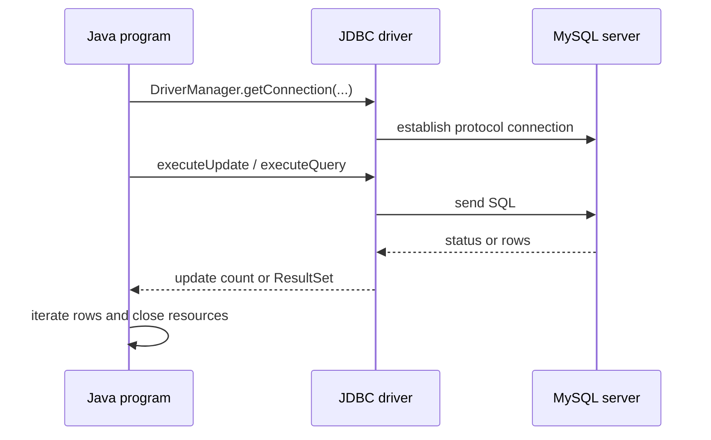

# SOE201 · Lab 02: JDBC and Index

## Video generation status
PENDING: source pack prepared; no cloud video has been generated or reviewed.

## Spanish video overview prompt
Explica esta unidad en español claro, paso a paso, para alguien que aprende de forma autodidacta. Usa únicamente el material incluido. Comienza con el problema motivador, presenta los conceptos, muestra un ejemplo visual fiel a las convenciones del curso, pausa para una pregunta y después explica la respuesta. Distingue práctica suplementaria de tareas oficiales y de soluciones oficiales. No inventes datos, fuentes, requisitos, capítulos pendientes, resultados de ejecución ni predicciones de examen. Conserva los límites y discrepancias indicados. Cierra con una actividad que el estudiante pueda intentar en Learning Uni. Cita el nombre del documento y su localizador cuando corresponda. Si falta evidencia, dilo; no rellenes el hueco. Mantén visibles las fórmulas y direcciones de flechas.

## Verified original file snapshots
- Lab2-JDBCandIndex.pdf · SHA-256 f853598c81b96795f83b9303766551b961a232d4683439edb1fb1596b00daa3f
- Database#1 Create privilege.pdf · SHA-256 28cf26ecf1a84f2d5aa0d3d60bda642e4839510e36d74b8cce9abb8912ebe573

## Source material

### Snapshot: content/reviewed/SOE201/lab-02/tutor.md
SHA-256: 0c42d7659cfcda4cf9a6a90d69d98285c54636198b0c46537ca4d3e31cce7df4

---
title: "Lab 02 · JDBC and Index · Tutor Notes"
course: SOE201
type: tutor-lab-notes
status: reviewed
study_status: untested
language: en
cssclasses:
  - soe201-study
  - university-study
---

# Lab 02 — JDBC and index

[[10_UNIVERSITY_CS/SOE201/Tutor Mode/00 Start Here|Tutor Start]] · [[10_UNIVERSITY_CS/SOE201/Tutor Mode/Lab 02 - JDBC and Index/02 Recall and Exam Practice|Recall and practice]] · [[10_UNIVERSITY_CS/SOE201/Labs/Lab 02 - JDBC and Index/03 Lab|Reference lab]]

> [!info] Local web update
> Task 2 is released. This adaptation preserves the original setup explanations and updates release/runtime boundaries using the newer task sheet and ordinary lab reference. No university connection was performed.

## In 60 Seconds

JDBC is the Java API used here to connect to MySQL, send SQL and read results. The two supplied programs differ by one important database action: `JDBCandIndex.java` attempts to create `numIndex` before running the same logical query. That difference does **not** prove the index was used or that the query became faster. The source environment details contain host, filename, schema-width and setup contradictions that must be confirmed before execution.

This is a course-level practical, not a new theory unit. Task 1.1 and Task 1.2 are released; Task 2 is now released in Lab2-JDBCandIndex-tasks.pdf, p. 3; see the separate Released Query Timing study segment.

## Concept Preview

> [!note] JDBC lifecycle
> **Plain-language meaning:** load/register driver, connect, create a statement, execute SQL, process the result, then close resources.
>
> **Why it matters:** each stage has a different failure mode.
>
> **Source:** `Lab2-JDBCandIndex.pdf`, PDF pp. 12–23.

> [!note] Driver-specific connection
> **Plain-language meaning:** the source uses MySQL Connector/J and driver class `com.mysql.cj.jdbc.Driver`.
>
> **Why it matters:** this is lab-specific configuration, not a course-wide DBMS conclusion.
>
> **Source:** Lab2, PDF pp. 5, 10, 18.

> [!note] Index experiment boundary
> **Plain-language meaning:** creating an index is not the same as observing the optimiser select it or measuring a speedup.
>
> **Why it matters:** evidence requires a plan/timing method that the supplied programs do not contain.
>
> **Source:** `JDBC.java`; `JDBCandIndex.java`.

## Exam Evidence Snapshot

The supplied four-paper sample contains no JDBC/Lab 02 question: **NOT OBSERVED IN AVAILABLE PAST-PAPER SAMPLE**. This does not make the lab unimportant or excluded.

## Before You Start

You need basic Java classes/methods, SQL `SELECT`/`CREATE INDEX`, and the difference between compilation and runtime connectivity.

> [!question] Prerequisite check
> If Java code compiles without contacting a database, what has compilation not proved?

> [!success]- Check your answer
> It has not proved driver availability at runtime, credentials, network access, schema state, SQL success or query-plan behaviour.
>
> Source boundary: supplied Java files and ordinary Lab 02 validation record.

## A motivating question

Two programs issue the same query for rows where `num=7`; one first creates an index on `num`. What evidence would justify each of these claims?

1. the index statement succeeded;
2. MySQL used the index;
3. the indexed run was faster;
4. the result set stayed logically equivalent.

The supplied programs support source inspection, but not all four conclusions.

## Learn the mechanism

### Architecture and lifecycle

**Figure 1 — JDBC request path**

**Read it:** Java talks through the DBMS-specific JDBC driver; SQL execution happens on the server.

**Key takeaway:** compile success and runtime database success are different evidence.

**Provenance:** teaching construction from Lab2, PDF pp. 10–23.

### What the source actually configures

The lab identifies MySQL, MySQL Connector/J and `com.mysql.cj.jdbc.Driver`. PDF p. 10 calls Connector/J 9.4.0 current at the time of the slide, but the server/JDK/storage-engine versions are not supplied. The Java source contains placeholders for database name, username and password; do not publish or commit real credentials.

### New setup handout: role and limits

`Database#1 Create privilege.pdf` is a two-page prerequisite handout for the school phpMyAdmin interface. It says:

- use `http://csse-mysql.xjtlu.edu.cn`;
- enter the university username without the dot and preserve case;
- it displays an initial course password and shows manual creation of a database named after the username;
- after creation, use the SQL interface to create tables.

Tutor Mode does not repeat the displayed password. Treat it as sensitive and potentially stale; use current official instructions. No university service was contacted.

> [!warning] Source contradiction — database creation
> `Database#1 Create privilege.pdf`, PDF p. 2 tells the user to create the username-named database manually. `Lab2-JDBCandIndex.pdf`, PDF p. 7 says there is no need to create it explicitly because it is created after login.
>
> **Safest interpretation:** these may describe different interface versions or provisioning states. Confirm current behaviour with the instructor; do not create extra schemas by guesswork.

### Other source discrepancies

| Source A | Source B | Conflict | Safest action |
|---|---|---|---|
| Lab2 p. 6: host `10.7.1.127` | Lab2 p. 11: `10.7.1.36/[DATABASE_NAME]`; Java uses `.127` | current server address unclear | obtain current official connection details |
| Lab2 p. 11: `JDBCIndex.java` | supplied files: `JDBC.java`, `JDBCandIndex.java` | filename mismatch | use supplied filenames; confirm submission expectation |
| SQL declares `mmatch varchar(12)` | supplied data include longer values | import may truncate/error by server mode | inspect actual import warnings before changing schema |
| Lab2 p. 24: `java.Date` | p. 25 table: `java.sql.Date` | type wording differs | use fully qualified JDBC type from mapping table |

### Two programs, four distinct claims

`JDBC.java` connects and queries `Orf_Motif` for the configured key/value. `JDBCandIndex.java` first issues a `CREATE INDEX numIndex ON Orf_Motif(num)` statement, then runs the same logical query.

| Claim | Required evidence | Supplied code alone? |
|---|---|---|
| index statement was attempted | code inspection | yes |
| index creation succeeded | runtime server response/state | no |
| optimiser selected index | execution plan such as `EXPLAIN` | no |
| indexed query was faster | controlled timing/measurement | no |
| returned rows are equivalent | compare actual result sets | no runtime evidence |

The dataset's static parse finds 614 supplied rows with `num=7`, but that is not an observed MySQL query result.

### Statement interfaces

- `Statement`: fixed SQL constructed in code.
- `PreparedStatement`: parameter placeholders for values; improves separation of SQL structure from external data and supports reuse.
- `CallableStatement`: invokes stored procedures.

The source introduces all three. It does not make every SQL identifier parameterisable; table/column/index identifiers need deliberate safe construction.

> [!question] Explain it yourself
> Why does creating `numIndex` not establish a physical B+ tree or a measured speedup?

> [!success]- Check your explanation
> The source does not confirm storage engine/index type, inspect an execution plan or measure comparable runs. Creation, selection and performance are separate claims.
>
> Source: supplied Java files; Lab2, PDF pp. 10–23.

## Worked example — evidence matrix

Suppose a run reports successful index creation, then returns 614 rows. That would establish only the executed server state and result count for that run. To show index selection, capture a plan. To show speed, define warm/cold cache, repeated trials, identical data/server load and timing boundaries. To show logical equivalence, compare result sets with and without the index.

This older explanation distinguishes static reasoning from execution. The updated ordinary Lab reference now reports a historical local run with 607 rows; see Released Query Timing for its exact boundary and limitations. This web app has not run a database experiment.

## Return to the motivating question

1. **Creation succeeded:** needs an actual server response/state.
2. **Index used:** needs a plan.
3. **Faster:** needs controlled measurement.
4. **Equivalent results:** needs compared actual result sets.

Source inspection alone proves only what statements the programs attempt.

## Definitions and distinctions

| Term A | Term B | Decisive distinction | Source |
|---|---|---|---|
| compile-time success | runtime success | Java syntax/types versus driver/network/server/schema execution | supplied Java; Lab2 |
| index created | index selected | schema object exists versus optimiser chooses it for a query | supplied Java |
| expected output | observed output | reasoned/source prediction versus recorded execution | Tutor protocol |
| Statement | PreparedStatement | direct SQL string versus parameterised values/reusable prepared operation | Lab2, pp. 20–23 |

## Review

### Full Understanding

Return to [[#Learn the mechanism]] and [[#Worked example — evidence matrix]].

## 5-Minute Review

- JDBC driver mediates Java↔MySQL;
- connect → statement → execute → result → close;
- host/database provisioning details conflict and require current confirmation;
- never expose credentials or contact infrastructure without authorisation;
- index creation, index selection, speed and result equivalence need different evidence;
- Task 2 is released; see the Released Query Timing segment.

## 60-Second Recall

- Connector/J
- driver class
- connection placeholders
- executeUpdate vs executeQuery
- ResultSet cursor
- close resources
- create ≠ select ≠ faster
- setup-source contradiction
- Task 2 released: separate timing segment

## Sources

- `Lab2-JDBCandIndex.pdf`, all 26 PDF pages.
- `Database#1 Create privilege.pdf`, both pages, SHA-256 `28cf26ecf1a84f2d5aa0d3d60bda642e4839510e36d74b8cce9abb8912ebe573`.
- `JDBC.java`, 76 lines; `JDBCandIndex.java`, 85 lines; `yeast_prosite.sql`.

### Snapshot: content/reviewed/SOE201/lab-02/practice.md
SHA-256: 00deaebb443eb3368c6d71bb507781aa29f21f9032c3e0c4cbe37826dead7be9

---
title: "Lab 02 · Recall and Practice"
course: SOE201
type: tutor-practice
status: reviewed
study_status: untested
language: en
cssclasses:
  - soe201-study
  - university-study
---

# Lab 02 — Recall and practice

[[10_UNIVERSITY_CS/SOE201/Tutor Mode/Lab 02 - JDBC and Index/01 Tutor Notes|Tutor notes]] · [[10_UNIVERSITY_CS/SOE201/Labs/Lab 02 - JDBC and Index/03 Lab|Reference lab]]

**Assessment evidence:** NOT OBSERVED IN AVAILABLE PAST-PAPER SAMPLE. These are source-based lab checks, not supported exam-format claims.

> [!info] Local web update
> Task 2 is released. This adaptation preserves the original setup explanations and updates release/runtime boundaries using the newer task sheet and ordinary lab reference. No university connection was performed.

## Atomic recall

### Card 01 — What does JDBC stand for?
> [!success]- Answer
> Java Database Connectivity.
>
> Source: Lab2, PDF p. 13.

### Card 02 — Which driver class does the source use?
> [!success]- Answer
> `com.mysql.cj.jdbc.Driver`.
>
> Source: Lab2, PDF p. 18.

### Card 03 — Which method executes a query returning rows?
> [!success]- Answer
> `executeQuery`, returning a `ResultSet`.
>
> Source: Lab2, PDF pp. 20–22; supplied Java.

### Card 04 — Which method is suitable for `CREATE INDEX`?
> [!success]- Answer
> `executeUpdate`, because the statement changes schema state rather than returning query rows.
>
> Source: `JDBCandIndex.java`.

### Card 05 — What does `ResultSet.next()` do?
> [!success]- Answer
> Advances the cursor to the next row and reports whether one exists.
>
> Source: Lab2, PDF pp. 21–22.

### Card 06 — What proves index selection?
> [!success]- Answer
> An observed execution plan or equivalent server evidence, not index creation alone.
>
> Source boundary: supplied Java files.

### Card 07 — What proves a speedup?
> [!success]- Answer
> Controlled measurements under comparable data, cache, server and timing conditions.
>
> Source boundary: supplied Java files.

### Card 08 — What exact Java call does released Lab 02 Task 2 ask you to time?
> [!success]- Answer
> The newer task sheet releases timing only rs = stmt.executeQuery(sql); before and after indexing. See the Released Query Timing segment.
>
> Source: Lab2-JDBCandIndex-tasks.pdf, PDF p. 3 (supersedes original Lab2 p. 2 release placeholder).

### Card 09 — What disagreement between the two JDBC setup documents needs confirmation?
> [!success]- Answer
> The privilege handout requires manual database creation, while Lab2 says provisioning is automatic.
>
> Source: privilege PDF p. 2; Lab2 p. 7.

### Card 10 — Does the static count of 614 parsed source records establish the number returned by MySQL for num=7?
> [!success]- Answer
> No. It is a static count from parsing supplied SQL, not an observed SELECT result. The recorded local run returned 607 rows for num=7; that historical count is also environment-specific, not a promised result for a future import.
>
> Source: ordinary course validation record.

## Practice

### Practice 1 — Trace the JDBC lifecycle

**SUPPLEMENTARY PRACTICE.** Put these in dependency order: iterate results, obtain connection, close resources, create statement, execute query.

> [!tip]- Hint
> Ask what object each later operation requires.

> [!success]- Solution
> Obtain connection → create statement → execute query → iterate results → close result/statement/connection.
>
> Errors may require earlier cleanup, so production code normally uses bounded resource management such as try-with-resources.
>
> Source: Lab2, PDF pp. 16–23.

### Practice 2 — ORIGINAL COURSE TASK 1.1 reasoning

Explain what must be configured before `JDBC.java` can run and what evidence a successful run would provide.

> [!tip]- Hint
> Separate driver/classpath, connection values, database state and query result.

> [!success]- Solution
> Configure Connector/J on the runtime classpath, current official server/database URL, username and password; ensure `Orf_Motif` is imported.
>
> A successful run would show that this environment connected and executed the query, with an observed result set. It would not establish general performance or a course-wide DBMS version.
>
> Source: Lab2, PDF pp. 4–23; `JDBC.java`.

### Practice 3 — ORIGINAL COURSE TASK 1.2 reasoning

Explain the additional state change attempted by `JDBCandIndex.java` and three checks needed before claiming improvement.

> [!tip]- Hint
> Think creation result, plan and measurement.

> [!success]- Solution
> It attempts `CREATE INDEX numIndex ON Orf_Motif(num)` before the query.
>
> Check that creation succeeded (and handle an existing index), inspect the execution plan to see whether MySQL selected it, and compare controlled timings/results with the non-index run. Also verify logical result equivalence.
>
> Source: `JDBCandIndex.java`; Lab2 Task 1.2.

### Practice 4 — Diagnose a second run

**SUPPLEMENTARY PRACTICE.** The first indexed run succeeds; the second fails before querying. Give a source-grounded hypothesis and a safe response.

> [!tip]- Hint
> Identify persistent schema state created by the first run.

> [!success]- Solution
> `numIndex` may already exist, so repeating the unconditional `CREATE INDEX` can fail. Inspect the actual server error and schema state; do not silently drop or alter objects without the lab's current instructions.
>
> Source: `JDBCandIndex.java`; ordinary Lab 02 notes.

### Practice 5 — Resolve contradictory setup documents

**SUPPLEMENTARY PRACTICE.** One document says to create the username-named database manually; another says login creates it automatically. What should a student do?

> [!tip]- Hint
> Preserve both sources and avoid guessing about a live service.

> [!success]- Solution
> Treat the provisioning behaviour as unconfirmed, use the current official lab/instructor instructions, inspect the interface without creating duplicate schemas, and never reuse the printed initial password as a general credential.
>
> Source: `Database#1 Create privilege.pdf`, p. 2; Lab2, p. 7.

### Practice 6 — Transfer: design an evidence table

**SUPPLEMENTARY PRACTICE.** Propose evidence columns for comparing the two programs without claiming unsupported performance.

> [!tip]- Hint
> Include environment, schema, plan, result and timing provenance.

> [!success]- Solution
> Record timestamp, server/version if confirmed, dataset hash/count, index existence and DDL result, exact query, execution plan, result-set checksum/count, cache/run protocol, repeated timings and errors.
>
> This design would support bounded observations; it would not prove universal speed across environments.
>
> Source principles: supplied Lab 02 materials; fields are supplementary engineering guidance.

## Official-task boundary

- Task 1.1 and Task 1.2 are mapped above and in the ordinary lab.
- Task 2 is released in the newer task sheet, p. 3; the separate timing segment contains its source-grounded walkthrough.
- No university infrastructure, credential or remote database was accessed.
