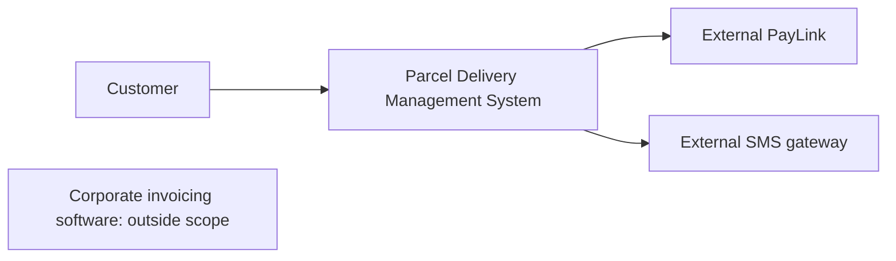
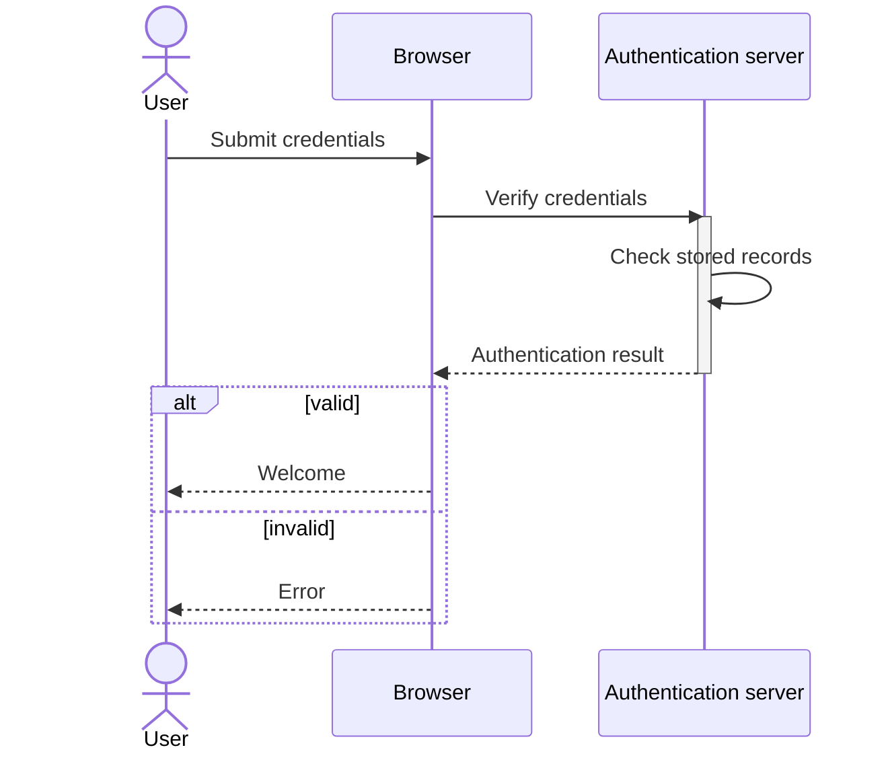
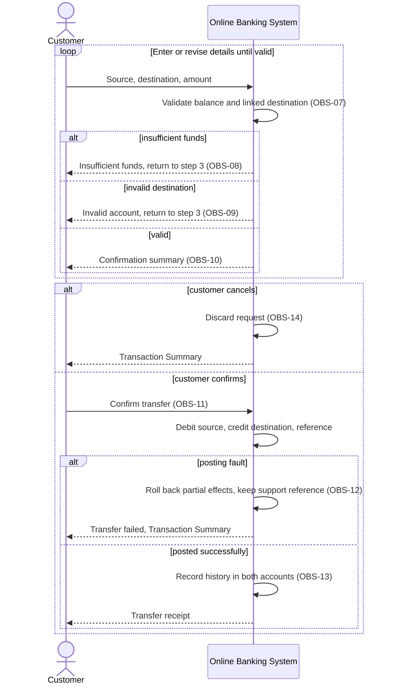

# SOE203 · Modelado de sistemas: contexto e interacciones

## Estado de generación del vídeo
PENDIENTE: material preparado; no se ha generado ni revisado ningún vídeo nuevo.

## Instrucciones
Explica la unidad en español siguiendo únicamente este material. Cita las fuentes y distingue práctica complementaria, respuestas suministradas y comentarios locales. Conserva fórmulas, identificadores, discrepancias y límites de evidencia. No inventes contenido, requisitos, resultados, dominio del estudiante ni predicciones de examen.

## Fuentes originales
- Week 5 Lecture.pdf (original en inglés) · SHA-256 866ff63f30db68dd31024a09f75fbadf7d588b7b30f1c12d996efa778bd6459f
- Week 5 - UML Lecture Exercise.docx (original en inglés) · SHA-256 cc81c67d8ddf07380dcce50ce753c821e82da1d8d86f206c03b25462e8573cd3
- Week 5 - UML Lecture Exercise - ANSWER.docx (original en inglés) · SHA-256 1037442f12fa1404f5673f336a23e05cb4c49a1a804791afee6331bfafc0f390
- Week 5 Tutorial.docx (original en inglés) · SHA-256 1ed19e25fca018e1a4452151a0ec910c2de697e9b0db45f7e2235c1f2904e033
- Use-case Description.pdf — Online Banking example (original en inglés) · SHA-256 f60f96b56628613187da82ebdac2169aab9ebca8d14f1ae99b848674345664d5

## Edición española derivada
El hash indicado para cada documento identifica la fuente inglesa; el contenido mostrado es la traducción española. Los originales se conservan en la biblioteca.

### content/reviewed/SOE203/05/tutor.md
Hash de fuente inglesa: 2c41bfe9748fd20ca3febcf32a49fc009a4b7b38431cd23e69c78b1b1332b098

# Modelado de sistemas: contexto e interacciones.

Edición de tutor web basada en **Week 5 Lecture.pdf, las 36 páginas PDF**, además del ejercicio de la conferencia de la Semana 5 y los archivos DOCX del tutorial. Los números de página del PDF que aparecen a continuación están basados ​​en uno; Los números de diapositivas impresos difieren. Las reconstrucciones complementarias están etiquetadas. Este no es un esquema de calificación oficial.

## En 60 segundos

Un modelo oculta deliberadamente detalles para responder una pregunta particular. El contexto muestra el límite; los casos de uso muestran roles externos y sus objetivos; Los diagramas de secuencia muestran mensajes ordenados para un escenario. Primero decida quién necesita el modelo y qué decisión respalda. Fuente: PDF de la conferencia, págs. 4–7.

## Antes de empezar

Recuerde los requisitos funcionales de la Unidad 04. Es necesario distinguir un actor externo de un objeto interno, un objetivo de un paso de implementación y una condición de una secuencia. Esta unidad desarrolla temas de contexto/caso de uso/secuencia únicamente. Los diagramas de clases, actividades y máquinas de estado aparecen en la agenda, pero no tienen sección de enseñanza en esta plataforma suministrada; quedan pendientes.

## 1. Elige una perspectiva y precisión

| Perspectiva | Pregunta | Modelo |
|---|---|---|
| Externo | ¿Qué hay afuera? | Contexto |
| Interacción | ¿Quién interactúa o en qué orden? | Caso de uso/secuencia |
| Estructural | ¿Qué estructura de datos existe? | Clase (pendiente aquí) |
| Comportamiento | ¿Cómo evoluciona el comportamiento? | Actividad/máquina de estados (pendiente aquí) |

Un modelo de sistema existente aclara el comportamiento actual para las discusiones sobre requisitos. Un modelo de sistema planificado comunica un diseño propuesto. Las herramientas basadas en modelos necesitan especificaciones correctas y completas para lo que generan; un boceto de discusión puede omitir más detalles. Las expectativas de precisión dependen del propósito. Fuente: PDF de la conferencia, págs. 5–7.

## 2. El contexto es una decisión de límites

Un diagrama de contexto muestra los sistemas y conexiones circundantes, no el diseño interno ni el orden de los mensajes. La elección del límite afecta la responsabilidad y los intereses de las partes interesadas. Croquis de límites complementario derivado del tutorial de mensajería:

El sistema financiero está fuera de este proyecto; el aviso no requiere una integración con él. Un cuadro en este boceto de contexto no es un óvalo de caso de uso UML. Fuente: conferencia PDF p. 9; Tutorial de la semana 5.docx, pregunta 2.

## 3. Actores y objetivos

Un diagrama de casos de uso brinda una vista funcional de alto nivel: rectángulo del sistema con nombre, actores afuera, óvalos de objetivos adentro, asociaciones de actores simples. Un actor es un **rol**, no una persona en particular; puede ser una persona, un sistema externo, un dispositivo o un temporizador. Los actores primarios persiguen objetivos, los actores de apoyo brindan servicios y las partes interesadas fuera del escenario tienen intereses sin utilizar directamente el sistema. Fuente: PDF de la conferencia, págs. 11-12.

Para el ejercicio del hotel: los huéspedes se asocian con Buscar habitaciones disponibles, reservar una habitación, ver detalles de la reserva, realizar pagos y cancelar la reserva. El recepcionista del hotel se asocia con el registro de huéspedes, el registro de salida de huéspedes y la generación de informes de ocupación. La declaración no establece vínculos obligatorios entre estos objetivos. No agregue una política porque una aplicación de reservas normalmente la tiene. Fuente: Semana 5: Ejercicio de conferencia UML.docx, Sistema de reserva de hotel.

## 4. Incluir, ampliar y generalizar

**Incluir** puntos desde la tarea base hasta el comportamiento reutilizado requerido. **Extender** puntos del comportamiento adicional condicional a su caso de uso base, con su condición indicada. Puntos de generalización desde actor especializado/caso de uso hasta su padre general. Fuente: PDF de la conferencia, págs. 13-14; tutorial de mensajería.

Ejemplos de aerolíneas: Reservar vuelo incluye Realizar pago; Aplicar código promocional amplía Reservar vuelo [código suministrado]; Solicitar Asistencia Especial amplía el Check-In Online [asistencia solicitada]. El ejercicio describe la autenticación como un requisito previo para cualquier otro objetivo de pasajeros. Su redacción puede representarse como una condición previa; Si el ejercicio de enseñanza espera incluir un caso de uso de autenticación, indique esa abstracción en lugar de asumir que se produce un nuevo inicio de sesión dentro de cada acción. El diagrama de línea aérea revisado visualmente en ANSWER.docx omite la autenticación a pesar de ese requisito previo en la hoja de trabajo. Mantenga el requisito previo visible en su explicación; esta discrepancia no prueba que la autenticación sea innecesaria. El diagrama confirma las instrucciones de pago/inclusión y promoción/asistencia/extensión.

> [!question]- Predice la flecha
> Un libro de la biblioteca devuelto está vencido. ¿Qué caso de uso se extiende a cuál y cada devolución requiere iniciar sesión?

> [!success]- Verificar
> Cobro Multa por Vencido extiende Libro de Devolución [fecha de vencimiento vencido], con la flecha hacia Libro de Devolución. El mensaje dice explícitamente que la devolución no requiere iniciar sesión. Fuente: Tutorial de la Semana 5.docx, Pregunta 1.

## 5. Los requisitos se convierten en escenarios

La conferencia rastrea los requisitos bancarios hasta objetivos y flujos numerados. El [[10_UNIVERSITY_CS/Software Engineering 1/Sources/Learning Mall 2026-10-12/Use-case Description.pdf|Use-case Description.pdf]] recientemente verificado proporciona Transferencia de fondos y OBS-01…OBS-17. Las referencias de mazos a OBS-18…OBS-20 exceden el alcance de este PDF; No inventes esos requisitos.

Una descripción completa nombra el caso de uso y el actor principal; condiciones previas; flujo principal numerado; alternativas/excepciones que se derivan de pasos numerados; y postcondiciones. En Transferir fondos: elija cuentas/monto, valide, muestre confirmación, confirme, registre débito/crédito/referencia, luego recibo/registro. Fondos insuficientes y validación de cuenta no válida; descartes de cancelación; un error de publicación se revierte. Fuente: PDF de la conferencia, págs. 15-22.

## 6. Leer un diagrama de secuencia

El tiempo corre hacia abajo en las líneas de vida de los participantes. Un mensaje sincrónico llama y espera; un retorno discontinuo lleva su respuesta. Las barras de activación muestran períodos de ejecución/espera. Mantenga los niveles de abstracción consistentes. **alt** elige alternativas protegidas, **opt** realiza un bloque opcional protegido, **bucle** se repite. Fuente: PDF de la conferencia, págs. 24-28.

Reconstrucción textual complementaria del escenario de inicio de sesión proporcionado (PDF, páginas 29 y 30; ejercicio de conferencia Iniciar sesión):

Ambas ramas son resultados, no dos mensajes que siempre se ejecutan. El diagrama es explicativo, no un protocolo de implementación prescrito.

## 7. Escribe interacciones controladas por guardas

El proceso de pago utiliza una **opción [pago exitoso]** para la actualización del inventario y la confirmación del pedido en la plataforma. La imagen de pago de ANSWER.docx proporcionada utiliza **alt [PagoSuccessful] / [PaymentFailed]** en su lugar: la rama de éxito actualiza el stock y confirma el pedido; la rama fallida envía **Pedido fallido** al cliente. Estas son dos variantes de origen. Ninguno de los dos proporciona una política de reembolso o reintento. Transferir fondos anida una opción alternativa externa para entradas válidas/inválidas, una opción para confirmación dentro de válidas y luego una opción alternativa para publicar con éxito/fallo. Fuentes: PDF de la conferencia, págs. 31–35; Imagen de pago de ANSWER.docx.

Para el tutorial de renovación de vehículos, un registro faltante o multas impagas deben cancelarse antes del pago. Para QuickMed, cada verificación fallida finaliza la solicitud; los controles de existencias se repiten para cada medicamento; La entrega a domicilio es opcional. Un pago rechazado está explícitamente fuera de alcance. Estos son escenarios de software ficticios, no consejos clínicos. El razonamiento trabajado adyacente completo se encuentra en Recordar y practicar.

## Revisión y límite de origen

Explique por qué un diagrama de contexto no puede sustituir a un diagrama de secuencia. Dibuja flechas para pago obligatorio y seguro opcional. Rastree un rechazo temprano sin mensajes exitosos posteriores. Luego intente las ocho tareas de ejercicio/tutorial proporcionadas en la Semana 5 en Recuperación y práctica.

Los documentos fuente originales permanecen disponibles en la biblioteca fuente. Las cinco imágenes de respuestas fueron inspeccionadas visualmente y permanecen conservadas en el DOCX original. Las diferencias entre la hoja de trabajo, el mazo y la imagen de respuestas se indican arriba. El nuevo razonamiento local y las reconstrucciones de Mermaid son ayudas didácticas derivadas de forma independiente; no se reivindican como soluciones propuestas por profesores. Los capítulos de enseñanza de clase/actividad/estado permanecen fuera de esta plataforma suministrada; El PDF de descripción bancaria ya está verificado y disponible.

## Cifras suministradas de la semana 5: compare los modelos

Estas son imágenes de bytes idénticos extraídas del [[Week 5 - UML Lecture Exercise - ANSWER.docx|solucionario DOCX del ejercicio de clase]] conservado. Se les proporcionan cifras de respuestas, no nuevas reconstrucciones locales o un esquema oficial de calificación de exámenes.

### Reserva de hotel
![[10_UNIVERSITY_CS/Software Engineering 1/Web Source Figures/week5-hotel.png|Diagrama de casos de uso de hotel suministrado]]
Lea los límites y las asociaciones de huéspedes/recepcionistas. El solucionario llama al óvalo de cancelación «Cancel Booking» (cancelar reserva), mientras que el ejercicio usa «Cancel Reservation» (cancelar reserva); conserva esa diferencia entre los nombres originales. No se muestran enlaces de inclusión/extensión. Fuente: ANSWER.docx, imagen del sistema de reservas de hoteles.

### Reserva de avión
![[10_UNIVERSITY_CS/Software Engineering 1/Web Source Figures/week5-airline.png|Diagrama de casos de uso de aerolínea suministrado]]
Reservar Vuelo incluye Realizar Pago; Las extensiones de promoción y asistencia especial apuntan hacia sus objetivos básicos. La fuente omite el requisito previo de autenticación de la hoja de cálculo; el diagrama no elimina ese requisito. Fuente: ANSWER.docx, imagen del sistema de reserva de billetes de avión.

### Inicie sesión en dos niveles de abstracción
![[10_UNIVERSITY_CS/Software Engineering 1/Web Source Figures/week5-login-overview.png|Secuencia de descripción general de inicio de sesión proporcionada]]
![[10_UNIVERSITY_CS/Software Engineering 1/Web Source Figures/week5-login-detailed.png|Secuencia de inicio de sesión detallada proporcionada]]
Ambos utilizan respuestas alternativas de éxito/fracaso. El segundo hace que la verificación del servidor sea explícita como un automensaje. Un detalle diferente no es un resultado de ejecución adicional; no ejecute ambos resultados alternativos como un solo seguimiento. Fuente: ANSWER.docx, Imágenes de inicio de sesión 1 y 2.

### Pagar
![[10_UNIVERSITY_CS/Software Engineering 1/Web Source Figures/week5-checkout.png|Secuencia de pago proporcionada]]
La sucursal exitosa actualiza el inventario antes de confirmar; la sucursal de pago fallido informa Orden fallida. Esta alternativa proporcionada difiere de la opción de solo éxito de la conferencia. Ninguno agrega una política de reembolso o reintento. Fuente: ANSWER.docx, imagen de pago de compras en línea.

## Ejemplo bancario: reintento, confirmación y desacuerdo con la fuente

El [[10_UNIVERSITY_CS/Software Engineering 1/Sources/Learning Mall 2026-10-12/Use-case Description.pdf|ejemplo bancario]] de tres páginas ya está disponible. [[content/reviewed/SOE203/05/banking-example|Lea el mapa completo de flujo y requisitos de OBS]]. Proporciona diecisiete requisitos, no los veinte mencionados en algunas referencias de mazos.

Los fondos insuficientes y un destino no válido/desvinculado **no** publican una transferencia; la descripción del caso de uso vuelve al paso 3 para editar los detalles. La Práctica 9 anterior es un ejercicio etiquetado de un solo intento: finalizar ese intento es diferente a finalizar todo el caso de uso interactivo. La cancelación descarta la solicitud y regresa al Resumen de la transacción. La publicación de fallas revierte efectos parciales, mantiene una referencia de soporte, informa fallas y regresa al resumen.

**Conflicto de origen visible:** la poscondición de la página 1 dice "A/C de origen acreditado, aire acondicionado de destino debitado". OBS-11 en la p.2 dice explícitamente fuente de débito y destino de crédito. La siguiente reconstrucción sigue el requisito explícito de OBS-11 y señala la poscondición conflictiva para su confirmación; no modifica silenciosamente el PDF original.

**Reconstrucción de secuencia complementaria**, basada en p.1 y OBS-07…OBS-14. Agrega un bucle de reintento para expresar el regreso documentado al paso 3; no es un diagrama elaborado por un profesor ni una prueba de implementación.

El mismo PDF tiene un bloqueo de tres inicios de sesión no válidos consecutivos (OBS-04) y un cierre de sesión por inactividad de diez minutos (OBS-17). Estas son las reglas de este escenario bancario; no los reemplace con la regla de más de cinco fallas/ventana/duración de bloqueo del ejemplo de respuesta diferente de la Semana 4. Aquí no se especifica ninguna duración del bloqueo.

### content/reviewed/SOE203/05/practice.md
Hash de fuente inglesa: d9abbe0097dd82d9818728474b6936715d6b340fc4a5ece9da7ef6b3d5c25ab0

# Modelado de sistemas: recordar y practicar.

Edición de tutores web. La nueva práctica a continuación es **PRÁCTICA COMPLEMENTARIA**, no una tarea oficial ni un esquema de calificación. Fuentes: Semana 5 Lecture.pdf / Semana 5 - Ejercicio de conferencia UML.docx / Semana 5 Tutorial.docx. Inténtelo antes de abrir la ayuda.

## Repaso activo atómico

### Tarjeta 01: ¿Por qué omitir detalles en un modelo?
> [!success]- Respuesta
> Hacer que un aspecto sea discutible y respaldar una audiencia y una decisión definidas.
>
> Fuente: Semana 5 Lecture.pdf / Semana 5 - UML Lecture Ejercicio.docx / Semana 5 Tutorial.docx, conferencia PDF, págs. 4–7.

### Tarjeta 02 — ¿Qué establece un diagrama de contexto?
> [!success]- Respuesta
> Los límites del sistema y los sistemas externos; no diseño interno, orden de casos de uso o cronograma de escenarios.
>
> Fuente: Semana 5 Conferencia.pdf / Semana 5 - Ejercicio de conferencia UML.docx / Semana 5 Tutorial.docx, conferencia PDF p. 9.

### Tarjeta 03 — ¿Qué es un actor?
> [!success]- Respuesta
> Un rol externo que interactúa en el límite, potencialmente una persona, sistema, dispositivo o temporizador.
>
> Fuente: Semana 5 Lecture.pdf / Semana 5 - UML Lecture Ejercicio.docx / Semana 5 Tutorial.docx, conferencia PDF págs. 11-12.

### Tarjeta 04: En un diagrama de casos de uso de UML, ¿hacia dónde apunta la flecha «incluir»?
> [!success]- Respuesta
> Del caso de uso base al comportamiento incluido obligatorio.
>
> Fuente: Semana 5 Conferencia.pdf / Semana 5 - Ejercicio de conferencia UML.docx / Semana 5 Tutorial.docx, conferencia PDF p. 13.

### Tarjeta 05: En un diagrama de casos de uso de UML, ¿hacia dónde apunta una flecha de «extensión»?
> [!success]- Respuesta
> Desde el comportamiento adicional condicional hasta el caso de uso base, con su condición de extensión establecida.
>
> Fuente: Semana 5 Conferencia.pdf / Semana 5 - Ejercicio de conferencia UML.docx / Semana 5 Tutorial.docx, conferencia PDF p. 13.

### Tarjeta 06: ¿Qué describe un diagrama de secuencia?
> [!success]- Respuesta
> Participantes intercambiando mensajes ordenados para un escenario; el tiempo corre hacia abajo.
>
> Fuente: Semana 5 Conferencia.pdf / Semana 5 - Ejercicio de conferencia UML.docx / Semana 5 Tutorial.docx, conferencia PDF p. 24.

### Tarjeta 07: ¿Qué distingue a alt y opt?
> [!success]- Respuesta
> alt tiene alternativas cautelosas; opt tiene un único bloque opcional protegido sin un else explícito.
>
> Fuente: Semana 5 Conferencia.pdf / Semana 5 - Ejercicio de conferencia UML.docx / Semana 5 Tutorial.docx, conferencia PDF p. 25.

### Tarjeta 08: ¿Qué representa un fragmento de bucle en un diagrama de secuencia UML?
> [!success]- Respuesta
> Una repetición cautelosa de mensajes adjuntos.
>
> Fuente: Semana 5 Conferencia.pdf / Semana 5 - Ejercicio de conferencia UML.docx / Semana 5 Tutorial.docx, conferencia PDF p. 25.

### Tarjeta 09: ¿Qué incluye una descripción completa del caso de uso?
> [!success]- Respuesta
> Actor/meta, condiciones previas, flujo principal, alternativas/excepciones numeradas y condiciones posteriores.
>
> Fuente: Semana 5 Conferencia.pdf / Semana 5 - Ejercicio de conferencia UML.docx / Semana 5 Tutorial.docx, conferencia PDF p. 20.

### Tarjeta 10: ¿Por qué detener los mensajes después de un rechazo anticipado?
> [!success]- Respuesta
> Las acciones de éxito posteriores requieren condiciones previas que la rama rechazada no estableció.
>
> Fuente: Semana 5 Lecture.pdf / Semana 5 - Ejercicio de conferencia UML.docx / Semana 5 Tutorial.docx, preguntas del tutorial 3–4.

## Práctica progresiva

### Práctica 1 — Objetivos del hotel

**EJERCICIO DEL CURSO ORIGINAL: texto fuente reformateado para su estudio; El razonamiento trabajado a continuación es complementario.**

Pregunta de ejercicio: diagrama de casos de uso para un sistema de reservas de hotel

A continuación se muestra la descripción de las funcionalidades de un sistema de reservas hoteleras. El diagrama de casos de uso debe capturar las interacciones entre los usuarios y el sistema para realizar operaciones básicas de reserva de hotel.

Escenario:

Actores:

- Invitado: Usuario que desea reservar y gestionar una estancia en un hotel a través del sistema.
- Recepcionista del hotel: Usuario que gestiona las reservas y los huéspedes por parte del hotel.

Casos de uso para invitados:

- Buscar habitaciones disponibles: el huésped busca habitaciones disponibles para un rango de fechas determinado.
- Reservar una Habitación: El huésped reserva una habitación para un rango de fechas elegido.
- Ver detalles de la reserva: el huésped ve los detalles de una reserva existente.
- Realizar pago: El huésped paga una reserva en línea.
- Cancelar Reserva: El huésped cancela una reserva que ha realizado.

Casos de uso para recepcionista de hotel:

- Check In Guest: La recepcionista registra al huésped en su habitación a su llegada.
- Check Out Guest: La recepcionista realiza el check out del huésped y cierra su factura a la salida.
- Generar Informes de Ocupación: El recepcionista genera informes sobre ocupación de habitaciones y reservas.

Su diagrama de casos de uso debe incluir:

Los actores Huésped y Recepcionista del Hotel.

Los casos de uso enumerados anteriormente para cada actor.

Las asociaciones entre actores y casos de uso para mostrar qué actor realiza qué caso de uso.

El diagrama de casos de uso debe ser lo suficientemente simple y claro para ilustrar las interacciones entre los actores y el sistema de reservas hoteleras, centrándose en las funcionalidades primarias.

Fuente: Semana 5: Ejercicio de conferencia UML.docx.

> [!tip]- Sugerencia
> Asociaciones separadas de recepcionistas de hoteles y huéspedes; No inventes políticas de inclusión.

> [!success]- Solución
> Dentro del sistema de reservas de hotel colocar objetivos de los huéspedes Buscar habitaciones disponibles, reservar una habitación, ver detalles de la reserva, realizar pagos, cancelar la reserva; asocie al Invitado afuera con cada uno. Colocar objetivos de recepcionista: registrar huéspedes, realizar salidas, generar informes de ocupación; Recepcionista asociado del hotel con cada uno. Para este mensaje bastan asociaciones sencillas. El pago como objetivo enumerado por separado no establece por sí solo que cada reserva lo incluya.
>
> Fuente: Semana 5 Conferencia.pdf / Semana 5 - Ejercicio de conferencia UML.docx / Semana 5 Tutorial.docx, ejercicio de conferencia, Sistema de reserva de hotel.

### Práctica 2: Reutilización y opciones de aerolíneas

**EJERCICIO DEL CURSO ORIGINAL: texto fuente reformateado para su estudio; El razonamiento trabajado a continuación es complementario.**

Pregunta de ejercicio: Diagrama de casos de uso para un sistema de reserva de billetes de avión 

A continuación se muestra la descripción de las funcionalidades de un sistema de reserva de billetes de avión. A diferencia de los ejercicios anteriores, parte de este comportamiento siempre es necesario como parte de una tarea más grande, y parte es opcional y solo sucede a veces: su diagrama debe capturar ambos, usando "incluir" y "extender", así como asociaciones simples.

Escenario:

Actores:

- Pasajero: Usuario que busca y reserva vuelos.
- Personal de la aerolínea: usuario que gestiona vuelos y reservas por parte de la aerolínea.

Casos de uso para pasajeros:

- Autenticar Pasajero: El pasajero inicia sesión en el sistema de reservas. Todos los demás casos de uso de pasajeros a continuación requieren que esto ya haya sucedido, por lo que nunca es algo que el pasajero elija hacer como una tarea separada e independiente.
- Buscar Vuelos: El pasajero busca vuelos por ruta y fecha.
- Reservar Vuelo: El pasajero reserva un vuelo. Reservar un vuelo siempre requiere realizar un pago; esto no es opcional y no es algo que el pasajero solicite por separado.
- Realizar pago: el sistema cobra el pago de una reserva.
- Check-In Online: El pasajero realiza el check-in para un próximo vuelo.
- Cancelar Reserva: El pasajero cancela una reserva existente.
- Ver historial de reservas: el pasajero ve sus reservas pasadas y futuras.
- Aplicar código de promoción: al reservar un vuelo, un pasajero que tenga un código de promoción puede aplicarlo para obtener un descuento. La mayoría de las reservas no implican esto.
- Solicitar Asistencia Especial: Durante el check-in, un pasajero que lo necesite (por ejemplo, una silla de ruedas) puede solicitar asistencia especial. La mayoría de los registros no implican esto.

Casos de uso para el personal de aerolíneas:

- Administrar horarios de vuelos: el personal de la aerolínea agrega, actualiza o cancela horarios de vuelos.
- Procesar reembolso: el personal de la aerolínea procesa un reembolso por una reserva cancelada.
- Generar informes: el personal de la aerolínea genera informes de reservas e ingresos.

Fuente: Semana 5: Ejercicio de conferencia UML.docx.

> [!tip]- Sugerencia
> Punto incluido al pago y extendido hacia la meta base.

> [!success]- Solución
> El pasajero se asocia con buscar vuelos, reservar vuelos, realizar el check-in en línea, cancelar la reserva y ver el historial de reservas. Reservar Vuelo incluye Realizar Pago. Aplicar código promocional amplía Reservar vuelo [promoción suministrada]; Solicitar Asistencia Especial amplía el Check-In Online [asistencia solicitada]. El personal se asocia con gestionar el horario de vuelos, procesar reembolsos y generar informes. Se requiere autenticación previa para los objetivos de los pasajeros: anotar una condición previa; si lo modela como incluir para la abstracción del ejercicio, establezca esta convención en lugar de requerir un nuevo inicio de sesión cada vez. No hay cancelación explícita → reembolso incluido en el mensaje.
>
> Fuente: Semana 5 Lecture.pdf / Semana 5 - Ejercicio de conferencia UML.docx / Semana 5 Tutorial.docx, ejercicio de conferencia, Sistema de reserva de boletos de avión; conferencia PDF pág. 13.

### Práctica 3: Mensajes de inicio de sesión

**EJERCICIO DEL CURSO ORIGINAL: texto fuente reformateado para su estudio; El razonamiento trabajado a continuación es complementario.**

Pregunta de ejercicio: Diagrama de secuencia para el proceso de inicio de sesión del usuario

Dibuje un diagrama de secuencia para modelar el proceso de inicio de sesión del usuario en una aplicación web. El diagrama de secuencia debe capturar las interacciones entre el usuario, el navegador web y el servidor de autenticación.

Escenario:

El usuario abre la página de inicio de sesión en el navegador web.

El usuario ingresa su nombre de usuario y contraseña y hace clic en el botón "Iniciar sesión".

El navegador web envía las credenciales de inicio de sesión al servidor de autenticación.

El servidor de autenticación verifica las credenciales.

El servidor de autenticación envía una respuesta al navegador web indicando si el inicio de sesión fue exitoso o fallido.

El navegador web muestra un mensaje de bienvenida si el inicio de sesión se realizó correctamente, o un mensaje de error si el inicio de sesión falló.

Su diagrama de secuencia debe incluir:

Las interacciones entre el usuario, el navegador web y el servidor de autenticación.

El orden de los mensajes intercambiados durante el proceso de inicio de sesión.

Los mensajes de retorno que indican el resultado del intento de inicio de sesión.

El diagrama de secuencia debe ser lo suficientemente simple y claro para ilustrar las interacciones básicas y el flujo de mensajes entre los actores involucrados en el proceso de inicio de sesión del usuario.

Fuente: Semana 5: Ejercicio de conferencia UML.docx.

> [!tip]- Sugerencia
> La presentación de credenciales precede a la verificación; rama en su resultado devuelto.

> [!success]- Solución
> El usuario abre la página; El navegador devuelve la página. El usuario envía nombre de usuario/contraseña; El navegador envía credenciales a Auth; La autenticación verifica los registros mediante un automensaje y devuelve el resultado. alt [válido]: el navegador muestra la bienvenida; else [no válido]: el navegador muestra un error. Incluya la línea de vida de cada participante y las respuestas discontinuas. No se proporciona ninguna política de bloqueo adicional.
>
> Fuente: Semana 5 Lecture.pdf / Semana 5 - Ejercicio de conferencia UML.docx / Semana 5 Tutorial.docx, ejercicio de conferencia, Proceso de inicio de sesión del usuario; PDF de la conferencia, págs. 29–30.

### Práctica 4: Guardia de caja

**EJERCICIO DEL CURSO ORIGINAL: texto fuente reformateado para su estudio; El razonamiento trabajado a continuación es complementario.**

Pregunta de ejercicio: Diagrama de secuencia para el proceso de compra y compra en línea

Dibuje un diagrama de secuencia para modelar el proceso de pago en un sistema de compras en línea. El diagrama de secuencia debe capturar las interacciones entre el cliente, la aplicación web de la tienda online, la pasarela de pago y el sistema de inventario.

Escenario:

El cliente inicia el proceso de pago haciendo clic en el botón "Pagar" en la aplicación web.

La aplicación web muestra el resumen del pedido y solicita al cliente que ingrese los detalles de envío.

El cliente ingresa los detalles de envío y los envía.

La aplicación web envía los detalles del pedido a la pasarela de pago para procesar el pago.

La pasarela de pago procesa el pago y envía una confirmación a la aplicación web.

Tras el pago exitoso, la aplicación web actualiza el sistema de inventario para reducir el stock de los artículos comprados.

El sistema de inventario confirma la actualización del stock.

La aplicación web envía una confirmación del pedido al cliente y muestra una página de confirmación.

Su diagrama de secuencia debe incluir:

Las interacciones entre el cliente, la aplicación web, la pasarela de pago y el sistema de inventario.

El orden de los mensajes intercambiados durante el proceso de pago.

Los mensajes de retorno confirman acciones como confirmación de pago y actualización de stock.

El diagrama de secuencia debe ser lo suficientemente detallado y claro para ilustrar las interacciones y el flujo de mensajes entre los actores involucrados en el proceso de pago de compras en línea.

Fuente: Semana 5: Ejercicio de conferencia UML.docx.

> [!tip]- Sugerencia
> El pago exitoso permite la actualización y confirmación del inventario.

> [!success]- Solución
> El cliente solicita el pago; La aplicación devuelve un resumen/aviso de envío; El cliente envía el envío; La aplicación solicita el pago con el pedido/monto; La puerta de enlace devuelve el resultado. optar [pago exitoso]: la aplicación solicita al Inventario que reduzca el stock; El inventario lo confirma; La aplicación confirma el pedido al Cliente. Este fragmento de opción sigue el camino feliz del mazo. En su lugar, la imagen de pago de ANSWER.docx proporcionada utiliza alt [Pago exitoso] para la reducción/confirmación de existencias y otra opción [Pago fallido] para enviar el pedido fallido al cliente. Ambos expresan la misma guardia de éxito, pero la imagen de respuesta agrega explícitamente la respuesta de fracaso. Ninguna fuente ofrece una política de reembolso o reintento.
>
> Fuente: Semana 5 Lecture.pdf / Semana 5 - Ejercicio de conferencia UML.docx / Semana 5 Tutorial.docx, ejercicio de conferencia, Pago de compras en línea; ANSWER.docx imagen de pago; PDF de la conferencia, págs. 31–32.

### Práctica 5: inclusión y ampliación de la biblioteca

**EJERCICIO DEL CURSO ORIGINAL: texto fuente reformateado para su estudio; El razonamiento trabajado a continuación es complementario.**

Pregunta 1: Sistema de préstamo de biblioteca universitaria

Diseñar un diagrama de casos de uso UML para un sistema de préstamo bibliotecario utilizado en una biblioteca universitaria. El sistema debe soportar lo siguiente:

Préstamo de un libro: un miembro toma prestado un libro escaneándolo en un quiosco de autoservicio. Antes de que se apruebe el préstamo, el sistema verifica las multas pendientes del miembro con el Sistema Financiero externo de la universidad. El préstamo siempre imprime un recibo que muestra la fecha de vencimiento.

Devolución de un libro: un miembro devuelve un libro colocándolo en la ranura de devolución, que lo escanea automáticamente. Los miembros no necesitan iniciar sesión para devolver un libro.

Devolución vencida: si un libro se devuelve después de su fecha de vencimiento, el sistema también cobra al socio una multa por mora. Los libros devueltos a tiempo no se ven afectados.

Reservar un libro: un miembro puede reservar un libro que actualmente está prestado a otra persona.

Autenticación: para pedir prestado un libro y reservarlo siempre es necesario que el miembro inicie sesión primero.

Tareas del bibliotecario: el bibliotecario puede ver los préstamos actuales y editar un registro de préstamo, por ejemplo para extender la fecha de vencimiento de un miembro que está enfermo.

Informes: el gestor de la biblioteca genera informes de uso mensuales. Si un informe muestra que un miembro tiene un libro vencido con más de 30 días, el sistema también envía a ese miembro un aviso de vencimiento.

Asegúrese de que su diagrama de casos de uso incluya los límites del sistema, los actores, los casos de uso, las asociaciones entre actores y casos de uso, y las relaciones apropiadas de "incluir" y "extender".

Fuente: Tutorial de la Semana 5.docx, Pregunta 1.

> [!tip]- Sugerencia
> Para pedir prestado y reservar es necesario iniciar sesión; el retorno no. Multa condicional y aviso de ampliación de objetivos base.

> [!success]- Solución
> Límite: Sistema de Préstamo Bibliotecario. Actores: Miembro, Bibliotecario, Responsable de la Biblioteca, Sistema Financiero externo. Asociaciones miembro: Libro de préstamo, Libro de devolución, Libro de reserva. El préstamo incluye autenticar a un miembro, verificar las multas pendientes (las finanzas lo respaldan) e imprimir el recibo con la fecha de vencimiento. La reserva incluye Autenticar Miembro. Cobro Multa Vencida extiende Libro de Devolución [fecha de vencimiento]. Bibliotecario: ver préstamos actuales, editar registro de préstamo. Gerente: Generar informe de uso mensual. Enviar aviso vencido extiende Generar informe [libro de miembros >30 días de retraso]. No se proporciona autenticación de devolución ni política de pago de multas. El quiosco/escáner de devolución se puede mostrar como dispositivos si se modela fuera de los límites del software elegido; hacer explícita esa elección de límites.
>
> Fuente: Semana 5 Lecture.pdf / Semana 5 - Ejercicio de conferencia UML.docx / Semana 5 Tutorial.docx, pregunta tutorial 1.

### Práctica 6: Límite del mensajero y jerarquía de actores

**EJERCICIO DEL CURSO ORIGINAL: texto fuente reformateado para su estudio; El razonamiento trabajado a continuación es complementario.**

Pregunta 2: Sistema de entrega de mensajería SwiftParcel

SwiftParcel, una empresa de mensajería urbana, quiere un nuevo sistema de gestión de entrega de paquetes. Alex, un ingeniero de software, entrevistó a Rachel Tan, directora de operaciones, para recopilar los requisitos.

Alex: ¿Cómo deberían utilizar el sistema los clientes?

Rachel: Los clientes reservan la recogida de paquetes en nuestro sitio web y deben iniciar sesión para hacerlo. El sistema calcula los gastos de envío de cada reserva y el cliente paga con tarjeta a través de PayLink, nuestra pasarela de pago externa. Si el paquete es valioso, el cliente también puede optar por añadir un seguro.

Alex: ¿Cómo sigue la gente un paquete?

Rachel: Cualquiera que tenga el número de seguimiento puede rastrearlo en el sitio web. No es necesario iniciar sesión porque los destinatarios a menudo no tienen una cuenta.

Alex: ¿Qué pasa con tu personal?

Rachel: Los despachadores asignan paquetes a los conductores, y los conductores ven las entregas asignadas en una aplicación. Cada entrega confirmada debe capturar la firma del destinatario. Si no hay nadie en casa, el conductor registra un intento fallido y el sistema programa una nueva entrega. En ambos casos, el cliente recibe un mensaje de texto a través de nuestra puerta de enlace SMS externa. Tanto los conductores como los despachadores son personal y todos inician sesión con su identificación de personal antes de utilizar cualquier función de personal.

Alex: ¿Algo para la gerencia?

Rachel: Genero un informe de rendimiento semanal. Si la tasa de puntualidad de un conductor es inferior al 90%, el sistema también debería marcarlo para su revisión. La facturación corporativa la maneja Finanzas en su propio software, así que manténgalo fuera de este proyecto.

Tarea

Dibuje un diagrama de casos de uso UML para este sistema. Incluya los límites del sistema, los actores (incluidos los sistemas externos), los casos de uso dentro del alcance, las asociaciones, las relaciones apropiadas de "incluir" y "extender" y la generalización de actores cuando corresponda.

Fuente: Tutorial de la Semana 5.docx, Pregunta 2.

> [!tip]- Sugerencia
> Separe las adiciones opcionales del comportamiento requerido después de una entrega fallida. Track Parcel no necesita iniciar sesión; Se requiere una nueva entrega cada vez que se registra un intento fallido.

> [!success]- Solución
> Actores: Cliente, titular del número de seguimiento, Staff parent especializado por Dispatcher y Driver, COO/Manager, PayLink, SMS Gateway. La recogida de libros incluye el inicio de sesión del cliente, el cálculo de la tarifa de envío y el pago con tarjeta (PayLink). Agregar seguro extiende la recogida de libros [paquete valioso/el cliente elige]. Track Parcel no tiene inicio de sesión. El despachador asigna paquetes; El conductor ve las entregas y registra la entrega confirmada/fallida; Las funciones del personal requieren el inicio de sesión del personal. Confirmar entrega incluye capturar firma y notificar al cliente (SMS). Registrar intento fallido incluye Programar nueva entrega y Notificar al cliente: la nueva entrega es obligatoria en ese caso de uso fallido. Flag Driver amplía el informe de rendimiento semanal [índice de puntualidad <90 %]. La facturación corporativa está fuera del alcance. Las flechas de generalización de actores apuntan Conductor/Despachador→Personal.
>
> Fuente: Semana 5 Lecture.pdf / Semana 5 - Ejercicio de conferencia UML.docx / Semana 5 Tutorial.docx, tutorial Pregunta 2.

### Práctica 7 — Terminación de la renovación del vehículo

**EJERCICIO DEL CURSO ORIGINAL: texto fuente reformateado para su estudio; El razonamiento trabajado a continuación es complementario.**

Pregunta 3: Renovación del registro de vehículos en algún estado

Algunos estados utilizan un sistema de registro de vehículos para renovar los registros de vehículos. Un administrador de registro utiliza el sistema y el sistema trabaja con varios otros participantes para completar una renovación.

Participantes:

- Administrador de registro - actor
- Registro de vehículos — sistema
- Registro de Registro — entidad de datos
- Sistema judicial de algún estado: sistema externo
- Sistema de tarjeta de crédito Welco: sistema externo
- Impresora — dispositivo

Principal escenario de éxito:

El Administrador de Registro presenta una solicitud de renovación al Registro de Vehículos.

Registro de Vehículos busca el Registro de Registro del vehículo. (Consulte el Flujo alternativo A1 si no se encuentra ningún registro).

El Registro de Vehículos pregunta al Sistema Judicial de algún estado si el vehículo tiene multas de estacionamiento impagas. (Ver Flujo Alternativo A2 si hay multas impagas).

El registro de vehículos solicita al administrador de registro los datos de la tarjeta de crédito.

El Administrador de Registro proporciona los datos de la tarjeta de crédito.

El registro del vehículo envía una solicitud de pago al sistema de tarjeta de crédito Welco. La solicitud contiene los datos de la tarjeta de crédito y el importe total de la renovación.

El sistema de tarjeta de crédito Welco aprueba el pago.

Registro de Vehículos actualiza el Registro de Registro para mostrar la renovación.

El Registro de Vehículos le indica a la Impresora que imprima un recibo de pago y el registro renovado del vehículo.

Flujos alternativos:

A1, registro no encontrado (en el paso 2): Registro de Vehículos rechaza la solicitud y le informa al Administrador de Registro. El escenario termina.

A2, multas de estacionamiento impagas (en el paso 3): Registro de Vehículos rechaza la solicitud y se lo informa al Administrador de Registro. El escenario termina.

Dibuje un diagrama de secuencia UML para este escenario.

Fuente: Tutorial de la Semana 5.docx, Pregunta 3.

> [!tip]- Sugerencia
> Utilice sucursales protegidas anidadas para que los registros faltantes o las multas no puedan llegar al pago.

> [!success]- Solución
> El administrador envía la solicitud → Registro; Registro → Registro: búsqueda; Devoluciones de registros encontradas/no encontradas. alt [no encontrado]: notificar rechazo y finalizar; else [encontrado]: consultar al tribunal, recibir el estado de las multas. alt [multas impagas]: notificar el rechazo y finalizar; else [clear]: solicita los detalles de la tarjeta, el administrador los devuelve; La inscripción solicita el pago de Welco con el monto/detalles; Welco devuelve la aprobación; Actualizaciones de registro Registro; El registro le indica a la impresora que imprima el recibo y el registro renovado. Sólo la sucursal clara llega al pago/actualización/impresión. No se proporciona una sucursal de fallo de pago.
>
> Fuente: Semana 5 Lecture.pdf / Semana 5 - UML Lecture Ejercicio.docx / Semana 5 Tutorial.docx, tutorial Pregunta 3.

### Práctica 8 — Bucles y condiciones de QuickMed

**EJERCICIO DEL CURSO ORIGINAL: texto fuente reformateado para su estudio; El razonamiento trabajado a continuación es complementario.**

Pregunta 4: Recarga de recetas médicas en línea de QuickMed

QuickMed Pharmacy permite a los pacientes surtir sus recetas en línea a través de su sistema de farmacia. El sistema trabaja con los participantes internos y externos que se enumeran a continuación para procesar una recarga.

Participantes:

- Paciente - actor
- Sistema de farmacia — sistema
- Registro de prescripción — entidad de datos
- Inventario - entidad de datos
- Sistema de seguro MediCare: sistema externo
- PayFast Gateway — sistema externo
- Servicio de mensajería — sistema externo

Principal escenario de éxito:

El Paciente envía una solicitud de recarga con un número de receta.

El Sistema de Farmacia recupera el Registro de Prescripción. (Ver A1.)

El Sistema de Farmacia verifica que a la receta le quede al menos un resurtido. (Ver A2.)

Por cada medicamento recetado, el Sistema de Farmacia verifica con Inventario que se encuentre en stock. (Ver A3.)

El Sistema de Farmacia solicita al Sistema de Seguro MediCare el monto cubierto y luego calcula el copago del paciente.

El Sistema de Farmacia solicita al Paciente los datos de la tarjeta y el Paciente se los proporciona.

El Sistema de Farmacia envía los datos de la tarjeta y el monto del copago a PayFast Gateway, que aprueba el pago.

El Sistema de Farmacia reduce en uno los resurtidos restantes en el Registro de Recetas.

Si el Paciente seleccionó la entrega a domicilio, el Sistema de Farmacia reserva una entrega con el Servicio de Mensajería, que devuelve un número de seguimiento.

El Sistema de Farmacia envía una confirmación del pedido al Paciente.

Flujos alternativos:

A1, receta no encontrada (paso 2): se rechaza la solicitud y se notifica al Paciente. El escenario termina.

A2, no quedan resurtidos (paso 3): la solicitud se rechaza y se recomienda al Paciente que se comunique con su médico. El escenario termina.

A3, un medicamento está agotado (paso 4): se rechaza la solicitud y se notifica al Paciente. El escenario termina.

Tarea

Dibuje un diagrama de secuencia UML para este escenario. Su diagrama debería:

mostrar una línea de vida para cada participante;

mostrar los mensajes en orden, con mensajes de respuesta cuando se necesita una respuesta;

utilice un fragmento alternativo para cada punto de decisión (A1–A3), un fragmento de bucle para la verificación de existencias en el paso 4 y un fragmento de opción para la entrega a domicilio en el paso 9;

mostrar las comprobaciones y cálculos internos como automensajes.

Nota: Un pago rechazado está fuera de alcance.

Fuente: Tutorial de la Semana 5.docx, Pregunta 4.

> [!tip]- Sugerencia
> Tres controles de rechazo preceden al procesamiento exitoso; la iteración de stock es un bucle y la entrega es una opción.

> [!success]- Solución
> Paciente→Farmacia: resurtido(número de receta); Farmacia→Registro de Prescripción: recuperar; devolver. alt [faltante]: rechazar/finalizar; else [encontrado]: autocomprueba las recargas restantes. alt [ninguno]: aconsejar contactar al médico/fin; else [disponible]: bucle [cada medicamento]: Farmacia→Verificación de existencias de inventario; Devoluciones de inventario; alt [agotado]: rechazar y finalizar el escenario completo (use un fragmento de interrupción o una protección terminada explícita para que no se ejecuten mensajes posteriores); más [en stock]: continuar. Una vez aprobados todos los controles, solicite la cobertura de MediCare y calcule el copago mediante automensaje; solicitar/recibir datos de la tarjeta del paciente; solicitar el pago PayFast y recibir aprobación; disminuir los reabastecimientos de registros de recetas; optar por [entrega a domicilio seleccionada]: reservar mensajería y recibir el número de seguimiento; enviar confirmación del pedido. Muestre siete líneas de vida y las respuestas discontinuas requeridas. No se proporciona ningún comportamiento de pago rechazado.
>
> Fuente: Semana 5 Lecture.pdf / Semana 5 - Ejercicio de conferencia UML.docx / Semana 5 Tutorial.docx, pregunta tutorial 4.

### Práctica 9: Anidamiento de fragmentos de transferencias bancarias

**PRÁCTICA COMPLEMENTARIA — condiciones desde la plataforma de conferencias.** Modela una transferencia bancaria con estas condiciones:

- Validar saldo y destino antes de pedir confirmación al cliente. Fondos insuficientes o un destino no válido finaliza la solicitud con un mensaje y sin publicación.
- Si pasa la validación, pedir confirmación. La cancelación descarta la solicitud sin publicarla.
- Solicitudes de confirmación contabilizadas a través del libro mayor. El éxito produce un recibo/registro/referencia; una falla de publicación se revierte, informa la falla y mantiene la referencia como se muestra en la plataforma.

Explique cómo anidar `alt` y `opt` para que la publicación se ejecute solo en la ruta válida y confirmada. Rastree sus ramas hasta OBS-08/09/10, OBS-14 y OBS-11/12/13 en el PDF de la conferencia, páginas 21–22 y 33–35. Estas son las condiciones anteriores de ejercicio de un solo intento. El PDF bancario ya está disponible; sus flujos de error de validación regresan al paso 3 en lugar de finalizar todo el caso de uso. Mantenga esa distinción al comparar este ejercicio guardado con la nueva práctica de reintento a continuación.

> [!tip]- Sugerencia
> La validación rodea a la confirmación, que a su vez rodea la publicación.

> [!success]- Solución
> Alt externo: fondos insuficientes→mensaje/sin publicación; destino no válido → mensaje/sin publicación; válido → confirmación. En caso válido, opte por que [el cliente confirme] las solicitudes de publicación a través del libro mayor. Dentro de esa opción, alt [éxito] produce recibo/registro/referencia; de lo contrario, [fallo] retrocede e informa el error/mantiene la referencia según la excepción mostrada. La cancelación no ejecuta ninguna publicación y descarta la solicitud. Condiciones de seguimiento a OBS-08/09/10, OBS-14 y OBS-11/12/13.
>
> Fuente: Semana 5 Lecture.pdf / Semana 5 - UML Lecture Ejercicio.docx / Semana 5 Tutorial.docx, conferencia PDF págs. 21–22, 33–35.

### Práctica 10 — Regresar al paso 3

**PRÁCTICA COMPLEMENTARIA: ejemplo de fuente recién verificada.** En Descripción del caso de uso.pdf p.1 y OBS-07…OBS-14, un cliente primero ingresa un destino no válido, lo corrige a una cuenta vinculada y luego cancela en el momento de la confirmación. Rastree el reintento y la cancelación. ¿Qué efectos de publicación se producen?

> [!tip]- Sugerencia
> Volver al paso 3 significa revisar los insumos; la confirmación sigue siendo una puerta separada.

> [!success]- Solución
> La primera validación informa una cuenta no válida (OBS-09) y regresa al paso 3 sin publicar. Los detalles revisados ​​están validados (OBS-07); si es válido, mostrar confirmación (OBS-10). La cancelación descarta la solicitud (OBS-14) y regresa al Resumen de transacción. En este seguimiento no se genera ningún historial de débito, crédito, recibo o transferencia exitosa. Volver a la entrada no es una transferencia exitosa y no supone la terminación de todo el caso de uso interactivo.
>
> Fuente: Descripción del caso de uso.pdf p.1 y pp.2–3, OBS-07…OBS-14; traza suplementaria de las condiciones suministradas.

### Práctica 11: Auditar la poscondición

**PRÁCTICA COMPLEMENTARIA: desacuerdo con el origen.** El PDF p.1 dice “A/C de origen acreditado, aire acondicionado de destino debitado”; OBS-11 p.2 dice origen del débito y destino del crédito. ¿Qué debe registrar un modelo cuya fuente sea fiel y qué sucede si se produce un error de publicación?

> [!tip]- Sugerencia
> Preservar ambas declaraciones fuente, luego indicar cuál sigue la reconstrucción.

> [!success]- Solución
> Registre la discrepancia con ambos localizadores. Siga la acción explícita OBS-11 en la reconstrucción etiquetada: origen del débito, destino del crédito y genere una referencia, mientras busca la confirmación de la redacción de la poscondición invertida. En caso de una falla de publicación del sistema/red, OBS-12 requiere la reversión del débito/crédito parcial, un mensaje de falla y la retención de la referencia para soporte. Este es un seguimiento de requisitos/modelo, no evidencia de que se haya ejecutado una transacción real, una reversión o una implementación atómica.
>
> Fuente: Descripción del caso de uso.pdf p.1 poscondición/excepción y páginas 2–3, OBS-11/OBS-12.
