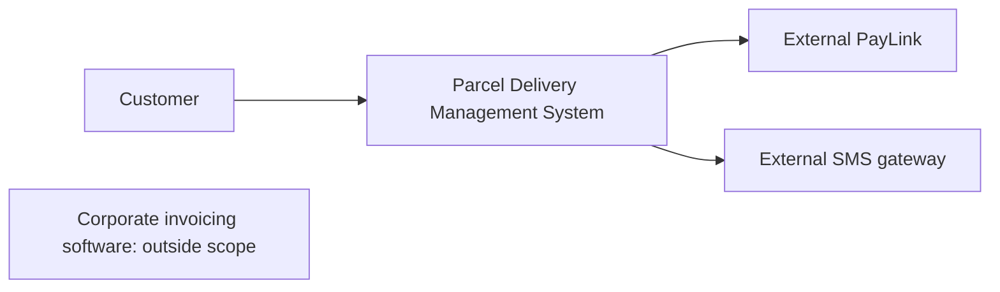
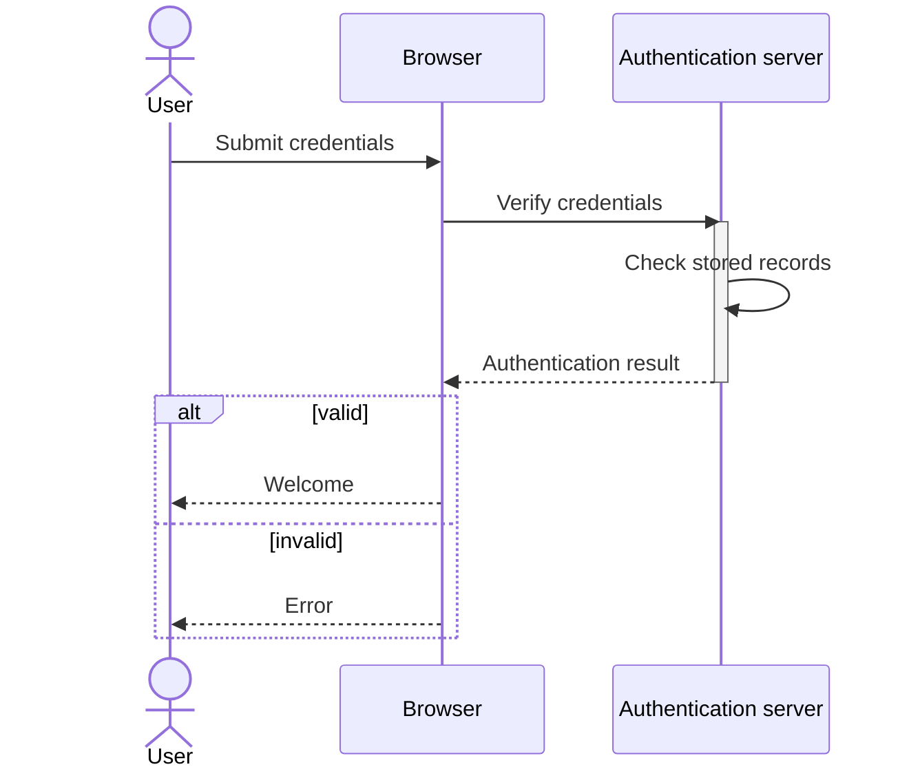

# SOE203 · System Modeling: Context and Interactions

## Video generation status
PENDING: source pack prepared; no cloud video has been generated or reviewed.

## Spanish video overview prompt
Explica esta unidad en español claro, paso a paso, para alguien que aprende de forma autodidacta. Usa únicamente el material incluido. Comienza con el problema motivador, presenta los conceptos, muestra un ejemplo visual fiel a las convenciones del curso, pausa para una pregunta y después explica la respuesta. Distingue práctica suplementaria de tareas oficiales y de soluciones oficiales. No inventes datos, fuentes, requisitos, capítulos pendientes, resultados de ejecución ni predicciones de examen. Conserva los límites y discrepancias indicados. Cierra con una actividad que el estudiante pueda intentar en Learning Uni. Cita el nombre del documento y su localizador cuando corresponda. Si falta evidencia, dilo; no rellenes el hueco. Mantén visibles las fórmulas y direcciones de flechas.

## Verified original file snapshots
- Week 5 Lecture.pdf · SHA-256 866ff63f30db68dd31024a09f75fbadf7d588b7b30f1c12d996efa778bd6459f
- Week 5 - UML Lecture Exercise.docx · SHA-256 cc81c67d8ddf07380dcce50ce753c821e82da1d8d86f206c03b25462e8573cd3
- Week 5 - UML Lecture Exercise - ANSWER.docx · SHA-256 1037442f12fa1404f5673f336a23e05cb4c49a1a804791afee6331bfafc0f390
- Week 5 Tutorial.docx · SHA-256 1ed19e25fca018e1a4452151a0ec910c2de697e9b0db45f7e2235c1f2904e033

## Source material

### Snapshot: content/reviewed/SOE203/05/tutor.md
SHA-256: c3d27e878c18ab62b3a01861430e3208221322e410a541861cb3aad585789b36

# System modeling: context and interactions

Web tutor edition grounded in **Week 5 Lecture.pdf, all 36 PDF pages**, plus the Week 5 lecture exercise and tutorial DOCX files. PDF page numbers below are one-based; printed slide numbers differ. Supplementary reconstructions are labelled. This is not an official marking scheme.

## In 60 seconds

A model deliberately hides detail to answer a particular question. Context shows the boundary; use cases show external roles and their goals; sequence diagrams show ordered messages for one scenario. First decide who needs the model and what decision it supports. Source: lecture PDF pp. 4–7.

## Before you start

Recall functional requirements from Unit 04. You need to distinguish an external actor from an internal object, a goal from an implementation step, and a condition from a sequence. This unit develops context/use-case/sequence topics only. Class, activity and state-machine diagrams appear in the agenda but have no teaching section in this supplied deck; they remain pending.

## 1. Choose a perspective and precision

| Perspective | Question | Model |
|---|---|---|
| External | What lies outside? | Context |
| Interaction | Who interacts, or in what order? | Use case / sequence |
| Structural | What data structure exists? | Class (pending here) |
| Behavioural | How does behavior evolve? | Activity / state machine (pending here) |

An existing-system model clarifies current behavior for requirements discussions. A planned-system model communicates a proposed design. Model-driven tooling needs correct, complete specifications for what it generates; a discussion sketch can omit more detail. Accuracy expectations depend on purpose. Source: lecture PDF pp. 5–7.

## 2. Context is a boundary decision

A context diagram shows surrounding systems and connections, not internal design or message order. Choosing the boundary affects responsibility and stakeholder interests. Supplementary boundary sketch derived from the courier tutorial:

The Finance system is outside this project; the prompt does not require an integration to it. A box in this context sketch is not a UML use-case oval. Source: lecture PDF p. 9; Week 5 Tutorial.docx, Question 2.

## 3. Actors and goals

A use-case diagram gives a high-level functional view: named system rectangle, actors outside, goal ovals inside, plain actor associations. An actor is a **role**, not a particular person; it can be a person, external system, device or timer. Primary actors pursue goals, supporting actors provide services, and offstage stakeholders have interests without directly using the system. Source: lecture PDF pp. 11–12.

For the hotel exercise: Guest associates with Search Available Rooms, Book a Room, View Booking Details, Make Payment and Cancel Reservation. Hotel Receptionist associates with Check In Guest, Check Out Guest and Generate Occupancy Reports. The statement does not establish mandatory include links between these goals. Do not add policy because a booking app usually has it. Source: Week 5 - UML Lecture Exercise.docx, Hotel Reservation System.

## 4. Include, extend and generalization

**Include** points from the base task to required reused behavior. **Extend** points from conditional additional behavior to its base use case, with its condition stated. Generalization points from specialized actor/use case to its general parent. Source: lecture PDF pp. 13–14; courier tutorial.

Airline examples: Book Flight includes Make Payment; Apply Promo Code extends Book Flight [code supplied]; Request Special Assistance extends Check-In Online [assistance requested]. The exercise describes authentication as a prerequisite for every other passenger goal. Its wording can be represented as a precondition; if the teaching exercise expects an included authentication use case, state that abstraction rather than assuming a fresh login occurs within each action. The visually reviewed airline diagram in ANSWER.docx omits authentication despite that prerequisite in the worksheet. Keep the prerequisite visible in your explanation; this discrepancy does not prove that authentication is unnecessary. The diagram confirms the payment/include and promo/assistance/extend directions.

> [!question]- Predict the arrow
> A returned library book is overdue. Which use case extends which, and does every return require login?

> [!success]- Check
> Charge Overdue Fine extends Return Book [past due date], with the arrow toward Return Book. The prompt explicitly says return does not require login. Source: Week 5 Tutorial.docx, Question 1.

## 5. Requirements become scenarios

The lecture traces banking requirements OBS-01…OBS-20 to goals and numbered flows. Its supplied excerpt gives login, transfer selection, insufficient funds, and cancel-at-confirmation requirements. Do not fabricate the full separate requirements PDF, which is referenced but absent.

A full description names the use case and primary actor; preconditions; numbered main flow; alternates/exceptions branching from numbered steps; and postconditions. In Transfer Funds: choose accounts/amount, validate, show confirmation, confirm, post debit/credit/reference, then receipt/log. Insufficient funds and invalid account stop validation; cancellation discards; a posting fault rolls back. Source: lecture PDF pp. 15–22.

## 6. Read a sequence diagram

Time runs downward on participants' lifelines. A synchronous message calls and waits; a dashed return carries its response. Activation bars show executing/waiting periods. Keep abstraction levels consistent. **alt** chooses guarded alternatives, **opt** performs one guarded optional block, **loop** repeats. Source: lecture PDF pp. 24–28.

Supplementary textual reconstruction of the supplied login scenario (PDF pp. 29–30; lecture exercise Login):

Both branches are outcomes, not two messages that always run. The diagram is explanatory, not a prescribed implementation protocol.

## 7. Compose guarded interactions

Checkout uses an **opt [payment succeeded]** for inventory update and order confirmation in the deck. The supplied ANSWER.docx checkout image uses **alt [PaymentSuccessful] / [PaymentFailed]** instead: the success branch updates stock and confirms the order; the failure branch sends **Order Failed** to the customer. These are two source variants. Neither supplies a refund or retry policy. Transfer Funds nests an outer alt for invalid/valid inputs, an opt for confirmation within valid, then an alt for posting success/fault. Sources: lecture PDF pp. 31–35; ANSWER.docx checkout image.

For the vehicle-renewal tutorial, a missing record or unpaid fines must terminate before payment. For QuickMed, each failed check terminates the request; stock checks repeat for each medication; home delivery is optional. A declined payment is explicitly out of scope. These are fictional software scenarios, not clinical advice. Full adjacent worked reasoning is in Recall & practice.

## Review and source boundary

Explain why a context diagram cannot substitute for a sequence diagram. Draw arrows for mandatory payment and optional insurance. Trace an early rejection without later successful messages. Then attempt all eight supplied Week 5 exercise/tutorial tasks in Recall & practice.

The original source documents remain available from Source library. All five answer images were visually inspected and remain preserved in the original DOCX. Differences between worksheet, deck and answer image are stated above. The new local reasoning and Mermaid reconstructions are independently derived teaching aids; they are not claimed as lecturer-issued solutions. No class/activity/state teaching chapter or missing banking-description PDF is invented.

### Snapshot: content/reviewed/SOE203/05/practice.md
SHA-256: 05b73aeafa145f6e0fc25f7ce772eb52fc148767364a5f540d9e6f571e927347

# System modeling: recall and practice

Web tutor edition. New practice below is **SUPPLEMENTARY PRACTICE**, not an official assignment or marking scheme. Sources: Week 5 Lecture.pdf / Week 5 - UML Lecture Exercise.docx / Week 5 Tutorial.docx. Attempt before opening help.

## Atomic Recall

### Card 01 — Why omit detail in a model?
> [!success]- Answer
> To make one aspect discussable and support a defined audience and decision.
>
> Source: Week 5 Lecture.pdf / Week 5 - UML Lecture Exercise.docx / Week 5 Tutorial.docx, lecture PDF pp. 4–7.

### Card 02 — What does a context diagram establish?
> [!success]- Answer
> The system boundary and external systems; not internal design, use-case order or a scenario timeline.
>
> Source: Week 5 Lecture.pdf / Week 5 - UML Lecture Exercise.docx / Week 5 Tutorial.docx, lecture PDF p. 9.

### Card 03 — What is an actor?
> [!success]- Answer
> An external role interacting at the boundary, potentially a person, system, device or timer.
>
> Source: Week 5 Lecture.pdf / Week 5 - UML Lecture Exercise.docx / Week 5 Tutorial.docx, lecture PDF pp. 11–12.

### Card 04 — In a UML use-case diagram, which way does an «include» arrow point?
> [!success]- Answer
> From the base use case to the mandatory included behavior.
>
> Source: Week 5 Lecture.pdf / Week 5 - UML Lecture Exercise.docx / Week 5 Tutorial.docx, lecture PDF p. 13.

### Card 05 — In a UML use-case diagram, which way does an «extend» arrow point?
> [!success]- Answer
> From conditional additional behavior to the base use case, with its extension condition stated.
>
> Source: Week 5 Lecture.pdf / Week 5 - UML Lecture Exercise.docx / Week 5 Tutorial.docx, lecture PDF p. 13.

### Card 06 — What does a sequence diagram describe?
> [!success]- Answer
> Participants exchanging ordered messages for one scenario; time runs downward.
>
> Source: Week 5 Lecture.pdf / Week 5 - UML Lecture Exercise.docx / Week 5 Tutorial.docx, lecture PDF p. 24.

### Card 07 — What distinguishes alt and opt?
> [!success]- Answer
> alt has guarded alternatives; opt has a single guarded optional block without an explicit else.
>
> Source: Week 5 Lecture.pdf / Week 5 - UML Lecture Exercise.docx / Week 5 Tutorial.docx, lecture PDF p. 25.

### Card 08 — What does a loop fragment represent in a UML sequence diagram?
> [!success]- Answer
> A guarded repetition of enclosed messages.
>
> Source: Week 5 Lecture.pdf / Week 5 - UML Lecture Exercise.docx / Week 5 Tutorial.docx, lecture PDF p. 25.

### Card 09 — What does a complete use-case description include?
> [!success]- Answer
> Actor/goal, preconditions, main flow, numbered alternates/exceptions and postconditions.
>
> Source: Week 5 Lecture.pdf / Week 5 - UML Lecture Exercise.docx / Week 5 Tutorial.docx, lecture PDF p. 20.

### Card 10 — Why stop messages after an early rejection?
> [!success]- Answer
> Later success actions require preconditions that the rejected branch did not establish.
>
> Source: Week 5 Lecture.pdf / Week 5 - UML Lecture Exercise.docx / Week 5 Tutorial.docx, tutorial Questions 3–4.

## Progressive Practice

### Practice 1 — Hotel goals

**ORIGINAL COURSE EXERCISE — source text reformatted for study; worked reasoning below is supplementary.**

Exercise Question: Use Case Diagram for a Hotel Reservation System

Below is the description of the functionalities of a hotel reservation system. The use case diagram should capture the interactions between users and the system for performing basic hotel booking operations.

Scenario:

Actors:

- Guest: A user who wants to book and manage a hotel stay through the system.
- Hotel Receptionist: A user who manages bookings and guests on the hotel's side.

Use Cases for Guest:

- Search Available Rooms: The guest searches for rooms available for a given date range.
- Book a Room: The guest reserves a room for a chosen date range.
- View Booking Details: The guest views the details of an existing reservation.
- Make Payment: The guest pays for a reservation online.
- Cancel Reservation: The guest cancels a reservation they have made.

Use Cases for Hotel Receptionist:

- Check In Guest: The receptionist checks a guest into their room on arrival.
- Check Out Guest: The receptionist checks a guest out and closes their bill on departure.
- Generate Occupancy Reports: The receptionist generates reports on room occupancy and bookings.

Your use case diagram should include:

The actors Guest and Hotel Receptionist.

The use cases listed above for each actor.

The associations between actors and use cases to show which actor performs which use case.

The use case diagram should be simple and clear enough to illustrate the interactions between the actors and the hotel reservation system, focusing on the primary functionalities.

Source: Week 5 - UML Lecture Exercise.docx.

> [!tip]- Hint
> Separate Guest and Hotel Receptionist associations; do not invent include policies.

> [!success]- Solution
> Inside Hotel Reservation System place Guest goals Search Available Rooms, Book a Room, View Booking Details, Make Payment, Cancel Reservation; associate Guest outside with each. Place receptionist goals Check In Guest, Check Out Guest, Generate Occupancy Reports; associate Hotel Receptionist with each. Plain associations suffice for this prompt. Payment as a separate listed goal does not by itself establish that every booking includes it.
>
> Source: Week 5 Lecture.pdf / Week 5 - UML Lecture Exercise.docx / Week 5 Tutorial.docx, lecture exercise, Hotel Reservation System.

### Practice 2 — Airline reuse and options

**ORIGINAL COURSE EXERCISE — source text reformatted for study; worked reasoning below is supplementary.**

Exercise Question: Use Case Diagram for an Airline Ticket Booking System 

Below is the description of the functionalities of an airline ticket booking system. Unlike the earlier exercises, some of this behaviour is always required as part of a larger task, and some of it is optional and only sometimes happens — your diagram needs to capture both, using «include» and «extend» as well as plain associations.

Scenario:

Actors:

- Passenger: A user who searches for and books flights.
- Airline Staff: A user who manages flights and bookings on the airline's side.

Use Cases for Passenger:

- Authenticate Passenger: The passenger logs into the booking system. Every other passenger use case below requires this to have already happened, so it is never something the passenger chooses to do as a separate, standalone task.
- Search Flights: The passenger searches for flights by route and date.
- Book Flight: The passenger books a flight. Booking a flight always requires making a payment — this is not optional, and it is not something the passenger asks for separately.
- Make Payment: The system takes payment for a booking.
- Check-In Online: The passenger checks in for an upcoming flight.
- Cancel Booking: The passenger cancels an existing booking.
- View Booking History: The passenger views their past and upcoming bookings.
- Apply Promo Code: While booking a flight, a passenger who happens to have a promo code can apply it for a discount. Most bookings don't involve this.
- Request Special Assistance: While checking in, a passenger who needs it (e.g. a wheelchair) can request special assistance. Most check-ins don't involve this.

Use Cases for Airline Staff:

- Manage Flight Schedule: Airline staff add, update or cancel flight schedules.
- Process Refund: Airline staff process a refund for a cancelled booking.
- Generate Reports: Airline staff generate booking and revenue reports.

Source: Week 5 - UML Lecture Exercise.docx.

> [!tip]- Hint
> Point include to payment and extend toward the base goal.

> [!success]- Solution
> Passenger associates with Search Flights, Book Flight, Check-In Online, Cancel Booking, View Booking History. Book Flight includes Make Payment. Apply Promo Code extends Book Flight [promo supplied]; Request Special Assistance extends Check-In Online [assistance requested]. Staff associates with Manage Flight Schedule, Process Refund, Generate Reports. Authentication is required beforehand for passenger goals: annotate a precondition; if modelling it as include for the exercise abstraction, state this convention rather than requiring a new login each time. There is no explicit cancellation→refund include in the prompt.
>
> Source: Week 5 Lecture.pdf / Week 5 - UML Lecture Exercise.docx / Week 5 Tutorial.docx, lecture exercise, Airline Ticket Booking System; lecture PDF p. 13.

### Practice 3 — Login messages

**ORIGINAL COURSE EXERCISE — source text reformatted for study; worked reasoning below is supplementary.**

Exercise Question: Sequence Diagram for User Login Process

Draw a sequence diagram to model the user login process in a web application. The sequence diagram should capture the interactions between the user, the web browser, and the authentication server.

Scenario:

The user opens the login page on the web browser.

The user enters their username and password and clicks the “Login” button.

The web browser sends the login credentials to the authentication server.

The authentication server verifies the credentials.

The authentication server sends a response back to the web browser indicating whether the login is successful or failed.

The web browser displays a welcome message if the login is successful, or an error message if the login failed.

Your sequence diagram should include:

The interactions between the user, web browser, and authentication server.

The order of messages exchanged during the login process.

The return messages indicating the result of the login attempt.

The sequence diagram should be simple and clear enough to illustrate the basic interactions and message flow between the actors involved in the user login process.

Source: Week 5 - UML Lecture Exercise.docx.

> [!tip]- Hint
> Credential submission precedes verification; branch on its returned result.

> [!success]- Solution
> User opens page; Browser returns page. User submits username/password; Browser sends credentials to Auth; Auth checks records using a self-message and returns result. alt [valid]: Browser shows welcome; else [invalid]: Browser shows error. Include each participant lifeline and dashed responses. No extra lockout policy is supplied.
>
> Source: Week 5 Lecture.pdf / Week 5 - UML Lecture Exercise.docx / Week 5 Tutorial.docx, lecture exercise, User Login Process; lecture PDF pp. 29–30.

### Practice 4 — Checkout guard

**ORIGINAL COURSE EXERCISE — source text reformatted for study; worked reasoning below is supplementary.**

Exercise Question: Sequence Diagram for Online Shopping Checkout Process

Draw a sequence diagram to model the checkout process in an online shopping system. The sequence diagram should capture the interactions between the customer, the online store’s web application, the payment gateway, and the inventory system.

Scenario:

The customer initiates the checkout process by clicking the “Checkout” button on the web application.

The web application displays the order summary and prompts the customer to enter shipping details.

The customer enters the shipping details and submits them.

The web application sends the order details to the payment gateway to process the payment.

The payment gateway processes the payment and sends a confirmation back to the web application.

Upon successful payment, the web application updates the inventory system to reduce the stock of the purchased items.

The inventory system confirms the stock update.

The web application sends an order confirmation to the customer and displays a confirmation page.

Your sequence diagram should include:

The interactions between the customer, web application, payment gateway, and inventory system.

The order of messages exchanged during the checkout process.

The return messages confirming actions such as payment confirmation and stock update.

The sequence diagram should be detailed and clear enough to illustrate the interactions and message flow between the actors involved in the online shopping checkout process.

Source: Week 5 - UML Lecture Exercise.docx.

> [!tip]- Hint
> Successful payment enables inventory update and confirmation.

> [!success]- Solution
> Customer requests checkout; App returns summary/shipping prompt; Customer submits shipping; App requests payment with order/amount; Gateway returns result. opt [payment successful]: App asks Inventory to reduce stock; Inventory confirms; App confirms order to Customer. This opt fragment follows the deck happy path. The supplied ANSWER.docx checkout image instead uses alt [PaymentSuccessful] for stock reduction/confirmation and else [PaymentFailed] to send Order Failed to Customer. Both express the same success guard, but the answer image explicitly adds the failure response. Neither source supplies a refund or retry policy.
>
> Source: Week 5 Lecture.pdf / Week 5 - UML Lecture Exercise.docx / Week 5 Tutorial.docx, lecture exercise, Online Shopping Checkout; ANSWER.docx checkout image; lecture PDF pp. 31–32.

### Practice 5 — Library include and extend

**ORIGINAL COURSE EXERCISE — source text reformatted for study; worked reasoning below is supplementary.**

Question 1: University Library Loan System

Design a UML use case diagram for a Library Loan System used in a university library. The system must support the following:

Borrowing a book: a member borrows a book by scanning it at a self-service kiosk. Before the loan is approved, the system checks the member's outstanding fines with the university's external Finance System. Borrowing always prints a receipt that shows the due date.

Returning a book: a member returns a book by placing it in the return slot, which scans it automatically. Members do not need to log in to return a book.

Overdue return: if a book is returned after its due date, the system also charges the member an overdue fine. Books returned on time are not affected.

Reserving a book: a member can reserve a book that is currently on loan to someone else.

Authentication: borrowing a book and reserving a book always require the member to log in first.

Librarian tasks: the librarian can view current loans and edit a loan record, for example to extend the due date for a member who is ill.

Reports: the library manager generates monthly usage reports. If a report shows that a member has a book more than 30 days overdue, the system also sends that member an overdue notice.

Ensure that your use case diagram includes the system boundary, the actors, the use cases, the associations between actors and use cases, and appropriate «include» and «extend» relationships.

Source: Week 5 Tutorial.docx, Question 1.

> [!tip]- Hint
> Borrow and reserve need login; return does not. Conditional fine and notice extend base goals.

> [!success]- Solution
> Boundary: Library Loan System. Actors: Member, Librarian, Library Manager, external Finance System. Member associations: Borrow Book, Return Book, Reserve Book. Borrow includes Authenticate Member, Check Outstanding Fines (Finance supports it), Print Due-Date Receipt. Reserve includes Authenticate Member. Charge Overdue Fine extends Return Book [past due date]. Librarian: View Current Loans, Edit Loan Record. Manager: Generate Monthly Usage Report. Send Overdue Notice extends Generate Report [member book >30 days overdue]. No return authentication or fine-payment policy is supplied. Kiosk/return scanner can be shown as devices if modelled outside the chosen software boundary; make that boundary choice explicit.
>
> Source: Week 5 Lecture.pdf / Week 5 - UML Lecture Exercise.docx / Week 5 Tutorial.docx, tutorial Question 1.

### Practice 6 — Courier boundary and actor hierarchy

**ORIGINAL COURSE EXERCISE — source text reformatted for study; worked reasoning below is supplementary.**

Question 2: SwiftParcel Courier Delivery System

SwiftParcel, a city courier company, wants a new Parcel Delivery Management System. Alex, a software engineer, interviewed Rachel Tan, the Chief Operating Officer, to gather the requirements.

Alex: How should customers use the system?

Rachel: Customers book a parcel pickup on our website, and they must be logged in to do it. The system calculates the shipping fee for every booking, and the customer pays by card through PayLink, our external payment gateway. If the parcel is valuable, the customer can also choose to add insurance.

Alex: How do people follow a parcel?

Rachel: Anyone with the tracking number can track it on the website. No login is needed, because recipients often don't have an account.

Alex: What about your staff?

Rachel: Dispatchers assign parcels to drivers, and drivers view their assigned deliveries in an app. Every confirmed delivery must capture the recipient's signature. If nobody is home, the driver records a failed attempt, and the system then schedules a redelivery. In both cases, the customer gets a text through our external SMS gateway. Drivers and dispatchers are both staff, and they all log in with their staff ID before using any staff function.

Alex: Anything for management?

Rachel: I generate a weekly performance report. If a driver's on-time rate is below 90%, the system should also flag them for review. Corporate invoicing is handled by finance in their own software, so keep that out of this project.

Task

Draw a UML use case diagram for this system. Include the system boundary, the actors (including external systems), the in-scope use cases, the associations, appropriate «include» and «extend» relationships, and actor generalisation where appropriate.

Source: Week 5 Tutorial.docx, Question 2.

> [!tip]- Hint
> Separate optional additions from behavior required after a failed delivery. Track Parcel needs no login; redelivery is required whenever a failed attempt is recorded.

> [!success]- Solution
> Actors: Customer, tracking-number holder, Staff parent specialized by Dispatcher and Driver, COO/Manager, PayLink, SMS Gateway. Book Pickup includes Customer Login, Calculate Shipping Fee and Card Payment (PayLink). Add Insurance extends Book Pickup [valuable parcel/customer chooses]. Track Parcel has no login. Dispatcher assigns parcels; Driver views deliveries and records confirmed/failed delivery; staff functions require Staff Login. Confirm Delivery includes Capture Signature and Notify Customer (SMS). Record Failed Attempt includes Schedule Redelivery and Notify Customer: redelivery is mandatory in that failure use case. Flag Driver extends Weekly Performance Report [on-time rate<90%]. Corporate invoicing is outside scope. Actor generalization arrows point Driver/Dispatcher→Staff.
>
> Source: Week 5 Lecture.pdf / Week 5 - UML Lecture Exercise.docx / Week 5 Tutorial.docx, tutorial Question 2.

### Practice 7 — Vehicle renewal termination

**ORIGINAL COURSE EXERCISE — source text reformatted for study; worked reasoning below is supplementary.**

Question 3: Somestate Vehicle Registration Renewal

Somestate uses a Vehicle Registration system to renew vehicle registrations. A Registration Administrator uses the system, and the system works with several other participants to complete a renewal.

Participants:

- Registration Administrator — actor
- Vehicle Registration — system
- Registration Record — data entity
- Somestate Court System — external system
- Welco Credit Card System — external system
- Printer — device

Main success scenario:

The Registration Administrator submits a renewal application to Vehicle Registration.

Vehicle Registration looks up the vehicle's Registration Record. (See Alternative Flow A1 if no record is found.)

Vehicle Registration asks the Somestate Court System whether the vehicle has unpaid parking fines. (See Alternative Flow A2 if there are unpaid fines.)

Vehicle Registration asks the Registration Administrator for credit card details.

The Registration Administrator provides the credit card details.

Vehicle Registration sends a payment request to the Welco Credit Card System. The request contains the credit card details and the total renewal amount.

The Welco Credit Card System approves the payment.

Vehicle Registration updates the Registration Record to show the renewal.

Vehicle Registration tells the Printer to print a payment receipt and the renewed vehicle registration.

Alternative flows:

A1, record not found (at step 2): Vehicle Registration rejects the application and tells the Registration Administrator. The scenario ends.

A2, unpaid parking fines (at step 3): Vehicle Registration rejects the application and tells the Registration Administrator. The scenario ends.

Draw a UML sequence diagram for this scenario.

Source: Week 5 Tutorial.docx, Question 3.

> [!tip]- Hint
> Use nested guarded branches so missing record/fines cannot reach payment.

> [!success]- Solution
> Administrator submits application→Registration; Registration→Record: lookup; Record returns found/not found. alt [not found]: notify rejection and end; else [found]: query Court, receive fines status. alt [unpaid fines]: notify rejection and end; else [clear]: request card details, Administrator returns them; Registration requests Welco payment with amount/details; Welco returns approval; Registration updates Record; Registration tells Printer to print receipt and renewed registration. Only the clear branch reaches payment/update/print. A payment failure branch is not supplied.
>
> Source: Week 5 Lecture.pdf / Week 5 - UML Lecture Exercise.docx / Week 5 Tutorial.docx, tutorial Question 3.

### Practice 8 — QuickMed loops and conditions

**ORIGINAL COURSE EXERCISE — source text reformatted for study; worked reasoning below is supplementary.**

Question 4: QuickMed Online Prescription Refill

QuickMed Pharmacy lets patients refill their prescriptions online through its Pharmacy System. The system works with the internal and external participants listed below to process a refill.

Participants:

- Patient — actor
- Pharmacy System — system
- Prescription Record — data entity
- Inventory — data entity
- MediCare Insurance System — external system
- PayFast Gateway — external system
- Courier Service — external system

Main success scenario:

The Patient submits a refill request with a prescription number.

The Pharmacy System retrieves the Prescription Record. (See A1.)

The Pharmacy System checks that the prescription has at least one refill remaining. (See A2.)

For each medication on the prescription, the Pharmacy System checks with Inventory that it is in stock. (See A3.)

The Pharmacy System asks the MediCare Insurance System for the covered amount, then calculates the patient's co-payment.

The Pharmacy System asks the Patient for card details, and the Patient provides them.

The Pharmacy System sends the card details and the co-payment amount to the PayFast Gateway, which approves the payment.

The Pharmacy System reduces the refills remaining in the Prescription Record by one.

If the Patient selected home delivery, the Pharmacy System books a delivery with the Courier Service, which returns a tracking number.

The Pharmacy System sends an order confirmation to the Patient.

Alternative flows:

A1, prescription not found (step 2): the request is rejected and the Patient is notified. The scenario ends.

A2, no refills remaining (step 3): the request is rejected and the Patient is advised to contact their doctor. The scenario ends.

A3, a medication is out of stock (step 4): the request is rejected and the Patient is notified. The scenario ends.

Task

Draw a UML sequence diagram for this scenario. Your diagram should:

show a lifeline for each participant;

show the messages in order, with return messages where a response is needed;

use an alt fragment for each decision point (A1–A3), a loop fragment for the stock check in step 4, and an opt fragment for home delivery in step 9;

show the internal checks and calculations as self-messages.

Note: A declined payment is out of scope.

Source: Week 5 Tutorial.docx, Question 4.

> [!tip]- Hint
> Three rejection checks precede successful processing; stock iteration is a loop and delivery an opt.

> [!success]- Solution
> Patient→Pharmacy: refill(prescription number); Pharmacy→Prescription Record: retrieve; return. alt [missing]: reject/end; else [found]: self-check remaining refills. alt [none]: advise contact doctor/end; else [available]: loop [each medication]: Pharmacy→Inventory stock check; Inventory returns; alt [out of stock]: reject and terminate entire scenario (use a break fragment or explicit terminated guard so later messages do not run); else [in stock]: continue. After all checks pass, request MediCare coverage and calculate co-payment by self-message; request/receive Patient card details; request PayFast payment and receive approval; decrement Prescription Record refills; opt [home delivery selected]: book Courier and receive tracking number; send order confirmation. Show seven lifelines and required dashed responses. No declined-payment behavior is supplied.
>
> Source: Week 5 Lecture.pdf / Week 5 - UML Lecture Exercise.docx / Week 5 Tutorial.docx, tutorial Question 4.

### Practice 9 — Bank transfer fragment nesting

**SUPPLEMENTARY PRACTICE — conditions from the lecture deck.** Model a bank transfer with these conditions:

- Validate the balance and destination before asking the customer to confirm. Insufficient funds or an invalid destination ends the request with a message and no posting.
- If validation passes, ask for confirmation. Cancellation discards the request without posting.
- Confirmation requests posting through the ledger. Success produces a receipt/log/reference; a posting fault rolls back, reports the failure and keeps the reference as shown in the deck.

Explain how to nest `alt` and `opt` so posting runs only on the confirmed, valid path. Trace your branches to OBS-08/09/10, OBS-14 and OBS-11/12/13 in lecture PDF pp. 21–22 and 33–35. These are the displayed conditions; the separately referenced banking requirements PDF is unavailable.

> [!tip]- Hint
> Validation surrounds confirmation, which surrounds posting.

> [!success]- Solution
> Outer alt: insufficient funds→message/no posting; invalid destination→message/no posting; valid→confirmation. In valid, opt [customer confirms] requests posting via ledger. Inside that opt, alt [success] produces receipt/log/reference; else [fault] rolls back and reports failure/keeps reference per the displayed exception. Cancelling runs no posting and discards the request. Trace conditions to OBS-08/09/10, OBS-14 and OBS-11/12/13.
>
> Source: Week 5 Lecture.pdf / Week 5 - UML Lecture Exercise.docx / Week 5 Tutorial.docx, lecture PDF pp. 21–22, 33–35.

